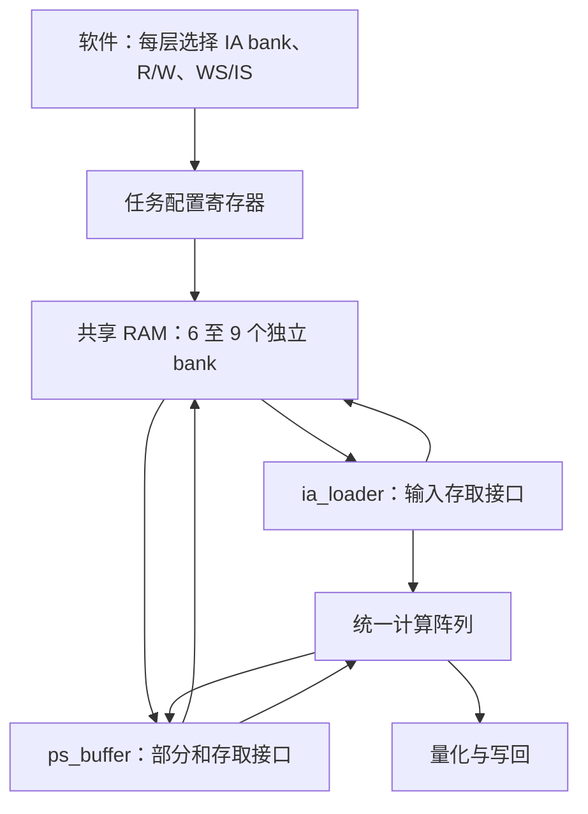

# 硬件架构

## SoC 与统一计算路径

`soc_top` 集成 PicoRV32、NPU、AXI 互连、主存和 UART。CPU 通过固定 32 位数据、16 位地址的 AXI-Lite 配置任务；NPU 通过 AXI4 主接口访问张量。`NPU_AXI_DATA_WIDTH` 选择 AXI4 的 32 或 64 位数据宽度，默认 64 位，并用于 SoC 数据互连和主存接口。CPU 指令及寄存器数据宽度保持 32 位。寄存器及访问方法见 [寄存器说明](../drivers/registers_v2.md) 和 [驱动说明](../drivers/README.md)。

`rtl/npu/top/npu_top.sv` 使用一套 GEMM 控制器、IA/kernel loader、计算阵列、量化及写回单元。Conv 的 im2col 请求由加载器提交给 DMA；Dense 和可直接映射为 GEMM 的点卷积使用矩阵请求。`PCR_ENGINE=1` 定义 `GEMPACT_PS_COMPRESS`，在该路径内启用可寻址 PS frame、无损编码和容量调度。计算阵列、Conv、INT16、逐通道量化和 WS/IS 能力由同一顶层参数控制。

VCE 与矩阵路径共享 DMA 窗口缓存，支持 DW、池化、Add、Softmax 和基础向量运算。默认 8 个 PE；Conv 与 DW 的原始输入读取经过 4 KiB、双路组相联的窗口缓存。详见 [VCE 说明](vector_engine.md) 和 [调度与窗口缓存](scheduling_and_window_cache.md)。

## IA 与 PS 共享存储

`SHARED_BANK_BYTES` 可选 2048、4096、8192 字节，`SHARED_BANK_COUNT` 可选 6 至 9。总容量为两者乘积。通用及 ASIC 的 [`config/npu.mk`](../config/npu.mk) 默认使用 7 个 2 KiB bank，总容量 14 KiB；FPGA 的 [`config/npu_fpga.mk`](../config/npu_fpga.mk) 默认使用 7 个 8 KiB bank，总容量 56 KiB。每个 bank 为 128 位宽、`SHARED_BANK_BYTES / 16` 行的同步 1R1W 存储器。内部 128 位存储接口独立于外部 AXI4 数据宽度。

ASIC 使用完整的 `RAMTP128X16` 数据容量，2、4、8 KiB bank 分别由 8、16、32 个宏组成。FPGA 工程要求 8 KiB bank，每个 bank 映射为两个 `RAMB36E1`，全部数据位均可寻址。FPGA 的 parity 容量单独统计。映射关系、实测范围和复现命令见 [共享 RAM 映射](shared_ram_mapping.md)。

软件在任务启动前选择 1、2 或 4 个 IA bank，其余 bank 用于 PS；任务执行期间分配保持不变。IA RAM 存储完整 S16 流式行时，每行同时访问两个 bank，因此至少分配两个 IA bank。

IA 与 PS 各有独立的请求和返回信号，地址转换保证二者访问不同的已分配 bank。IA 的紧凑 S8 行使用一个 128 位读口，S16 行使用两个不同 bank 的读口。PS 的一行包含 16 个 INT32 值，编码结果占用 0 至 4 个 128 位字，可在至多四个不同 bank 上并行读写。每个物理 bank 每周期最多接受一次读和一次写；同地址读写、重复端口访问、越界地址及非法分配会报告容量错误。

下表给出默认七个 2 KiB bank 配置的分配：

| IA bank 数 | IA 容量 | PS 容量 | 紧凑 S8 IA 的 R 上限 | S16 IA 的 R 上限 |
|---:|---:|---:|---:|---:|
| 1 | 2 KiB | 12 KiB | 4 | 不支持 |
| 2 | 4 KiB | 10 KiB | 8 | 4 |
| 4 | 8 KiB | 6 KiB | 16 | 8 |

FPGA 默认七个 8 KiB bank 的分配如下：

| IA bank 数 | IA 容量 | PS 容量 | 紧凑 S8 IA 的 R 上限 | S16 IA 的 R 上限 |
|---:|---:|---:|---:|---:|
| 1 | 8 KiB | 48 KiB | 16 | 不支持 |
| 2 | 16 KiB | 40 KiB | 32 | 16 |
| 4 | 32 KiB | 24 KiB | 64 | 32 |

R 表示每组流式操作数的 tile 数，表中给出 IA 存储允许的上限，已包含双缓冲要求。跨 K 的 RAW32 行需要四个 PS bank；默认七 bank 配置因此可使用 IA=1 或 2。严格 S24、S16 部分和界分别要求至少三个、两个 PS bank。IA=4、PS=3 可用于无需保留中间部分和的任务，或已证明中间累加范围满足 S24/S16 的任务。运行时能力寄存器给出实际支持的分配。

对于任意合法配置，IA 字节数为 `IA_BANKS × SHARED_BANK_BYTES`，PS 字节数为 `(SHARED_BANK_COUNT − IA_BANKS) × SHARED_BANK_BYTES`。紧凑 S8 的双缓冲需要 `512R` 字节，S16 需要 `1024R` 字节。W 还受剩余 PS bank 数、各 bank 的容量、PS 目录行数和任务形状限制。

S8 输出 FIFO 为一次 IA 行组保留完整的输出空间。默认 `PS_FRAME_COUNT=16` 时，2、4 KiB 共享 bank 使用 32 个输出 tile bank，共 8 KiB；8 KiB 共享 bank 使用 64 个输出 tile bank，共 16 KiB。每个输出 tile bank 保存 16×16 个 S8 值。这部分容量在共享 IA/PS 数据 RAM 之外单独计算，`MATRIX_OUTPUT_BANKS` 报告实际数量。S16 输出默认使用四个 tile bank，因此 S16 输出任务的 R 上限为 4；表中的 S16 R 上限描述输入存储容量。

物理容量通过 `NPU_REG_SHARED_TOTAL_BYTES`、`NPU_REG_SHARED_BANK_BYTES` 和 `NPU_REG_IA_BANK_MASK` 报告。`IA_CACHE_BLOCKS` 与 `PS_POOL_BYTES` 为固定缓冲实现及其接口提供参数；共享配置的实际容量由 bank 大小、bank 总数和任务分配决定。

## IA 紧凑格式

S8 流式操作数保存在 SRAM 中；读取时符号扩展并加上对应的 offset。Conv DMA 若已返回校正后的 S16 激活数据，写入 IA RAM 前先减去同一个 input offset，恢复原始 S8 表示。该过程保持全部数值，包括 padding 的校正后零值。S16 流式操作数使用完整的 16 位 IA 存储。

WS 中 IA 保存激活；IS 中 IA 保存 S8 权重，另一加载器处理激活。软件据此分别计算两种数据流的 R 上限。普通矩阵布局与按 16×16 tile 排列的布局均保留；跨 K 的 frame 地址使用完整矩阵的归约长度计算 tile 行跨度。

## DiP 阵列

阵列每周期接收一个完整输入行。第 `p` 行、第 `q` 列的 PE 将输入传递到下一行的前一列；第零列传递到下一行的最后一列。等价地，下一行第 `q` 列读取上一行第 `(q+1) mod SIZE` 列的数据。部分和沿同一列向下传递。

权重加载器为 PE `(p,q)` 提供 `B[(p+q) mod SIZE,q]`。这一旋转使各列按各自的归约顺序计算同一个输入行，所有列在 `SIZE` 个 PE 周期后同时产生结果。IA loader 直接提供完整输入行，PS 读取和写入也使用完整矩阵行。控制信息随行经过固定长度的寄存器管线。

### 逐行权重选择

权重加载器的两个缓冲槽保留独立的描述符和响应标识。每个 PE 使用 `weight_reg` 和 `weight_shadow` 两组寄存器保存驻留权重，`row_weight_select` 为每个物理行保存一个选择位。`weight_commit` 使第零行的选择位翻转，其余行每周期接收上一行的选择位。选择位、输入数据和部分和经过相同的寄存器级数，因此同一周期内不同物理行可以使用不同权重块。有效输入之间存在空隙时，选择位仍每周期向下一行传递。

下一块权重通过同一个目标寄存器组向下移位。全阵列的 `weight_load_select` 等于第零行下一状态选择位的反值，`weight_out` 也从这个目标组读取。某行只有在本周期进入该行的选择位与 `weight_load_select` 不同时，才接受 `store_weight_req`。这一条件使仍在使用该组权重的行保持原值；该行切换到另一组后即可写入新权重。加载顺序从最后一行开始，第 `r` 行需要的权重位于最后 `SIZE-r` 次移位中。

完整权重块的 `SIZE` 次加载完成后才允许选择该块。选择新块的同一周期可以开始加载下一块；两组权重交替使用。复位将全部行选择位清零，首次选择前先完整加载另一组。选择权重时，数据和部分和寄存器继续正常传递。算术、连续选择、复位及逐行权重检查见 [DiP 阵列测试](../test/dip_array/README.md)、[权重加载测试](../test/dip_weights/README.md) 和[计算核心测试](../test/compute_core/README.md)。

控制器在权重已加载完成后即可发出 `weight_commit`。IA 行组启动还需满足输入数据、PS frame、偏置、量化参数和输出 FIFO 的接收条件。`compute_tail_count` 记录已启动但尚未完成的行组；跨 K 的部分和保存与恢复仍由对应 frame 的完成状态控制。

### 单 K tile 的直接输出

当任务使用连续调度、WS、S8 输出、逐张量量化、零偏置地址，且归约长度满足 `1≤K≤SIZE` 时，顶层可启用 `direct_final_stream`。输出 FIFO 还必须满足额外预留条件。令

\[
E=\left\lceil\frac{\mathrm{SIZE}-1+12}{\mathrm{SIZE}}\right\rceil,
\]

其中 `SIZE-1` 对应阵列中尚未输出的行，12 对应量化流水级数。启动下一组前需为 `R+E` 个输出 tile bank 留出空间；启用 WS 输出合并时，整个合并窗口占用的 tile bank 数加上 `E` 也必须不超过 FIFO 容量。SIZE=16 时 `E=2`。

直接输出的每组同时为初始 K 和最终 K，阵列结果经过量化与输出 FIFO 写回。该组不创建 PS 存储命令，IA 可以在前一组的末尾数据仍在阵列中时启动；逐行选择位使各行使用对应的权重。输出空间与参数条件在每次启动时检查。其他任务继续根据 PS、参数及输出完成状态启动下一组。

## PS 编码与调度

`ps_buffer` 按行接收阵列输出，并把有效矩阵行交给 `ps_frame_store`。每行 16 个 INT32 值，编码器在重复行、Sparse128、S16、S24、RAW32 及行间差分 Rice 格式中选择较短的表示。恢复出的数值与原始 INT32 完全相同。读取端的预取队列向阵列提供完整部分和行。

Sparse128 的 opcode 为 7，使用一个 128 位字，包含 16 位非零 lane 掩码、2 位字宽选择和依次排列的非零值。值宽可为 8、16、24 或 32 位；当 `18 + 非零值数量 × 值宽 ≤ 128` 时可使用此格式。它不依赖上一行，因此也可用于 frame 的首行；重复行仍使用零 payload 字的 COPY。RAW32、S24、S16 分别需要 4、3、2 个 128 位字。

`ps_window_scheduler` 的 `frame_k` 为每个 frame 保存下一次归约分块的位置。只有计算、PS 更新和该命令需要的输出操作完成后才推进进度。接收新的非最终 K 命令前，存储器按每个 bank 的可用字数以及该 frame 可回收的旧字数检查容量。Prepare 根据固定权重和合法输入范围证明 S16 或 S24 上限，通过 `PS_CONTROL[5:4]` 告知硬件。RTL 也可依据输入格式、offset 和归约长度计算通用 S24 上限。其余情况按 RAW32 最坏长度保留空间。

严格权重界覆盖所有需要保存的 K16 前缀，Prepare 不读取运行时激活。软件仅在设备报告 `PS_CAPS[5]` 时提交该上限。存储器检查实际编码记录是否符合预留长度；编码格式仍按实际数据选择。RAW32 策略始终采用四个字的容量要求。

开启新 frame 时若容量不足，调度器把目标窗口缩减为已开启的 frame 数，随后轮流更新这些 frame。更新已有 frame 时若容量不足，待执行 frame 保留原有部分和与进度；调度器继续计算最近成功更新的受保护 frame，完成其剩余 K，写出最终结果并释放存储，再恢复待执行 frame。最终 K 读取旧 PS，不再分配中间结果。这样可以保留已经完成的乘累加工作。

在可直接容纳整个工作窗口时，顶层采用连续计算调度；需要逐 frame 调度时，软件可选 16 行、32 行或整个 R 组作为 frame 高度。调度方式与编码策略分别配置：`PS_CONTROL[0]=0` 允许自适应行编码，`PS_CONTROL[0]=1` 强制 RAW32。WS bias 在最终 K 后加入；IS 沿用最终输出的 bias 处理，因此中间部分和的容量上限不包含 bias。

## 软件配置与容量统计

软件查询共享总字节数、bank 大小、允许的 IA bank 数和 PS 目录行数，为每层联合选择数据流、R、W、IA 分配及 PS 调度方式。TFLM Prepare 阶段保存配置，Invoke 阶段提交准备好的描述符。

RAW32 与压缩比较在同一个 RTL 程序中，通过 `PS_CONTROL` 选择存储策略。共享 RAM、目录、输出缓冲、窗口缓存和阵列数量保持一致。完整容量统计包含元数据和固定队列，使用当前源码的 Verilator 展开结果核对，方法见 [容量说明](capacity.md)。
