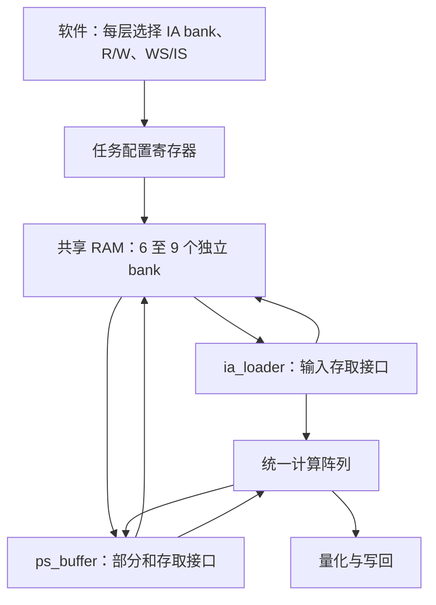

# 硬件架构

## SoC 与统一计算路径

`soc_top` 集成 PicoRV32、NPU、AXI 互连、主存和 UART。CPU 通过固定 32 位数据、16 位地址的 AXI-Lite 配置任务；NPU 通过 AXI4 主接口访问张量。`NPU_AXI_DATA_WIDTH` 选择 AXI4 的 32 或 64 位数据宽度，默认 64 位，并用于 SoC 数据互连和主存接口。CPU 指令及寄存器数据宽度保持 32 位。寄存器及访问方法见 [寄存器说明](../drivers/registers_v2.md) 和 [驱动说明](../drivers/README.md)。

`rtl/npu/top/npu_top.sv` 使用一套 GEMM 控制器、IA/kernel loader、计算阵列、量化及写回单元。Conv 的 im2col 请求由加载器提交给 DMA；Dense 和可直接映射为 GEMM 的点卷积使用矩阵请求。`PCR_ENGINE=1` 定义 `GEMPACT_PS_COMPRESS`，在该路径内启用可寻址 PS frame 和容量调度；部分和采用固定 INT32 格式。计算阵列、Conv、INT16、逐通道量化和 WS/IS 能力由同一顶层参数控制。

VCE 与矩阵路径共享 DMA 窗口缓存，支持 DW、池化、Add、Softmax 和基础向量运算。`VECTOR_PE_COUNT` 默认取 `min(SIZE, 16)`，16×16 阵列配置使用 16 个向量 PE。DW 的乘加、参数读取、量化请求及输出写回可以并行推进；结果缓冲保存量化返回标签和有效通道数，使下一通道组的权重加载能够与上一组的结果返回重叠。

量化资源由共享存储配置选择。SIZE=16 且共享 RAM 使用六个或七个 bank 时，矩阵量化使用两个计算通道，VCE 使用本地量化；使用八个或九个 bank 时，矩阵量化使用 16 个计算通道，DW 通过带标签的请求接口共用这条流水。顶层以 `REQUANT_COMPUTE_LANES == SIZE` 生成 `DW_SHARED_QUANT_ENABLE`，并在当前矩阵任务或向量任务的上下文中选择数据与参数。

Conv 与 DW 的原始输入读取经过双路组相联窗口缓存。默认数据容量为 4 KiB，缓存行大小为 128 B，对应 16 个缓存组；`IM2COL_CACHE_BYTES` 控制数据容量，`CONV_CACHE_SETS` 按容量、路数和行长计算。AXI64 性能比较配置使用 8 KiB、32 组、双路缓存及八个 4 KiB IA/PS bank。具体配置与结果见 [DW 共享量化与性能比较](dw_shared_quant_20261121.md)，执行结构见 [VCE 说明](vector_engine.md)。

## 窗口供数与任务完成

`WINDOW_LANES` 在 16 个向量 PE 配置下默认为 16；较小 PE 配置默认采用 `BUS_WIDTH / 8`。窗口缓存的同步读取宽度独立于外部 AXI 宽度，16 路窗口对应 128 位原始数据，一次可提供 16 个 S8 元素或八个 S16 元素。原始 S8 经过符号扩展和 offset 校正后，以 16 位元素返回。IA 紧凑写入和 kernel im2col 写入可接收完整窗口，非紧凑 IA 写入按总线字节数限制每拍的元素数量。字边界、卷积核位置边界及尾部由有效掩码控制，加载器只消费有效元素。

共享读仲裁器先保存客户端和矩阵描述符，`axi_dual_block_dma` 再保存前端所需的几何坐标。普通卷积最多保留两条尚未完成的描述符，使下一条描述符的准备与当前块执行重叠。当前 im2col 块的末拍返回后即可报告描述符完成，缓存填充和预取继续由 `rd_busy`、`conv_busy` 记录；相同图像配置的下一块可以继续执行。切换到线性读取、新任务配置或报告整个卷积任务完成时，均等待相应物理读取结束。

所有普通矩阵与 Conv 任务使用 `operand_completion_seen` 记录完成接收。`done_valid` 在输出、加载器预取、窗口缓存及可选 operand cache 满足完成条件后发布；握手后保持抑制，直到控制器的完成状态撤销。外部背压和后台读取均由这些状态处理，每项任务只接受一次完成。接口及排空条件见 [block_dma 矩阵与 im2col 接口](block_dma_im2col.md)。

## 任务配置与范围检查

任务接受后，卷积描述符及权重布局保存在任务上下文中。配置控制器利用已有准备阶段计算权重分配容量、卷积张量长度及地址范围，并在提交计算命令前完成检查。

| 配置阶段 | 运算与寄存内容 |
| --- | --- |
| 上下文接收 | 保存矩阵维度；按权重布局选择原始维度或 tile 数 |
| 第一级准备 | 计算四个 16×16 位权重分积，以及输入、卷积核和输出的二维面积 |
| 第二级准备 | 归并权重交叉分积；计算输入面积及卷积核面积与通道数的分积 |
| 容量阶段 0 | 组合完整权重字节数、输入字节数及归约元素数 |
| 容量阶段 1 | 保存 DMA 分配区间末端，检查地址溢出和卷积维度 |
| 容量阶段 2 | 汇总卷积配置检查结果 |
| 容量阶段 3 至 5 | 检查分块配置，形成任务状态并提交计算命令 |

地址检查分别判断字节数的高位和低 32 位相加产生的进位，保留完整的越界判断。部分乘积在独立时钟阶段寄存，地址加法与最终配置判断分阶段执行。该流程与共享存储及输出配置并行准备，任务启动的配置周期数保持固定。

## IA 与 PS 共享存储

`SHARED_BANK_BYTES` 可选 2048、4096、8192 字节，`SHARED_BANK_COUNT` 可选 6 至 9。总容量为两者乘积。通用及 ASIC 的 [`config/npu.mk`](../config/npu.mk) 默认使用 9 个 2 KiB bank，总容量 18 KiB；FPGA 的 [`config/npu_fpga.mk`](../config/npu_fpga.mk) 默认使用 7 个 8 KiB bank，总容量 56 KiB。每个 bank 为 128 位宽、`SHARED_BANK_BYTES / 16` 行的同步 1R1W 存储器。内部 128 位存储接口独立于外部 AXI4 数据宽度。

ASIC 使用完整的 `RAMTP128X16` 数据容量，2、4、8 KiB bank 分别由 8、16、32 个宏组成。FPGA 工程要求 8 KiB bank，每个 bank 映射为两个 `RAMB36E1`，全部数据位均可寻址。FPGA 的 parity 容量单独统计。映射关系、实测范围和复现命令见 [共享 RAM 映射](shared_ram_mapping.md)。

软件在任务启动前选择 1、2 或 4 个 IA bank，其余 bank 用于 PS；任务执行期间分配保持不变。IA RAM 存储完整 S16 流式行时，每行同时访问两个 bank，因此至少分配两个 IA bank。

IA 与 PS 各有独立的请求和返回信号，地址转换保证二者访问不同的已分配 bank。IA 的紧凑 S8 行使用一个 128 位读口，S16 行使用两个不同 bank 的读口。PS 的一行包含 16 个 INT32 值，使用 4 个 128 位字，并在四个不同 bank 上并行读写。每个物理 bank 每周期最多接受一次读和一次写；同地址读写、重复端口访问、越界地址及非法分配会报告容量错误。

下表给出七个 2 KiB bank 配置的分配示例：

| IA bank 数 | IA 容量 | PS 容量 | 紧凑 S8 IA 的 R 上限 | S16 IA 的 R 上限 |
|---:|---:|---:|---:|---:|
| 1 | 2 KiB | 12 KiB | 4 | 不支持 |
| 2 | 4 KiB | 10 KiB | 8 | 4 |

FPGA 默认七个 8 KiB bank 的分配如下：

| IA bank 数 | IA 容量 | PS 容量 | 紧凑 S8 IA 的 R 上限 | S16 IA 的 R 上限 |
|---:|---:|---:|---:|---:|
| 1 | 8 KiB | 48 KiB | 16 | 不支持 |
| 2 | 16 KiB | 40 KiB | 32 | 16 |

R 表示每组流式操作数的 tile 数，表中给出 IA 存储允许的上限，已包含双缓冲要求。RAW32 部分和存储使用四个 PS bank；默认七 bank 配置可使用 IA=1 或 2。运行时能力寄存器给出实际支持的分配。

对于任意合法配置，IA 字节数为 `IA_BANKS × SHARED_BANK_BYTES`，PS 字节数为 `(SHARED_BANK_COUNT − IA_BANKS) × SHARED_BANK_BYTES`。紧凑 S8 的双缓冲需要 `512R` 字节，S16 需要 `1024R` 字节。W 还受剩余 PS bank 数、各 bank 的容量、PS 目录行数和任务形状限制。

S8 输出 FIFO 为一次 IA 行组保留完整的输出空间。默认七个共享 bank 和 `PS_FRAME_COUNT=16` 时，S8 输出 FIFO 使用 32 个输出 tile bank，共 8 KiB。每个输出 tile bank 保存 16×16 个 S8 值。这部分容量在共享 IA/PS 数据 RAM 之外单独计算，`MATRIX_OUTPUT_BANKS` 报告实际数量。S16 输出默认使用四个 tile bank，因此 S16 输出任务的 R 上限为 4；表中的 S16 R 上限描述输入存储容量。

物理容量通过 `NPU_REG_SHARED_TOTAL_BYTES`、`NPU_REG_SHARED_BANK_BYTES` 和 `NPU_REG_IA_BANK_MASK` 报告。`IA_CACHE_BLOCKS` 与 `PS_POOL_BYTES` 为固定缓冲实现及其接口提供参数；共享配置的实际容量由 bank 大小、bank 总数和任务分配决定。

## IA 紧凑格式

S8 流式操作数保存在 SRAM 中；读取时符号扩展并加上对应的 offset。Conv DMA 若已返回校正后的 S16 激活数据，写入 IA RAM 前先减去同一个 input offset，恢复原始 S8 表示。该过程保持全部数值，包括 padding 的校正后零值。S16 流式操作数使用完整的 16 位 IA 存储。

WS 中 IA 保存激活；IS 中 IA 保存 S8 权重，另一加载器处理激活。软件据此分别计算两种数据流的 R 上限。普通矩阵布局与按 16×16 tile 排列的布局均保留；跨 K 的 frame 地址使用完整矩阵的归约长度计算 tile 行跨度。

## 偏置同步读取

`bias_loader_buffer` 将两个逻辑 bank 保存在统一的 64 位同步 RAM 中，DMA 通过独立写端口加载 INT32 偏置。32 位 AXI 数据使用字节写使能更新相应半字，64 位 AXI 数据直接更新整字。WS 的首个偏置向量在 DMA 加载期间写入向量寄存器；选择驻留窗口内的其他块时，硬件连续读取元素对，并在完整向量准备完成后置位 `bias_valid`。SIZE=16 时共读取八个元素对。IS 在 `group_read_start` 时保存执行组的 bank 和起点，顶层在消费当前结果时提前请求下一行偏置，因此同步读取可以保持每拍一个偏置。执行上下文独立于下一组的预取选择，对另一 bank 的 DMA 写入能够与 IS 连续读取并行进行。配置清除和复位使有效状态及执行上下文失效，RAM 数据内容保留。

## DiP 阵列

阵列每周期接收一个完整输入行。第 `p` 行、第 `q` 列的 PE 将输入传递到下一行的前一列；第零列传递到下一行的最后一列。等价地，下一行第 `q` 列读取上一行第 `(q+1) mod SIZE` 列的数据。部分和沿同一列向下传递。

权重加载器为 PE `(p,q)` 提供 `B[(p+q) mod SIZE,q]`。这一旋转使各列按各自的归约顺序计算同一个输入行，所有列在 `SIZE` 个 PE 周期后同时产生结果。IA loader 直接提供完整输入行，PS 读取和写入也使用完整矩阵行。控制信息随行经过固定长度的寄存器管线。

### 逐行权重选择

权重加载器的两个缓冲槽保留独立的描述符和响应标识。每个 PE 使用 `weight_active` 和 `weight_prefetch` 两组寄存器，分别保存当前计算权重和预取权重。`weight_active` 直接连接乘加单元，`weight_prefetch` 向下一行传递。`row_weight_select` 为每个物理行保存当前权重块的选择位；`weight_commit` 使第零行的选择位翻转，其余行每周期接收上一行的选择位。选择位、输入数据和部分和经过相同的寄存器级数，因此同一周期内不同物理行可以使用不同权重块。有效输入之间存在空隙时，选择位仍每周期向下一行传递。

`row_buffer_phase` 同步记录每行两组权重的物理 bank 相位。本周期进入该行的选择位与记录的相位不同时，产生 `row_commit_weight`。在该时钟边沿，`weight_active` 接收原有的 `weight_prefetch`，`weight_prefetch` 保存原有的 `weight_active`。若同一边沿还接受 `store_weight_req`，新写入的 `weight_in` 优先保存到 `weight_prefetch`，`weight_active` 仍接收提交前的预取权重。数据和部分和寄存器继续正常传递，权重提交不增加计算周期。

全阵列的 `weight_load_select` 等于第零行下一状态选择位的反值。某行只有在本周期进入该行的选择位与 `weight_load_select` 不同时，才接受 `store_weight_req`。这一条件使仍在使用目标权重块的行保持原值；该行提交另一块权重的同一边沿即可写入新的预取权重。加载顺序从最后一行开始，第 `r` 行需要的权重位于最后 `SIZE-r` 次移位中。

完整权重块的 `SIZE` 次加载完成后才允许提交该块。提交新块的同一周期可以开始加载下一块。复位将全部行选择位清零，并在时钟边沿依据原有的 bank 相位恢复两组权重的顺序，然后清零同步相位记录；首次提交前先完整加载预取权重。算术、连续提交、复位及逐行权重检查见 [DiP 阵列测试](../test/dip_array/README.md)、[权重加载测试](../test/dip_weights/README.md) 和[计算核心测试](../test/compute_core/README.md)。

控制器在权重已加载完成后即可发出 `weight_commit`。IA 行组启动还需满足输入数据、PS frame、偏置、量化参数和输出 FIFO 的接收条件。`compute_tail_count` 记录已启动但尚未完成的行组；跨 K 的部分和保存与恢复仍由对应 frame 的完成状态控制。

### 单 K tile 的直接输出

当任务使用连续调度、WS、S8 输出、逐张量量化、零偏置地址，且归约长度满足 `1≤K≤SIZE` 时，顶层可启用 `direct_final_stream`。输出 FIFO 还必须满足额外预留条件。令

\[
E=\left\lceil\frac{\mathrm{SIZE}-1+12}{\mathrm{SIZE}}\right\rceil,
\]

其中 `SIZE-1` 对应阵列中尚未输出的行，12 对应量化流水级数。启动下一组前需为 `R+E` 个输出 tile bank 留出空间；启用 WS 输出合并时，整个合并窗口占用的 tile bank 数加上 `E` 也必须不超过 FIFO 容量。SIZE=16 时 `E=2`。

直接输出的每组同时为初始 K 和最终 K，阵列结果经过量化与输出 FIFO 写回。该组不创建 PS 存储命令，IA 可以在前一组的末尾数据仍在阵列中时启动；逐行选择位使各行使用对应的权重。输出空间与参数条件在每次启动时检查。其他任务继续根据 PS、参数及输出完成状态启动下一组。

## 部分和存储与调度

`ps_buffer` 按行接收阵列输出。需要跨 K 分块保留的每行部分和包含 16 个 INT32 值，占用四个 128 位字。`ps_frame_store` 根据 frame 编号、行号和配置的行跨度计算固定存储地址，将四个字分布到不同的 PS bank，并通过回放队列向阵列提供完整的部分和行。

`ps_window_scheduler` 为各个 frame 保存 K 分块进度，并在计算、部分和更新和必要的输出操作完成后推进进度。启动 frame 前，硬件检查分配的 bank 数、各 bank 的容量、frame 数和有效行数；软件根据硬件能力寄存器选择合法的 IA/PS 分配、R、W 和 frame 高度。

连续调度与逐 frame 调度根据工作窗口及输出缓冲容量选择。WS 的 bias 在最终 K 分块后加入，IS 的 bias 按最终输出路径处理。每个中间部分和保持完整 INT32 精度。

## 软件配置与容量统计

软件查询共享总字节数、bank 大小、允许的 IA bank 数和 PS 目录行数，为每层联合选择数据流、R、W、IA 分配及 PS 调度方式。TFLM Prepare 阶段保存配置，Invoke 阶段提交准备好的描述符。

当前构建使用 RAW32 部分和存储，软件通过 `PS_CONTROL` 配置工作区执行方式。完整容量统计包含共享 RAM、元数据、输出缓冲、窗口缓存、固定队列及阵列状态，并使用当前源码的 Verilator 展开结果核对，方法见 [容量说明](capacity.md)。
