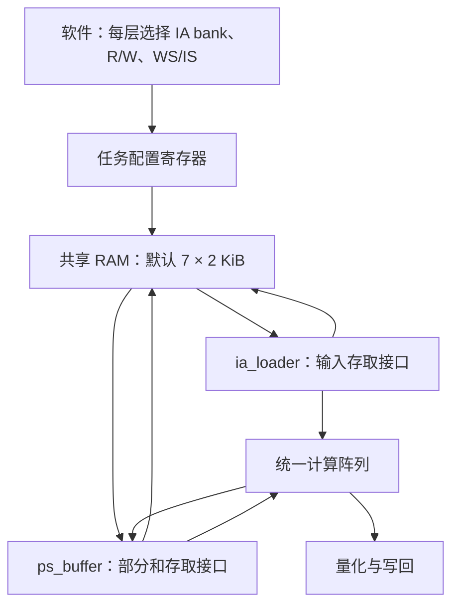

# 硬件架构

## SoC 与统一计算路径

`soc_top` 集成 PicoRV32、NPU、AXI 互连、主存和 UART。CPU 通过固定 32 位数据、16 位地址的 AXI-Lite 配置任务；NPU 通过 AXI4 主接口访问张量。`NPU_AXI_DATA_WIDTH` 选择 AXI4 的 32 或 64 位数据宽度，默认 64 位，并用于 SoC 数据互连和主存接口。CPU 指令及寄存器数据宽度保持 32 位。寄存器及访问方法见 [寄存器说明](../drivers/registers_v2.md) 和 [驱动说明](../drivers/README.md)。

`rtl/npu/top/npu_top.sv` 使用一套 GEMM 控制器、IA/kernel loader、计算阵列、量化及写回单元。Conv 的 im2col 请求由加载器提交给 DMA；Dense 和可直接映射为 GEMM 的点卷积使用矩阵请求。`PCR_ENGINE=1` 定义 `GEMPACT_PS_COMPRESS`，在该路径内启用可寻址 PS frame、无损编码和容量调度。计算阵列、Conv、INT16、逐通道量化和 WS/IS 能力由同一顶层参数控制。

VCE 与矩阵路径共享 DMA 窗口缓存，支持 DW、池化、Add、Softmax 和基础向量运算。默认 8 个 PE；Conv 与 DW 的原始输入读取经过 4 KiB、双路组相联的窗口缓存。详见 [VCE 说明](vector_engine.md) 和 [调度与窗口缓存](scheduling_and_window_cache.md)。

## IA 与 PS 共享存储

`SHARED_BANK_BYTES` 可选 1024、2048、4096 字节，`SHARED_BANK_COUNT` 可选 6 至 9。总容量为两者乘积。默认配置使用 7 个 2 KiB bank，总容量 14 KiB。每个 bank 为 128 位宽、`SHARED_BANK_BYTES / 16` 行的同步 1R1W 存储器。内部 128 位存储接口独立于外部 AXI4 数据宽度。

软件在任务启动前选择 1、2 或 4 个 IA bank，其余 bank 用于 PS；任务执行期间分配保持不变。真实 S16 输入的一个完整行同时访问两个 IA bank，因此至少分配两个 bank。

IA 与 PS 各有独立的请求和返回信号，地址转换保证二者访问不同的已分配 bank。IA 的紧凑 S8 行使用一个 128 位读口，S16 行使用两个不同 bank 的读口。PS 的一行包含 16 个 INT32 值，编码结果占用 0 至 4 个 128 位字，可在至多四个不同 bank 上并行读写。每个物理 bank 每周期最多接受一次读和一次写；同地址读写、重复端口访问、越界地址及非法分配会报告容量错误。

下表给出默认七个 2 KiB bank 配置的分配：

| IA bank 数 | IA 容量 | PS 容量 | 紧凑 S8 的 R 上限 | S16 的 R 上限 |
|---:|---:|---:|---:|---:|
| 1 | 2 KiB | 12 KiB | 4 | 不支持 |
| 2 | 4 KiB | 10 KiB | 8 | 4 |
| 4 | 8 KiB | 6 KiB | 16 | 8 |

R 表示每组流式操作数的 tile 数，表中已包含双缓冲要求。跨 K 的 RAW32 行需要四个 PS bank；默认七 bank 配置因此可使用 IA=1 或 2。IA=4、PS=3 用于无需保留中间部分和的任务，或可以根据输入类型、offset 和归约长度保证中间结果适合 S24 的任务。运行时能力寄存器给出实际支持的分配。

对于任意合法配置，IA 字节数为 `IA_BANKS × SHARED_BANK_BYTES`，PS 字节数为 `(SHARED_BANK_COUNT − IA_BANKS) × SHARED_BANK_BYTES`。紧凑 S8 的双缓冲需要 `512R` 字节，S16 需要 `1024R` 字节。W 还受剩余 PS bank 数、各 bank 的容量、PS 目录行数和任务形状限制。

物理容量通过 `NPU_REG_SHARED_TOTAL_BYTES`、`NPU_REG_SHARED_BANK_BYTES` 和 `NPU_REG_IA_BANK_MASK` 报告。`IA_CACHE_BLOCKS` 与 `PS_POOL_BYTES` 为固定缓冲实现及其接口提供参数；共享配置的实际容量由 bank 大小、bank 总数和任务分配决定。

## IA 紧凑格式

原始 S8 激活保存在 SRAM 中；读取时符号扩展并加上 input offset。Conv DMA 若已返回校正后的 S16 数据，写入 IA RAM 前先减去同一个 offset，恢复原始 S8 表示。该过程保持全部数值，包括 padding 的校正后零值。真实 S16 输入使用完整的 16 位存储。

WS 中 IA 保存激活；IS 中 IA 保存 S8 权重，另一加载器处理激活。软件据此分别计算两种数据流的 R 上限。普通矩阵布局与按 16×16 tile 排列的布局均保留；跨 K 的 frame 地址使用完整矩阵的归约长度计算 tile 行跨度。

## PS 编码与调度

`ps_buffer` 在阵列输出去除对角延迟后，把有效矩阵行交给 `ps_frame_store`。每行 16 个 INT32 值，编码器在重复行、S16、S24、RAW32 及行间差分 Rice 格式中选择较短的表示。恢复出的数值与原始 INT32 完全相同。读取端的预取队列和对角延迟寄存器将矩阵行重新变换为阵列需要的时序。

`ps_window_scheduler` 的 `frame_k` 为每个 frame 保存下一次归约分块的位置。只有计算、PS 更新和该命令需要的输出操作完成后才推进进度。接收新的非最终 K 命令前，存储器按每个 bank 的可用字数以及该 frame 可回收的旧字数检查容量。软件和 RTL 分别依据同一输入范围规则计算 S24 上限；其余情况按 RAW32 最坏长度保留空间。

开启新 frame 时若容量不足，调度器把目标窗口缩减为已开启的 frame 数，随后轮流更新这些 frame。更新已有 frame 时若容量不足，待执行 frame 保留原有部分和与进度；调度器继续计算最近成功更新的受保护 frame，完成其剩余 K，写出最终结果并释放存储，再恢复待执行 frame。最终 K 读取旧 PS，不再分配中间结果。这样可以保留已经完成的乘累加工作。

在可直接容纳整个工作窗口时，顶层采用连续计算调度；需要逐 frame 调度时，软件可选 16 行、32 行或整个 R 组作为 frame 高度。若 RAW32 已能容纳窗口，硬件可自动选择 RAW32，减少编解码开销。WS bias 在最终 K 后加入；IS 沿用最终输出的 bias 处理，因此中间部分和的容量上限不包含 bias。

## 软件配置与容量统计

软件查询共享总字节数、bank 大小、允许的 IA bank 数和 PS 目录行数，为每层联合选择数据流、R、W、IA 分配及 PS 调度方式。TFLM Prepare 阶段保存配置，Invoke 阶段提交准备好的描述符。

RAW32 与压缩比较在同一个 RTL 程序中，通过 `PS_CONTROL` 选择存储策略。共享 RAM、目录、输出缓冲、窗口缓存和阵列数量保持一致。完整容量统计包含元数据和固定队列，使用当前源码的 Verilator 展开结果核对，方法见 [容量说明](capacity.md)。
