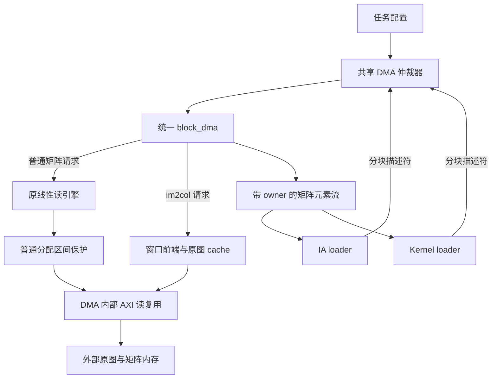

# 在 block_dma 内完成 im2col：统一矩阵分块接口

## 1. 交付目标与代码范围

本版本将卷积窗口生成和原始输入复用完整下沉到共享 `block_dma`。`ia_loader`
与 `kernel_loader` 都只发出矩阵分块请求并接收矩阵元素：普通 GEMM 请求直接读取
外部矩阵，Conv 请求由 DMA 从原始 NHWC 输入生成矩阵块。两个 loader 不再持有
图像几何、原图 cache 或独立的原图 AXI 读口。

WS Conv 由 `ia_loader` 请求 im2col；IS Conv 由 `kernel_loader` 请求 im2col。
两种模式均在真实阵列上执行，支持部分和、bias、逐通道最近偶数舍入量化和 NHWC 写回。
受支持任务不由 CPU 展开 im2col，不在外部内存存放展开矩阵，也不由 CPU 完成 MAC。

当前默认配置使用统一 NPU 计算路径、4 KiB 共享窗口缓存和 14 KiB IA/PS bank RAM。
硬件参数与每层存储分配见 [硬件架构](architecture.md) 和 [容量说明](capacity.md)。
本文第 12 节的固定参数实验对应 `148964d180f52cb852c5a7e3d5c89773fa0a8ea5`
集成阶段，相关生成方法见 [源码交付说明](conv_source_only.md)。当前共享 PS 与完整
模型比较由 [`test/ps_compression`](../test/ps_compression/README.md) 执行。

| 模块 | 本版本职责 |
|---|---|
| `rtl/npu/dma/axi_dual_block_dma.sv` | 普通矩阵 / im2col 命令执行器；持有 im2col 前端、原图 cache、普通读范围保护与读通道复用 |
| `rtl/npu/dma/axi_linear_block_dma.sv` | 线性读写、在途事务管理、4 KiB 分段、写回重叠与取消后的事务完成处理 |
| `rtl/npu/dma/axi_block_dma_arbiter.sv` | IA、kernel、bias、quant 客户端仲裁、分块描述符转发、返回 owner 与失败完成门控 |
| `rtl/npu/loaders/ia_loader*.sv` | 产生分块坐标；接收矩阵元素并维护原 IA tile RAM / 预取 / 重发 |
| `rtl/npu/loaders/kernel_loader*.sv` | 产生普通权重或 IS 输入分块坐标；按有效 lane 组装行，写入原 kernel buffer |
| `rtl/npu/top/npu_top.sv` | 每任务配置 DMA，选择 WS / IS 的 loader 角色，管理统计、错误排空和已有计算路径 |
| `rtl/axi_top/npu_axil_*.sv` | Conv 配置寄存器、能力位、busy 配置锁定和标准任务接口 |
| `drivers/dsa_conv*.h` | 原图地址与动态几何提交、能力检查、WS / IS 分块规划 |

源码中保留了供早期独立测试使用的 `conv_ia_tile_path.sv`。它不在当前生产 NPU
可达层级中；保留这个 helper 不代表生产 loader 内仍实例化另一套 im2col 或 cache。
实际 elaboration 层级检查也验证了这一点。

## 2. 数据路径与模块边界



图中 `D`、`L`、`F`、`G`、`M` 均位于 `axi_dual_block_dma` 内部。
外部只看到原有 AXI 主接口；顶层旧的 Conv 专用读旁路、原图响应复用器和 IA
私有 grant 已移除。写引擎仍独立工作，可与普通矩阵读或 im2col 读重叠。

这是两级配置接口：任务开始时只提交一次完整几何；每个分块只提交矩阵坐标。
因此 loader 无需在每块重复携带图像参数，cache 也不会随分块重新清空。

## 3. 数学矩阵与 WS / IS 的对应关系

对当前 batch、当前输入通道组，定义：

\[
P=H_oW_o,\qquad Q=K_hK_wC_g,\qquad O=C_{out}/groups
\]

虚拟输入矩阵为 `A[P,Q]`，OHWI 权重视为 `B[O,Q]`，输出为 `C[P,O]`。
其中 `O` 是当前硬件 job 的输出通道数；普通非分组卷积的 `groups=1`，分组调用
由驱动逐组提交，输出行 stride 仍可为完整层的 `Cout`。
公共寄存器保持 `k=P, n=Q, m=O`，`lhs_base` 始终是原始 NHWC 输入地址，
`rhs_base` 始终是 OHWI 权重地址。选择 IS 不要求软件交换地址或改写矩阵定义。

给定元素 `(p,q)`，DMA 内的窗口前端计算：

```text
oy = p / output_w
ox = p % output_w
tap = q / group_c
channel_in_group = q % group_c
ky = tap / kernel_w
kx = tap % kernel_w
iy = oy * stride_h - pad_top  + ky * dilation_h
ix = ox * stride_w - pad_left + kx * dilation_w
addr = input_base + (iy * input_w + ix) * input_c
       + group_offset + channel_in_group
```

合法图像坐标的矩阵值为 `sign_extend_s8(input[addr]) + input_offset`。
padding 与 `q >= Q` 的归约尾部返回**校正后的零**，不发出原图读取；不能先填
原始零再加 offset。公共 LHS / RHS 零点寄存器为零，offset 只在 DMA 前端加一次。

| 模式 | IA loader 接收 | Kernel loader 接收 | 内部计算与输出 |
|---|---|---|---|
| GEMM WS / IS | 原矩阵 DMA 返回 | 原矩阵 DMA 返回 | 原有行为 |
| Conv WS | im2col 的 `A[p,q]` 块 | OHWI 的 `B[o,q]` 块 | `A × Bᵀ` |
| Conv IS | OHWI 的 `B[o,q]` 块 | im2col 的 `A[p,q]` 块 | 内部计算 `B × Aᵀ`，沿用原 IS 输出转置得到 `C[p,o]` |

IS 内部 `stream_k=m`、`stream_m=k`，bias 和逐通道量化仍沿输出通道维度。
**DMA 自身不转置 im2col**：两种模式返回的局部行都是输出位置 `p`，局部列都是
展开归约坐标 `q`。kernel buffer 原有装载 / 发送布局与 OA 的 IS 转置负责计算方向。

## 4. 任务配置接口

`conv_cfg_valid && conv_cfg_ready` 表示 DMA 接受一次任务上下文。顶层在
`init_cfg_ia` 提交该配置，包含普通 GEMM 的 `conv_enable=0`。这样不会让上一条
Conv 的保护范围、错误状态或模式泄漏到下一条 GEMM。

当前接口沿用原任务初始化的空闲脉冲合同：调用方只在 ready 时发一个 valid 脉冲，
不能在该窗口另排队一个客户端分块；它不是可以任意保持 valid 等待背压的通用
配置流。arbiter 不会用客户端请求队列再单独过滤 `conv_cfg_ready`，生产顶层保证
初始化发生在各客户端安静时，仿真断言检查该前提。

| 字段 | 含义与生命周期 |
|---|---|
| `conv_enable` | 本任务是否启用 Conv；在任务握手时锁存 |
| `conv_cfg` | 原图地址、输入 / 输出尺寸、核、stride、dilation、padding、通道组、offset 和 cache bypass |
| `conv_sched_r` | 实际分块规划的空间复用数 R，供 WS 几何预测使用 |
| `conv_sched_groups` | WS 输出通道组数；IS 设为 0，禁用不适用的 WS 预测顺序 |
| `conv_range_base[4]` / `conv_range_end[4]` | OHWI 权重、bias、multiplier、shift 的真实半开分配区间；end 为 33 位 |
| `conv_error` / `conv_busy` | 几何、描述符或前端错误，以及前端 / cache 尚未排空状态 |
| `conv_stat_hits/misses/read_bytes` | 本任务原图 cache 请求统计与实际输入 AXI 字节数 |

DMA 只有在读命令、前端、保护器和读响应路由全部排空，且没有待发布的读完成时
才接受新任务配置。配置周期不同时启动新读分块。配置总线在握手后改变，不会修改
当前已锁存任务；同地址的新任务会清除旧原图 cache 和 word 保持状态。

这里的 job 指一次硬件 START。batch 与输入通道组由驱动拆成多个 job；跨 job
不保留原图 cache 内容。执行期间调用方必须保持该 job 的输入和权重稳定。

## 5. 每块请求接口

既有客户端的 `req/granted/start/busy/done` 与普通矩阵字段继续保留，新增字段
只描述“这是一块隐式输入矩阵”。仲裁器将它们传给 DMA 的 `rd_*` 接口。

| 字段 | 普通矩阵请求 | im2col 请求 |
|---|---|---|
| `rd_im2col` | 0 | 1 |
| `rd_base_addr / rd_row_stride` | 外部矩阵地址与字节行距 | 不参与原图地址生成 |
| `rd_p0` | 忽略 | 本块首行的输出空间坐标 p |
| `rd_q0` | 忽略 | 本块首列的展开归约坐标 q |
| `rd_group` | 忽略 | 调度中的输出组号，供未来使用预测；不是 NHWC 的输入通道组偏移 |
| `rd_rows_to_read` | 原普通矩阵行数 | 1～`IM2COL_SIZE` 个有效空间行 |
| `rd_slot_id` | 原目标 buffer slot | 原目标 buffer slot |
| `rd_valid_cols / rd_use_16bits / rd_lhs_zp` | 原普通矩阵解释 | im2col 输出完整 `IM2COL_SIZE` 列、s16、offset 已处理 |

顶层最大 DMA 维度还服务分组 bias，标准配置为 `SHARED_DMA_SIZE=4*SIZE`。
因此新增独立参数 `IM2COL_SIZE=阵列 SIZE`，不能用最大 bias DMA 维度作为卷积块宽。
例如 16×16 阵列的 im2col 块始终最多 16 行、固定 16 列，而不是 64 列。

描述符在接受时锁存。行数为零、超过 `IM2COL_SIZE`、未启用 Conv、非法几何
或不支持的配置不发出有效原图请求，并按错误完成规则释放 owner。

## 6. 统一返回接口与有效 lane

普通矩阵和 im2col 都通过现有 `wr_slot / wr_row / wr_col_base / wr_data[] /
wr_valid[] / wr_use_16bits` 返回，仲裁器用已经锁存的 client owner 分发。
`row`、`col_base` 以**矩阵元素**计数，不以字节计数。

im2col 的每个有效行返回完整 `IM2COL_SIZE` 列：padding 和归约尾列也作为有效的
零元素写入 buffer。32 位总线上每拍最多返回两个 s16 元素，但不保证每拍两个
lane 都有效。原图 word 边界或 kernel tap 边界可以产生只有 lane 0 的一拍；下一拍
再返回后续列。loader 必须按 `wr_valid` 消费，不能由总线位宽推断实际元素数。

本次实测在 IS 行组装中发现并修复了这个边界：原实现按 `col_base + 2` 判断行尾，
会在 `col_base=SIZE-2` 且只有一个有效 lane 时提前提交并清空行，随后最后一列
形成不完整行。现在只有**实际有效 lane 覆盖最后一列**才提交整行。正常 GEMM
的满 lane 末拍行为保持不变。对应回归由生成器现场构造 partial-lane 描述符，
逐项检查矩阵元素和整行提交，避免只以量化后偶然相同的值判断正确。

矩阵输出没有新增反压接口，沿用原 buffer 每拍接收的合同。数据拍和完成信号不是
同一件事：最后一拍必须先写入 buffer，loader 的完成流水随后发布整个 tile 可用。

## 7. 仲裁、末拍与写通道

共享读仲裁仍使用既有 kernel、quant、IA、bias 优先顺序。一个读取命令有一个
owner；im2col 占用该命令直到窗口输出和相关读事务排空。普通线性 DMA 原有的
多 outstanding 请求及最后 R 拍提前接受下一命令的时序保留。

普通线性引擎的最后一个矩阵数据拍在物理 R 握手之后注册输出，因此切换到新
im2col 命令时，不能用“当前命令类型”覆盖这拍。新 wrapper 根据实际 producer
valid 选择矩阵输出；arbiter 的 `rd_response_client` 保留上一条命令的归属。
独立测试特意让 ordinary 最后数据拍与下一 owner 的 im2col 启动相邻，逐项核对
slot、行、列、mask 和数值。

写命令、写数据流、AW/W/B 状态机完整保留在线性引擎中。新前端不会把写回通道
串到 im2col 调度后面。读配置的接受条件仅描述读侧排空；顶层仍负责完整任务间的
生命周期，不允许上层随意在尚未完成的输出任务之间覆盖配置。

统一后的读接口一次持有一个 block owner，普通块与 im2col 块没有各自独立的
命令队列。它保留普通块内部的 outstanding 行读取，但不保留旧 IA 私有前端与
普通读引擎独立运行的全部机会。因此相对旧架构，Conv 的周期可能增加；后文给出
同容量、同策略下的实测变化，不把接口统一宣传为无代价的吞吐提升。

## 8. 原图读取、分配区间与错误恢复

两类读取在 DMA 内使用不同保护方式：

- 普通权重 / bias / quant 从线性 DMA 发出的整字请求，先通过四个真实分配区间的
  `conv_axi_read_guard`，将首尾无效 lane 本地补零，并按分配边界和 4 KiB 边界拆分。
- im2col 的原图读取由窗口前端、raw cache 和 span reader 根据真实输入区间产生。
  边界允许精确的 byte / word AXI 请求，padding 不访问外部内存。不能将它再送入
  只接受对齐整字输入请求的普通 guard。

两条受保护的路径最后在 DMA 内部的 `conv_axi_read_mux` 合并。请求阻塞时 AR
字段保持稳定，响应归属来自已接受的请求，而不是某个后来改变的模式信号。
实际 SoC RAM 也保存和执行 ARSIZE；其窄读行为与普通 word burst 分别验证。

错误时内部 `rd_done + rd_error` 用于结束命令并释放 owner；这**不等于成功加载**。
对于 Conv，arbiter 在读错误时屏蔽 IA / kernel 的成功 `done`，避免部分 buffer
写入被发布为有效 tile。全局错误状态等待 DMA / 前端 / 读路由排空，再复位任务
内部状态并报告错误；后续任务可在同一仿真进程、不复位芯片的情况下继续执行。
这不提供输出内存事务回滚：已经开始的任务若后来发生错误，调用方必须丢弃其输出。

### 可选外层 operand cache 的任务排空

Conv 任务绕过顶层可选 `OPERAND_CACHE`，原图复用统一由 DMA 内部 cache 处理；
GEMM 继续使用原可选矩阵 cache。但在启用 64 B 预取时，原 cache 会先将调用方
需要的 16 B sector 返回，外部 burst 的其余响应可能尚未完成。重构审查中的实际
RED 测试证明：还有 12 个 R beat 未返回时，旧代码已发布 DONE 并接受下一条 Conv，
导致过早切换旁路和 flush。

修复为 cache 提供真实 `idle`，覆盖请求状态、outstanding 队列、metadata commit、
flush / flush_pending 和新 AR 请求。顶层对外 DONE / READY、controller 的完成
接收以及错误排空均等待该条件；暂停响应期间时钟保持运行，仍可接收外部尾拍。
仅在该可选分支增加一个 completion_seen 位，抑制原 controller 在 WAIT_DONE
退出后的注册 valid 尾拍被重复握手。默认 `OPERAND_CACHE_ENABLE=0` 时这些门控
分别化为常量 1 / 0，不改变原默认退休时序。

GREEN 测试在真实 AXI-Lite 时钟门控顶层中，将 12 个尾部响应暂停 250 周期，确认
期间没有 DONE、READY、新任务、flush 或旁路切换。排空后连续完成 GEMM → IS
Conv → 同址新数据 GEMM，三次任务各只有一次完成，六个输出均正确，最后外部
未完成读取为零；各任务间关钟再唤醒也通过。测试通过层级参数 / 输入覆写启用
现有 NPU 可选 cache 和 fetch64；未扩大生产 AXI-Lite 的参数或寄存器接口。

## 9. 共享窗口缓存与请求队列

共享 DMA 使用一套原始输入缓存，服务矩阵 Conv、DW 和空间池化的窗口读取。
默认参数为 `128 sets × 2 ways × 16 B = 4 KiB`，`CONV_CACHE_POLICY=3`。
缓存保存原始输入字节，窗口前端在返回矩阵元素时完成符号扩展和 offset 校正。
图像边界外和归约尾部产生校正后的零值。

策略 3 根据空间位置、通道片段和最后使用位置选择集合及替换对象。命中检查比较
完整物理行标记；几何提示不改变地址相等的判断。八项预取队列提前请求后续空间
位置和通道片段，需求缺失优先于新预取。具体公式与适用条件见
[矩阵调度与共享窗口缓存](scheduling_and_window_cache.md)。策略 0、1、2
可用于 LRU 和未来访问预测的固定参数实验。

缓存需求接口默认允许四个已接受、尚未返回的字请求，并按接受顺序返回数据。
已经驻留、没有排队等待且接收端持续就绪时，可每周期返回一个 32 位字。
独立填充可以与其他已驻留行的读取重叠；同地址读写受到保护。DW 和空间池化
使用另一个带目标区域 tag 的四项窗口描述队列，由 VCE 输入区域状态限制可用请求数。

缓存内容在同一任务的窗口、tile 和加载器请求之间保留。新任务配置等待需求、
响应、填充和预取队列完成后清除有效状态。运行时输入保持稳定。填充地址限定在
缓存行与合法张量范围的交集，首尾按有效字节读取，4 KiB 边界由范围读取器分段。
旁路选择改变访问行为，物理缓存容量保持不变。

## 10. IA/PS 数据与窗口缓存的容量

窗口缓存按原图地址保存数据。IA RAM 按计算 tile 保存流式操作数，支持同一组
操作数在多个输出 frame 之间重复使用。默认共享 IA/PS RAM 为九个 2 KiB bank；
软件为 IA 分配 1 或 2 个 bank；总数达到 8 个时也可分配 4 个，其余用于 INT32 部分和。两个接口分别访问已
分配的 bank，可在同一周期工作。

紧凑 S8 每个 16×16 tile 占 256 字节，双缓冲需要 `512R` 字节；真实 S16 每 tile
占 512 字节，双缓冲需要 `1024R` 字节。对于已由 im2col 校正的 S16 流，IA 写入
时恢复可表示的原始 S8，读取时恢复 offset；真实 S16 保留完整位宽。PS 编码保存
有效矩阵行，并由每个 bank 的可用字数限制新命令。

| 数据区域 | 默认容量 | 用途 |
|---|---:|---|
| IA/PS 共享数据 | 14336 B | 每层选择 IA/PS 分配 |
| 原始输入窗口数据 | 4096 B | Conv、DW 与池化窗口复用 |
| PS 目录 | 1024 × 34 bit | 行地址、编码格式与顺序 |
| PS 解码队列 | 8 × 512 bit | 解码与阵列读取重叠 |

缓存标签、请求队列、预取队列、frame 描述和控制状态均单独计入容量。
[`scripts/capacity`](../scripts/capacity) 使用当前源码展开核对全部缓冲数组与
顺序逻辑位数。SRAM 宏取整、组合逻辑面积、布线和时钟频率属于目标工艺测量范围。

## 11. 运行时参数、软件 API 与能力位

核高宽、图像尺寸、stride、dilation、padding、输入地址和 offset 都按任务动态
配置。cache 的 sets / ways / line bytes / policy 是 elaboration 参数，需要重新
综合；两种“动态”不能混为一谈。

| 参数 | 当前合同 |
|---|---|
| `kernel_h/w` | 各 1～65535，支持矩形核 |
| `kernel_h * kernel_w * group_c` | C / NMSIS 入口不超过 65535，还需满足地址、计数和分块资源限制 |
| `stride_h/w`、`dilation_h/w` | 各 1～65535 |
| `pad_top/left` | 各 0～65535，输出 H/W 显式给出 |
| `input_offset` | −127～128，DMA 内加一次 |
| 输入 / 权重 / 输出 | s8 NHWC / s8 OHWI / s8 NHWC；内部激活矩阵 s16 |
| `dataflow_mode` | 0 为 WS，1 为 IS；其他值在 START 前拒绝 |
| batch / channel groups | 驱动逐 batch / 组提交硬件 job |

`dsa_conv_s8_config_t.dataflow_mode` 支持 0=WS、1=IS、2=AUTO。
NMSIS 默认 `DSA_NN_CONV_DATAFLOW_MODE=2`；直接 C 调用可按任务指定。
`dsa_conv_plan` 查询设备能力，在允许的数据流、IA bank 分配、R/W 和 PS 策略中
选择预计周期较小的参数。TFLM Prepare 保存配置，Invoke 提交准备好的描述符。
输入与权重地址、分组范围、量化参数及存储容量在 START 前检查。

`CONV_CAPS` 的高 16 位仍为版本 1，低位 0 / 1 为 s8 Conv / 精确窄读，新增 bit 2
表示 IS Conv。标准配置为 `0x00010007`，禁用 IS 时为 `0x00010003`，整体不支持
Conv 的 profile 返回 0。普通 core 将 kernel 内部宽度提升到至少 16 位，因此外部
`WEIGHT_WIDTH=8` 本身不关闭 IS；能力位反映实际数据通路。统一 PS 压缩路径
保留硬件 Conv 能力，`PCR_ENGINE=1` 可运行普通卷积和 Dense。

选择 IS 时驱动在任何 MMIO 写入 / START 之前检查 bit 2。旧设备仅提供版本 1
的 WS 能力时仍可执行 WS，IS 返回 unsupported。busy 时修改配置和重复 START
由实际 AXI-Lite 接口拒绝。合法但硬件不支持的 NMSIS 调用在 START 前走原软件
fallback；启动后错误不能冒险与仍在排空的 DMA 同时进行 CPU 重试。

## 12. 固定版本的功能验证与参考结果

本节记录硬件实现的验证范围和实测数值；本次纯源码交付的重新执行范围单独列于
[源码交付说明](conv_source_only.md)。各测试入口见
[`test/conv_dma/README.md`](../test/conv_dma/README.md)。测试运行时重新生成输入、
独立参考结果、源码摘要和日志，同时核对数值与真实总线行为。日志中 cycles 是
指定等待模型下的算子周期，不是 FPGA 时钟频率。

### 分块接口和真实 NPU

SIZE=4 / 16 的直接 DMA 测试覆盖普通矩阵、IA / kernel 两个 owner 的 im2col、
partial lane、padding、归约尾零、跨 client 缓存保留、任务重配置、普通末拍与新
命令重叠、读错误和非法描述符。每个返回元素的值、slot、行列和 valid 都独立检查。

完整 NPU 连续序列在单次复位后执行：WS → IS → IS GEMM → 同地址换输入的 IS
→ IS 原图 RRESP 错误 → IS 恢复 → 非法几何 → WS 恢复。输入直接为 NHWC，
测试还在任务接受后改变外部配置以检查锁存。每个成功任务比较整个输出内存和
分配区外哨兵；每个输入字节的读取次数、错误期间的写入及 padding 读取均检查。

### 实际 C 驱动与 RTL

协同仿真链接生产 NMSIS / C 驱动，经实际 AXI-Lite 顶层访问实际 SoC RAM。
独立参考由直接 C 卷积和原 NMSIS 量化计算；硬件运行期间 CPU 的输入 / 权重 /
输出页为 `PROT_NONE`，因此不能靠 CPU 读写这些页生成硬件结果。

14 个用例包含 WS / IS 的 3×3、1×1、batch / groups、矩形核与 stride / dilation、
同址新输入、对齐的高复用层、WS→IS→WS 切换、IS bypass 双尾，以及一个应在
START 前 fallback 的调用。SIZE=4 / 16 分别执行固定和随机 RAM 延迟。另验证
IS 关闭、逐通道量化关闭的 capability / 强制 MMIO 拒绝，并正向执行参数
`WEIGHT_WIDTH=8` 时提升后的实际数据通路。

### 真实 CNN 尺寸与 GEMM 兼容

从仓库已有四个 TFLite 模型提取十个普通 Conv 的完整原始尺寸，使用生产 C 规划器
的自动 R/W 和相同独立数值参考。默认策略 2 / 1 KiB 执行十层，并以同一 DMA
架构的策略 0 / 1 KiB 对照三个困难层。训练权重和整网分类准确率不在本实验范围。
旧架构的 25 条替换策略结果只作为历史依据，不能冒充此次 DMA 架构的周期结果。

原有 GEMM / WS / IS / PCR 回归按固定种子重新生成输入和 golden，比较输出以及周期、
AR 请求、读字节、R beat、写字节。线性 DMA 与 arbiter 的原独立测试也保留原断言。

已执行的硬件版本验证包括：直接 DMA 的 28 个描述符、2322 个有效元素；原
DMA / arbiter 两个独立测试；连续 NPU 的 16 条命令；真实尺寸的 13 条命令；原
GEMM 的 20 条用例。后 49 条 NPU / CNN / GEMM 命令均在可选 cache 排空修复后
重新执行。原 GEMM 的数值、周期及全部上述总线指标与原始基线逐项相同，60 个
config / init / golden 文件的 SHA 也相同。

最终 NMSIS 源码另通过 SIZE4、SIZE16、窄 kernel 参数三个 profile 的固定 / 随机
延迟回归，共 84 个 case 执行、59724 个硬件输出、600 个软件 fallback 输出和
138 次硬件 START。AXI-Lite 协议专项的 103 项检查通过，包含 250 个完整输出。
关闭 IS / 逐通道能力的两个 profile 分别通过 15 项拒绝检查。各范围独立计数，
没有将开发失败、旧版本 PASS 或 source review 计作新增硬件执行。

### 1 KiB 原图 cache 实验

下表使用该实验版本的 DMA、SIZE16、策略 2、自动 R/W 和固定 RAM 延迟，记录
真实 RTL 结果。读取字节仅统计原始输入，不混入权重、量化参数或输出写入。
“不同输入字节”按实际 AXI 地址直方图去重，“重复字节”是多于第一次的读取量。
全部 13 条真实尺寸命令的完整输出匹配，padding 读取和未使用预取字节均为 0。

| 模型层 | 不同输入字节 | 输入读取字节 | 重复字节 | NPU 周期 |
|---|---:|---:|---:|---:|
| MNIST op0 | 784 | 784 | 0 | 73981 |
| MNIST op2 | 1568 | 1568 | 0 | 57920 |
| Gesture op1 | 4096 | 4096 | 0 | 100267 |
| Gesture op7 | 4096 | 4976 | 880 | 40264 |
| Gesture op16 | 2048 | 2400 | 352 | 29195 |
| Gesture op10 | 4096 | 4096 | 0 | 17624 |
| Person Detection op6 | 18432 | 18432 | 0 | 79599 |
| Person Detection op10 | 9216 | 9216 | 0 | 48206 |
| MobileNetV2 op32 | 37632 | 37632 | 0 | 191551 |
| MobileNetV2 op52 | 18816 | 43392 | 24576 | 506235 |

十层中七层达到了每个需要的输入字节仅外读一次。剩余三层存在容量 / 冲突 / 调度
重播造成的重读；不能把这个结果描述为“1 KiB 对任意卷积均无多余读取”。同一个
DMA 架构、同样的 1 KiB 容量下，用策略 0 的普通 LRU 作对照：

| 层 | LRU / 几何策略输入字节 | 输入读取减少 | LRU / 几何策略周期 | 周期减少 |
|---|---:|---:|---:|---:|
| Gesture op7 | 8208 / 4976 | 39.38% | 43157 / 40264 | 6.70% |
| Gesture op16 | 3872 / 2400 | 38.02% | 30839 / 29195 | 5.33% |
| MobileNetV2 op52 | 55680 / 43392 | 22.07% | 542691 / 506235 | 6.72% |

逐层数据、byte histogram 与独立离线 line model 的一致性记录由
[真实 CNN runner](../test/conv_npu/model_shapes.py) 和
[替换策略对照](../test/conv_replacement/rtl_compare.py) 在输出目录生成。
这里的百分比仅比较替换策略，
不是软件 im2col 与硬件 im2col 的 SoC 加速比。

### 统一读接口的周期代价

共享的读 owner 简化了接口，但也收紧了旧 IA 内前端与普通读引擎的重叠执行。
同样策略 2 / 1 KiB、相同输入与 R/W 下，以下三个完整层的输入读取字节保持相同，
当前周期却高于前一版 `cb45d0e`。这项代价应与缓存读取改善同时呈现：

| 层 | 旧 IA 内前端周期 | 当前 DMA 内前端周期 | 增加 |
|---|---:|---:|---:|
| Gesture op7 | 33626 | 40264 | 19.74% |
| Gesture op16 | 16726 | 29195 | 74.55% |
| MobileNetV2 op52 | 360881 | 506235 | 40.28% |

这是架构前后实测，不是每个停顿原因的精确归因。后续可在统一返回合同下增加
独立读请求排队 / 内部并行性，但本补丁没有以未经验证的额外并行逻辑掩盖周期差异。
与原 CPU im2col 加 DSA GEMM 的完整调用比较另见 SoC 性能文档。

## 13. 复现与补丁使用

在基线仓库根目录应用完整补丁：

```bash
git switch -c conv-im2col-source 148964d180f52cb852c5a7e3d5c89773fa0a8ea5
git apply --check --index --whitespace=nowarn "$(pwd)/mini_tflm_dsa_block_dma_im2col.patch"
git apply --index --whitespace=nowarn "$(pwd)/mini_tflm_dsa_block_dma_im2col.patch"
```

以上命令在仓库根目录执行，补丁文件放在当前目录；本次校验对应的 `main` 是
`148964d180f52cb852c5a7e3d5c89773fa0a8ea5`。已有本地改动时应先保留工作副本再
应用；这是完整基线差异，不应叠加在旧阶段补丁上。
交付前执行了 `git apply --check`，并将补丁应用到独立 Git index，核对生成的完整
tree 与最终提交一致。本说明和测试脚本随补丁加入，运行产物由脚本现场生成。

主要验证入口：

```bash
make conv-dma VERILATOR=/path/to/verilator
make conv-cosim VERILATOR=/path/to/verilator
make conv-axil-protocol conv-disabled-config conv-narrow-kernel VERILATOR=/path/to/verilator
make conv-gemm-regression VERILATOR=/path/to/verilator
```

完整验证入口为 `make conv-verify`；真实模型与替换策略的独立脚本及准确命令在
测试 README 中列出。所有数值文件、日志、摘要和构建产物放在 `build/` 或指定
临时目录，清理这些目录后可以重新生成。GEMM 基线由指定的 `148964d1` 源码现场
执行，默认不读取提交中的历史结果。

真实 PicoRV32 执行 NMSIS 的 SoC 性能对照单独记录在
[`conv_soc_performance.md`](conv_soc_performance.md)。该实验与前述 host C / RTL
协同仿真分开，采用 CPU 指令执行产生的 cycle CSR，不能用主机运行时间替代。

`config/npu.mk` 默认 `PCR_ENGINE=1`，在统一 NPU 路径中启用 PS 压缩和容量调度，支持硬件 Conv。`conv-*` 脚本通过显式参数指定测试配置；共享 bank、压缩和 RAW32 的组合由 `make shared-memory-test` 覆盖。详细的当前硬件参数见 [容量说明](capacity.md)。

## 14. 明确边界

- 默认共享窗口缓存为 4 KiB；实际重读受任务形状、集合冲突和调度顺序影响。
- 矩阵 Conv 入口支持普通 s8 卷积；DW 和池化由 VCE 执行。
- 转置卷积、完整 s16 Conv 和缺少相应能力的裁剪配置不属于该入口。
- 命名端口的原普通 DMA 实例可使用新增输入的默认零值；使用位置端口的外部
  实例需要更新连接。生产 filelist 已加入新线性引擎和 Conv package / 模块依赖。
- 本轮统一 Conv 集成的数值验证为 SIZE4 / 16，原 GEMM 回归另覆盖 SIZE8。
  可实例化的 im2col 前端要求块宽是至少 2 的二次幂，不能将该范围外的旧独立
  DMA 参数值自动视为已兼容。
- 未完成目标 FPGA / ASIC 工艺的面积、功耗和时序收敛，不提供这些指标的推测数字。
