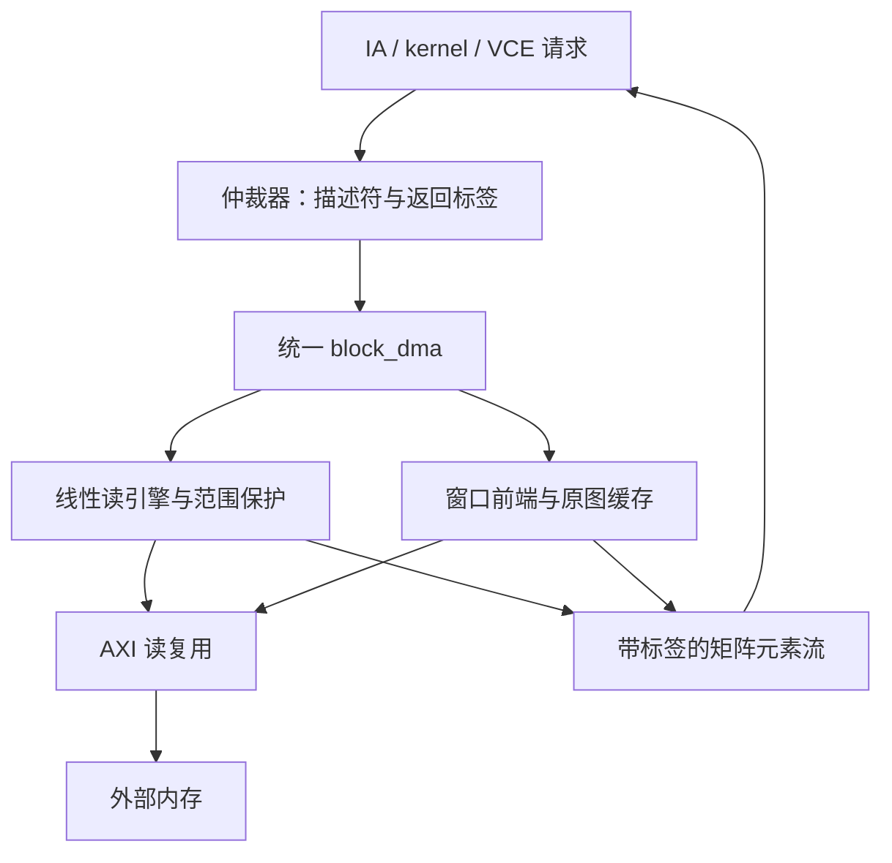

# block_dma 矩阵与 im2col 接口

## 1. 模块职责与配置

共享 `block_dma` 接收矩阵分块描述符。普通 GEMM 描述符读取外部矩阵；Conv 描述符根据原始 NHWC 图像生成隐式输入矩阵。`ia_loader` 和 `kernel_loader` 提交矩阵坐标并接收元素流，图像几何、原始数据缓存和 AXI 读取由 DMA 内部管理。

WS Conv 由 `ia_loader` 请求 im2col，IS Conv 由 `kernel_loader` 请求 im2col。DW 与空间池化通过带标签的窗口接口使用同一前端和缓存。计算结果继续经过各自的乘加、量化及输出缓冲路径。

| 模块 | 职责 |
|---|---|
| `axi_block_dma_arbiter` | 客户端选择、描述符保存、返回标签、在途计数和失败完成处理 |
| `axi_dual_block_dma` | 线性与 im2col 描述符执行、前端配置、普通读取保护和 AXI 读复用 |
| `axi_linear_block_dma` | 线性读写、多个在途请求、4 KiB 分段和写回 |
| `conv_im2col_frontend` | 坐标计算、padding、原始字选择、offset 校正和预取提示 |
| `conv_read_cache` | 原始图像缓存、需求读取、后台填充与预取 |
| `conv_sdp_ram` | 具有独立读写宽度的同步缓存数据存储 |
| `conv_window_queue` | VCE 窗口描述符、目标标签和响应顺序 |
| `ia_loader` / `kernel_loader` | 按有效元素掩码接收矩阵行并管理计算缓冲 |
| `npu_top` | 任务配置、WS/IS 角色、返回宽度、整项任务完成与错误排空 |

SIZE=16 的顶层默认使用 16 个向量 PE、16 路窗口返回，以及 `16 sets × 2 ways × 128 B = 4 KiB` 的图像缓存。`IM2COL_CACHE_BYTES` 控制数据容量，缓存组数按容量、路数和行长计算。AXI64 性能比较配置使用 `32 sets × 2 ways × 128 B = 8 KiB`，与八个 4 KiB IA/PS 共享 bank 共同计入 80 KiB 逻辑状态预算。构建默认值与共享存储分配见 [硬件架构](architecture.md)，指定比较配置见 [DW 共享量化与性能比较](dw_shared_quant_20261121.md)。

## 2. 数据路径



任务开始时提交完整图像几何，每个分块提交矩阵坐标。缓存内容在同一任务的窗口、tile 和加载器请求之间保留。写命令及 AW/W/B 状态独立运行，可以与线性读取或窗口读取重叠。

## 3. 数学矩阵与 WS/IS

对当前 batch 和输入通道组，定义：

\[
P=H_oW_o,\qquad Q=K_hK_wC_g,\qquad O=C_{out}/groups.
\]

隐式输入矩阵为 `A[P,Q]`，OHWI 权重视为 `B[O,Q]`，输出为 `C[P,O]`。`O` 表示当前硬件任务的输出通道数。公共寄存器使用 `k=P, n=Q, m=O`；`lhs_base` 为原始 NHWC 输入地址，`rhs_base` 为 OHWI 权重地址。分组调用由驱动逐组提交，输出行距可以保留完整层的通道数。

对于元素 `(p,q)`，前端按以下坐标读取 S8 输入：

```text
oy = p / output_w
ox = p % output_w
tap = q / group_c
channel_in_group = q % group_c
ky = tap / kernel_w
kx = tap % kernel_w
iy = oy * stride_h - pad_top  + ky * dilation_h
ix = ox * stride_w - pad_left + kx * dilation_w
addr = input_base + (iy * input_w + ix) * input_c
       + group_offset + channel_in_group
```

合法图像坐标返回 `sign_extend_s8(input[addr]) + input_offset`。padding 和 `q >= Q` 的归约尾部直接返回校正后的零值，并保持相应输出元素有效；这些位置不发出原图请求。offset 在前端处理一次。

| 模式 | IA loader 接收 | Kernel loader 接收 | 计算方向 |
|---|---|---|---|
| GEMM WS/IS | 外部矩阵 | 外部矩阵 | 普通矩阵模式 |
| Conv WS | `A[p,q]` 的 im2col 块 | `B[o,q]` 权重块 | `A × Bᵀ` |
| Conv IS | `B[o,q]` 权重块 | `A[p,q]` 的 im2col 块 | 内部计算 `B × Aᵀ`，由输出转置得到 `C[p,o]` |

DMA 返回的局部行始终表示输出空间位置 `p`，局部列表示展开归约坐标 `q`。IS 的 kernel buffer 和输出缓冲负责对应的装载与转置，bias 和逐通道量化仍沿最终输出通道索引。

## 4. 任务配置接口

`conv_cfg_valid && conv_cfg_ready` 接受任务上下文。顶层在初始化阶段提交配置；普通 GEMM 也提交 `conv_enable=0`，建立该任务的读取模式与分配范围。配置握手发生时，各客户端没有待提交的描述符。

| 字段 | 含义 |
|---|---|
| `conv_enable` | 本任务是否启用图像窗口处理 |
| `conv_cfg` | 输入地址、输入与输出尺寸、卷积核、stride、dilation、padding、通道组、offset、缓存旁路及预取配置 |
| `conv_sched_r` | 空间复用数 R，供几何预测使用 |
| `conv_sched_groups` | WS 输出通道组数；IS 使用 0 |
| `conv_range_base[4]` / `conv_range_end[4]` | 权重、bias、multiplier、shift 的真实半开地址区间，末端使用 33 位 |
| `conv_error` | 描述符、几何、前端或读取错误 |
| `conv_busy` | 图像描述符、窗口队列或前端缓存仍有工作 |

仲裁器要求已接收命令、暂存描述符和当前授予全部释放；DMA 同时要求前端、读取保护器、读响应复用及完成状态全部空闲。满足这些条件后才接受下一任务。配置字段在握手时保存，后续外部配置变化不影响执行中的上下文。

一次硬件 START 对应一个任务。驱动逐 batch、逐输入通道组提交需要拆分的普通卷积任务；VCE 在自己的任务内推进 DW 通道组。新的图像任务清除缓存有效位和原始字保持状态，执行期间输入数据与权重保持稳定。

## 5. 分块描述符

客户端使用 `req/granted/start/busy/done` 提交命令，仲裁器将字段保存后交给 DMA。

| 字段 | 线性矩阵描述符 | im2col 描述符 |
|---|---|---|
| `rd_im2col` | 0 | 1 |
| `rd_base_addr / rd_row_stride` | 矩阵地址与字节行距 | 原图地址由任务配置与坐标计算 |
| `rd_p0 / rd_q0` | 无需使用 | 起始空间位置与归约位置 |
| `rd_group` | 无需使用 | 调度输出组号，供未来使用预测 |
| `rd_rows_to_read` | 矩阵行数 | 1～`IM2COL_SIZE` 个空间行 |
| `rd_valid_cols` | 线性有效列数 | 在 1～`IM2COL_SIZE` 范围内取指定列数，其余取完整块宽 |
| `rd_slot_id` | 目标 buffer slot | 目标 buffer slot |
| `rd_wide_im2col` | 无需使用 | 允许按 `WINDOW_LANES` 返回矩阵元素 |
| `rd_use_16bits / rd_lhs_zp` | 线性数据格式与 offset | 返回经过校正的 S16 元素 |

`IM2COL_SIZE` 等于阵列 `SIZE`。用于分组 bias 的 `SHARED_DMA_SIZE=4*SIZE` 只扩大通用 DMA 的维度范围；SIZE=16 的 im2col 块最多包含 16 行和 16 列。

DMA 在接受 im2col 描述符时保存 `p0`、`q0`、行列数、输出组号、slot、返回标签和宽输出选择。行数为零、超过块高、图像模式未启用或配置非法时，描述符以错误完成，并阻止有效原图请求。

## 6. 返回宽度与有效元素

矩阵返回使用 `wr_slot / wr_row / wr_col_base / wr_data[] / wr_valid[] / wr_use_16bits`。VCE 窗口返回使用对应的 tag、列坐标、元素掩码和末拍标志。行号和列号均以矩阵元素为单位。

顶层设置 `MATRIX_INPUT_LANES=max(WINDOW_LANES, BUS_WIDTH/8)`。线性 DMA 的实际数据来自外部 AXI 拍；窗口命中数据来自独立的同步缓存读口。因此，外部 AXI64 与内部 128 位缓存读取可以同时存在。

| 返回路径 | SIZE=16、WINDOW_LANES=16 时的元素上限 |
|---|---|
| S8 窗口宽输出 | 每拍 16 个经过校正的 S16 元素 |
| S16 原始窗口 | 每个 128 位缓存字最多八个元素 |
| Kernel im2col | 允许完整窗口宽度 |
| IA 紧凑 im2col | `run_compact` 有效时允许完整窗口宽度 |
| IA 非紧凑 im2col | 每拍最多 `BUS_WIDTH/8` 个元素 |
| 线性 S8/S16 | 分别由外部拍的字节数、半字数限制 |

`tile_narrow` 在描述符接受时保存；窄输出限制本拍有效元素数，缓存仍按已配置的原始字宽读取。原始字边界、卷积核位置边界、有效通道数和请求尾部可以形成部分有效的数据拍。加载器按实际有效掩码推进列坐标，只有有效元素覆盖该行最后一列时才提交完整行。

矩阵 buffer 接收接口每周期消费所有有效元素。VCE 窗口接口具有 `rsp_ready`，停顿时保持数据、tag、掩码和末拍标志。描述符完成在末拍数据交付后发布。

## 7. 描述符准备与连续执行

普通读请求经过两个保存阶段：仲裁器保存客户端和矩阵字段，DMA 再保存图像坐标及前端上下文。普通卷积最多保留两条未完成描述符，可以在当前描述符执行期间准备下一条。非卷积线性任务的描述符在途上限为四条；kernel 客户端最多两条，其余线性客户端各最多一条。描述符数量与 AXI 读事务数量分别统计。

请求优先顺序为 VCE 线性读、kernel、quant、bias、IA，窗口请求在普通描述符空闲时进入独立队列。VCE 窗口队列默认有四项，每项保留请求坐标、长度和目标标签。队列提前读取下一项；当前项完成或直接接收新项时可以连续交付。没有其他客户端竞争且各级就绪时，窗口仲裁可以每周期接受一条请求。

普通 im2col 描述符在最后一拍矩阵数据返回后发布 `conv_done_r`，释放其客户端在途状态。后台缓存填充和预取由 `rd_busy`、`conv_busy` 持续记录，相同图像配置的下一描述符可继续执行。切换至线性读取时，DMA 等待前端和窗口队列空闲，并在图像任务中等待范围保护器及 AXI 读复用器排空。

线性读取的最后一拍数据在物理 R 握手后寄存输出。返回路径依据实际生产单元的有效信号和已保存标签选择数据，使描述符切换与末拍返回能够相邻发生。读描述符准备、图像填充和写通道各自保留状态；写数据及 B 响应可以与后续读取重叠。

## 8. 同步窗口缓存

缓存保存原始输入字节。默认顶层 `CONV_LINE_BYTES=128`、`CONV_CACHE_WAYS=2`、`CONV_CACHE_POLICY=3`，组数由 `IM2COL_CACHE_BYTES / (CONV_CACHE_WAYS * CONV_LINE_BYTES)` 得到。

`conv_sdp_ram` 的地址以 32 位字为单位，读写宽度独立设置。存储器分为多个 32 位同步 bank，读取按自然地址组选择相应的 bank，写入使用字节掩码。总数据位数始终为 `DEPTH*32`；扩大读口只改变 bank 的组织与结果选择。AXI32/64 可分别填充 32/64 位数据，缓存读口可提供 32、64 或 128 位原始字。同地址读写由缓存控制逻辑避免。

前端默认 `REGISTER_CACHE_REQUEST=0`，直接使用缓存内部的请求寄存级，并设置 `DEMAND_DEPTH=1`。命中字读取、下一原始字请求和后续行请求可流水执行；缓存已驻留、没有访问冲突且接收端持续就绪时，可每周期返回一个原始字。`REGISTER_CACHE_REQUEST=1` 配置保留前端请求寄存级，并使用四项需求队列。

前端保存当前原始字，按有效掩码消费其中的元素。连续 tap、相邻输出位置、跨输出行和连续空间 tile 可以从已保存坐标推进；满足相应几何条件时直接计算后续地址。padding、非连续坐标和新任务仍按描述符几何处理。

八项预取队列与需求读取共用缓存填充路径，需求缺失优先。windowed 模式且输入通道数至少为 16 时，前端按缓存行对应的像素跨度预取，提前距离为四个行跨度并限制在一条输入行内。纵向 stride 和 dilation 均为 1 时，预测卷积窗口底部输入行；其他配置沿当前核位置预测。横向跨行保留剩余位移，并按输出 stride 推进纵坐标。小通道窗口使用相应的核行与输出位置预测。

完整物理行标记决定命中，空间组号、通道片段与最后使用位置参与替换选择。填充范围取缓存行与合法输入张量区间的交集，范围读取器按有效字节及 4 KiB 边界分段。缓存旁路改变读取方式，实例化的数据容量保持不变。

## 9. 分配区间与错误处理

线性权重、bias 和量化参数读取经过 `conv_axi_read_guard`，按四个已保存分配区间处理首尾有效字节，并拆分边界请求。图像读取由窗口前端、原始数据缓存及 span reader 按真实输入范围产生；padding 由本地零值处理。

两类读取经 `conv_axi_read_mux` 连接到外部 AXI。AR 被阻塞时保持地址及突发字段，返回归属来自已接受的请求。总线错误使仲裁器立即阻止新命令；已经接受的 R/W/B 事务继续完成。暂存且尚未进入 DMA 的描述符可以取消，在途计数同时处理完成与取消事件。

内部 `rd_done` 在成功和失败时都释放命令。图像任务发生读取错误时，IA/kernel 的成功完成信号保持无效，部分写入的 tile 不发布为可用。顶层等待 DMA、窗口前端和可选 operand cache 空闲后清理任务状态，再报告错误。调用方丢弃失败任务的输出，后续任务可重新配置并执行。

## 10. 整项任务的单次完成

描述符完成和整项任务完成分别使用独立状态。对普通 Conv，`conv_task_idle` 要求 `dma_idle && !conv_busy`；最终 DONE 和下一任务接收等待全部图像读取与后台预取结束。IA/kernel 预取状态和可选 operand cache 的物理空闲状态也参与普通任务的完成条件。

`operand_completion_seen` 用于全部普通矩阵与 Conv 任务。控制器完成、上述存储状态空闲且尚未接受该完成时，顶层发布 `done_valid`。外部 `done_ready` 接受后置位该状态，直到控制器撤销完成信号后清零。控制器寄存尾拍、外部背压和后台预取排空共同受此规则处理，每项任务只有一次完成接收。

可选 `OPERAND_CACHE` 的 `idle` 包含请求、在途队列、元数据提交、flush 和待提交 AR。读取请求尚未完成时，时钟保持运行以接收尾部响应。VCE 的任务完成由向量执行器及其结果队列、共享量化返回和写回状态共同管理。

## 11. 容量与软件规划

图像缓存按原始地址保存数据，IA RAM 按计算 tile 保存流式操作数。共享 RAM 的总容量为 `SHARED_BANK_BYTES * SHARED_BANK_COUNT`；通用及 ASIC 默认九个 2 KiB bank。软件为 IA 分配 1、2 或受支持的 4 个 bank，其余用于完整 INT32 部分和。每个 bank 每周期最多接受一次读和一次写。

紧凑 S8 的 16×16 tile 占 256 B，双缓冲需要 `512R` B；S16 tile 占 512 B，双缓冲需要 `1024R` B。已经校正的 S8 im2col 流在紧凑 IA 写入时恢复原始 S8，读取时恢复 offset。部分和采用 RAW32 固定地址存储。

| 数据区域 | 配置方式 |
|---|---|
| IA/PS 共享数据 | bank 大小乘以 bank 总数 |
| 原始输入窗口数据 | `IM2COL_CACHE_BYTES`，默认 4096 B |
| 窗口缓存元数据与队列 | 按组数、路数、行长和队列深度实例化 |
| 输出、参数和结果缓冲 | 按阵列、向量和量化配置实例化 |

[`scripts/capacity`](../scripts/capacity) 以当前源码展开结果核对 RAM、ROM、缓冲、队列和控制状态。容量报告同时保存参数与来源哈希。

核尺寸、图像尺寸、stride、dilation、padding、通道组和 offset 按任务配置。缓存容量、路数、行长、返回宽度和 PE 数量在构建时选择。`dsa_conv_s8_config_t.dataflow_mode` 使用 0=WS、1=IS、2=AUTO；生产规划器联合选择数据流、IA bank 数、R/W 和 PS 执行方式。TFLM Prepare 保存这些配置，Invoke 提交任务。

普通 S8 Conv 入口检查核高宽与输入输出尺寸、地址区间及 `kernel_h * kernel_w * group_c <= 65535`，input offset 范围为 −127～128。`CONV_CAPS` 的高 16 位为版本，低位表示 S8 Conv、精确窄读和 IS 支持。驱动在 START 前检查能力与资源，未启动的受限形状可由软件处理。DW、池化及其他向量任务使用 VCE 入口。

## 12. 验证入口

测试由独立数值参考、实际返回坐标和 AXI 事务共同检查。源码、配置、输入、期望输出和运行日志保存在各测试输出目录。

| 测试入口 | 覆盖内容 |
|---|---|
| [窗口前端](../test/conv_frontend/README.md) | 动态几何、跨行、尾部、S8/S16、宽窄返回和错误恢复 |
| [同步缓存流水](../test/cache_pipeline/README.md) | 32/64/128 位读取、需求队列、同步 RAM、连续命中和背压 |
| [DMA 描述符准备](../test/dma_registered_issue/README.md) | 注册请求、线性与图像切换、后台预取、完成时序和取消 |
| [窗口描述符队列](../test/window_queue/run.py) | 连续请求、响应标签、随机反压和错误排空 |
| [共享 DMA](../test/conv_dma/README.md) | WS/IS 描述符、部分有效拍、padding、范围保护与客户端切换 |
| [缓存配置与驱动](../test/im2col_cache_config/README.md) | 缓存几何、容量查询、连续计划复用与图像成本估算 |
| [向量执行器](../test/vector_engine/README.md) | DW 窗口消费、共享量化、通道尾部、跨组执行和写回 |

独立算子性能与完整模型结果见 [DW 共享量化与性能比较](dw_shared_quant_20261121.md)。各结果使用其记录的硬件参数、内存时序和计时区间。
