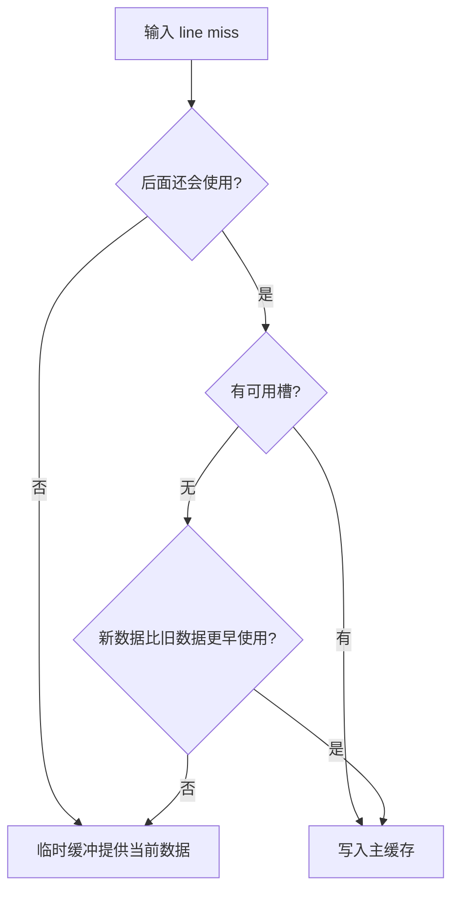

# 按卷积未来访问替换输入缓存

本文记录策略 1、2 的卷积未来访问预测算法及固定版本实验，25 条 RTL 结果使用
`cb45d0e`。该算法的前端、预测器与原图 cache 位于共享 `block_dma`。
以下 next-use 公式适用于 WS；对应实验的 IS 使用同一缓存的 LRU。

当前标准配置使用策略 3 的 **4 KiB 共享窗口缓存**，参数为 128 sets、2 ways、
16 B line。其 WS、IS 和 DW 的集合映射、预取及队列见
[矩阵调度与共享窗口缓存](scheduling_and_window_cache.md)。请求接口见
[DMA 设计说明](block_dma_im2col.md)。实验向量在运行时生成，方法见
[源码交付说明](conv_source_only.md)。

## 目标与实现范围

已知输入图像、卷积核、stride、dilation 和实际 IA 分块顺序时，输入的未来访问
可以从几何关系推出。替换时不仅要选择移出的旧 line，还要决定新读入的 line
是否值得保留。仅把 miss 数据强制写进缓存，会让一次扫描的数据冲掉下一次扫描
还要使用的数据。

本次新增硬件预测器、按未来访问选择替换对象和选择性存入机制。原 LRU 集成及其
实测记录保存在本地提交 `629a39a4e0497036ab66942ca8b58b13d5d2ceca`，所有比较
采用相同 CNN 层尺寸、生产默认分块、数值、总线等待和原始参考输出。

本文的主要实验配置为 **1 KiB**：32 sets、2 ways、16 B line、策略 2；同时
比较 512 B、2 KiB 和 4 KiB。容量与周期结果按各层分别记录。

运行时不由 CPU 枚举 im2col、不生成完整访问计划表，不增加外部 im2col 矩阵。
CPU 仍只提交原有命令。预测器在硬件中每周期检查一个 kernel tap，取得当前
line 下一次完整使用的位置；最多检查 25 个 tap。离线 Python 轨迹和几何 oracle
用于独立核验，未作为硬件运行的输入。

## 为什么不能只看“剩余几次”

剩余次数能判断数据是否已经用完，但不能完整描述保留它的收益。一次很快就会
发生的复用，与许多轮以后才开始的复用，对有限缓存的要求不同。本实现优先比较
下一次使用的位置；没有后续使用的数据记为 `INF`。数学 oracle 同时核对剩余
完整访问次数，便于检验预测和比较基于次数的方案。

在已测三个困难层中，精确剩余次数策略和下一次使用策略的外读结果恰好相同，
这不证明两种规则对所有形状等价。硬件保存 `next_use`，不为每个输入像素建立
一张全图计数表。

## 实际调度和预测单位

WS 模式下，IA Loader 请求 DMA 的装载次序是：

```text
for p_block:                         # 每块最多 R*SIZE 个输出位置
  for output_channel_group:
    for q_tile:                      # kernel 与输入通道组成的展开列
      for position_tile in R:
        for row in SIZE:
          load one input channel slice
```

在本次优化的快路中，`SIZE=LINE_BYTES=16`，s8 输入与通道片段都对齐 16 字节。
一条 line 正好是一个输入像素的 16 个通道；一次逻辑使用连续消费该 line 的四个
32 位 word。因此预测单位是**当前四个 word 全部消费之后，下一次完整 line 使用**。
如果将当前 line 内紧接着的三个 word 也当作待竞争的未来复用，新读入数据会总显得
马上要用，选择性存入就会退化为每次 miss 都占用主缓存。

事件以 `(p_block, output_group, q_tile, output_position)` 区分。不同事件即使恰好
连续使用相同地址，也不能因地址相同而合并。专门的边界向量覆盖了这种情况。

定义 `Q = kernel_h * kernel_w * group_c / SIZE`，并将完整事件顺序编码为：

\[
t=\left(\left((bG+g)Q+q\right)R+r\right)S+u
\]

其中 `b` 为 p 块号，`G` 为输出通道组数，`g` 为当前输出通道组，`q` 为展开列
tile 号，`r` 为块内空间 tile 号，`u` 为 tile 内行号，`S=16`。padding 和末块
未使用位置可以留下编号空隙，不影响先后次序。整个编号范围必须小于 `0xffffffff`，
该值保留为没有未来使用的标记。

输出通道组号来自原 Loader 的真实装载 / 预取描述符。预测器使用正在填充的 tile
所属的组号，不拿当前计算组或上一个任务的配置代替它。

## 根据当前输入反推未来使用

已知输入像素 `(iy, ix)` 及组内 16 通道片段，对每个 kernel tap `(ky,kx)` 计算：

\[
n_y=iy+pad_{top}-ky\cdot dilation_h,\qquad
n_x=ix+pad_{left}-kx\cdot dilation_w
\]

只有分子非负、可分别被 stride 整除，且得到的输出坐标合法时，才产生候选：

\[
oy=n_y/stride_h,\quad ox=n_x/stride_w,\quad
p=oy\cdot output_w+ox
\]

\[
q_{candidate}=\left((ky\cdot kernel_w+kx)\cdot group_c+channel_{slice}\right)/16
\]

将 `p` 分解成 p 块、空间 tile 和行号后，确定最早尚未执行的输出通道组：

1. 候选 p 块已经过去：忽略。
2. 候选 p 块在后面：最早组号为 0。
3. 候选仍在当前 p 块，且 `(q,r,u)` 在当前位置之后：使用当前组。
4. 候选仍在当前 p 块，但局部位置已执行：尝试下一个输出通道组。

将所有合法候选编码成 `t`，取最小者。没有候选就返回 `INF`。R 和 stride 的
2 的幂约束使对应除法可用移位及低位整除判断实现；不在数据返回的关键路径上增加
通用组合除法器。

## 替换与选择性存入

每个主缓存 line 保存一个 32 位 `next_use`。命中后更新预测；miss 时执行：

1. 新 line 后面不再使用：由临时 line 缓冲提供当前数据，不占用主缓存。
2. 有无效槽或已经用完的旧 line：优先使用它。
3. 否则在该 set 的驻留 line 中找下一次使用最远的一个。
4. 若新 line 的下一次使用更晚或一样晚，当前数据读入临时缓冲，保留旧 line；
   否则替换那个未来使用最远的旧 line。



主数据 RAM 仍为原来的单块 1R1W 存储。16 B 临时缓冲单独保存 miss 的返回值。
满 set 的竞争 miss 若决定不准入，禁止写主数据 RAM，也不清除驻留 line 的 valid。
冷 miss 在预测尚未完成时可以先写无效槽；若随后得知没有未来使用，就不发布 tag，
只由临时缓冲返回。这种投机写不会覆盖任何 valid line。不能直接借用原有
全任务 bypass 开关，因为原旁路实现会使用主 RAM 的 way 0 返回 word。

临时缓冲仅服务连续同 line 的请求；每个逻辑事件包含四个 word，相邻不同事件若
恰好连续使用同一 line，也可继续命中。接受不同 line 地址时，即使新地址命中主缓存，
也使旧临时 line 失效。它不被当作一条额外的长期全相联缓存；实际存储成本
仍包含这 16 B。读错误必须排空已经接收的事务，不提交主缓存 valid，也不留下可命中
的临时 line。

预测从前端 `ADDRESS` 阶段开始。命中可以先返回数据，随后在后台更新预测；冷缓存
的无效槽填充可以先发 AR，提交时才等待预测。满 set 的竞争 miss 必须取得新 line
的预测后才能决定是否替换。下一事件启动前检查未完成的预测更新，防止写入下一条
line 的标签。周期收益需要真实 RTL 衡量，不能把预测工作当成零开销。

## 减少图像行之间的 set 冲突

仅改替换规则仍受 2 路 set 划分限制。图像行宽和通道数产生的规则步幅可能使多个
图像行落到相同 set。本次提供可逆 XOR 索引：

```text
raw_set = line_address 的低 SI 位
tag     = line_address >> SI
set     = raw_set XOR tag 的低 SI 位
```

tag 不增宽：命中时 tag 相同、XOR 后 set 相同，就意味着原 raw_set 也相同，
不会引入不同地址被误认为相同数据的问题。

`CONV_CACHE_POLICY` 是 elaboration 参数：

| 值 | 策略 |
|---:|---|
| 0 | 原低位索引与 LRU，用于基线对照 |
| 1 | 低位索引，几何预测、未来使用替换和选择性存入 |
| 2 | 策略 1 加可逆 XOR 索引；本文几何替换实验配置 |
| 3 | 当前标准配置的共享窗口策略，见独立设计说明 |

不满足快路条件的任务继续使用原低位索引和 LRU。XOR 只在当前任务确认启用几何
预测后使用，配置切换同时清除缓存。

XOR 本身不是充分条件：模型中 Gesture op7 的 2 KiB LRU，从低位索引的 4096 B
读取增加到了 XOR 的 4320 B；配合未来使用替换后才恢复为 4096 B。因此保留
替换规则和索引的独立对照，不能将两者的改善混成一个无法核对的结果。

## 当前快路条件

快路要求 WS、s8、`SIZE=LINE_BYTES=16`，输入基地址、Cin、group C 和 group offset
均对齐 16；R 和两个 stride 为 2 的幂；dilation 为合法正值；kernel tap 总数不超过
25；完整事件编号不溢出 32 位。矩形核可用，只要满足总 tap 数限制。

这些是**新替换策略**的适用条件，不是新增的卷积功能限制。其他合法任务仍由原
硬件窗口、输入缓存、原 IA 和阵列执行，不因为预测器未启用就退回 CPU 卷积。
原 kernel 高宽及 stride/dilation 等动态寄存器合同保持有效。

## 存储成本

下表固定 2 路、16 B line，计入主数据、tag/valid/LRU 数组、新增 next-use 表、
16 B 临时数据及其 28 位 tag / 1 位 valid。不包含双方共有的前端 word 保持寄存器、流水和控制逻辑，也不把
字节数当作器件面积。

| 主数据容量 | 原 tag/valid/LRU | 新 next-use 表 | 临时数据及 tag/valid | 合计，向上取整 B |
|---:|---:|---:|---:|---:|
| 512 B | 102 B | 128 B | 16 B + 29 bit | 762 B |
| 1 KiB | 196 B | 256 B | 16 B + 29 bit | 1496 B |
| 2 KiB | 376 B | 512 B | 16 B + 29 bit | 2956 B |
| 4 KiB | 720 B | 1024 B | 16 B + 29 bit | 5860 B |

预测器共享寄存器为 581 bit，另有 frontend、scheduler 和 cache 控制的新增状态；
1 KiB 配置的新增共享状态合计 819 bit，约 103 B；这只计替换算法相对旧 LRU 的
状态，不含后来 DMA 统一接口的描述符寄存器。原 4 KiB LRU 的对应数组合计
为 4816 B。1 KiB 新策略的上述数组合计为 1496 B，是否具有面积或频率优势还取决于
预测算术与实际工艺映射；没有以缓存数据容量缩小倍数冒称完整硬件面积缩小倍数。

源码中有 15 处乘法表达式，操作数与中间位宽不同，不能等同为 15 个物理 64×64
乘法器，也不能未经综合就当作免费移位。现有 Yosys 在 `return` 语法处停止，尚未
执行预测器的优化 / 资源统计；这里只提供声明状态与运算结构审查，不提供 gate、
DSP、面积或 Fmax 数字。详见 [成本审查](../test/conv_replacement/cost/README.md)。

## 模型对照与验证层级

数学请求轨迹首先匹配原真实 NPU 的 10 层、60 个配置：hit/miss、有效输入字节、
不同 / 重复字节、最大读取次数及输入分配内每个地址的完整直方图均一致。它是
**经过 RTL 核对的数学轨迹**，并非声称从 RTL 捕获了逐请求时间序列。

同容量模型结果如下；实际执行周期必须另由新 RTL 测量。

| 层 / 主缓存 | 原 LRU 读取 | 未来使用替换 | 加 XOR 后 | 不同输入字节 |
|---|---:|---:|---:|---:|
| Gesture op7 / 512 B | 8208 | 6288 | 6176 | 4096 |
| Gesture op7 / 1 KiB | 8208 | 5840 | 4976 | 4096 |
| Gesture op7 / 2 KiB | 4096 | 4096 | 4096 | 4096 |
| Gesture op16 / 512 B | 3872 | 2976 | 2688 | 2048 |
| Gesture op16 / 1 KiB | 3872 | 2784 | 2400 | 2048 |
| Gesture op16 / 2 KiB | 2048 | 2048 | 2048 | 2048 |
| MobileNetV2 op52 / 512 B | 55680 | 49536 | 49536 | 18816 |
| MobileNetV2 op52 / 1 KiB | 55680 | 43392 | 43392 | 18816 |
| MobileNetV2 op52 / 2 KiB | 55680 | 31104 | 31104 | 18816 |

真实模型尺寸中，未改变遍历顺序时要保持每个输入 line 只外读一次，Gesture op7、
op16 和 MobileNetV2 op52 的同时驻留需求分别至少为 76、72、192 条 line，即
1216、1152、3072 B。这说明前两层在不超过 1 KiB、后一层在不超过 2 KiB 的
缓存下，剩余重读不能全靠替换规则消除；精确知道未来使用也不能突破容量本身。

历史结果由上表保留；当前生成与验证入口：

- [实际模型参数与数值生成](../test/conv_models/README.md)
- [完整请求轨迹生成](../test/conv_replacement/trace_model.py)
- [同容量策略模型](../test/conv_replacement/focus.py)
- [几何 oracle](../test/conv_replacement/geometry_oracle.py)
- [真实预测器 RTL 单测](../test/conv_replacement/predictor_test.py)：31 配置，13046 个现场生成向量。
- [真实缓存 RTL 专项](../test/conv_replacement/run_cache_policy.py)：39 事务，296 B、24 AR。

## IA 内前端阶段的真实 NPU 对照

该历史阶段执行 6 个构建、25 条命令：三困难层覆盖策略 2 的 512 B / 1 KiB /
2 KiB / 4 KiB，以及策略 0 / 1 的 1 KiB；其余七个原模型层补齐策略 2 / 1 KiB。
每项使用原始完整 descriptor、init、golden 和输入需求文件，逐字节比较整个输出
内存，并独立核对输入地址计数。下面仅保留当时的结果表，当前 DMA 架构的
测试脚本会现场生成相同定义的数值和描述符，不依赖这些历史文件。

| 层 / 容量 | 原 LRU 字节 / 周期 | 新策略 2 字节 / 周期 |
|---|---:|---:|
| Gesture op7 / 512 B | 8208 / 36745 | 6176 / 34351 |
| Gesture op7 / 1 KiB | 8208 / 36745 | 4976 / 33626 |
| Gesture op7 / 2 KiB | 4096 / 33461 | 4096 / 33244 |
| Gesture op7 / 4 KiB | 4096 / 33461 | 4096 / 32736 |
| Gesture op16 / 512 B | 3872 / 18728 | 2688 / 17351 |
| Gesture op16 / 1 KiB | 3872 / 18728 | 2400 / 16726 |
| Gesture op16 / 2 KiB | 2048 / 17010 | 2048 / 16578 |
| Gesture op16 / 4 KiB | 2048 / 17010 | 2048 / 16590 |
| MobileNetV2 op52 / 512 B | 55680 / 377135 | 49536 / 362828 |
| MobileNetV2 op52 / 1 KiB | 55680 / 377135 | 43392 / 360881 |
| MobileNetV2 op52 / 2 KiB | 55680 / 377135 | 31104 / 357489 |
| MobileNetV2 op52 / 4 KiB | 18816 / 353087 | 18816 / 353355 |

1 KiB 的策略 0 在该阶段最终源码重新运行，三个困难层的全部结果、周期及访存指标均与
旧 checkpoint 相同；其他容量的 LRU 列引用已归档的真实 RTL 数据。1 KiB 新策略
相对旧 4 KiB LRU，三个困难层的周期变化分别为 +0.49%、−1.67%、+2.21%。
这支持本次将主数据容量降为 1 KiB 的取舍，仍保留较大容量作为参数选项。

同容量规则也有明确限制：Gesture op7 / 1 KiB 的策略 1 为 5840 B、33597 周期，
策略 2 少读 864 B，但慢 29 周期；MobileNetV2 op52 / 4 KiB 的新策略与原 LRU
同样只读 18816 B，却慢 268 周期。没有将访存降低直接当作等比例加速，也没有
宣称新策略每层每档都更快。

四个单输出通道组的 1×1 层仍每字节只读一次；新策略可把没有后续使用的数据留在
临时缓冲，降低当前 line 后续 word 的返回开销，周期分别为 14781、65455、33953、
140550。三个不满足对齐条件的 C1/C8 层在 1 KiB 的输出、访存和周期与原 LRU 完全
相同。当前 DMA 版本的数值与逐字节访问对照由
[替换策略 runner](../test/conv_replacement/README.md) 重新生成并执行。

该阶段默认配置另执行了真实 NMSIS C → AXI-Lite → NPU → SoC RAM 协同仿真，
当前复现入口见 [C/RTL 测试](../test/conv_cosim/README.md)。
该协同仿真的 SIZE=4，覆盖新默认容量和几何策略未启用时的完整集成；SIZE=16 的
几何快路整 NPU 验证由上述 25 条命令覆盖，尚未将两项组合成 NMSIS 直接调用快路的测试。
最终源码还重跑了原有 20 项 GEMM / WS / IS / PCR，输出、周期、AR 请求与字节、
R 拍数及 W 字节均与最初基线一致。当前
[GEMM 回归](../test/conv_regression/run.py) 会现场运行指定 Git 基线后比较。
这一早期阶段未运行 RISC-V 固件；后续统一 DMA 版本的真实 CPU 测量见
[SoC 性能报告](conv_soc_performance.md)。训练权重下的完整网络和板级测试仍未完成。

## 复现

```bash
make conv-replacement VERILATOR=/absolute/path/to/verilator
# 几何替换实验：1 KiB，策略 2。
make conv-npu CONV_CACHE_SETS=32 CONV_CACHE_POLICY=2 VERILATOR=/absolute/path/to/verilator
# 原 4 KiB LRU 参数对照。
make conv-npu CONV_CACHE_SETS=128 CONV_CACHE_POLICY=0 VERILATOR=/absolute/path/to/verilator
```

`conv-replacement` 包含轨迹核对、几何 oracle、预测器 RTL、缓存专项及最终 25 条
原 NPU 命令。缓存容量和策略是 elaboration 参数；运行时几何参数动态选择适用的
硬件路径，不会在运行时改变已综合的 RAM 大小。
