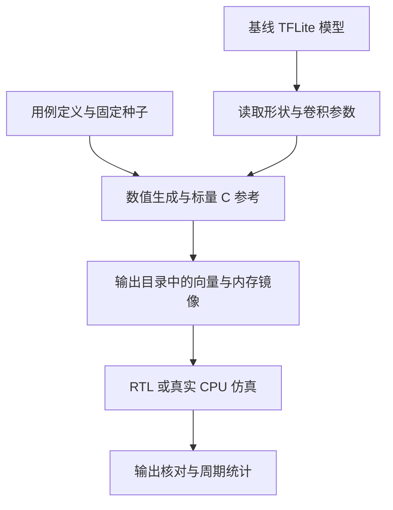

# Conv 源码交付与即时生成测试

## 1. 交付内容

本补丁固定以 `148964d180f52cb852c5a7e3d5c89773fa0a8ea5` 为基线，包含硬件
Conv、DMA 内 im2col、1 KiB 原图缓存、NMSIS 驱动、测试源码和设计文档。
生产 RTL 和驱动沿用已完成的统一 DMA 实现，本次修改集中于测试输入生成、
运行目录和补丁内容。

补丁不加入 ELF、固件 `.bin`、预生成向量、`.mem` 内存镜像、访问轨迹、日志、
生成的 C++、编译对象、压缩源码快照或逐次运行报告。也不把这些数据转换为
base64、十六进制数组或压缩字节后放入源文件。保留的是测试条件、固定种子和
生成算法；运行时的数据文件写入 `build/` 或用户指定的输出目录。

基线已经包含的 TFLite 模型继续作为真实形状来源，补丁不新增模型二进制。
当前原软件性能对照的 C 源码、官方 newlib 内存例程源码和版权说明仍属于源码
交付，相关库与固件在用户机器上编译。测试准备不需要网络下载模型或旧向量包。

## 2. 从源码生成测试数据



公共入口为 [`generate_vectors.py`](../test/conv_models/generate_vectors.py)。
它现场提取四个模型的算子信息，选择原十个普通 s8 Conv 层，使用固定种子
`20261115` 构造输入、权重、bias、逐通道 multiplier 与 shift。独立输出由
标量 C 卷积和 NMSIS 量化计算。生产 C planner 决定分块参数。

同一层、种子和分块策略产生相同数值，不同运行目录不影响张量内容。生成器可以
输出全部十层，也可以按 layer ID 或 slug 选择单层：

```bash
make conv-vectors

python3 test/conv_models/generate_vectors.py \
  --layers justure_detect:sg0:op7 \
  --seed 20261115 --tiling-policy driver-auto \
  --out /tmp/conv-vectors
```

`--metadata-only` 只生成形状与调度需要的信息，供几何 oracle 和请求轨迹模型
使用，不需要先生成数值向量或运行 RTL。默认 `make conv-vectors` 输出到
`build/conv_verify/vectors`；其中的 `.bin`、`.mem` 和 JSON 都是运行产物。

## 3. 各测试怎样准备输入

| 测试 | 现场生成的输入 | 独立检查 |
|---|---|---|
| 前端数学参考 | 有限尺寸与随机输入 | Python 与 C 直接卷积逐元素比较 |
| 统一 DMA / 连续 NPU | 描述符、原图、权重、量化参数、完整内存参考 | 矩阵元素、partial lane、错误恢复及整输出内存 |
| 真实 CNN 尺寸 | 实际 TFLite 层参数与确定性张量 | 每个输出字节、输入区逐地址读取计数 |
| 几何 oracle / 预测器 | 从 im2col 与真实分块顺序枚举请求和未来使用事件 | oracle 与 RTL next-use，非法条件与完成时序 |
| 缓存替换对照 | 同一层与数值下的访问序列 | 实际 AXI 计数与独立缓存模型 |
| C/RTL 联合仿真 | C 测试程序运行时初始化数据 | 真实 AXI-Lite / NPU / RAM，硬件运行时张量页受保护 |
| SoC 性能 | 公共生成器的张量与 golden，再编译 CPU 固件 | 固件和测试台分别核对输出、START 类型和周期 |
| GEMM 基线对照 | 两个源码版本中使用同一固定种子生成矩阵 | 数值、周期、AR / R / W 统计逐项比较 |

测试不依赖旧补丁中的 `evidence_*`、`results*`、`pre_optional_drain` 或
源码快照目录。只服务历史交付归档的脚本与报告一并移除。PCR 拒绝测试保留在
独立的 [`test/conv_pcr_guard`](../test/conv_pcr_guard/README.md)。

## 4. 构建与运行

普通 host 测试需要 Python 3 和 GCC/G++。模型解析需要 `numpy`、`flatbuffers`，
使用仓库内已有的 TFLite schema，不需要 TensorFlow。RTL 仿真需要 Verilator；
RAM 推断还需要 Yosys。SoC 仿真额外需要固定的 PicoRV32 子模块与支持 RV32IM
的裸机 GCC/newlib。

```bash
python3 -m venv .venv-conv
. .venv-conv/bin/activate
python -m pip install numpy flatbuffers
git submodule update --init picorv32

make conv-model conv-driver conv-pcr-guard
make conv-dma VERILATOR=/path/to/verilator
make conv-cosim VERILATOR=/path/to/verilator
make conv-replacement VERILATOR=/path/to/verilator
make conv-gemm-regression VERILATOR=/path/to/verilator
make conv-soc-perf VERILATOR=/path/to/verilator \
  CONV_RISCV_GCC=/path/to/riscv64-unknown-elf-gcc
```

`make conv-verify` 组合普通验证入口；真实 CPU 性能运行保持独立。
`CONV_BUILD_DIR` 可以指定另一个输出根目录，单个 runner 的 `--out` 或 `--build`
参数见其 README。简单 host / 独立模块 runner 默认使用各自的 `build/conv_*`
目录。默认生成目录以及 `test/conv_*/` 下的常见产物受 `.gitignore` 管理。

SoC runner 会自动准备本次需要的层，不要求先执行 `make conv-vectors`。
IS、额外 RAM 等待、官方内存例程构建及结果审计的命令见
[SoC 测试说明](../test/conv_soc_perf/README.md)。

## 5. GEMM 对照基线也现场执行

`make conv-gemm-regression` 默认使用
`CONV_BASELINE_REF=148964d180f52cb852c5a7e3d5c89773fa0a8ea5`。
runner 将此提交从本地 Git 导出到输出目录，在基线和当前代码上分别生成相同
用例并执行仿真，再逐项比较。它不切换用户工作分支，也不读取旧补丁的统计文件。

默认套件包含 SIZE4/8/16 的 18 个普通 WS/IS 用例与 2 个 PCR 用例。
如果已经生成了另一个基线报告，可以显式传入：

```bash
make conv-gemm-regression VERILATOR=/path/to/verilator \
  CONV_BASELINE=/absolute/path/to/generated/summary.json
```

固定 Git 基线必须存在于本地仓库；按本补丁指定的 `148964d1` 应用后已具备该
提交。自动导出的基线源码及二进制都只属于构建目录。

## 6. 本次生成与验证

在移除历史输入目录后，已经验证：

- 十层数值重新生成，共 100 个张量 / 内存 / 描述符文件与先前测量输入逐字一致；
  对比仅用于本次开发核验，正常 runner 不读取先前文件。
- 生成器的四项自动检查通过：单层选择不改变种子和数据、metadata-only 不产生
  数值载荷、显式改种子会改变数值但保留几何、仓库外输出使用有效的相对来源路径。
- 上游容量、规划器、menuconfig 的 49 项测试通过，包含 3 个真实 PTY 会话。
- 两种 host 驱动及 PCR guard 的三个构建通过；前端 Python/C 数学参考通过
  150 个形状。
- SIZE4 C/RTL 联合仿真重新构建后，固定与随机各 14 例通过；共核对 20108 个
  输出，其中 19908 个来自硬件、200 个来自软件回退，实际发出 46 条硬件命令。
- 读取保护器真实 RTL 通过 10 个请求、46 个返回与 2 个错误响应检查；完成
  119 B、32 个 burst 的读取。
- SIZE4/16 统一 DMA 的 28 个描述符、2322 个元素，两个原 DMA 测试，以及
  16 条连续 NPU 命令通过。
- 可选 operand cache 的排空测试重新构建后通过 3 个连续任务；最后 12 个物理
  返回 beat 延迟 250 周期时，DONE/READY 等待真实排空，随后 Conv 和 GEMM 正常完成。
- next-use 预测器的 31 个配置、13046 个现场生成向量通过；缓存专项的
  39 个事务、296 B、24 AR 检查通过。
- 十个真实层尺寸在 1 KiB 下均通过策略 2 测试，三个困难层另运行策略 0，合计
  13 次 NPU 执行；完整输出及逐地址 AXI 直方图与现场模型一致。困难层的策略 2
  输入读取为 4976 / 2400 / 43392 B，策略 0 为 8208 / 3872 / 55680 B。
- GEMM 取 SIZE4 的六个用例和 SIZE16 的 PCR WS/IS 两个用例，在现场导出的
  `148964d1` 基线与当前代码各执行一次，共 16 次。数值和六项完成 / 性能计数
  逐项一致。这次针对输入生成改造的复验未重跑默认套件中的其余 SIZE8/16 用例。
- 已验证缓存构建复用会拒绝源码、参数或可执行文件摘要不匹配；有效复用保持
  原构建 manifest 不变，不能用当前摘要覆盖旧记录来冒充新构建。
- 重新生成输入并编译 WS/IS 固件后，完成 13 次真实 PicoRV32 SoC 仿真：主对照
  10 次、RAM 附加延迟对照 2 次、IS 1 次。58 条 NPU 命令、261120 个输出字节
  全部通过；13 次调用周期与性能报告一致。复用的纯 RTL simulator 通过全部
  69 项 RTL / 文件表依赖、配置和可执行文件摘要核对；固件本次重新编译。
- SoC 结果审计通过 508 项检查，覆盖 124 个独立源码依赖（69 项 RTL / 文件表
  与 55 项 C 源码 / 头文件）；从仓库外输出目录也可以汇总和审计。

本节计数仅描述明确列出的执行范围；硬件实现此前其他参数的测试范围在设计文档
中另列，不合并成此次重跑次数。仿真可执行文件只在完整源码、配置和二进制摘要
匹配时复用；生成数据和执行仿真仍是本次运行。

## 7. 性能与适用范围

测试使用真实 CNN 层尺寸和确定性合成值，未执行训练权重下的完整网络。
生成向量、编译、CPU 初始化和输出校验均在性能计时区间之外；指标仍是真实
PicoRV32 上一次完整 NMSIS 调用的 `rdcycle` 差值。

完整数据见 [SoC 性能报告](conv_soc_performance.md)：四个 3×3 层的完整调用
加速比为 1.97×～34.19×，1×1 控制项增加 50.95% 周期。负结果保留。
缓存复用、统一读接口的周期代价与 IS 使用 LRU 的限制见
[DMA 设计说明](block_dma_im2col.md)。

共享配置默认 `PCR_ENGINE=1`，硬件 Conv 需要 `PCR_ENGINE=0`。各 `conv-*`
runner 使用固定测试配置，不会随 menuconfig 自动改变。

## 8. 补丁应用

应用和 commit 命令见 [固定基线说明](conv_rebase_148964d.md)。这是相对
`148964d1` 的完整补丁，适合从该提交建立新分支后应用，不应与旧完整补丁叠加。
ZIP 仅包含文本 patch、校验文件与 commit 说明；源码和详细设计文档全部在
同一个 patch 内。
