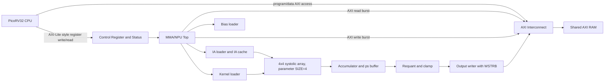
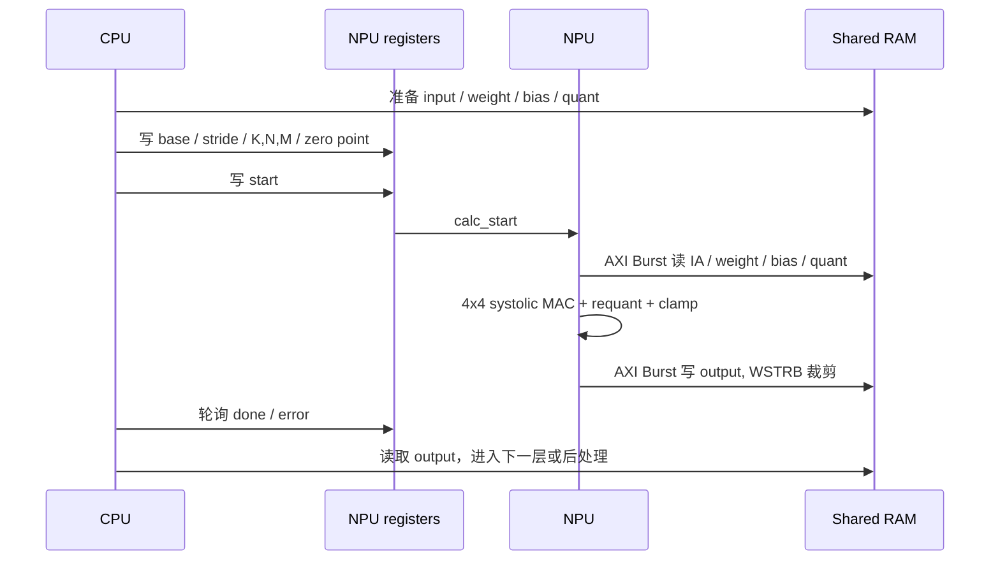

# 面向 TFLM 端侧推理的 NPU 设计文档（CPU + NPU 异构处理器赛题版）

## 0. 交付说明与五轮迭代记录

本文面向“基于 CPU 和 NPU 的异构处理器设计”赛题交付，内容只写设计，不展开验证细节。RTL 仿真、用例、日志、覆盖率和回归结果放在《RTL 仿真报告》中。本文依据当前仓库 `/home/etc/FPGA/tflm_ai_dsa` 与集成仓库 `/media/proj_tmp/aiEngine_integrated` 中可读取的 RTL、驱动、TFLM 程序、性能报告和仿真日志编写。资料不足处统一标记为【待补充】，不写硬件板卡运行、芯片物理实现结果，也不写未实现的低功耗数据。

五轮迭代记录如下。

| 轮次 | 工作内容 | 主要证据 | 结论 |
|---|---|---|---|
| 第 1 轮 | 资料盘点与赛题指标映射 | `top/mma_top.sv`、`sub_modules/*.sv`、`test/mma_top/Makefile`、集成 SoC RTL | 已确认 CPU 使用 PicoRV32，NPU 为 32 位寄存器和 32 位 AXI 数据接口的矩阵计算单元 |
| 第 2 轮 | 模块、AXI、性能信息卡 | `axi_dual_block_dma.sv`、`axi_block_dma_arbiter.sv`、`ia_loader*.sv`、`oa_writer.sv` | 已确认基础 4×4 配置可由 `SIZE=4` 生成，扩展配置支持 8/16/32 |
| 第 3 轮 | 设计文档主体 | 本文第 1 至第 15 章 | 已按赛题目录组织设计内容 |
| 第 4 轮 | 指标覆盖检查 | `docs/size_cache_hw_sw_perf_report_cn.md`、MNIST MLP 日志、固定容量 sweep CSV | 低功耗、DFS、覆盖率结果不足，按未实现或待补充处理 |
| 第 5 轮 | 最终稿检查 | 禁用词扫描、图片与日志来源检查 | 本文只讲设计，仿真细节由验证报告承接 |

## 1. 赛题理解与总体方案

赛题要求在指定 CPU 中集成 32 位 NPU 计算单元，基础设计采用 4×4 脉动阵列，通过 AXI-Lite 单拍访问完成控制，通过 AXI Burst 地址递增访问完成大块数据搬运。CPU 负责模型调度、寄存器配置、异常处理和软件 fallback；NPU 负责 INT8 矩阵乘、卷积展开后的 GEMM、bias 加法、重量化、输出裁剪和写回。该划分符合边缘 AI 处理器的基本分工：通用 CPU 擅长控制和分支，NPU 擅长规则矩阵运算。

本设计当前有两层形态。第一层是 `tflm_ai_dsa` 仓库中的独立 MMA/NPU RTL，顶层为 `top/mma_top.sv`，可通过参数 `SIZE` 生成基础 4×4 阵列，也可生成更大阵列用于性能研究。第二层是 `aiEngine_integrated` 仓库中的 SoC 集成形态，CPU 使用 PicoRV32，CPU 原生存储接口经 `pico_native_to_axi.sv` 转换到 AXI，UART 与控制寄存器通过 AXI-Lite 风格接口接入，NPU 使用 AXI master 读写共享 RAM。本文将基础赛题交付重点放在 `SIZE=4` 的 4×4 配置，同时说明扩展配置的性能结果。

NPU 的“32 位”含义包括：控制寄存器为 32 位，AXI 数据总线为 32 位，地址为 32 位，累加器为 32 位，INT8 输入和权重按 4 个字节打包到一个 AXI beat，输出通过 `WSTRB` 按有效字节写回。矩阵输入支持 s8 和 s16 IA，权重侧支持 s8，也保留 IS 模式下 16 位侧数据扩展。输出经 32 位累加、bias 加法、per-tensor 或 per-channel 重量化、activation clamp 后写回 s8。

总体数据流如下。



## 2. 赛题指标映射与完成情况总览

| 赛题要求 | 本设计实现方式 | 对应章节 | 完成状态 | 证据 |
|---|---|---|---|---|
| 指定 CPU 中集成 32 位 NPU | PicoRV32 + NPU，通过 AXI/AXI-Lite 风格访问 | 第 3 章 | 完成 | `soc_top.sv`、`mma_top.sv` |
| 4×4 脉动阵列 | `SIZE=4` 配置生成 4 行 × 4 列 PE | 第 6 章 | 完成 | `test/mma_top/Makefile` 默认 `SIZE=4`，`ws_systolic_array.sv` |
| AXI-Lite 单拍传输 | CPU 访问控制寄存器、UART、状态寄存器 | 第 4 章 | 部分完成 | `soc_axil_ctrl.sv`、`soc_axil_simpleuart.sv`；NPU 控制寄存器完整映射需【待补充】 |
| AXI Burst 传输 | NPU AXI master 通过 `axi_dual_block_dma` 发起 INCR burst | 第 4 章 | 完成 | `axi_dual_block_dma.sv` |
| AXI Burst 地址递增 | `ARADDR/AWADDR` 按 beat 字节数递增，`ARLEN/AWLEN` 为 burst 长度减 1 | 第 4 章 | 完成 | `axi_dual_block_dma.sv`、`soc_axi_ram.sv` |
| CPU/NPU 协同 | CPU 配置模型参数，NPU 读写共享 RAM，CPU 读取完成状态 | 第 11 章 | 完成 | MNIST MLP SoC 日志 PASS |
| VCS + Verilator 联合仿真 | 独立 MMA 回归主要使用 Verilator，SoC 集成回归主要使用 VCS；报告按实际脚本和日志编写 | 验证报告 | 部分完成 | `test/mma_top/Makefile`、`veri/sim` 日志、工具版本 |
| 代码覆盖率 ≥95% | 尚未发现可引用的覆盖率汇总 | 验证报告 | 待补充 | 【待补充：覆盖率报告】 |
| 200MHz RTL 仿真频率 | 性能报告按 200MHz 换算；`tb_mma_top` 当前时钟周期为 10ns，SoC/VCS 报告按 200MHz 等效 | 第 13 章 | 部分完成 | `docs/size_cache_hw_sw_perf_report_cn.md`；5ns 仿真配置需【待补充】 |
| NPU INT8 算力指标 | 4×4 峰值 16 MAC/cycle，200MHz 为 3.2 GMAC/s = 6.4 GOPS | 第 13 章 | 完成 | 公式与 `SIZE=4` 配置 |
| Burst 带宽利用率 | 以 AXI beat/active 统计；S16/C16 512³ 读 beat/active 为 44.85%，未达到 60% | 第 13 章 | 未达成 | 固定容量 sweep |
| 时钟门控低功耗 | 当前项目未实现低功耗设计 | 第 8 章 | 未实现 | 未发现 array clock gating RTL |
| 动态可调阵列 | 通过参数重新生成不同 SIZE，不支持运行时动态改形态 | 第 6 章 | 未实现加分项 | `SIZE` 为 elaboration 参数 |
| AXI 共享总线拓扑 | SoC 侧 CPU/NPU/RAM 使用 AXI 互连，NPU 内部有读仲裁 | 第 4 章 | 部分完成 | `soc_top.sv`、`axi_block_dma_arbiter.sv` |
| DMA 控制器 | 实现 AXI native block DMA，读写分引擎 | 第 7 章 | 完成 | `axi_dual_block_dma.sv` |
| DFS 动态频率调整 | 未实现 | 第 8 章 | 未实现 | 无 DFS 控制 RTL |

## 3. CPU + NPU 异构处理器总体架构

CPU 采用 PicoRV32。PicoRV32 原生接口不是完整 AXI，因此 SoC 中使用 `pico_native_to_axi.sv` 将 CPU 的 `mem_valid/mem_ready/mem_addr/mem_wdata/mem_wstrb` 转换为 AXI 读写通道。该桥接模块对 CPU 写请求生成 AW/W/B 单 beat 访问，对 CPU 读请求生成 AR/R 访问，并可对取指读使用 4 word line fill。CPU 侧主要承担程序执行、TFLM 调度、NMSIS NN 调用、NPU 任务参数准备、状态轮询和结果检查。

NPU 包含两个接口类别。第一类是软件可见控制接口，SoC 中通过 AXI-Lite 风格寄存器或 MMIO 封装完成参数写入，包括输入地址、权重地址、输出地址、矩阵维度、stride、zero point、量化 multiplier/shift、activation clamp、dataflow mode、reuse 参数和 start。第二类是数据访问接口，NPU 作为 AXI master 读共享 RAM 中的 LHS/RHS/bias/quant，作为 AXI master 写输出。读通道由 IA、kernel、bias、quant 多客户端共享；写通道由 OA writer 独占，因此读写可并行推进。

CPU 与 NPU 共享同一片仿真 RAM。当前未发现数据 cache 一致性机制；PicoRV32 仿真环境中主要按共享 RAM 直接访问处理。TFLM 硬件路径在 NMSIS NN ExtraAccFunctions 中调用加速器，CPU 将 tensor 和参数放在共享内存，NPU 按地址直接访问，输出写回同一内存区域。若软件启用 CPU 指令小缓存，该缓存只面向取指，不改变 NPU 数据视图；对数据 cache 一致性仍标记为【待补充：真实 SoC cache 一致性策略】。

CPU 等待 NPU 当前采用轮询方式。SoC 程序通过 `soc_get_cycle()` 包围 `interpreter.Invoke()` 统计周期，通过 UART 打印 `[tflm_perf]` 与 PASS/FAIL。未发现 NPU 中断输出和 CPU 中断服务程序，因此本文不写中断完成机制。

## 4. AXI 总线系统设计

### 4.1 AXI 接口划分

SoC 中包含 CPU AXI master、NPU AXI master、AXI RAM slave、UART/控制寄存器 AXI-Lite 风格 slave。CPU 原生接口到 AXI 的转换由 `pico_native_to_axi.sv` 完成。NPU 数据访问接口位于 `mma_top.sv`，包含标准 AXI4 master 的 AR/R/AW/W/B 通道信号：`m_axi_arvalid`、`m_axi_arready`、`m_axi_araddr`、`m_axi_arlen`、`m_axi_arsize`、`m_axi_arburst`、`m_axi_rvalid`、`m_axi_rready`、`m_axi_rlast`、`m_axi_awvalid`、`m_axi_awaddr`、`m_axi_awlen`、`m_axi_wdata`、`m_axi_wstrb`、`m_axi_wlast`、`m_axi_bvalid` 等。

AXI-Lite 单拍传输用于 CPU 写控制寄存器和读状态。`soc_axil_simpleuart.sv` 是一个清晰的 AXI-Lite slave 示例，它分别处理 AW、W、B、AR、R 五个通道，使用 `s_axil_wstrb` 更新寄存器字节，写完成后返回 `BRESP=OKAY`，读完成后返回 `RRESP=OKAY`。NPU 控制寄存器在集成环境中由软件 MMIO 封装使用，完整寄存器地址表见第 10 章，若需逐地址 AXI-Lite 解码源码，标【待补充：NPU 控制寄存器 AXI-Lite 地址译码文件】。

AXI Burst 数据接口用于 NPU 大块访问。`axi_dual_block_dma.sv` 将读和写分成独立引擎。读引擎服务 IA、kernel、bias、quant；写引擎服务 OA writer。`m_axi_arsize` 与 `m_axi_awsize` 由 `BUS_WIDTH/8` 推导，32 位总线时为 4 字节 beat；`m_axi_arburst` 与 `m_axi_awburst` 固定为 `2'b01`，即 INCR 模式。

### 4.2 AXI-Lite 单拍传输设计

AXI-Lite 写寄存器流程为：CPU 同时或分开给出 AW 和 W；slave 通过 `aw_seen_q`、`w_seen_q` 记录先到的地址或数据；当地址和数据都齐备且没有未完成 B 响应时，写寄存器并拉高 `BVALID`；CPU 拉高 `BREADY` 后清除响应。写 strobe 按字节生效，例如 UART divider 使用 `uart_div_we = wr_strb[3:0]`，输出 data 寄存器仅在 `|wr_strb` 时写入。读状态流程为：CPU 发 AR，slave 在 `ARREADY` 接收地址后组合选择寄存器数据，随后拉高 `RVALID`，CPU 以 `RREADY` 接收。

AXI-Lite 写寄存器 WaveDrom JSON：

```json
{
  "signal": [
    {"name": "clk", "wave": "p........."},
    {"name": "s_axil_awvalid", "wave": "0.10......"},
    {"name": "s_axil_awready", "wave": "1........."},
    {"name": "s_axil_awaddr", "wave": "x.=x......", "data": ["REG"]},
    {"name": "s_axil_wvalid", "wave": "0.10......"},
    {"name": "s_axil_wready", "wave": "1........."},
    {"name": "s_axil_wstrb", "wave": "x.=x......", "data": ["1111"]},
    {"name": "s_axil_bvalid", "wave": "0..10....."},
    {"name": "s_axil_bready", "wave": "1........."}
  ],
  "head": {"text": "AXI-Lite 写控制寄存器"}
}
```

AXI-Lite 读状态 WaveDrom JSON：

```json
{
  "signal": [
    {"name": "clk", "wave": "p........."},
    {"name": "s_axil_arvalid", "wave": "0.10......"},
    {"name": "s_axil_arready", "wave": "1........."},
    {"name": "s_axil_araddr", "wave": "x.=x......", "data": ["STATUS"]},
    {"name": "s_axil_rvalid", "wave": "0..10....."},
    {"name": "s_axil_rready", "wave": "1........."},
    {"name": "s_axil_rdata", "wave": "x..=x.....", "data": ["DONE/ERR"]}
  ],
  "head": {"text": "AXI-Lite 读状态寄存器"}
}
```

### 4.3 AXI Burst 地址递增传输设计

`axi_dual_block_dma.sv` 以 `rd_start` 锁存 `rd_base_addr`、`rd_row_stride`、`rd_rows_to_read`、`rd_valid_cols`、`rd_burst_len_m1` 等参数。每一行或线性块发出一个 AR 命令，`m_axi_arlen` 等于请求 beat 数减 1。若访问未对齐，读引擎会检测 `rd_unaligned_mode`，必要时多取一个对齐 beat，并在内部用 offset 重排数据，避免外部端口再处理非对齐。写引擎按 `wr_start` 锁存写回基址、stride、行数、burst 长度，OA writer 通过 `src_wdata/src_wmask/src_wvalid/src_wready` 送入每个 beat。

地址递增公式为：

```text
addr_i = start_addr + i * (1 << AxSIZE)
```

32 位总线下 `AxSIZE=2`，每 beat 4 字节。读 `ARLEN=3` 表示 4 beat，地址为 `A, A+4, A+8, A+12`；写 `AWLEN=0` 表示 1 beat，地址只访问 `A`。tail tile 中有效列数小于 `SIZE` 时，loader 将 `valid_cols` 转换为较短的 `burst_len_m1`；输出尾列由 FIFO 产生 `output_mask`，OA writer 把它传给 DMA 的 `src_wmask`，最终成为 `m_axi_wstrb`，避免覆盖无效字节。

AXI Burst 读 WaveDrom JSON：

```json
{
  "signal": [
    {"name": "clk", "wave": "p............"},
    {"name": "m_axi_arvalid", "wave": "0.10........."},
    {"name": "m_axi_arready", "wave": "1............"},
    {"name": "m_axi_araddr", "wave": "x.=x.........", "data": ["BASE"]},
    {"name": "m_axi_arlen", "wave": "x.=x.........", "data": ["LEN-1"]},
    {"name": "m_axi_arburst", "wave": "x.=x.........", "data": ["INCR"]},
    {"name": "m_axi_rvalid", "wave": "0..11110...."},
    {"name": "m_axi_rready", "wave": "1............"},
    {"name": "m_axi_rlast", "wave": "0.....10...."}
  ],
  "head": {"text": "AXI Burst 读地址递增"}
}
```

AXI Burst 写 WaveDrom JSON：

```json
{
  "signal": [
    {"name": "clk", "wave": "p............"},
    {"name": "m_axi_awvalid", "wave": "0.10........."},
    {"name": "m_axi_awready", "wave": "1............"},
    {"name": "m_axi_awaddr", "wave": "x.=x.........", "data": ["DST"]},
    {"name": "m_axi_awlen", "wave": "x.=x.........", "data": ["LEN-1"]},
    {"name": "m_axi_wvalid", "wave": "0..11110...."},
    {"name": "m_axi_wstrb", "wave": "x..====x....", "data": ["F", "F", "F", "MASK"]},
    {"name": "m_axi_wlast", "wave": "0.....10...."},
    {"name": "m_axi_bvalid", "wave": "0......10..."}
  ],
  "head": {"text": "AXI Burst 写回与 WSTRB"}
}
```

### 4.4 AXI 共享互连与仲裁

SoC 层面 CPU 和 NPU 共享 AXI RAM，`soc_top.sv` 中连接 PicoRV32、UART、NPU、RAM 与 AXI 缓冲模块。NPU 内部读请求由 `axi_block_dma_arbiter.sv` 仲裁，优先级为 kernel、quant、IA、bias。该优先级服务于计算不断粮：kernel 和 quant 对当前 tile 计算关键，IA 随 IA cache 预取，bias 可被 `bias_sleep` 跳过。OA writer 使用独立写引擎，不与读客户端争读仲裁。

NPU 长 burst 可能增加 CPU 读等待，SoC 日志提供 `SOC_AXI_STATS` 统计。例如 MNIST MLP 硬件路径中 `cpu_ar_wait=726153`、`mma_ar_wait=705726`、`rd_yield=792114`，说明 CPU 与 NPU 都会受到读侧争用影响。当前设计没有证明达到 ≥80% Burst 带宽优化目标，因此该指标在完成情况表中不写达成。

## 5. NPU 硬件总体架构

NPU 顶层 `mma_top.sv` 包含 controller、IA loader、kernel loader、bias loader、vec requant、ps buffer/fifo、OA writer、AXI DMA arbiter 和 AXI DMA。工作阶段可抽象为：IDLE 等待 `calc_start`；INIT 锁存配置并检查参数；LOAD_WEIGHT/LOAD_INPUT/LOAD_BIAS 发起 AXI 读；COMPUTE 由 controller 触发 IA 和 weight 进入脉动阵列；REQUANT 对 32 位累加结果进行乘 shift、zero point、clamp；WRITE_BACK 由 OA writer 组织 AXI 写；DONE 拉高 `sa_ready` 并通过 `wb_valid` 返回状态；ERROR 输出 `err_code`。

控制器实际状态为 `IDLE`、`INIT`、`WEIGHT_START`、`IA_START`、`WEIGHT_WAIT`、`IA_WAIT`、`WAIT_WB`、`ERROR`。它检查指针、维度、stride、量化配置；指针缺失返回 `2'b10`，配置错误返回 `2'b01`。`issue_weight_now` 与 `issue_ia_now` 综合考虑 weight/IA 数据有效、bias 是否可用、quant 参数是否有效、FIFO 是否满、tail pending 是否完成，从而避免数据不齐时触发计算。

## 6. 4×4 脉动阵列与矩阵计算单元设计

基础赛题配置采用 `SIZE=4`。`ws_systolic_array.sv` 以双层 generate 生成 `SIZE × SIZE` 个 `ws_systolic_cell`。每个 PE 具有 `data_reg`、`weight_reg`、`sum_reg`，在 `store_weight_req` 时加载权重并清空累加；计算阶段数据从左向右传递，权重从上向下传递或保持，partial sum 从上向下累加。单个 PE 每周期执行一次有符号乘法和一次加法，累加结果饱和到 32 位。

4×4 峰值计算如下：

```text
peak_mac_per_cycle = 4 × 4 × 1 = 16 MAC/cycle
peak_macs_per_s = 16 × 200 MHz = 3.2 GMAC/s
peak_ops_per_s = 3.2 GMAC/s × 2 = 6.4 GOPS
peak_tops = 6.4e9 / 1e12 = 0.0064 TOPS
```

本文按 1 MAC = 2 ops 计算 INT8 算力。当前 RTL 未发现 SIMD、多 MAC/PE、多阵列并行、bit-serial 折算或运行时动态改阵列的机制，因此基础 4×4 配置 200MHz 下无法达到 0.5TOPS。扩展配置 `SIZE=16` 的理论峰值为 102.4 GOPS，`SIZE=32` 的理论峰值为 409.6 GOPS，但它们是参数重新生成后的扩展形态，不是基础 4×4 的直接算力。

tail row 和 tail col 由 loader、requant 和 OA writer 共同处理。IA loader 根据 `k/n` 计算最后 tile 的有效行列和 burst；vec requant 根据当前 tile 的 `lane_need_cur` 屏蔽无效输出；OA writer 计算 `rows_valid_cur_tile`、`cols_valid_cur_tile` 和 `beats_per_row_cur_tile`，FIFO 产生 `output_mask`，写回时通过 `WSTRB` 剪除无效字节。当前未实现无效 PE 时钟门控，无效 lane 主要通过数据屏蔽和写掩码保证功能正确。

动态可调脉动阵列未实现。`SIZE` 是 SystemVerilog 参数，只能在综合/仿真 elaboration 前确定，不能由 CPU 在运行时切换 4×4、2×8、1×16 等形态。因此该加分项标记为未实现。

## 7. NPU 硬件子模块详细设计

### 7.1 AXI-Lite Register File / SoC MMIO

模块阅读记录：AXI-Lite 控制接口

| 项目 | 内容 |
|---|---|
| 已读取文件 | `soc_axil_ctrl.sv`、`soc_axil_simpleuart.sv`、`tflm_mnist_mlp_soc_main.cc`、`dsa_accel_mmio.c` |
| 端口数量 | AXI-Lite 五通道、UART 或控制寄存器输出 |
| 参数 | `AXIL_ADDR_WIDTH=32`、`AXIL_DATA_WIDTH=32` |
| 状态机 | AW/W 捕获、B 响应、AR/R 响应 |
| 关键输入信号 | `s_axil_awvalid`、`s_axil_wvalid`、`s_axil_wstrb`、`s_axil_arvalid` |
| 关键输出信号 | `s_axil_awready`、`s_axil_wready`、`s_axil_bvalid`、`s_axil_rvalid` |
| 关键内部寄存器 | `awaddr_q`、`wdata_q`、`wstrb_q` |
| 是否访问 AXI | 作为 AXI-Lite slave |
| 是否参与 AXI Burst | 否 |
| 是否影响带宽利用率 | 控制访问会占用 CPU AXI 访问时间 |
| 是否影响门控时钟 | 否，当前无低功耗实现 |
| 已识别性能优化点 | 单拍控制访问与大块数据访问分离 |
| 仍不确定信息 | NPU 控制寄存器完整地址译码源码需【待补充】 |

4.x.1 模块定位与赛题相关性：该接口承担 CPU 配置 NPU 的单拍控制访问，是赛题 AXI-Lite 单拍传输要求的核心。  
4.x.2 上下游连接关系：上游为 PicoRV32 AXI master，下游为 NPU 控制寄存器、UART 或状态寄存器。  
4.x.3 内部结构与关键寄存器：保存 AW/W 先到信息，并在地址和数据都有效后更新目标寄存器。  
4.x.4 端口、参数与接口定义：32 位地址、32 位数据、4 位 `WSTRB`。  
4.x.5 数据通路说明：写数据经 strobe 更新寄存器，读数据由地址选择后返回。  
4.x.6 控制通路与状态机说明：无复杂 FSM，以 ready/valid 和 pending 标志控制。  
4.x.7 地址生成 / buffer / FIFO / 仲裁机制：控制接口不产生 burst 地址，不需要 FIFO。  
4.x.8 接口时序与 WaveDrom JSON：见第 4.2 节。  
4.x.9 边界条件、异常条件与错误处理：非法地址当前多返回 0 或 OKAY，错误响应细化需【待补充】。  
4.x.10 对算力、带宽、功耗的影响：控制访问不贡献算力，频繁轮询会占用 CPU AXI 读周期。  
4.x.11 可扩展性与当前限制：可增加中断、错误码和性能计数器寄存器。  
4.x.12 图表与 AI 绘图 Prompt：绘制 CPU 通过 AXI-Lite 写 start、读 done 的五通道时序图。

### 7.2 AXI Read/Write Engine 与 Burst Address Generator

模块阅读记录：`axi_dual_block_dma`

| 项目 | 内容 |
|---|---|
| 已读取文件 | `sub_modules/axi_dual_block_dma.sv` |
| 端口数量 | 读命令、写命令、写数据流、AXI 五通道、读 unpack 输出 |
| 参数 | `DATA_WIDTH`、`SIZE`、`BUS_WIDTH`、`READ_OUTSTANDING`、`WRITE_OUTSTANDING` |
| 状态机 | 读 active/outstanding 计数，写 active/响应计数 |
| 关键输入信号 | `rd_start`、`wr_start`、`rd_base_addr`、`wr_base_addr`、`src_wmask` |
| 关键输出信号 | `m_axi_ar*`、`m_axi_aw*`、`m_axi_wstrb`、`rd_raw_valid` |
| 关键内部寄存器 | `rd_cfg_*`、`rd_cmd_row_addr`、`rd_outstanding_cnt`、写地址队列 |
| 关键计数器 | row count、beat count、outstanding count |
| 是否访问 AXI | 是，AXI master |
| 是否参与 AXI Burst | 是，读写 INCR burst |
| 是否影响带宽利用率 | 是，直接决定 AXI beat 和 active 周期 |
| 是否影响门控时钟 | 否 |
| 已识别性能优化点 | 读写双引擎、outstanding、非对齐处理、WSTRB |
| 仍不确定信息 | 覆盖率和最大 outstanding 验证需【待补充】 |

4.x.1 模块定位与赛题相关性：该模块实现 NPU 数据面 AXI Burst，直接回应地址递增与带宽利用率要求。  
4.x.2 上下游连接关系：上游为 loader/OA writer 请求，下游为 AXI RAM。  
4.x.3 内部结构与关键寄存器：读引擎锁存 row stride、rows、burst 长度；写引擎锁存目标地址和行数。  
4.x.4 端口、参数与接口定义：AXI 数据宽度 32 位，`ARLEN/AWLEN` 8 位，支持 outstanding 参数。  
4.x.5 数据通路说明：读 beat 被拆成 s8/s16 元素或 raw quant word；写 beat 来自 OA writer。  
4.x.6 控制通路与状态机说明：读侧以 `rd_active` 管理命令和响应，写侧以 AW/W/B 完成写回。  
4.x.7 地址生成 / buffer / FIFO / 仲裁机制：地址按 row stride 与 beat index 递增；非对齐读多取 beat 并内部重排。  
4.x.8 接口时序与 WaveDrom JSON：见第 4.3 节。  
4.x.9 边界条件、异常条件与错误处理：AXI `RRESP/BRESP` 高位错误置位 `rd_error/wr_error`。  
4.x.10 对算力、带宽、功耗的影响：供数不足会降低阵列利用率；burst 可减少地址握手占比。  
4.x.11 可扩展性与当前限制：可继续提高 outstanding 或扩大 AXI 数据宽度。  
4.x.12 图表与 AI 绘图 Prompt：绘制读写双引擎 DMA，左侧四个读客户端，右侧 OA 写回，底部 AXI RAM。

### 7.3 NPU Controller

模块阅读记录：`mma_controller`

| 项目 | 内容 |
|---|---|
| 已读取文件 | `sub_modules/mma_controller.sv` |
| 端口数量 | 配置输入、loader 触发、状态输出、写回握手 |
| 参数 | `WEIGHT_WIDTH`、`DATA_WIDTH`、`SIZE`、`BUS_WIDTH`、`REG_WIDTH` |
| 状态机 | `IDLE/INIT/WEIGHT_START/IA_START/WEIGHT_WAIT/IA_WAIT/WAIT_WB/ERROR` |
| 关键输入信号 | `calc_start`、`weight_data_valid`、`ia_data_valid`、`bias_valid`、`quant_params_valid`、`fifo_full_flag` |
| 关键输出信号 | `init_cfg_*`、`send_weight_trigger`、`send_ia_trigger`、`wb_valid`、`err_code` |
| 关键内部寄存器 | `cfg_16bits_ia_reg`、`config_error`、`compute_tail_pending` |
| 关键计数器 | 仿真下 `util_*` 性能计数器 |
| 是否访问 AXI | 间接控制访问 |
| 是否参与 AXI Burst | 间接控制 |
| 是否影响带宽利用率 | 是，触发时序影响 loader 间隔 |
| 是否影响门控时钟 | 未实现 |
| 已识别性能优化点 | 避免 FIFO full、bias/quant 未就绪时误触发 |
| 仍不确定信息 | 中断接口未实现 |

4.x.1 到 4.x.12：控制器是 NPU 调度中心，负责参数合法性、计算启动、tail pending、写回完成和错误输出。它不直接搬运数据，但决定 IA、weight、bias、quant 和 OA 的工作顺序。其边界条件包括空维度、空指针、stride 为 0、per-channel 参数无效、FIFO 满和写回未完成。当前错误码只有 2 位，足够区分配置错误和资源缺失，但不够细分 AXI 响应错误。建议后续增加详细 error register 和中断输出。

### 7.4 Input Loader / IA Cache

模块阅读记录：`ia_loader`

| 项目 | 内容 |
|---|---|
| 已读取文件 | `ia_loader.sv`、`ia_loader_ctrl.sv`、`ia_loader_cache_mgr.sv` |
| 端口数量 | 配置、DMA 客户端、阵列输出、bias 协调信号 |
| 参数 | `SIZE`、`CACHE_BLOCKS`、`PS_FRAME_COUNT`、`EXTERNAL_DMA` |
| 状态机 | 顶层 `IDLE/INIT/RUN`，ctrl `S_IDLE/S_INIT/S_LOAD/S_SEND/S_DONE` |
| 关键输入信号 | `init_cfg`、`send_ia_trigger`、`ext_dma_done` |
| 关键输出信号 | `load_ia_req`、`ext_dma_start`、`ia_out`、`ia_l1_switch`、`bias_sleep` |
| 关键内部寄存器 | cache block valid/busy、slot rows、reuse counters |
| 关键计数器 | L2/L1/W/IA index、load cursor、reuse count |
| 是否访问 AXI | 通过 DMA 读 |
| 是否参与 AXI Burst | 是 |
| 是否影响带宽利用率 | 是，IA cache 决定重复读数量 |
| 是否影响门控时钟 | 未实现 |
| 已识别性能优化点 | tile buffer、load-send overlap、early release、prefetch |
| 仍不确定信息 | 运行时非 2 的幂 reuse 处理范围需补充验证 |

4.x.1 到 4.x.12：IA loader 是访存瓶颈缓解的核心模块。它把输入矩阵按 `SIZE × SIZE` tile 读取到 IA cache，多 slot 保存多个 row tile，并在计算时按 reuse 参数连续输出。`ia_loader_ctrl` 使用 cache block 状态表避免覆盖正在发送的数据；在最后一次复用期间可预取下一组 tile；tile 完成最后一次使用后释放 slot。输出端内置对角化延迟，使输入数据按脉动阵列需要的时序进入 PE。该模块通过减少重复 IA 读提高有效带宽，但 cache block 太少时无法覆盖深复用，`S32/C4` 性能下降即体现了该限制。

### 7.5 Weight Loader

模块阅读记录：`kernel_loader`

| 项目 | 内容 |
|---|---|
| 已读取文件 | `kernel_loader.sv`、`kernel_loader_ctrl.sv`、`kernel_loader_buffer.sv` |
| 端口数量 | 配置、DMA 客户端、weight 输出 |
| 参数 | `DATA_WIDTH`、`SIZE`、`BUS_WIDTH`、`EXTERNAL_DMA` |
| 状态机 | `TOP_IDLE/TOP_INIT/TOP_RUN` 与 ctrl 内部 tile 遍历 |
| 关键输入信号 | `send_weight_trigger`、`ext_dma_wr_valid` |
| 关键输出信号 | `load_weight_req`、`store_weight_req`、`weight_out`、`weight_data_valid` |
| 是否访问 AXI | 通过 DMA 读 |
| 是否参与 AXI Burst | 是 |
| 已识别性能优化点 | RHS 列展平，DMA 连续读取 |
| 仍不确定信息 | 权重复用 loop order 仍有提升空间 |

4.x.1 到 4.x.12：weight loader 读取右矩阵列展平后的连续数据。WS 模式下权重加载进入 PE 后驻留，IA 流过阵列；IS 模式下硬件交换角色并配合输出转置。列展平布局让每个输出列对应连续 reduction axis 元素，保持 DMA 读地址递增。tail 列通过 `dma_valid_cols` 缩短 burst。该模块对带宽影响很大，MNIST MLP 中 `dma_busy_kernel` 占 active 主要部分，说明权重供给是当前重要瓶颈。

### 7.6 Bias Loader

模块阅读记录：`bias_loader`

| 项目 | 内容 |
|---|---|
| 已读取文件 | `bias_loader.sv`、`bias_loader_ctrl.sv`、`bias_loader_buffer.sv` |
| 端口数量 | 配置、DMA 客户端、当前/下一组 bias 输出 |
| 参数 | `SIZE`、`DATA_WIDTH=32`、`GROUP_BLOCKS_MAX` |
| 状态机 | ctrl 管理 active bank、switch pending |
| 关键输出信号 | `bias_valid`、`next_bias_valid`、`bias_group_valid` |
| 是否访问 AXI | 通过 DMA 读 |
| 是否参与 AXI Burst | 是 |
| 已识别性能优化点 | 双 bank 和 group 读取 |
| 仍不确定信息 | bias 为 0 的所有路径覆盖率需【待补充】 |

4.x.1 到 4.x.12：bias loader 负责读取 s32 bias。每个 bias block 使用 burst 连续读，避免逐 word 访问开销。`bias_sleep` 表示当前 IA 组可从 ps buffer 回灌，不需要等待新 bias。双 bank 支持当前 bias 与下一组 bias 切换，减少计算等待。无 bias 时 `bias_base=0` 由 controller 允许，bias loader 不应阻塞计算。

### 7.7 Accumulator / ps buffer / FIFO

模块阅读记录：`accumulator_array` 与 `ps_buffer_fifo`

| 项目 | 内容 |
|---|---|
| 已读取文件 | `accumulator_array.sv`、`ps_buffer.sv`、`ps_buffer_fifo.sv`、`de_diagonalizer.sv` |
| 关键功能 | 保存 partial sum、支持 replay、对齐输出时序 |
| 是否访问 AXI | 否 |
| 是否参与 AXI Burst | 否 |
| 已识别性能优化点 | ps frame 保留多个输出列 tile，减少中间结果访存 |
| 仍不确定信息 | 极端 FIFO full 覆盖率需【待补充】 |

4.x.1 到 4.x.12：该组模块位于阵列之后和 requant 之前，处理 partial sum 保存、回放和输出重排。`ps_buffer_fifo` 使用同步 RAM 保存 frame 长度和数据，`FRAME_COUNT` 允许保留多个输出列 tile。它减少了 partial sum 外写再读的需求，是 NPU 内部数据复用的一部分。边界条件包括 frame_count 满、replay_count 未结束又收到触发、tail tile 有效行列变化。当前设计用 FIFO full 信号反压 controller。

### 7.8 Requant / Activation Unit

模块阅读记录：`vec_requant`

| 项目 | 内容 |
|---|---|
| 已读取文件 | `sub_modules/vec_requant.sv` |
| 参数 | `VLEN=SIZE`、`REG_WIDTH`、`MAX_IA_REUSE` |
| 状态机 | `IDLE/LOAD/COMPUTE` |
| 关键输入信号 | `acc_data_out`、`bias_data`、`use_per_channel`、quant DMA raw data |
| 关键输出信号 | `out_valid`、`out_tile_done`、s8 输出向量 |
| 是否访问 AXI | per-channel 参数通过 DMA 读 |
| 是否参与 AXI Burst | 是 |
| 已识别性能优化点 | per-channel 参数缓存、tail lane 屏蔽 |
| 仍不确定信息 | 所有 activation 极值组合覆盖率需【待补充】 |

4.x.1 到 4.x.12：vec requant 将 32 位累加加 bias 后按 multiplier/shift 转成 s8，并加 `dst_zp`、执行 `act_min/act_max` 裁剪。per-channel 模式会分别读取 multiplier 与 shift 两组参数，`burst_len_m1` 支持 8 位，覆盖 `SIZE=64` 的参数读。tail tile 中无效 lane 不输出有效数据。该模块是数值正确性的关键，历史修复包括新 LOAD 前重置 phase，避免最后单行 tile 漏读 multiplier。

### 7.9 Output Writer

模块阅读记录：`oa_writer`

| 项目 | 内容 |
|---|---|
| 已读取文件 | `sub_modules/oa_writer.sv` |
| 状态机 | `S_IDLE/S_REQ/S_START/S_WRITE/S_DONE` |
| 关键输入信号 | FIFO 输出数据、mask、`dma_src_wready` |
| 关键输出信号 | `dma_start`、`dma_base_addr`、`dma_src_wmask`、`write_done` |
| 是否访问 AXI | 通过 DMA 写 |
| 是否参与 AXI Burst | 是 |
| 已识别性能优化点 | 按 tile 组织写回，支持 IS 转置地址 |
| 仍不确定信息 | 最大写 outstanding 覆盖率需【待补充】 |

4.x.1 到 4.x.12：OA writer 负责把 requant 输出写回共享内存。WS 模式按输出矩阵行列写回；IS 模式交换 row/col 地址步进，完成硬件转置写回。tail column 通过 `output_mask` 转成 `dma_src_wmask`，最终驱动 `WSTRB`，避免写坏同一 word 中其他字节。该模块直接影响写 beat 数和输出正确性。

### 7.10 Performance Counter Unit

模块阅读记录：仿真性能计数器

| 项目 | 内容 |
|---|---|
| 已读取文件 | `mma_controller.sv`、`mma_top.sv`、`pico_native_to_axi.sv`、性能报告日志 |
| 类型 | `ifndef SYNTHESIS` 仿真计数器与 `$display` |
| 关键输出 | `[MMA_UTIL]`、`[MMA_CTRL_UTIL]`、`[SOC_AXI_STATS]` |
| 是否访问 AXI | 否 |
| 是否参与 AXI Burst | 统计 burst 结果 |
| 已识别性能优化点 | 支持 active、DMA busy、AXI beat、stall 统计 |
| 仍不确定信息 | 软件可读硬件性能寄存器地址需【待补充】 |

4.x.1 到 4.x.12：当前性能计数器主要用于仿真统计，能输出 MMA active 周期、IA 行有效、ACC 有效、DMA busy、AXI AR/R/AW/W/B beat、CPU wait、MMA wait 等数据。设计文档的性能分析基于这些日志和 CSV。若赛题要求 CPU 读取硬件性能寄存器，需要补充寄存器映射与 RTL 保留计数器。

## 8. 低功耗设计

本项目当前未实现低功耗设计。未发现脉动阵列 idle 时的 clock gating cell、array clock enable、DFS 控制寄存器、电源域控制或功耗计数器。因此本文不写 NPU 未使用时关闭阵列时钟的实现，不写功耗数据，不写低功耗验证结论。

赛题低功耗基础项在当前版本中的状态如下。

| 项目 | 状态 | 说明 |
|---|---|---|
| NPU idle 时关闭阵列时钟 | 未实现 | 未发现 `array_clk_en` 或 gated clock |
| tail tile 无效 PE 门控 | 未实现 | 功能上使用数据屏蔽和 `WSTRB`，不是时钟门控 |
| DFS 动态频率调整 | 未实现 | 无频率档位和切频控制 |
| 功耗统计 | 未覆盖 | 无功耗仿真和功耗模型 |

后续若补低功耗，应优先增加 `array_active`、`loader_active`、`writer_active`、`requant_active` 等 clock enable，并验证 idle 保持、start 恢复和功能一致性。

## 9. 性能优化特色与访存瓶颈缓解设计

访存瓶颈来自输入矩阵、权重矩阵、bias、量化参数和输出写回。4×4 阵列理论峰值较低，单个 tile 小，若每行都用单 beat 访问，会被地址握手和响应延迟吞掉大量周期；扩展到 16×16/32×32 后，阵列每拍可消费的数据更多，更容易暴露 AXI 读通道与 cache 容量不足。tail tile 会使有效计算减少，若输出不裁剪还会产生无效写。

AXI Burst 缓解了单拍传输的握手开销。IA、kernel、bias、quant 根据有效列数生成 `burst_len_m1`，使用 `ARBURST=INCR` 连续读取；OA writer 根据有效输出列生成写 burst，并用 `WSTRB` 裁剪 tail。`axi_dual_block_dma` 读写分离，使写回不阻塞读客户端的状态机。`READ_OUTSTANDING=4` 允许多个读 burst 提前排队，减少响应延迟导致的空等。

Tile buffer 与数据复用是第二个核心机制。IA loader 的 IA cache 保存多个 input tile，通过 `IA_CACHE_BLOCKS`、`ia_reuse_num` 和 `w_reuse_num` 控制复用深度；ps buffer 保存 partial sum frame，避免中间结果外部写回；bias loader 保存当前和下一组 bias；kernel loader 按列展平权重，保证 DMA 连续读取。固定容量 sweep 显示，`S4/C256` active 利用率最高但峰值低，`S16/C16` 绝对算力最好，`S32/C4` 因 cache block 太少而阵列饥饿。

DMA 控制器已实现为 `axi_dual_block_dma` 和 `axi_block_dma_arbiter`。CPU 不逐字搬运张量，只写配置并启动 NPU；NPU 内部 loader 生成 DMA 请求。读客户端优先级为 kernel、quant、IA、bias，写客户端 OA 独占写引擎。该设计降低 CPU 参与度，但也带来读侧争用，后续可考虑更细的优先级或读通道宽度提升。

输出裁剪和 WSTRB 是写回优化。NPU 输出 s8，每个 32 位 beat 可写 4 个结果。tail column 不满 4 字节时，FIFO 产生 mask，OA writer 传给 DMA，最终成为 `m_axi_wstrb`。这样既保护同一 word 内旧数据，也让 write_bytes 统计更接近有效输出量。

| 优化点 | 对应赛题指标 | 对应模块 | 关键机制 | 影响指标 | 是否实现 |
|---|---|---|---|---|---|
| AXI Burst | Burst 带宽利用率 | `axi_dual_block_dma` | INCR burst、8 位 len | AXI beat/active | 是 |
| IA cache | 数据复用 | `ia_loader` | 多 slot tile buffer | 重复读次数 | 是 |
| 权重列展平 | 连续读取 | `kernel_loader` | RHS 每列连续存储 | AR 次数与 burst 长度 | 是 |
| ps buffer | partial sum 复用 | `ps_buffer_fifo` | RAM frame replay | 外部访存次数 | 是 |
| 输出裁剪 | 正确写回 | `oa_writer` | `WSTRB` mask | write_bytes | 是 |
| DMA | CPU 占用降低 | `axi_dual_block_dma` | NPU 自主读写 | CPU wait / DMA busy | 是 |
| 动态可调阵列 | 加分项 | 无 | 运行时改形态 | 阵列利用率 | 未实现 |
| 时钟门控 | 低功耗 | 无 | idle 关钟 | power | 未实现 |
| DFS | 低功耗加分 | 无 | 动态调频 | energy | 未实现 |

## 10. 寄存器、指令与软件可见接口

当前软件可见参数来自 TFLM/NMSIS NN 的加速器调用封装和 `tb_mma_top` 的配置字段。寄存器地址完整表需结合 SoC MMIO 文件补齐，当前报告先按功能列出。

| 类别 | 字段 | 位宽 | 用途 | 状态 |
|---|---|---:|---|---|
| 控制 | `start` | 1 | 启动 NPU | 完成 |
| 状态 | `done/busy/error` | 1/1/2 | CPU 轮询 | 完成 |
| 地址 | `lhs_base/rhs_base/dst_base/bias_base` | 32 | 张量基地址 | 完成 |
| 维度 | `k/n/m` | 32 | 矩阵形状 | 完成 |
| stride | `lhs_row_stride_b/rhs_col_stride_b/dst_row_stride_b` | 32 | 行或列步长 | 完成 |
| 量化 | `lhs_zp/rhs_zp/dst_zp/q_mult/q_shift` | 32 | INT8 重量化 | 完成 |
| 模式 | `cfg_16bits_ia/cfg_dataflow_mode` | 1 | s16 IA、WS/IS | 完成 |
| 复用 | `cfg_ia_reuse_num/cfg_w_reuse_num` | 32 | tile 复用参数 | 完成 |
| 裁剪 | `act_min/act_max` | 32 | activation clamp | 完成 |
| 性能 | active、AXI beat、stall | 64 仿真计数 | 性能分析 | 仿真完成，软件寄存器待补充 |
| 低功耗 | clock gating/DFS | - | 未实现 | 未实现 |

## 11. CPU/NPU 协同执行流程

CPU/NPU 协同流程如下。



伪代码：

```c
dsa_task_t task = {
  .lhs = lhs_base,
  .rhs = rhs_base,
  .dst = dst_base,
  .bias = bias_base,
  .k = k, .n = n, .m = m,
  .lhs_stride = lhs_row_stride,
  .rhs_stride = rhs_col_stride,
  .dst_stride = dst_row_stride,
  .q_mult = q_mult,
  .q_shift = q_shift,
  .act_min = -128,
  .act_max = 127,
};
dsa_write_task(&task);
dsa_start();
while (!dsa_done()) {
  if (timeout()) return FALLBACK_TO_SW;
}
if (dsa_error()) return FALLBACK_TO_SW;
```

当前版本采用轮询，不支持 NPU 中断。fallback 在 NMSIS NN/TFLM 集成中以软件 reference 或 NMSIS 普通内核承担，具体函数覆盖范围需【待补充：完整 fallback 表】。

## 12. 软件驱动设计

驱动层应提供 32 位 MMIO 读写 API、任务参数结构体、启动、等待、错误读取、性能读取、matmul 调用和 timeout。当前仓库已有 `drivers/dsa_accel.c`、`drivers/dsa_accel.h` 以及集成仓库中的 `veri/soc_csrc/dsa_accel_mmio.c`。TFLM 路径通过 NMSIS NN ExtraAccFunctions 调用加速器，普通 Conv 和 Depthwise Conv 的 im2col batch 默认为 32 行，FC 通过 NPU 执行矩阵乘。

建议 API 表：

| API | 功能 | 当前状态 |
|---|---|---|
| `dsa_write_reg(addr, value)` | 写 32 位控制寄存器 | 已有 MMIO 封装 |
| `dsa_read_reg(addr)` | 读状态或计数器 | 已有 MMIO 封装 |
| `dsa_start(task)` | 写配置并启动 NPU | 已实现于加速器封装 |
| `dsa_wait_done(timeout)` | 轮询完成 | 已实现/需整理 |
| `dsa_get_error()` | 读取错误码 | 部分实现 |
| `dsa_read_perf()` | 读取性能计数器 | 软件可读寄存器待补充 |
| `dsa_run_matmul()` | 执行矩阵乘 | 已用于 NMSIS NN 路径 |
| `dsa_fallback_sw()` | 异常回退软件 | 部分实现，完整表待补充 |

## 13. 标准测试集 AI 推理性能分析

标准测试集使用 MNIST MLP 与 MNIST CNN。MLP 结构为 `784 -> 512 -> 256 -> 128 -> 10`，全 int8 TFLite，float test accuracy 为 96.93%，样本标签为 7、2、1。CNN 结构为 Conv/Pool/Conv/Pool/FC/FC/Softmax，float test accuracy 为 97.74%。数据来自 SoC RTL 仿真日志。

| 模型 | 样本数 | CPU-only 平均周期 | NPU 加速平均周期 | 加速比 | NPU 准确率 |
|---|---:|---:|---:|---:|---:|
| MNIST MLP big | 3 | 44,126,602 | 443,903 | 99.4x | 3/3 |
| MNIST CNN sample1 | 1 | 60,410,324 | 4,198,745 | 14.39x | 1/1 |

4×4 基础配置理论峰值为 6.4 GOPS。固定 IA cache 容量 16 KiB sweep 中，`S4/C256` 在 512³ active 利用率为 96.50%，active 算力 6.18 GOPS，接近 4×4 理论峰值；`S16/C16` 的绝对算力最高，512³ SoC 等效 13.68 GOPS、MMA active 60.91 GOPS。本文不把 S16 的算力写成 4×4 基础算力。

AXI 带宽统计使用 AXI beat/active 表示。512³ 下：

| 配置 | read beat/active | write beat/active | 说明 |
|---|---:|---:|---|
| S4/C256 | 6.80% | 0.75% | 阵列小，IA cache 深，读通道压力低 |
| S16/C16 | 44.85% | 7.44% | 当前绝对算力较优 |
| S32/C4 | 49.26% | 5.44% | 读通道更忙但阵列仍饥饿 |

按赛题 ≥60% Burst 带宽目标，当前公开统计未证明达成。后续需要以 `read_bytes + write_bytes`、5ns 时钟、AXI active 周期和总周期重新计算正式带宽百分比。

## 14. 赛题基础指标与优化指标完成情况

| 类别 | 赛题指标 | 目标 | 本设计结果 | 是否达成 | 说明 |
|---|---|---|---|---|---|
| 基础 | 4×4 脉动阵列 | 实现 | `SIZE=4` 生成 16 PE | 是 | 4×4 回归 PASS |
| 基础 | AXI-Lite | 支持 | SoC AXI-Lite 风格控制/外设 | 部分 | NPU 寄存器地址译码需补齐 |
| 基础 | AXI Burst | 支持 | NPU DMA INCR burst | 是 | `axi_dual_block_dma` |
| 基础 | 代码覆盖率 | ≥95% | 未发现汇总报告 | 待补充 | 不能写达成 |
| 基础 | RTL 频率 | 200MHz | 性能按 200MHz 等效，部分 TB 为 100MHz | 部分 | 5ns 系统回归需补充 |
| 基础 | NPU 算力 | ≥0.5TOPS@INT8 | 4×4 为 0.0064 TOPS | 否 | 诚实说明差距 |
| 基础 | Burst 带宽利用率 | ≥60% | 现有 beat/active 未达 60% | 否 | S32/C4 read 49.26% |
| 基础 | 时钟门控 | 支持 | 未实现 | 否 | 无低功耗 RTL |
| 优化 | 算力接近或超过 1TOPS | 越高越好 | S32 理论 0.4096 TOPS | 否 | 未达 1TOPS |
| 优化 | Burst 带宽利用率 | ≥80% | 未证明达成 | 否 | 需更高带宽或更深复用 |
| 优化 | 动态可调阵列 | 支持 | 未实现 | 否 | `SIZE` 非运行时配置 |
| 优化 | AXI 共享总线 | 支持 | SoC 共享 AXI + NPU 内读仲裁 | 部分 | 完整公平性需补充 |
| 优化 | DMA 控制器 | 支持 | AXI block DMA | 是 | 读写双引擎 |
| 优化 | DFS | 支持 | 未实现 | 否 | 无 DFS |

## 15. 当前限制与后续优化方向

当前限制包括：低功耗未实现；正式覆盖率 ≥95% 未完成；系统级 VCS + Verilator 回归证据还需继续整理；4×4 算力距离 0.5TOPS 很远；Burst 带宽利用率按现有统计未达 60%；NPU 控制寄存器地址表和软件可读性能计数器需补齐。后续优化优先级建议为：增加可引用覆盖率工具流程；完善 AXI-Lite NPU register file 文档与非法地址响应；提高 AXI 数据宽度或 outstanding；增加更深 IA cache 或重排 loop order 以降低权重重复读；补齐低功耗设计后再做验证；若赛题算力目标必须接近 0.5TOPS，需要多阵列并行或显著提高时钟/并行度。

## 16. 附录

### 16.1 图表清单

1. CPU + NPU 总体架构 Mermaid 图。
2. AXI-Lite 写/读 WaveDrom JSON。
3. AXI Burst 读/写 WaveDrom JSON。
4. SIZE/CACHE_BLOCKS 性能图：`docs/perf_plots/size_cache_effective_gops_by_dim.png`、`size_cache_active_gops_by_dim.png`、`size_cache_active_util_by_dim.png`、`size_cache_bus_beat_util_by_dim.png`。

### 16.2 AI 绘图 Prompt

请绘制一张 CPU + NPU 异构处理器总体架构图。白色背景，工程技术风格，16:9。左侧为 PicoRV32 CPU，中间为 AXI 互连，右侧为 NPU 与共享 RAM。CPU 通过 AXI-Lite 风格寄存器配置 NPU，NPU 通过 AXI Burst master 读 input、weight、bias、quant 并写 output。NPU 内部画出 IA cache、kernel loader、bias loader、4×4 systolic array、accumulator、requant、OA writer、AXI DMA。蓝色箭头表示控制，橙色箭头表示数据，绿色表示存储，紫色表示状态。

### 16.3 最终交付检查

| 检查项 | 是否满足 | 证据 |
|---|---|---|
| 文档覆盖基础指标 | 是 | 第 2、14 章 |
| 已实现优化项已说明 | 是 | 第 4、9、14 章 |
| 未实现加分项已说明 | 是 | 第 8、14、15 章 |
| 4×4 阵列说明 | 是 | 第 6、7 章 |
| AXI-Lite 与 AXI Burst 说明 | 是 | 第 4 章 |
| 带宽公式和结果 | 是 | 第 4、13 章 |
| NPU 算力公式 | 是 | 第 6、13 章 |
| 低功耗未编造 | 是 | 第 8 章 |
| 无硬件板卡运行内容 | 是 | 全文 |
| 无芯片物理实现内容 | 是 | 全文 |

## 17. 硬约束补丁执行审计与资料盘点

本章依据 `docs/tflm_npu_agent_hard_constraints.md` 新增。该补丁要求报告不能只写模块概述，必须在阅读 RTL、驱动、仿真脚本和日志之后，给出模块树、信息卡、状态机、握手、边界处理、访存瓶颈和待补充清单。当前文档此前已经覆盖了赛题指标、AXI Burst、4×4 阵列、TFLM 推理性能和低功耗未实现状态，但按补丁中的最低篇幅门槛审计后，仍存在核心模块正文不够长、部分模块未展开到每个 12 小节、验证用例信息卡不够完整等缺口。因此本章不是装饰性总结，而是把已读取资料、当前证据、模块清单和未达标章节写清楚，作为后续继续扩写的依据。

### 17.1 已读取文件清单

| 类别 | 已读取文件或目录 | 用途 |
|---|---|---|
| NPU 顶层 | `top/mma_top.sv` | 顶层参数、AXI master 端口、loader/compute/requant/OA writer 实例化关系 |
| 控制器 | `sub_modules/mma_controller.sv` | `IDLE/INIT/WEIGHT_START/IA_START/WEIGHT_WAIT/IA_WAIT/WAIT_WB/ERROR` 状态机、写回握手和错误码 |
| 共享 DMA | `sub_modules/axi_block_dma_arbiter.sv`、`sub_modules/axi_dual_block_dma.sv` | IA/kernel/bias/quant/OA 共享 DMA、AXI Burst、非对齐读写、outstanding |
| IA 访存 | `sub_modules/ia_loader.sv`、`ia_loader_ctrl.sv`、`ia_loader_cache_mgr.sv` | IA cache、`blk_valid/blk_busy`、预取、早期释放、连续输出 |
| 权重访存 | `sub_modules/kernel_loader.sv`、`kernel_loader_ctrl.sv`、`kernel_loader_buffer.sv` | W 列展平读取、双 slot buffer、`store_weight_req` 送入阵列 |
| bias 访存 | `sub_modules/bias_loader.sv`、`bias_loader_ctrl.sv`、`bias_loader_buffer.sv` | bias group、双 bank、预取、`bias_switch/bias_sleep` |
| 计算核心 | `sub_modules/compute_core.sv`、`ws_systolic_array.sv`、`basic/ws_systolic_cell.sv` | weight-stationary 阵列、PE、partial sum 输出 |
| 累加缓存 | `sub_modules/ps_buffer_fifo.sv`、`basic/pseudo_dual_port_ram.v` | partial sum frame、同步 RAM、FIFO 反压 |
| 量化写回 | `sub_modules/vec_requant.sv`、`sub_modules/oa_writer.sv` | per-tensor/per-channel 重量化、activation clamp、写回地址和 `WSTRB` |
| 独立回归 | `test/mma_top/Makefile`、`test/mma_top/gen_mem.py`、`test/mma_top/tb_mma_top.sv` | 随机 case、mem/golden 生成、Verilator 回归 |
| SoC 回归 | `/media/proj_tmp/aiEngine_integrated/veri/sim/Makefile`、`runs/*` | VCS SoC/TFLM 日志、`MMA_UTIL`、`SOC_AXI_STATS` |
| 驱动 | `drivers/dsa_accel.h`、`drivers/dsa_accel.c` | MMIO/CSR、reuse 参数选择、轮询完成、软件 fallback 入口 |
| TFLM/NMSIS | `.../NMSIS/NN/Source/ExtraAccFunctions/*.c`、`mnist_mlp/*`、`mnist_cnn/*` | TFLM 接入点、FC/Conv/DWConv 加速包装、标准样例数据 |

### 17.2 RTL 顶层模块树与实例化关系

当前 `mma_top` 的硬件模块树如下。括号中列出实例名或关键连接信号。

```text
mma_top
  axi_block_dma_arbiter (u_block_dma_arbiter)
    axi_dual_block_dma
      AXI AR/R read engine
      AXI AW/W/B write engine
  mma_controller (u_mma_controller)
  ia_loader (u_ia_loader)
    ia_loader_ctrl
    ia_loader_cache_mgr
      pseudo_dual_port_ram
  kernel_loader (u_kernel_loader)
    kernel_loader_ctrl
    kernel_loader_buffer
  bias_loader (u_bias_loader)
    bias_loader_ctrl
    bias_loader_buffer
  compute_core (u_compute_core)
    ws_systolic_array
      ws_systolic_cell[SIZE][SIZE]
    ps_buffer_fifo / partial sum path
  vec_requant (u_vec_requant)
  vec_s8_to_fifo (u_vec_s8_to_fifo)
  oa_writer (u_oa_writer)
```

顶层对外控制输入包括 `calc_start`、`cfg_16bits_ia`、`cfg_dataflow_mode`、`cfg_ia_reuse_num`、`cfg_w_reuse_num`，对外完成输出为 `sa_ready`、`wb_valid`、`err_code`。数据地址和量化配置由 `lhs_base`、`rhs_base`、`dst_base`、`bias_base`、`lhs_zp`、`rhs_zp`、`dst_zp`、`q_mult_pt`、`q_shift_pt`、`use_per_channel`、`k/n/m`、`lhs_row_stride_b`、`rhs_col_stride_b`、`dst_row_stride_b`、`act_min/act_max` 给出。AXI master 端口覆盖 `m_axi_arvalid/arready/araddr/arlen/arsize/arburst`、`m_axi_rvalid/rready/rdata/rresp/rlast`、`m_axi_awvalid/awready/awaddr/awlen/awsize/awburst`、`m_axi_wvalid/wready/wdata/wstrb/wlast` 和 `m_axi_bvalid/bready/bresp`。

### 17.3 模块端口、状态机、总线和 buffer 盘点

| 模块 | RTL 文件 | 输入端口 | 输出端口 | 状态机 | 总线/DMA | FIFO/SRAM/buffer | 是否直接影响访存瓶颈 |
|---|---|---:|---:|---|---|---|---|
| `mma_top` | `top/mma_top.sv` | 35 | 19 | 无独立 FSM，实例化各子 FSM | AXI master | 顶层连接 IA cache、FIFO、DMA | 是 |
| `mma_controller` | `sub_modules/mma_controller.sv` | 30 | 11 | `IDLE/INIT/WEIGHT_START/IA_START/WEIGHT_WAIT/IA_WAIT/WAIT_WB/ERROR` | 否 | 否 | 是，调度供数和写回 |
| `axi_block_dma_arbiter` | `sub_modules/axi_block_dma_arbiter.sv` | 60 | 50 | `C_IA/C_KERNEL/C_BIAS/C_QUANT/C_NONE` | AXI DMA 客户端仲裁 | 无数据 RAM | 是 |
| `axi_dual_block_dma` | `sub_modules/axi_dual_block_dma.sv` | 29 | 34 | 读写引擎用寄存器式流程 | AXI4 AR/R/AW/W/B | outstanding 计数和非对齐暂存 | 是 |
| `ia_loader` | `sub_modules/ia_loader.sv` | 27 | 27 | `IDLE/INIT/RUN` | ICB 或外部 DMA | IA cache | 是 |
| `ia_loader_ctrl` | `sub_modules/ia_loader_ctrl.sv` | 30 | 24 | `S_IDLE/S_INIT/S_LOAD/S_SEND/S_DONE` | DMA 命令生成 | `blk_valid/blk_busy` 状态表 | 是 |
| `ia_loader_cache_mgr` | `sub_modules/ia_loader_cache_mgr.sv` | 15 | 7 | 无独立枚举 | DMA 响应写入 | `pseudo_dual_port_ram` | 是 |
| `kernel_loader` | `sub_modules/kernel_loader.sv` | 24 | 21 | `TOP_IDLE/TOP_INIT/TOP_RUN` | ICB 或外部 DMA | `kernel_loader_buffer` | 是 |
| `kernel_loader_ctrl` | `sub_modules/kernel_loader_ctrl.sv` | 18 | 13 | `S_IDLE/S_RUN/S_DONE` | DMA 命令生成 | 无 RAM | 是 |
| `kernel_loader_buffer` | `sub_modules/kernel_loader_buffer.sv` | 8 | 5 | 无枚举，寄存器流程 | 否 | 双 slot `mem` | 是 |
| `bias_loader` | `sub_modules/bias_loader.sv` | 23 | 23 | 控制在子模块 | ICB 或外部 DMA | 双 bank | 是 |
| `bias_loader_ctrl` | `sub_modules/bias_loader_ctrl.sv` | 12 | 12 | `S_IDLE/S_REQ/S_LOAD/S_WAIT/S_DONE` | DMA 命令生成 | 预取元数据 | 是 |
| `bias_loader_buffer` | `sub_modules/bias_loader_buffer.sv` | 14 | 6 | 无枚举 | 否 | 双 bank byte RAM | 是 |
| `compute_core` | `sub_modules/compute_core.sv` | 14 | 4 | 内部流水控制 | 否 | ps buffer | 是，影响数据复用 |
| `ws_systolic_array` | `sub_modules/ws_systolic_array.sv` | 5 | 1 | 无 FSM | 否 | PE 寄存器阵列 | 是，决定消费速率 |
| `vec_requant` | `sub_modules/vec_requant.sv` | 19 | 15 | `IDLE/LOAD/COMPUTE`，`PH_MUL/PH_SHIFT` | quant DMA 读 | `ch_multiplier_r/ch_shift_r` | 是 |
| `oa_writer` | `sub_modules/oa_writer.sv` | 18 | 19 | `S_IDLE/S_REQ/S_START/S_WRITE/S_DONE` | DMA 写 | 上游 FIFO 反压 | 是 |
| `ps_buffer_fifo` | `sub_modules/ps_buffer_fifo.sv` | 8 | 5 | 无枚举 | 否 | `pseudo_dual_port_ram` | 是 |

### 17.4 软件驱动文件树与 TFLM 接入点

软件驱动的最小闭合路径是 `dsa_accel.h` 定义 MMIO/CSR 和 `dsa_matmul_config_t`，`dsa_accel.c` 完成 reuse 参数选择、寄存器配置、启动和轮询。寄存器窗口从 `DSA_MMIO_BASE=0x10000000` 开始，控制寄存器为 `DSA_REG_CTRL`，状态为 `DSA_REG_STATUS`，完成数据为 `DSA_REG_WB_DATA`，新增 reuse 配置为 `DSA_REG_IA_REUSE` 与 `DSA_REG_W_REUSE`。矩阵参数仍按 CSR word address 组织，包括 `CSR_MULT_LHS_PTR`、`CSR_MULT_RHS_PTR`、`CSR_MULT_DST_PTR`、`CSR_MULT_BIAS_PTR`、`CSR_MULT_LHS_ROWS`、`CSR_MULT_RHS_COLS`、`CSR_MULT_RHS_ROWS`、`CSR_MULT_LHS_ROW_STRIDE`、`CSR_MULT_RHS_COL_STRIDE`、`CSR_MULT_DST_ROW_STRIDE`、`CSR_MULT_DST_MULT`、`CSR_MULT_DST_SHIFT`、`CSR_MULT_ACT_MIN` 和 `CSR_MULT_ACT_MAX`。

TFLM 接入点位于集成仓库 NMSIS NN 的 `Source/ExtraAccFunctions`，已发现 `riscv_nn_mat_mult_acc.c`、`riscv_conv_acc.c`、`riscv_fully_connected_acc.c`、`riscv_dwconv_acc.c` 和该目录下的 `dsa_accel.c`。TFLM 模型数据位于 `tflite-micro/mnist_mlp` 与 `tflite-micro/mnist_cnn`，SoC 仿真日志显示 MLP 和 CNN 均通过 NMSIS NN 路径调用硬件加速或软件对照。当前完整 fallback 函数覆盖表仍需整理，标记为【待补充：NMSIS NN fallback 函数映射】。

### 17.5 当前未达标章节清单

| 补丁要求 | 当前状态 | 未达标原因 | 后续动作 |
|---|---|---|---|
| A/B/C 类核心模块达到最低篇幅 | 未达标 | 第 7 章为压缩写法，部分模块只写信息卡和短段落 | 逐模块扩写 `mma_top`、`mma_controller`、`ia_loader`、`kernel_loader`、`axi_dual_block_dma`、`oa_writer` |
| 每个核心模块 12 个固定小节 | 部分达标 | 部分模块使用“4.x.1 到 4.x.12”合并描述 | 拆成逐小节正文 |
| 每张模块信息卡至少 8 个具体信号 | 部分达标 | 新增盘点表已列信号来源，但早期信息卡不够完整 | 在第 18 章补全信息卡 |
| 性能优化特色章节不少于 3500 中文字 | 未达标 | 第 9 章已有要点但篇幅和信号绑定不足 | 扩写为第 19 章 |
| 验证用例逐项包含 12 个字段 | 验证报告未达标 | 早期验证报告以总表和段落为主 | 在验证报告中追加完整用例卡 |
| 覆盖率 ≥95% | 待补充 | 无可引用覆盖率汇总 | 保持待补充，不写达成 |

## 18. 核心模块信息卡补充

本章按补丁第 2 轮要求建立模块信息卡。每张卡都引用具体信号、状态、寄存器、参数或计数器，避免只凭模块名称发挥。

### 18.1 模块信息卡：`mma_top`

| 项目 | 内容 |
|---|---|
| 模块名 | `mma_top` |
| RTL 文件 | `top/mma_top.sv` |
| 上游模块 | SoC 控制寄存器、软件驱动 `dsa_accel.c`、AXI RAM |
| 下游模块 | `axi_block_dma_arbiter`、`mma_controller`、`ia_loader`、`kernel_loader`、`bias_loader`、`compute_core`、`vec_requant`、`vec_s8_to_fifo`、`oa_writer` |
| 输入端口数量 | 35 |
| 输出端口数量 | 19 |
| 参数列表 | `WEIGHT_WIDTH`、`DATA_WIDTH`、`SIZE`、`BUS_WIDTH`、`REG_WIDTH`、`ADDR_WIDTH`、`IA_CACHE_BLOCKS`、`PS_FRAME_COUNT`、`AXI_READ_OUTSTANDING`、`AXI_WRITE_OUTSTANDING` |
| 状态机名称 | 顶层自身无独立状态机，由 controller、loader、DMA、writer 子状态机组成 |
| 关键寄存器/信号 | `run_is_mode`、`run_use_16bits`、`stream_k`、`stream_m`、`ia_reuse_num_eff`、`w_reuse_num_eff`、`is_bias_row_idx`、`is_bias_group_base`、`is_bias_tile_data`、`compute_bias_latched` |
| 总线接口 | AXI4 master：`m_axi_ar*`、`m_axi_r*`、`m_axi_aw*`、`m_axi_w*`、`m_axi_b*` |
| valid-ready 接口 | `wb_valid/wb_ready`、`m_axi_*valid/*ready`、`oa_dma_src_wvalid/oa_dma_src_wready`、loader req/grant |
| 配置接口 | `calc_start`、`cfg_16bits_ia`、`cfg_dataflow_mode`、`cfg_ia_reuse_num`、`cfg_w_reuse_num`、base/stride/quant/dim 寄存器输入 |
| 完成信号 | `sa_ready`、`wb_valid`、`oa_calc_over` |
| 错误信号 | `err_code`，子模块内部还有 `rd_error/wr_error` |
| 边界处理 | WS/IS 模式下 `ia_base_eff/weight_base_eff` 互换，`k/m` 通过 `stream_k/stream_m` 进入 loader，bias 在 IS 下用 `is_bias_tile_data` 做行组选择 |
| 访存优化点 | 共享 `axi_block_dma_arbiter`、IA cache、reuse 参数、OA 写 mask、per-channel quant DMA |
| 需要绘制的图 | 顶层模块树、AXI master 数据路径、WS/IS 地址角色切换图 |
| 需要生成的 WaveDrom | `calc_start` 到 `init_cfg_*`，AXI read/write burst，`wb_valid/wb_ready` |

### 18.2 模块信息卡：`mma_controller`

| 项目 | 内容 |
|---|---|
| 模块名 | `mma_controller` |
| RTL 文件 | `sub_modules/mma_controller.sv` |
| 上游模块 | `mma_top` 配置输入、`calc_start`、各 loader/compute/writer 状态 |
| 下游模块 | IA/weight/bias/requant/OA 初始化，IA/weight 发送触发，写回握手 |
| 输入端口数量 | 30 |
| 输出端口数量 | 11 |
| 参数列表 | `WEIGHT_WIDTH`、`DATA_WIDTH`、`SIZE`、`BUS_WIDTH`、`REG_WIDTH` |
| 状态机名称 | `state_t current_state,next_state` |
| 状态列表 | `IDLE`、`INIT`、`WEIGHT_START`、`IA_START`、`WEIGHT_WAIT`、`IA_WAIT`、`WAIT_WB`、`ERROR` |
| 关键寄存器 | `cfg_16bits_ia_reg`、`config_error`、`error_type`、`compute_tail_pending`、`wb_valid`、`err_code` |
| 关键计数器 | 仿真下 `util_active_cycles`、`util_weight_start_cycles`、`util_ia_wait_cycles`、`util_stall_fifo_cycles`、`util_tail_pending_cycles` |
| valid-ready 接口 | `wb_valid/wb_ready`；对 loader 是 trigger/done 语义 |
| 配置接口 | `lhs_base/rhs_base/dst_base/bias_base`、`k/n/m`、stride、quant 参数 |
| 完成信号 | `sa_ready=(current_state==IDLE)`，`wb_valid_next=oa_calc_over || WAIT_WB || ERROR` |
| 错误信号 | `err_code=00/01/10`，`ERROR` 状态等待 `wb_ready` |
| 边界处理 | `issue_ia_now` 同时检查 `ia_data_valid`、`bias_ready_for_compute`、`quant_params_valid`、`!fifo_full_flag`、`!ia_sending_done`；`issue_weight_now` 检查 `weight_safe_to_send` |
| 访存优化点 | 控制器不发 AXI，但通过 `send_weight_trigger/send_ia_trigger` 决定供数节奏，避免 FIFO 满或量化参数未就绪时浪费读写 |
| 需要绘制的图 | controller 状态图、stall 来源图 |
| 需要生成的 WaveDrom | `WEIGHT_START -> WEIGHT_WAIT -> IA_WAIT`，`WAIT_WB` 写回握手 |

### 18.3 模块信息卡：`axi_dual_block_dma`

| 项目 | 内容 |
|---|---|
| 模块名 | `axi_dual_block_dma` |
| RTL 文件 | `sub_modules/axi_dual_block_dma.sv` |
| 上游模块 | `axi_block_dma_arbiter` 的读写命令；OA writer 写数据流 |
| 下游模块 | AXI RAM 或 SoC interconnect |
| 输入端口数量 | 29 |
| 输出端口数量 | 34 |
| 参数列表 | `DATA_WIDTH`、`SIZE`、`BUS_WIDTH`、`REG_WIDTH`、`CACHE_BLOCKS`、`READ_OUTSTANDING`、`WRITE_OUTSTANDING` |
| 状态机名称 | 无枚举状态机，读写引擎由 `rd_active`、`wr_active`、`wr_data_active`、outstanding 计数驱动 |
| 关键寄存器 | `rd_cfg_base_addr`、`rd_cfg_row_stride`、`rd_cfg_rows`、`rd_cfg_valid_cols`、`rd_cmd_row_addr`、`rd_rsp_beat_cnt`、`rd_rsp_prev_data`、`wr_cfg_base_addr`、`wr_tail_data`、`wr_tail_mask` |
| 关键计数器 | `rd_outstanding_cnt`、`wr_outstanding_cnt`、`rd_cmd_row_cnt`、`rd_rsp_row_cnt`、`wr_cmd_row_cnt`、`wr_resp_row_cnt` |
| 总线接口 | AXI4 read address/data 与 write address/data/response 五通道 |
| valid-ready 接口 | `rd_start`、`rd_done`、`wr_start`、`wr_done`、`src_wvalid/src_wready`、AXI `valid/ready` |
| 完成信号 | `rd_done`、`wr_done` |
| 错误信号 | `rd_error` 由 `m_axi_rresp[1]` 置位，`wr_error` 由 `m_axi_bresp[1]` 置位 |
| 边界处理 | `rd_unaligned_mode`、`rd_rsp_cross` 用 `rd_rsp_prev_data` 拼接非对齐读；写侧 `wr_row_cross`、`wr_tail_beat`、`wr_tail_mask` 处理非对齐写 |
| 访存优化点 | `m_axi_arburst=INCR`、`m_axi_awburst=INCR`、8 位 burst len、读写 outstanding、读写双引擎并行、非对齐集成 |
| 需要绘制的图 | 读写双引擎并行图、非对齐拼接图 |
| 需要生成的 WaveDrom | AR/R outstanding，AW/W/B，非对齐尾拍 `WSTRB` |

### 18.4 模块信息卡：`ia_loader` / `ia_loader_ctrl` / `ia_loader_cache_mgr`

| 项目 | 内容 |
|---|---|
| 模块名 | `ia_loader`、`ia_loader_ctrl`、`ia_loader_cache_mgr` |
| RTL 文件 | `sub_modules/ia_loader.sv`、`ia_loader_ctrl.sv`、`ia_loader_cache_mgr.sv` |
| 上游模块 | controller 的 `init_cfg_ia`、`send_ia_trigger`，DMA arbiter 的 `load_ia_granted` |
| 下游模块 | compute core 的 `ia_out[SIZE]`、`ia_row_valid`、`ia_tile_start`、`ia_calc_done` |
| 输入端口数量 | `ia_loader` 27，`ia_loader_ctrl` 30，`ia_loader_cache_mgr` 15 |
| 输出端口数量 | `ia_loader` 27，`ia_loader_ctrl` 24，`ia_loader_cache_mgr` 7 |
| 参数列表 | `DATA_WIDTH`、`SIZE`、`BUS_WIDTH`、`REG_WIDTH`、`CACHE_BLOCKS`、`PS_FRAME_COUNT`、`EXTERNAL_DMA` |
| 状态机名称 | `ia_loader.state_t=IDLE/INIT/RUN`；`ia_loader_ctrl.state_t=S_IDLE/S_INIT/S_LOAD/S_SEND/S_DONE` |
| 关键寄存器 | `cfg_k/cfg_n/cfg_m`、`cfg_lhs_base`、`cfg_lhs_row_stride_b`、`cfg_ia_reuse_num`、`cfg_w_reuse_num`、`blk_valid`、`blk_busy`、`wr_slot_ptr`、`rd_slot_base`、`prefetch_active` |
| 关键计数器 | `l2_idx`、`l1_idx`、`w_group_idx`、`w_cnt`、`ia_idx`、`load_ia_cursor`、`load_tiles_done` |
| 总线接口 | ICB 兼容口或 `ext_dma_*` 外部 DMA 读客户端 |
| valid-ready 接口 | `load_ia_req/load_ia_granted`、`tl_start/tl_tile_done`、`send_ia_trigger/ia_data_valid/ia_sending_done` |
| 完成信号 | `ctrl_all_done`、`ia_sending_done`、`ia_l1_switch` |
| 边界处理 | `rsp_rows_last_tile`、`rsp_beats_per_row_last`、`last_col_valid_cols`、`load_rows_cur/load_cols_cur` 控制尾块有效行列 |
| 访存优化点 | IA cache、load-send overlap、prefetch、早期释放、reuse 参数、对角化连续输出 |
| 需要绘制的图 | IA cache slot 状态图、L2/L1/W/IA 循环嵌套图 |
| 需要生成的 WaveDrom | `load_ia_req` 到 `ext_dma_start`，`cache_l1_start` 到连续 `ia_row_valid` |

### 18.5 模块信息卡：`kernel_loader`

| 项目 | 内容 |
|---|---|
| 模块名 | `kernel_loader` |
| RTL 文件 | `sub_modules/kernel_loader.sv`、`kernel_loader_ctrl.sv`、`kernel_loader_buffer.sv` |
| 上游模块 | controller `init_cfg_weight/send_weight_trigger`、DMA grant |
| 下游模块 | `compute_core` / `ws_systolic_array` 的 `weight_out[SIZE]` 和 `store_weight_req` |
| 输入端口数量 | `kernel_loader` 24 |
| 输出端口数量 | `kernel_loader` 21 |
| 参数列表 | `DATA_WIDTH`、`SIZE`、`BUS_WIDTH`、`REG_WIDTH`、`CACHE_BLOCKS`、`EXTERNAL_DMA` |
| 状态机名称 | `TOP_IDLE/TOP_INIT/TOP_RUN`；子控制器 `S_IDLE/S_RUN/S_DONE` |
| 关键寄存器 | `cfg_rhs_base`、`cfg_rhs_row_stride_b`、`cfg_rhs_zp`、`cfg_use_16bits`、`load_tile_row`、`load_tile_col`、`group_base_addr`、`col_addr_step`、`row_addr_step` |
| 关键计数器 | `loaded_count`、`sent_count`、`load_repeat`、`load_l2`、`load_col_in_group`、`valid_count`、`send_row_idx` |
| 总线接口 | ICB 或 `ext_dma_*` 外部 DMA 读客户端 |
| valid-ready 接口 | `load_weight_req/load_weight_granted`、`buf_load_ready`、`send_weight_trigger/weight_data_valid/weight_sending_done` |
| 完成信号 | `load_weight_done`、`weight_sending_done`、`ctrl_all_done` |
| 边界处理 | `valid_n_rows`、`valid_m_cols`、`cfg_last_n_rows`、`cfg_last_m_cols`、`dma_burst_len_m1` |
| 访存优化点 | W 列展平保持 DMA 连续，双 slot buffer 允许加载和发送错开，WS 模式中 `store_weight_req` 后权重驻留 PE |
| 需要绘制的图 | 权重列展平地址图、kernel 双 slot buffer 图 |
| 需要生成的 WaveDrom | `load_weight_req`、`dma_start`、`row_valid`、`store_weight_req`、`weight_sending_done` |

### 18.6 模块信息卡：`bias_loader`

| 项目 | 内容 |
|---|---|
| 模块名 | `bias_loader` |
| RTL 文件 | `sub_modules/bias_loader.sv`、`bias_loader_ctrl.sv`、`bias_loader_buffer.sv` |
| 上游模块 | controller 初始化、IA loader 的 `bias_switch/bias_sleep/bias_last_loop` |
| 下游模块 | `mma_top` bias latch、compute core bias 输入、IS bias group 输出 |
| 输入端口数量 | 23 |
| 输出端口数量 | 23 |
| 参数列表 | `SIZE`、`DATA_WIDTH`、`BUS_WIDTH`、`REG_WIDTH`、`GROUP_BLOCKS_MAX`、`EXTERNAL_DMA` |
| 状态机名称 | `bias_loader_ctrl.state_t=S_IDLE/S_REQ/S_LOAD/S_WAIT/S_DONE` |
| 关键寄存器 | `ctrl_current_block_idx`、`ctrl_load_block_idx`、`ctrl_next_block_idx`、`ctrl_group_blocks_needed`、`active_bank`、`switch_pending`、`prefetch_valid`、`bank_loaded` |
| 关键计数器 | `num_blocks`、`last_block_elems`、`step_blocks_eff`、`last_group_start_idx` |
| 总线接口 | ICB 或 `ext_dma_*` 外部 DMA 读客户端 |
| valid-ready 接口 | `load_bias_req/load_bias_granted`、`dma_start/dma_done`、`bias_valid/next_bias_valid/bias_group_valid` |
| 完成信号 | `load_bias_done`、`S_DONE` |
| 边界处理 | `bias_base=0` 表示无 bias；最后 group 用 `f_group_burst_len` 缩短 burst；IS 下 `GROUP_BLOCKS_MAX` 支持多行 bias group |
| 访存优化点 | 双 bank 预取、bias sleep 跳过不需要的新 bias、group burst 连续读 |
| 需要绘制的图 | bias 双 bank 切换图 |
| 需要生成的 WaveDrom | `bias_switch`、`load_bias_req`、`dma_done`、`bias_group_valid` |

### 18.7 模块信息卡：`vec_requant`

| 项目 | 内容 |
|---|---|
| 模块名 | `vec_requant` |
| RTL 文件 | `sub_modules/vec_requant.sv` |
| 上游模块 | compute core 的 `acc_data_valid/tile_calc_over/acc_data_out`，软件量化寄存器 |
| 下游模块 | `vec_s8_to_fifo` 与 OA writer |
| 输入端口数量 | 19 |
| 输出端口数量 | 15 |
| 参数列表 | `VLEN`、`REG_WIDTH`、`MAX_IA_REUSE` |
| 状态机名称 | `state_e=IDLE/LOAD/COMPUTE`，`phase_e=PH_MUL/PH_SHIFT` |
| 关键寄存器 | `activation_min_r`、`activation_max_r`、`dst_offset_r`、`pt_multiplier_r`、`pt_shift_r`、`mul_base_r`、`sh_base_r`、`lane_need_q`、`ch_multiplier_r`、`ch_shift_r` |
| 关键计数器 | `tile_row`、`tile_col`、`row_in_tile_cnt`、`rd_beats_cnt`、`beats_expect`、`load_offset` |
| 总线接口 | per-channel 量化参数 DMA 读客户端 |
| valid-ready 接口 | `load_quant_req/load_quant_granted`、`dma_start/dma_raw_valid`、`in_valid/out_valid` |
| 完成信号 | `out_tile_done`、`quant_params_valid` |
| 错误信号 | 仿真断言检查 `zero-length quant LOAD`、`beats_expect > VLEN`、`quant buffer index >= QBUF_DEPTH` |
| 边界处理 | `lane_need_cur`、`rows_need_cur` 屏蔽尾列和尾行；per-channel 按 `PH_MUL/PH_SHIFT` 两次加载 |
| 访存优化点 | per-tensor 不读量化表；per-channel 才读取 multiplier/shift；同一量化 group 可复用 |
| 需要绘制的图 | per-tensor/per-channel 分支图，量化流水图 |
| 需要生成的 WaveDrom | `LOAD PH_MUL -> PH_SHIFT -> COMPUTE` |

### 18.8 模块信息卡：`oa_writer`

| 项目 | 内容 |
|---|---|
| 模块名 | `oa_writer` |
| RTL 文件 | `sub_modules/oa_writer.sv` |
| 上游模块 | `vec_s8_to_fifo` 输出 `output_valid/output_mask/output_data` |
| 下游模块 | `axi_block_dma_arbiter` 写客户端和 AXI DMA 写引擎 |
| 输入端口数量 | 18 |
| 输出端口数量 | 19 |
| 参数列表 | `VLEN`、`DATA_WIDTH`、`REG_WIDTH`、`BUS_WIDTH` |
| 状态机名称 | `state_t=S_IDLE/S_REQ/S_START/S_WRITE/S_DONE` |
| 关键寄存器 | `cfg_dst_base`、`cfg_dst_row_stride_b`、`tile_row_idx`、`tile_col_idx`、`rows_valid_cur_tile`、`cols_valid_cur_tile`、`beats_per_row_cur_tile`、`tile_base_addr_cur`、`row_group_base_addr_cur` |
| 关键计数器 | `tiles_done`、`row_in_tile`、`beats_in_row` |
| 总线接口 | 外部 DMA 写客户端，`dma_src_wdata/dma_src_wmask/dma_src_wvalid/dma_src_wready` |
| valid-ready 接口 | `write_oa_req/write_oa_granted`、`output_valid/output_ready`、`dma_done` |
| 完成信号 | `write_done`、`oa_calc_over` |
| 边界处理 | `k_last_valid/m_last_valid`、`rows_valid_calc/cols_valid_calc`、`output_mask` 转成 `dma_src_wmask`，IS 模式互换行列遍历 |
| 访存优化点 | 行内 burst、字节 mask、尾列裁剪、写回与 requant FIFO 解耦 |
| 需要绘制的图 | output tile 到 AXI write burst 映射图 |
| 需要生成的 WaveDrom | `S_REQ/S_START/S_WRITE` 与 `output_ready/dma_src_wvalid/WSTRB` |

## 19. NPU 性能优化特色与访存瓶颈缓解设计补充

端侧 TFLM 推理的矩阵计算不是单纯“MAC 数足够就快”。当前 NPU 的 PE 阵列每周期可以消耗一组 IA 和一组权重，但外部共享 RAM 只有 32 位 AXI 数据宽度，s8 数据每拍最多搬 4 个元素，s16 数据每拍最多搬 2 个元素。若每个 tile 都重新读 IA、重新读 W、重新读 bias 和 per-channel quant 参数，阵列会在 `ia_data_valid`、`weight_data_valid` 或 `quant_params_valid` 没有到来时停顿。仿真日志中 `MMA_UTIL` 的 `dma_busy_kernel`、`dma_busy_ia`、`axi_ar/axi_r` 与 `SOC_AXI_STATS` 的 `cpu_ar_wait/mma_ar_wait/rd_yield` 正是用来定位这些瓶颈。

访存瓶颈主要来自十个来源。第一，输入激活在多输出列 tile 上会被重复使用，如果没有 IA cache，每次换权重组都要重新读 IA。第二，权重矩阵读取量大，MNIST MLP 第一层日志中 `dma_busy_kernel=251853` 明显高于 IA、bias 和 quant busy。第三，per-channel 模式下 multiplier 和 shift 是数组，`vec_requant` 要在 `LOAD` 状态按 `PH_MUL` 和 `PH_SHIFT` 分两批读取。第四，输出写回存在尾列和尾行，若不用 `output_mask` 和 `WSTRB`，会写坏同一 word 中无效字节。第五，卷积 im2col 或矩阵展开会放大输入访问，CNN 日志中 `dma_busy_ia=47691`、`dma_busy_oa=11475` 相比 MLP 更突出。第六，32 位总线导致大矩阵需要大量 beat，S16/C16 512³ 的 `axi_r=98433`，S4/C256 512³ 的 `axi_r=590978`。第七，非对齐地址会触发 `rd_unaligned_mode` 或 `wr_row_cross`，DMA 要多取或多写一个对齐 beat 并用 `rd_rsp_prev_data/wr_tail_mask` 拼接。第八，IA、kernel、bias、quant 和 OA writer 争用一个 block DMA。第九，下游 FIFO full 或 DMA ready 拉低会让 controller 停在等待状态。第十，小 tile 或尾块会让 `actual_macs` 小于理论 `SIZE*SIZE*cycles`，S32/C4 的 `mma_ia_row_util_bp=1087` 就说明大阵列在当前带宽下大量空转。

本设计用九类机制缓解瓶颈。`ws_systolic_array` 采用 weight-stationary 数据流，`kernel_loader_buffer` 在 `store_weight_req` 时把权重送入 PE，权重驻留后 IA 通过 `ia_out[SIZE]` 连续流过阵列，避免每次 MAC 从外存读取权重。`ia_loader` 通过 `CACHE_BLOCKS`、`blk_valid`、`blk_busy`、`wr_slot_ptr`、`rd_slot_base` 保存 IA tile，支持 load-send overlap、prefetch 和 early release。`axi_dual_block_dma` 固定 `m_axi_arburst/m_axi_awburst=2'b01`，用 `ARLEN/AWLEN` 合并连续地址，读侧 `rd_outstanding_cnt` 和写侧 `wr_outstanding_cnt` 允许请求响应解耦。`oa_writer` 依据 `rows_valid_cur_tile`、`cols_valid_cur_tile` 和 `beats_per_row_cur_tile` 生成行内 burst，`output_mask` 进入 `dma_src_wmask`，最终成为 AXI `WSTRB`。`vec_requant` 在 per-tensor 模式下不发 quant DMA，在 per-channel 模式下只按当前 tile 的 `quant_need_cur` 读取需要的参数。`bias_loader` 用双 bank 和 `prefetch_valid` 预取下一组 bias，并通过 `bias_sleep` 避免不需要的 bias 等待。`axi_block_dma_arbiter` 将读客户端统一到一个 DMA，保护 burst 原子性。性能计数器把 `active`、`ia_row_util_bp`、`acc_util_bp`、`dma_busy_*` 和 AXI beat 写入日志，让优化有量化依据。

关键公式如下，变量均来自 RTL 参数或仿真计数器。

```text
bus_peak_bw_Bps = bus_width_bytes * bus_freq_hz
task_time_s = npu_cycle_count / npu_freq_hz
bus_actual_bw_Bps = (read_bytes + write_bytes) / task_time_s
bus_utilization = bus_actual_bw_Bps / bus_peak_bw_Bps * 100%
bus_busy_ratio = bus_busy_cycle_count / npu_cycle_count * 100%
compute_utilization = actual_macs / (peak_mac_per_cycle * npu_cycle_count) * 100%
peak_mac_per_cycle = SIZE * SIZE
peak_ops_per_second = SIZE * SIZE * 2 * npu_freq_hz
```

如果 `bus_busy_ratio` 高而 `compute_utilization` 低，优先检查 IA/W/quant 读是否限制计算；如果 `compute_utilization` 高而 bus busy 中等，说明阵列供数较好；如果 `fifo_full_flag` 或 `dma_src_wready` 长期阻塞，瓶颈在输出写回；如果 `rd_bytes` 远大于理论输入权重大小，说明 tile 调度复用不足；如果 `wr_bytes` 高于理论输出大小，优先检查 `output_mask`、`dma_src_wmask` 和 tail column 裁剪。

| 优化点 | 对应模块 | 关键机制 | 影响指标 | 可能副作用 |
|---|---|---|---|---|
| 权重固定数据流 | `ws_systolic_array`、`kernel_loader` | `store_weight_req` 后权重驻留 PE | 降低权重重复读取，提高阵列有效工作比例 | tile 切换仍需重载 |
| Tile 化计算 | `mma_controller`、loaders、ps buffer | K/N/M 分块、partial sum 回放 | 降低片上 buffer 需求 | 增加 tile 调度开销 |
| IA cache | `ia_loader_ctrl/cache_mgr` | `blk_valid/blk_busy`、prefetch、早期释放 | 降低 IA 重复读，提升连续 IA 输出 | cache block 太少会饥饿 |
| AXI Burst | `axi_dual_block_dma` | `ARLEN/AWLEN`、INCR burst | 降低命令握手开销 | 边界和 mask 更复杂 |
| outstanding | `axi_dual_block_dma` | `rd_outstanding_cnt/wr_outstanding_cnt` | 隐藏 RAM 响应延迟 | 需要响应顺序管理 |
| 输出 FIFO | `vec_s8_to_fifo`、`oa_writer` | 量化与写回解耦 | 降低写回反压对 requant 的影响 | 增加 buffer 面积 |
| 字节掩码写回 | `oa_writer`、DMA write engine | `output_mask` 到 `m_axi_wstrb` | 避免无效尾列写回 | mask 生成复杂 |
| 双量化路径 | `vec_requant` | per-tensor 常量 / per-channel DMA | 在精度和带宽之间选择 | per-channel 增加读流量 |
| 性能计数器 | controller、top 仿真统计 | `MMA_UTIL`、`SOC_AXI_STATS` | 定位瓶颈和 sweet spot | 需要与 monitor 对照 |
