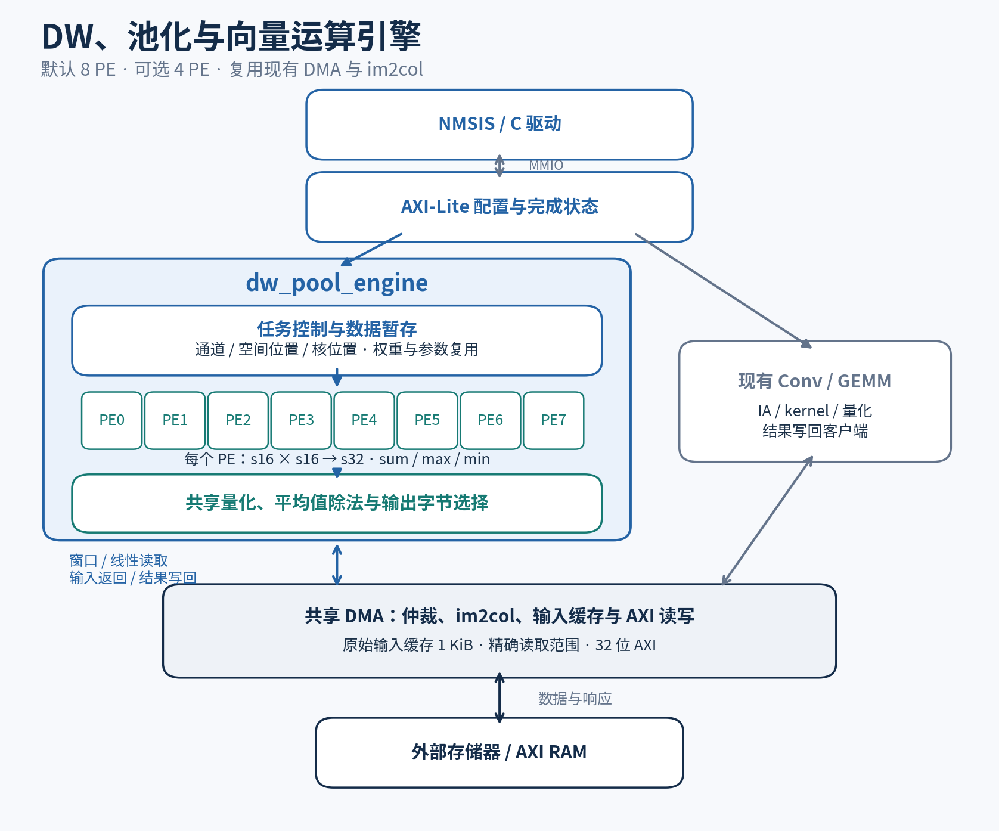
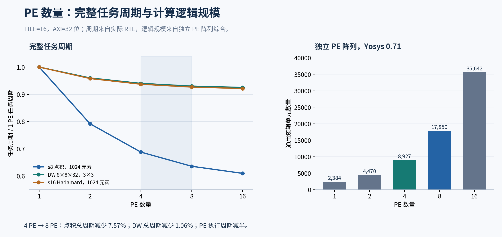

# DW、池化与向量运算引擎

日期：2026-11-15。目标仓库为 `Little-W/mini_tflm_dsa`，起始提交为
`f9602e4eb20be8039ed08e706957f5412462106d`。

## 1. 设计结果

`dw_pool_engine` 是共享 DMA 的独立计算客户端。它读取原始 NHWC 输入、请求
DMA 内部的 im2col 窗口、完成向量计算，再通过同一个 DMA 写回结果。DW、池化
和基础向量运算使用同一组 PE。标准 NPU 顶层、AXI-Lite、SoC、FPGA 源文件表、
ASIC 源文件表与 NMSIS 驱动均已接入。

默认配置为 **8 个 PE**，另支持 **4 个 PE** 配置。每个 PE 包含有符号
16×16 位乘法、32 位累加、加法和比较运算。8 个 PE 每个计算周期处理
8 个元素，对应每路操作数 128 位；4 个 PE 对应每路操作数 64 位。
计算组织采用向量长度、分段执行和尾部有效元素控制。DW 与池化以通道作为硬件
并行维度，并采用仓库 NMSIS 实现的整数运算规则。软件接口为任务描述符和 MMIO，
提交的是完整算子或向量任务。

仓库 `riscv_depthwise_conv_s8_opt.c` 的 RVV 分支在单个输出通道内，对卷积核
位置执行跨步读取、加宽乘法与求和；池化 RVV 分支沿通道并行。本引擎将这些
乘法、累计和比较操作实现为共享 PE，并沿 NHWC/HWC 中连续的通道维取得数据。
每个通道保留独立累计结果，窗口位置由 DMA 的 im2col 地址计算处理。

默认 `TILE=16`、`MAX_TAPS=49`、AXI 数据宽度为 32 位。`TILE` 决定暂存元素数，
`PE_COUNT` 决定每周期参与计算的元素数；一个完整 tile 在 8 PE 下需要 2 个
计算周期，在 4 PE 下需要 4 个计算周期。



当前标准核心支持硬件 DW/池化。仓库的 `config/npu.mk` 默认选择 PCR 核心，
实际构建应设置 **`PCR_ENGINE=0`**。PCR、resident 与 `GEMMORA_INT8_PROFILE` 配置读取
`DW_POOL_CAPS` 得到 0，NMSIS 使用软件实现。新增测试入口会自行选择标准核心；
PCR 配置另有独立的能力检测和拒绝执行测试。

## 2. 支持的运算

| 操作 | 编码 | 输入与输出 | 运算方式 |
|---|---:|---|---|
| `DW_S8` | 0 | s8 输入、s8 权重、s32 bias、s8 输出 | 每个通道独立乘加，逐通道量化 |
| `AVGPOOL_S8` | 1 | s8 → s8 | 对窗口内有效元素求和、除以有效元素数 |
| `MAXPOOL_S8` | 2 | s8 → s8 | 对窗口内有效元素求最大值 |
| `MINPOOL_S8` | 3 | s8 → s8 | 对窗口内有效元素求最小值 |
| `VEC_SUM` | 4 | s8/s16 → 一个 s32 | 所有有效元素求和 |
| `VEC_MAX` | 5 | s8/s16 → 一个 s32 | 所有有效元素求最大值 |
| `VEC_MIN` | 6 | s8/s16 → 一个 s32 | 所有有效元素求最小值 |
| `VEC_DOT` | 7 | 两个同类型 s8/s16 向量 → 一个 s32 | 逐元素乘法后求和 |
| `VEC_HADAMARD` | 8 | 两个同类型 s8/s16 向量 → s32 向量 | 逐元素乘法 |

DW 的输入和输出采用 NHWC，权重采用 `[Kh, Kw, C]`，通道倍率为 1。
一条硬件命令处理一个 batch，NMSIS 分发函数循环提交多个 batch。
卷积核面积不超过 49，支持矩形卷积核、步长、膨胀系数和调用者给出的输出尺寸。
输入高、宽、通道数、输出高宽、步长与膨胀系数均为正整数，最大 65535；
上方与左方 padding 为 0 至 65535。

池化使用相同的 NHWC 窗口调度，窗口面积同样不超过 49，更大的窗口通过 NMSIS
软件实现执行。膨胀系数固定为 1，输入与输出 offset 均为 0。
每个输出窗口必须至少包含一个有效输入元素。向量长度大于 0，可以超过 tile
容量；引擎自动分段处理，尾部不足一个 tile 时仅更新有效元素。

所有总长度还受到 32 位 DMA 地址范围限制。s16 向量输入地址须为 2 字节整数倍，
s32 输出以及 bias、multiplier、shift 地址须为 4 字节整数倍。
s8 输入和输出允许任意字节地址。驱动要求非零有效地址，bias 地址为 0 时使用
零偏置。分配区间的末端地址须小于 `2^32`，输出区间与输入、权重和参数区间分离。
多 batch 分发在第一次 START 前检查所有 batch 的地址区间。

## 3. 数据调度与 DMA

### 3.1 DW 和池化

DW 使用以下循环次序：通道 tile、输出位置、卷积核位置。进入通道 tile 后，
引擎通过线性 DMA 读取该 tile 的全部权重以及 bias、multiplier、shift，并在
所有输出位置之间复用。每个有效卷积核位置请求一个通道窗口：

```text
p0 = oy × output_w + ox
q0 = (ky × kernel_w + kx) × input_c + channel_base
rows = 1
valid_cols = 当前 tile 的有效通道数
```

DMA 内的 `conv_im2col_frontend` 根据输出坐标、步长、膨胀系数和 padding 计算
输入地址。读出的 s8 只在此处加一次 `input_offset`，以 s16 返回给引擎。
引擎在提交请求前检查空间位置，padding 位置不产生外部读取。
DW 的对应乘积为零；池化的有效元素数也不包含该位置。

`conv_im2col_frontend` 的 `tile_cols` 和 DMA 的 `rd_valid_cols` 支持不足
`SIZE` 的通道段。既有完整矩阵请求仍可使用原接口行为。
输入窗口复用现有 1 KiB 原始输入缓存，默认组织为 32 组、2 路、每行 16 字节。
DW 使用 LRU 替换方式，每次任务开始重新配置缓存状态。

池化沿通道并行执行 sum/max/min。平均池化在窗口累计结束后，使用共享的
32 位迭代除法器依次处理通道。DW 使用共享的 32×32 位乘法器依次完成量化。
当前控制器依次执行读取、计算和写回，PE 数量仅改变向量执行阶段的长度。

### 3.2 基础向量

线性 DMA 每次读取最多 `TILE` 个元素，二元操作分别读取左右操作数。
s8 读入后进行符号扩展，s16 保持原值。sum、dot、max、min 在各个暂存位置上
跨段累计，末段完成后将 `TILE` 个部分结果归约为一个 s32；Hadamard 每段
直接生成并写回 s32 向量。加法与乘加按 32 位二进制补码执行，溢出按模 `2^32`
回绕。

### 3.3 仲裁、写回与完成

`axi_block_dma_arbiter` 为 DW 增加独立请求来源，分别处理读写请求，返回数据和
完成信号交给已获得请求的客户端。DW 与既有 IA、kernel、量化和结果写回客户端
共用 `axi_dual_block_dma`。

输出数据按地址为 4 字节整数倍的单拍 AXI 写事务发送，通过 `WSTRB` 指定有效
字节。该方式支持非整字 s8 输出和通道尾部，单次写事务不跨越 4 KiB 边界。
DMA 读取同时使用输入和参数区间检查，支持分配区间边缘的窄读取。

配置在 START 时保存，任务期间保持有效。总线背压时地址、数据及字节使能保持
稳定。读写响应错误使任务进入错误处理状态，已发出的事务完成后才报告 DONE。
已完成的输出写入保留；发生错误时调用方应按失败任务处理输出。
DONE 保持到上层接收，并通过原有 STATUS/IRQ 机制通知软件。

## 4. 数值规则

### 4.1 DW 量化

本仓库 NMSIS 的 `riscv_nn_requantize()` 使用双舍入规则。设累加结果为 `a`，
逐通道 multiplier 为 `m`，shift 为 `s`：

1. `x = wrap32(a << max(s, 0))`。
2. `h = wrap32((int64(x) × m + 2^30) >> 31)`，右移采用算术右移。
3. 对 `h` 除以 `2^max(-s,0)`，按 NMSIS 的余数比较规则舍入，半整数向远离零
   的方向取整，所得结果记为 `r`。
4. `z = wrap32(r + output_offset)`，然后限制到激活上下限并写入 s8。

multiplier 为非负 s32，shift 范围为 `[-31, 30]`，input offset 范围为
`[-127, 128]`，output offset 范围为 `[-128, 127]`。
bias 可省略。引擎读取量化数组时检查 multiplier 和 shift，数组内容无效时返回
任务错误。当前测试覆盖正负 shift、极值、偏置、32 位回绕以及激活裁剪。

### 4.2 池化

设有效元素和为 `sum`、数量为 `n`。平均池化计算
`sign(sum) × floor((abs(sum) + floor(n/2)) / n)`，随后限制到激活范围。
这对应 NMSIS 的整数平均值规则，包括负数半整数舍入。
最大池化与最小池化只比较有效输入，分别以 −128 和 127 初始化。
激活上下限满足 `−128 ≤ min ≤ max ≤ 127`。

## 5. 软件与寄存器

公开 C 接口位于 [`drivers/dsa_dw_pool.h`](../drivers/dsa_dw_pool.h)：

```c
void dsa_dw_pool_config_init(dsa_dw_pool_config_t *config);
uint32_t dsa_dw_pool_capabilities(void);
uint32_t dsa_dw_pool_validate(const dsa_dw_pool_config_t *config);
uint32_t dsa_dw_pool_execute(const dsa_dw_pool_config_t *config);
```

`validate()` 只检查描述符，不访问 MMIO 或张量内存。`execute()` 完成能力检查、
寄存器配置、START 和完成等待。NMSIS 的 DW wrapper、通用 DW、`_acc` 入口及
平均/最大池化入口均可分发到该接口。最小池化和基础向量通过上述通用接口调用。
硬件能力缺失或通道倍率等配置超出支持范围时，NMSIS 在 START 前使用软件实现。
设备忙时，低层驱动返回 `DSA_ERR_BUSY`，NMSIS 返回
`RISCV_NMSIS_NN_NO_IMPL_ERROR`。启动后的错误和超时返回错误状态。
默认超时上限为 2,000,000 次状态寄存器轮询，可通过 `DSA_DW_POOL_TIMEOUT` 设置。
设备超时后，平台应先确认 DMA 停止或复位设备，再重新使用相关缓冲区。

定义 `DSA_NN_DW_POOL_ENABLE=0` 可构建独立 NMSIS 软件配置，无需链接 DSA
驱动。硬件路径不需要 CPU 展开窗口或执行 DW/池化运算。驱动提供 RISC-V
`fence rw,rw`；使用非一致性 CPU cache 的平台应完成输入刷新和输出失效处理。

CTRL bit 8 选择 DW/池化/向量模式，与 bit 6 的普通 Conv 模式互斥。
新增寄存器如下，偏移相对于 NPU MMIO 基地址：

| 偏移 | 名称 | 定义 |
|---:|---|---|
| `0x0b0` | `DW_POOL_OP` | bits 3:0 为操作；bit 8 为 s16 向量输入 |
| `0x0b4` | `DW_POOL_LENGTH` | 向量元素数 |
| `0x0b8` | `DW_POOL_CAPS` | 能力、PE 数量、最大核面积和版本 |
| `0x0bc` | `DW_POOL_CYCLES` | 本次引擎任务周期 |
| `0x0c0` | `DW_POOL_COMPUTE` | PE 处于 EXECUTE 的周期数 |
| `0x0c4` | `DW_POOL_DMA_WAIT` | 数据读取、窗口返回、写回与相关等待周期 |

`CAPS` bits 0/1/2/3 分别表示 DW s8、池化 s8、向量 s8、向量 s16；
bits 15:8 为 PE 数量，bits 23:16 为最大卷积核面积，bits 31:24 为扩展版本 1。
默认 8 PE 返回 `0x0131080f`，4 PE 返回 `0x0131040f`。
几何参数复用 Conv 寄存器，数据和量化地址复用既有公共寄存器。

`DMA_WAIT` 包含 DMA/im2col 内部工作和响应等待，不能直接作为外部总线阻塞时间。
三个计数器均为 32 位。详细字段见[寄存器说明](../drivers/registers_v2.md)。
计数器在引擎接受 START 时清零；顶层直接拒绝的双模式命令保留上一次引擎任务的
统计结果。

## 6. PE 数量实验

### 6.1 完整硬件任务周期

测试使用实际 `dw_pool_engine`、仲裁器、DMA 和 im2col；`TILE=16`，32 位 AXI，
1 KiB 输入缓存，外部存储模型不额外插入随机等待。周期从引擎接受任务后开始，
包括参数读取、窗口取得、计算、量化/除法和结果写回，排除 CPU 配置时间。
所有规模执行同样的确定性性能用例，并核对数值输出。

| 工作负载 | 1 PE | 2 PE | 4 PE | 8 PE | 16 PE |
|---|---:|---:|---:|---:|---:|
| DW，输入 8×8×16，3×3，步长 1 | 95,026 | 91,154 | 89,218 | 88,250 | 87,766 |
| DW，输入 8×8×32，3×3，步长 1 | 193,973 | 186,229 | 182,357 | 180,421 | 179,453 |
| DW，输入 16×16×64，3×3，步长 2 | 445,381 | 428,453 | 419,989 | 415,757 | 413,641 |
| 平均池化，输入 8×8×32，3×3，步长 1 | 255,075 | 247,331 | 243,459 | 241,523 | 240,555 |
| 最大池化，输入 8×8×32，2×2，步长 2 | 27,499 | 26,475 | 25,963 | 25,707 | 25,579 |
| s8 点积，长度 1024 | 2,460 | 1,948 | 1,692 | 1,564 | 1,500 |
| s16 Hadamard，长度 1024 | 12,211 | 11,699 | 11,443 | 11,315 | 11,251 |

8 PE 相比 4 PE，点积完整任务周期减少 **7.57%**；第二组 DW 减少 **1.06%**。
两项任务的 PE 执行周期均减半：点积从 256 到 128，DW 从 3,872 到 1,936。
在 8 PE 的第二组 DW 中，DMA 相关周期为 163,409，占总周期的 90.6%。
增加 PE 可以提高计算吞吐量，当前窗口获取与控制开销限制了完整 DW 任务的收益。
平均池化还包含逐通道迭代除法，Hadamard 包含长度为 1024 的 s32 输出写回。



### 6.2 PE 组合逻辑综合

使用 Yosys 0.71 对独立 `dw_pool_pe` 阵列执行通用逻辑综合和 `check -assert`。
综合保留共享操作选择输入，操作数和累加输入相互独立。

| PE 数量 | 16×16 乘法器数量 | 通用逻辑单元数量 |
|---:|---:|---:|
| 1 | 1 | 2,384 |
| 2 | 2 | 4,470 |
| 4 | 4 | 8,927 |
| 8 | 8 | 17,850 |
| 16 | 16 | 35,642 |

该统计覆盖 PE 的乘法、加法、比较和选择逻辑，不包含控制器、数据数组、共享
量化乘法器、除法器与 DMA。元数据对象单独记录。通用逻辑单元数量用于比较
计算阵列规模，FPGA LUT/DSP 数量、工艺面积和最高频率需由相应目标工具确定。

据此，默认选择 **8 PE** 以提供 128 位操作数并行度，**4 PE** 作为计算资源
较少的配置。16 PE 相比 8 PE 的点积周期继续减少 4.09%，第二组 DW 减少 0.54%，
PE 逻辑数量接近翻倍。当前配置重点保留 4/8 PE。

### 6.3 本地数据容量

`TILE=16`、`MAX_TAPS=49` 时，引擎主要数据数组如下：

| 数组 | 逻辑容量 |
|---|---:|
| 49×16 个 s8 权重 | 784 B |
| 两组 16 个 s16 输入暂存 | 64 B |
| bias、multiplier、shift，各 16 个 s32 | 192 B |
| 累加与结果，各 16 个 s32 | 128 B |
| 合计 | **1,168 B** |

该合计不含描述符、控制状态、共享 DMA 缓存及存储宏容量取整。
4/8 PE 使用同样的数据数组容量，区别在组合计算单元数量和执行周期。

## 7. 验证结果

测试工具为 Verilator 5.054、GCC 14.2.0、RISC-V GCC 14.2.0 和 Yosys 0.71。
汇总数据保存在 [`dw_pool_measurements_20261115.json`](dw_pool_measurements_20261115.json)。
可通过第 8 节所列命令重新运行测试。

| 层次 | 执行规模 | 结果 |
|---|---|---|
| 引擎与实际 DMA 功能测试 | 1/2/4/8/16 PE，各 97 项，共 485 次 | 全部通过 |
| PE 性能实验 | 5 种规模，各 7 项，共 35 次 | 输出全部一致 |
| 生产 C、AXI-Lite、标准 NPU 与 RAM 协同仿真 | 4/8 PE；各执行固定等待与随机等待，每轮 64 项 | 全部通过 |
| 关闭 DW 能力与 PCR 配置 | 各执行固定等待与随机等待，每轮 17 项 | 软件分发与硬件拒绝行为通过 |
| C 驱动和 NMSIS，启用 UBSan | 798、1,254、816 项断言；独立软件链接 | 全部通过 |
| AXI-Lite 寄存器 | 89 项检查 | 全部通过 |
| 原 DMA 与仲裁器 | 2 个独立测试 | 全部通过 |
| 原矩阵窗口，SIZE4/16 | 28 个描述符，2,322 个有效元素 | 全部一致 |
| 原完整 Conv | 18 条命令，1,905 个输出字节 | 全部通过 |
| RV32IM/ILP32 生产 C | 11 个生产对象、9 个软件配置对象、3 个静态链接 ELF | 全部通过，未定义符号为 0 |
| PE 组合逻辑综合 | 1/2/4/8/16 PE | 全部通过 |

协同仿真合计执行 324 次用例并核对 21,316 个输出元素。实际生产驱动通过
AXI-Lite 操作 `npu_axil_top`，张量存放在生产 `soc_axi_ram` 中。
硬件运行期间，主机侧的输入、权重、bias、量化数组和输出页面使用 `PROT_NONE`，
以检查驱动是否仅提交硬件工作。DW、平均池化和最大池化与独立编译的 NMSIS
标量实现逐元素比较；向量和最小池化使用独立整数参考实现。

覆盖内容包括：通道和长度尾部、非整字地址、跨 4 KiB 访问、padding、矩形核、
步长和膨胀系数、正负舍入、有符号极值、累计回绕、多 batch、同址更新后的再次
执行、Conv WS/IS 与 DW/池化/向量连续切换、读写错误后的恢复、DONE 背压及
无效配置的零外部访问。读写检查同时核对输入范围、输出保护字节、`WSTRB`
和背压期间的信号稳定性。

协同仿真周期包含 MMIO 引发的 RTL 周期，主机执行 C 指令的时间未换算为
RISC-V CPU 周期。本次完成 RTL 功能仿真、驱动交叉编译与 PE 逻辑综合；
FPGA 板级运行、完整 SoC 固件执行及 ASIC 物理实现不属于本组测量结果。

## 8. 复现方法

依赖：Linux、Python 3、GNU Make、GCC/G++、Verilator；PE 逻辑综合另需 Yosys。
所有命令在仓库根目录运行，工具在 PATH 中时可省略路径变量。

```bash
# 默认 8 PE：驱动、实际 DMA、寄存器、顶层协同仿真、能力关闭和原功能回归
make dw-pool-test VERILATOR=/path/to/verilator DW_PE_COUNT=8 DW_JOBS=1

# 4 PE 的完整测试
make dw-pool-test VERILATOR=/path/to/verilator DW_PE_COUNT=4 \
  DW_BUILD_DIR=build/dw_pool_verify_pe4 DW_JOBS=1

# 1/2/4/8/16 PE 的周期与逻辑规模
make dw-pool-sweep VERILATOR=/path/to/verilator DW_JOBS=1
make dw-pool-area YOSYS=/path/to/yosys

# PCR 实际配置的能力检测和软件选择
python3 test/dw_pool_cosim/run.py --verilator /path/to/verilator \
  --size 16 --pe-count 8 --pcr --jobs 1 --out build/dw_pool_pcr
```

生产 RTL 顶层参数为 `ENABLE_DW_POOL=1`、`DW_PE_COUNT=8`、`DW_MAX_TAPS=49`。
`SIZE<8` 时默认 PE 数量为 `SIZE`；PE 数量应为不超过 `SIZE` 的二次幂。
选择 4 PE 时设置顶层 `DW_PE_COUNT=4`。本节 Make 变量用于对应测试入口，
实际 FPGA/ASIC 工程通过顶层参数配置计算规模。

## 9. 主要文件

| 文件 | 内容 |
|---|---|
| [`rtl/npu/conv/dw_pool_engine.sv`](../rtl/npu/conv/dw_pool_engine.sv) | 任务控制、DMA 请求、分段计算、量化和写回 |
| [`rtl/npu/conv/dw_pool_pe.sv`](../rtl/npu/conv/dw_pool_pe.sv) | 共享乘加、求和、比较与逐元素乘法 |
| [`rtl/npu/conv/01_dw_pool_pkg.sv`](../rtl/npu/conv/01_dw_pool_pkg.sv) | 操作与描述符类型 |
| [`rtl/npu/dma/axi_block_dma_arbiter.sv`](../rtl/npu/dma/axi_block_dma_arbiter.sv) | DW 读写请求与完成返回 |
| [`drivers/dsa_dw_pool_impl.h`](../drivers/dsa_dw_pool_impl.h) | 参数检查、MMIO、能力检测和等待 |
| [`drivers/tflm/NMSIS/NN/Source/ExtraAccFunctions/riscv_dwconv_acc.c`](../drivers/tflm/NMSIS/NN/Source/ExtraAccFunctions/riscv_dwconv_acc.c) | NMSIS 算子分发与多 batch 调度 |
| [`test/dw_pool/`](../test/dw_pool/) | 实际 DMA 功能测试、PE 周期与综合实验 |
| [`test/dw_pool_cosim/`](../test/dw_pool_cosim/) | 生产 C 与 NPU 顶层协同仿真 |
| [`test/dw_pool_driver/`](../test/dw_pool_driver/) | 驱动、软件选择和 UBSan 检查 |
| [`test/dw_pool_regs/`](../test/dw_pool_regs/) | AXI-Lite 寄存器行为 |

参考实现为目标提交随仓库提供的 NMSIS NN 源码，主要包括
`riscv_depthwise_conv_s8.c`、`riscv_depthwise_conv_s8_opt.c`、
`riscv_avgpool_s8.c`、`riscv_max_pool_s8.c` 与 `riscv_nnsupportfunctions.h`。
