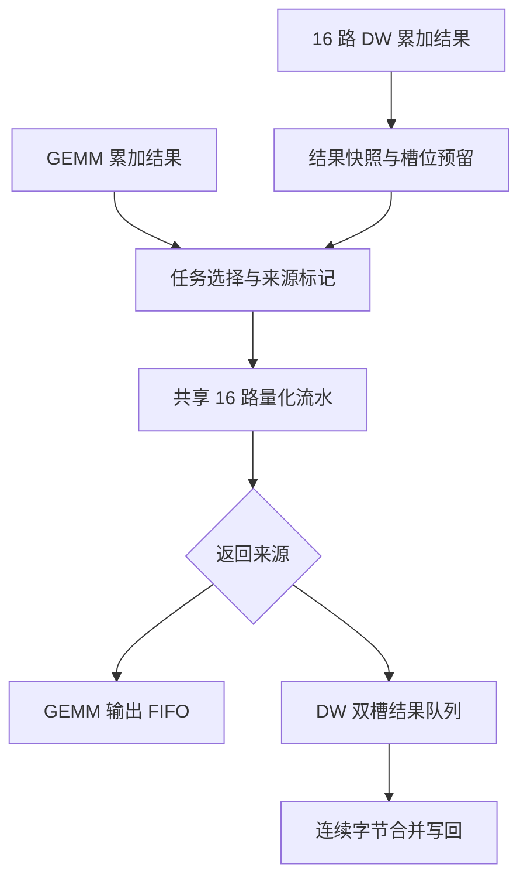
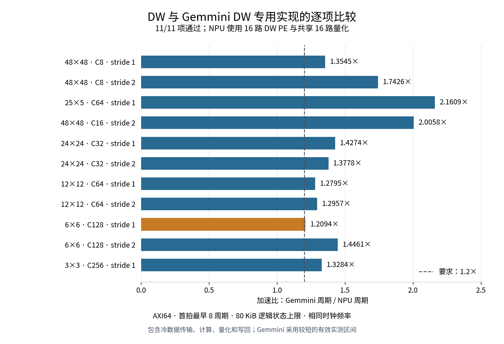

# DW 与 GEMM 共享量化及性能比较

日期：2026-11-21。目标仓库：[Little-W/mini_tflm_dsa](https://github.com/Little-W/mini_tflm_dsa)。

## 实测结果

45 个共同硬件算子全部达到 1.2 倍要求，最低加速比为 1.202987833×。四个完整模型保留全部 68 个节点，并分别检查两个输入形成的 136 条逐层记录；全部达到要求，最低加速比为 1.852907640×。性能判定统一使用整数不等式 `6 × NPU 周期 ≤ 5 × Gemmini 周期`。

独立核验读取了 NPU 的 16 次完整模型执行及 Gemmini 四种固件策略的 64 次执行，检查 680 份中间张量和 3664 个文件。最终输出、全部中间输出、输入保护、实际固件及仿真二进制、内存初始内容、CPU 配置和外部存储参数均通过检查。相关记录见 [完整模型独立核验](data/dw_shared_quant_20261121/model_verification.json)、[逐节点性能检查](data/dw_shared_quant_20261121/model_targets.json) 和 [共同硬件算子检查](data/dw_shared_quant_20261121/operator_targets.json)。

## 共同实验条件与计时范围

两侧矩阵阵列均为 16×16，使用 INT8 输入和 INT32 累加，外部接口为 AXI64。物理外部 RAM 为 2 MiB，每个读请求在 AR 接受 8 周期后具备首拍返回条件，排队和背压计入实际等待；连续响应每周期一拍，读、写方向各允许 4 个在途事务，单个突发不超过 2048 B，并按 4 KiB 地址边界分段。完整模型使用相同 PicoRV32 配置、1 KiB 指令缓存、512 KiB TFLM arena、模型文件和两个输入。

共同硬件算子使用相同随机张量，输入与权重零点均为零，缩放为 1/32，舍入方式为最近偶数舍入。计时包含数据读取、计算、硬件量化、写回和外部响应完成。Gemmini 同时记录完整命令区间和循环启动到完成区间，逐项性能要求采用较短的有效实测区间。

完整模型使用真实模型的逐通道量化和零点，比较当前 NPU 软件实现与固定 Gemmini DW 软件版本。`perf` 记录完整 `MicroInterpreter::Invoke()`；独立 `trace` 固件记录每个节点及中间张量。逐层检查对每个输入选择最快的有效 Gemmini 节点结果；整网比较始终使用一次完整固件运行的实测时间。初始化和初始化加首个 Invoke 单独列出。

## 实际存储与计算资源

| 项目 | NPU | Gemmini DW |
| --- | ---: | ---: |
| 加速器逻辑状态 | 615,083 bit / 76,885.375 B | 650,391 bit / 81,298.875 B |
| 逻辑状态上限 | 81,920 B | 81,920 B |
| 矩阵阵列 | 16×16 | 16×16 |
| 主要本地存储 | IA/PS 共享 32 KiB，raw32 | scratchpad 32 KiB，accumulator 32 KiB |
| NPU 输入缓存 | 8 KiB，128 B 行，2 路，32 组 | 使用固定 Gemmini 实现 |
| NPU 向量执行 | 16 个 PE，16 路窗口返回 | 使用固定专用 DW 数据流 |
| NPU DW 量化 | 与 GEMM 共用 16 路量化 | 使用固定 Gemmini 量化实现 |

NPU 容量采用与性能仿真相同参数和 RTL 分支的 `generic` 展开；Gemmini 容量按实际生成 RTL 统计，并核对其源码摘要。两侧均包含实际存储与寄存器状态位。NPU 剩余容量为 5,034.625 B。完整位数明细见 [NPU 容量](data/dw_shared_quant_20261121/npu_capacity.json) 与 [Gemmini 容量](data/dw_shared_quant_20261121/gemmini_capacity.json)。起始提交 `81d09e2d`采用 8 个向量 PE 和 4 KiB 输入缓存，优化后的内部资源配置同时受上述 80 KiB 总上限约束。

## 共享量化与 DW 执行结构

DW 使用 GEMM 已有的 `vec_requant` 运算流水。一次请求携带 16 个 INT32 累加值、逐通道乘数、六位右移量、有效通道掩码、输出零点、激活范围及结果槽标签。流水保留完整有符号乘积，执行最近偶数舍入和裁剪；固定延迟为十二周期。来源标记随数据传播，返回时分别通知矩阵输出 FIFO 或 DW 结果槽。

DW 在发出量化请求前预留返回槽。两个结果槽分别保存地址、有效通道数和末项标志，因此前一通道组返回时，下一组可以准备权重与参数。正常任务完成等待已提交量化、结果队列和写入响应全部结束。矩阵采用双路分时量化的六、七 bank 配置继续使用本地 DW 量化；本次八 bank 配置启用完整的十六路共享量化。

计算与数据供给使用以下安排：

- **连续乘加。** 16 个 DW PE 通过累加反馈连续处理相邻卷积核位置，像素计算结束后保存结果快照，下一像素与量化、写入并行执行。
- **同步宽读取。** 输入缓存采用 128 B 行和可配置的同步宽读口，本次一次返回 16 个经过 offset 校正的 INT16 元素。外部接口保持 AXI64。四个输入区域保存已完成与尚在读取的窗口数据。
- **合并参数读取。** 一条二维 DMA 命令读取当前通道组的全部卷积核位置；地址排列满足条件时，将偏置、乘数和移位数组合并为两行或三行读取。最后一个像素提交量化后即可开始下一组参数读取。
- **连续结果写入。** 待写缓冲与当前事务各保存 64 B；连续地址的 INT8 输出合并发送。成功 B 响应到达时，下一笔已准备事务可进入请求阶段。
- **通用调度。** 驱动分别估算原图缓存读取、实际内部返回宽度、窗口生成及最终输出写入时间，并根据数据流和存储分配选择执行计划。计划缓存保留输入在 128 B 行内的位置和输出页面偏移。

十一项 DW 的逐周期记录中，`wait_snapshot=0`、`quant_slots=0`，说明这些任务没有因快照未释放或量化结果槽耗尽而停顿。最接近要求的 `6×6 C128 stride 1` 记录了 993 个等待输入周期，其整体时间为 5,263 周期。各计数可以重叠，不能直接相加得到总周期。完整记录见 [DW 流水统计](data/dw_shared_quant_20261121/dw_pipeline_profile.csv)。

共享量化、PE 数、缓存行长及数据调度共同构成本次实现。相对于起始提交，十一项 DW 的自身加速比为 3.6021×～11.3075×。这些数值描述完整修改的效果；单独共享量化的接口吞吐由十六路量化测试验证。

| 源码 | 主要职责 |
| --- | --- |
| [npu_top.sv](../rtl/npu/top/npu_top.sv)、[vec_requant.sv](../rtl/npu/writeback/vec_requant.sv) | 共享配置、请求选择、量化流水与返回标记 |
| [vector_engine.sv](../rtl/npu/conv/vector_engine.sv)、[vector_quant_params.sv](../rtl/npu/conv/vector_quant_params.sv) | 连续乘加、结果快照、跨组执行和逐通道参数 |
| [vector_writeback.sv](../rtl/npu/conv/vector_writeback.sv) | 双缓冲、连续地址合并和写响应处理 |
| [conv_im2col_frontend.sv](../rtl/npu/conv/conv_im2col_frontend.sv)、[conv_sdp_ram.sv](../rtl/npu/dma/cache/conv_sdp_ram.sv) | 坐标推进、窗口生成、同步宽读取与预取 |
| [dsa_memory_schedule.h](../drivers/dsa_memory_schedule.h)、[dsa_schedule_impl.h](../drivers/dsa_schedule_impl.h) | 成本估算和计划复用 |

参数、状态与接口的完整说明见 [向量计算引擎](vector_engine.md)、[硬件架构](architecture.md) 和 [DMA 接口](block_dma_im2col.md)。新增和修改的 RTL 注释使用中文，位宽和有符号运算在接口及运算表达式中明确指定。

## DW 共同硬件算子

下表全部为周期级硬件仿真结果，Gemmini 时间采用专用 DW 数据流的有效最短实测区间。优化前列对应起始提交 `81d09e2d`，优化后列对应生产实现 `3a95bec6`。两次执行使用相同算子张量及外存服务条件。

| 算子 | 优化前 NPU 周期 | 优化后 NPU 周期 | Gemmini 周期 | 相对 Gemmini | NPU 自身加速比 |
| --- | ---: | ---: | ---: | ---: | ---: |
| `dw3x3_s1_48_c8` | 149,561 | 24,145 | 32,705 | 1.354525× | 6.194285× |
| `dw3x3_s2_48_c8` | 37,585 | 10,216 | 17,802 | 1.742561× | 3.679033× |
| `model_dw3x3_s1_25x5_c64` | 60,246 | 6,520 | 14,089 | 2.160890× | 9.240184× |
| `model_dw3x3_s2_48x48_c16` | 72,006 | 9,816 | 19,689 | 2.005807× | 7.335575× |
| `model_dw3x3_s1_24x24_c32` | 141,299 | 12,496 | 17,837 | 1.427417× | 11.307538× |
| `model_dw3x3_s2_24x24_c32` | 36,611 | 7,790 | 10,733 | 1.377792× | 4.699743× |
| `model_dw3x3_s1_12x12_c64` | 70,269 | 7,688 | 9,837 | 1.279527× | 9.140088× |
| `model_dw3x3_s2_12x12_c64` | 19,389 | 5,258 | 6,813 | 1.295740× | 3.687524× |
| `model_dw3x3_s1_6x6_c128` | 34,081 | 5,263 | 6,365 | 1.209386× | 6.475584× |
| `model_dw3x3_s2_6x6_c128` | 11,570 | 3,212 | 4,645 | 1.446139× | 3.602117× |
| `model_dw3x3_s1_3x3_c256` | 17,934 | 4,948 | 6,573 | 1.328416× | 3.624495× |

11 个 DW 几何形状全部满足要求，最低比率为 6×6、128 通道、步长 1 的 1.209386×。31 个 GEMM 与 3 个普通卷积也全部满足要求；45 项中最接近阈值的算子为 `model_m1_n64_k784`，NPU 6,493 周期，Gemmini 7,811 周期，允许的 NPU 最大整数周期为 6,509。完整 45 项表见 [硬件结果表](data/dw_shared_quant_20261121/operator_targets.csv)。

## 完整 Invoke 的逐输入结果

四种 Gemmini 策略 `native`、`im2col`、`pipelined`、`selected` 均实际执行。在本组八个输入中，完整 Invoke 最快的策略均为 `native`。下表采用每个输入实际执行的完整固件时间。

| 模型 | 输入 | NPU Invoke 周期 | Gemmini Invoke 周期 | 加速比 |
| --- | ---: | ---: | ---: | ---: |
| mnist_cnn | 0 | 59,878 | 5,395,128 | 90.102007× |
| mnist_cnn | 1 | 59,881 | 5,388,352 | 89.984336× |
| mobilenet_v1_vww | 0 | 354,459 | 109,401,226 | 308.642822× |
| mobilenet_v1_vww | 1 | 354,458 | 109,033,769 | 307.607020× |
| resnet8_cifar10 | 0 | 724,509 | 74,637,157 | 103.017571× |
| resnet8_cifar10 | 1 | 724,508 | 74,609,202 | 102.979128× |
| ds_cnn_kws | 0 | 109,282 | 41,951,990 | 383.887465× |
| ds_cnn_kws | 1 | 109,279 | 41,897,902 | 383.403051× |

上述加速比反映完整软件栈，包括命令准备、驱动调度、数据处理和硬件等待。固定 Gemmini 模型后端先取得 INT32 累加结果，再通过 CPU 实现模型的零点校正、逐通道量化及输出截断。NPU 使用相应硬件和驱动路径，因此完整模型的加速比与共同硬件算子的加速比应分别理解。

例如 ResNet 的平均加速器 busy 计数为 NPU 672,096.5 周期、Gemmini 441,024 周期，完整 Invoke 为 NPU 724,508.5 周期、Gemmini 74,623,179.5 周期。两侧硬件任务组织与软件工作分配不同，完整 Invoke 的约 103 倍结果归属于所比较的软件与硬件组合。

## 初始化与首次推理

初始化由实际固件单独计时，起点为 `Run()` 内调用 `InitializeTarget()` 之前，其中 NPU 包含通用计划搜索。下表同时保留初始化加首个 Invoke 的周期总数，终点为该次 Invoke 返回，并对每个输入选择该区间最快的 Gemmini 固件；本组均为 `native`。

| 模型 | 输入 | NPU 初始化 | Gemmini 初始化 | NPU 初始化+Invoke | Gemmini 初始化+Invoke | 总时间比率 |
| --- | ---: | ---: | ---: | ---: | ---: | ---: |
| mnist_cnn | 0 | 14,106,150 | 5,429,759 | 14,166,028 | 10,824,887 | 0.764144× |
| mnist_cnn | 1 | 14,106,150 | 5,429,759 | 14,166,031 | 10,818,111 | 0.763666× |
| mobilenet_v1_vww | 0 | 83,884,462 | 62,256,478 | 84,238,921 | 171,657,704 | 2.037748× |
| mobilenet_v1_vww | 1 | 83,884,462 | 62,256,478 | 84,238,920 | 171,290,247 | 2.033386× |
| resnet8_cifar10 | 0 | 56,415,467 | 12,931,427 | 57,139,976 | 87,568,584 | 1.532527× |
| resnet8_cifar10 | 1 | 56,415,467 | 12,931,427 | 57,139,975 | 87,540,629 | 1.532038× |
| ds_cnn_kws | 0 | 20,427,778 | 13,084,444 | 20,537,060 | 55,036,434 | 2.679859× |
| ds_cnn_kws | 1 | 20,427,778 | 13,084,444 | 20,537,057 | 54,982,346 | 2.677226× |

MNIST 的 NPU 初始化加首个 Invoke 的时间约为 Gemmini 的 1.31 倍。NPU 14,106,150 个初始化周期中，通用计划搜索占 9,180,137 周期。VWW、ResNet 和 KWS 在该区间的时间比率最低分别为 2.033386×、1.532038× 和 2.677226×。1.2 倍逐层要求采用 Invoke 内各节点的实测经过周期，初始化按本节独立报告。

## RESHAPE 与实际软件来源

四个模型的 RESHAPE 节点均保留，两个输入的 NPU 节点经过时间均为 877 周期。Gemmini 最短实测值为 MNIST、VWW、ResNet 各 1,625 周期，KWS 为 3,332 周期。对应加速比为 1.852908× 与 3.799316×，这些节点的加速器 busy、加速器读写字节数和硬件命令数均为零。

当前 RESHAPE 实现在 Prepare 保存稳定的 `TfLiteEvalTensor` 描述符及数据字节数，Invoke 读取分配完成后的数据指针；分配器使用 `GetBuiltinCode` 识别兼容算子编码，并在生命周期条件允许时共享存储。四个模型的静态 RESHAPE 输入与输出在正式运行中均共享同一内存位置。上述收益属于 CPU/TFLM 实现。

对四种 Gemmini 策略的 `perf` 和 `trace` 共八套实际固件，逐一检查共同编译的 TFLM 文件：每套共有 187 个文件，其中 185 个文件与 NPU 完全一致。差异如下。

| 文件 | 当前 NPU 实现 | 固定 Gemmini 固件来源 |
| --- | --- | --- |
| `tensorflow/lite/micro/kernels/reshape.cc` | Prepare 保存描述符与字节数 | 使用各策略实际编译时的固定实现 |
| `tensorflow/lite/micro/micro_allocation_info.cc` | `GetBuiltinCode` 识别 RESHAPE 编码并满足存储共享条件 | 使用各策略实际编译时的固定实现 |
| `tensorflow/lite/micro/kernels/softmax_vce.h` | NPU 单独编译的硬件 Softmax 接口 | 未编译该接口 |

`native`、`im2col` 固件来源为保存的 `firmware_sources_current`；`pipelined` 为环境包的 `source_im2col_pipelined`；`selected` 为环境包的 `source_selected`。逐文件 SHA-256、固件 SHA-256 和实际目录见 [软件来源比较](data/dw_shared_quant_20261121/software_sources.json)。

## 功能与协议验证

生产 RTL 固定后，三种向量配置重新执行相同功能集。每组均使用当前的 33 个生产 RTL 文件，并校验构建摘要。

| 验证内容 | 实际执行与结果 |
| --- | --- |
| PE16、共享量化、AXI64 | 615 场景，170,639 个输出比较通过 |
| PE8、本地量化、AXI32 | 615 场景，170,971 个输出比较通过 |
| PE16、本地量化、AXI64 | 615 场景，171,469 个输出比较通过 |
| 共享量化窗口错误与恢复 | 32 场景通过，包括 16 次错误注入与 16 次恢复 |
| 共享 `vec_requant` | 240 个交替 GEMM/DW 任务、7,680 个向量、122,880 个通道输出通过 |
| 真实顶层完成握手 | 固定延迟、随机停顿下共 8 个交替 GEMM/Conv 任务；每项持续 ready 24 周期仅完成一次，1,498 个数值比较通过 |
| DMA 配置与恢复 | AXI32、AXI64 各 195 场景、10,698 个数值比较通过，包含配置范围溢出与后续任务恢复 |
| 图像调度与地址复用 | 四种编译配置各检查 3,622 个缓存占用形状、24 个地址复用计划和 20 个图像成本例子 |
| 通用计划与准备结果 | 3,456 个配置、8,370 个布局检查、960 个尾部读取及 2,198 项准备后分发检查通过 |
| 容量计算 | 99 项单元测试通过；实际展开通过 80 KiB 状态上限检查 |
| RESHAPE 软件 | 13 个分配器用例、35 次重复推理和 8 个算子用例通过 ASan/UBSan 检查 |
| 性能检查程序 | 23 项逐层比较测试及 9 项窗口计数测试通过 |

向量功能测试合计 1,845 个场景和 513,079 个输出比较，覆盖非整通道、多个通道组、最大 49 个 DW 核位置、stride、dilation、padding、随机背压、跨 4 KiB 访问、量化极值及错误后的恢复。共享量化单元测试使用独立整数除法与余数参考，包含完整有符号边界、右移量 0～63、通道掩码及十二周期延迟。

最终记录保存在 [验证数据目录](data/dw_shared_quant_20261121/validation)。独立算子比较另外核对了 59 对共同输入与几何、59 个 Gemmini 实际输出，以及仿真和容量计算共同使用的生产源码。详情见 [比较条件审查](data/dw_shared_quant_20261121/operator_conditions_review.json)。

本次性能结论使用相同时钟频率下的 RTL 周期。容量统计覆盖 RAM、ROM、队列、元数据、流水寄存器和控制状态；目标工艺的物理存储映射、面积、功耗和布局布线频率不包含在这组测量中。

## 数据文件与重复执行

- [45 项硬件检查 JSON](data/dw_shared_quant_20261121/operator_targets.json)、[CSV](data/dw_shared_quant_20261121/operator_targets.csv)、[Markdown](data/dw_shared_quant_20261121/operator_targets.md)。
- [136 个输入逐层整数比较 CSV](data/dw_shared_quant_20261121/layer_sample_targets.csv)。
- [68 个节点及 136 个逐输入目标检查](data/dw_shared_quant_20261121/model_targets.json)、[逐项 CSV](data/dw_shared_quant_20261121/model_targets.csv)、[Markdown](data/dw_shared_quant_20261121/model_targets.md)。
- [完整模型数据](data/dw_shared_quant_20261121/models.json)、[八个输入计时](data/dw_shared_quant_20261121/model_samples.csv)、[80 次原始执行计时](data/dw_shared_quant_20261121/runs.csv)。
- [68 个节点汇总](data/dw_shared_quant_20261121/layers.csv)、[136 个逐输入记录](data/dw_shared_quant_20261121/layer_samples.csv)。
- [实际二进制、输入与输出核验](data/dw_shared_quant_20261121/model_verification.json)。

Gemmini 硬件采用 `dwconv/gemmini-dwconv` 的 `4a33b75f975297e309847f41f81f4c0f8b20b81d`；专用软件采用 `dwconv/gemmini-rocc-tests-dwconv` 的 `576f08c217dfefb9fa2e3e087575f23699565560`。正式 NPU 生产 RTL 与驱动对应 `3a95bec65abc9b03395bb10e5e1322df4af38901`，后续测试、观察器与解析程序按结果中的 SHA-256 核验。

重复执行命令见 [逐层比较说明](../test/gemmini_comparison/README_storage_comparison.md)。窗口解析器与独立核验器使用实际 `window_lanes`；9 项定向测试检查 4/8/16 路响应范围、请求和元素守恒、在途容量及周期约束，23 项逐层比较测试检查整数阈值、每个输入、RESHAPE、计时区间及完整输入集合。
