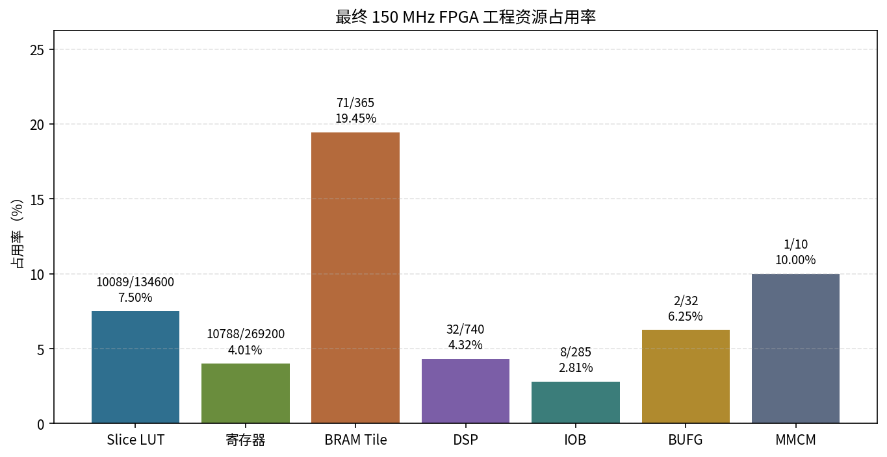
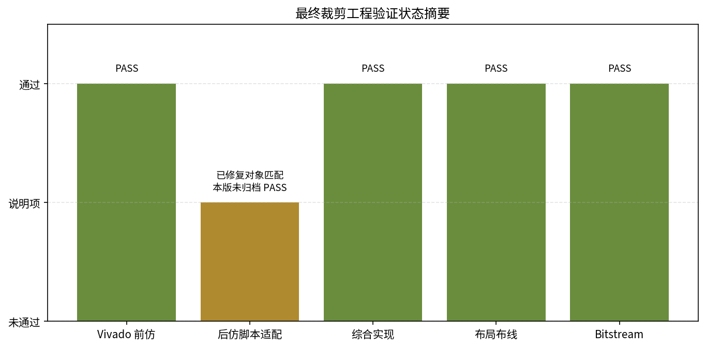
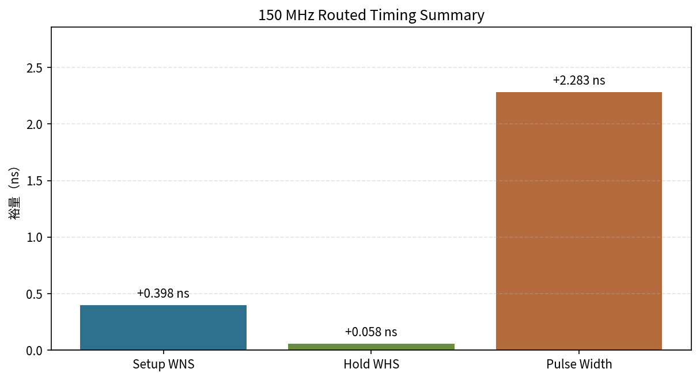
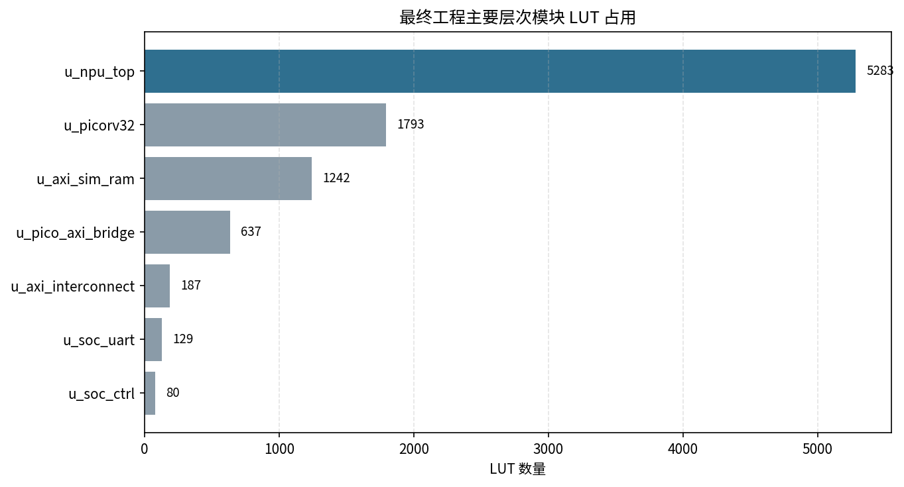
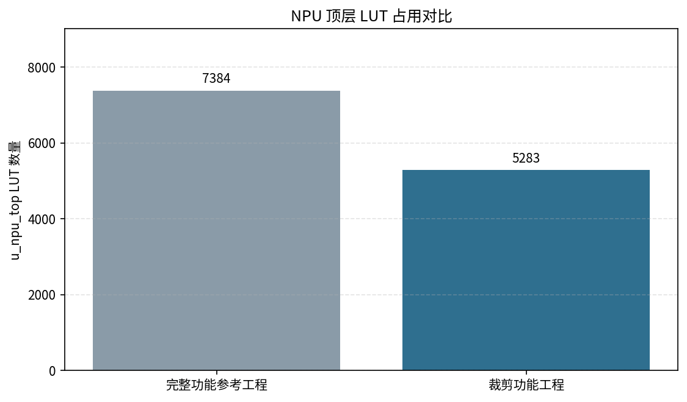

# TFLM AI DSA SoC FPGA 验证与测试报告

| 文档项 | 内容 |
|---|---|
| 文档名称 | TFLM AI DSA SoC FPGA 验证与测试报告 |
| 验证对象 | PicoRV32 + AXI SoC + NPU + UART + AXI RAM FPGA 顶层 |
| FPGA 器件 | Xilinx Artix-7 `xc7a200tfbg484-3` |
| 工具版本 | Vivado 2024.2.1，VCS W-2024.09-SP1 |
| 输入时钟 | 板级 50 MHz |
| 核心时钟 | 150.000 MHz，由 Clocking Wizard 生成 |
| UART 配置 | 约 115200 baud，软件配置分频值为 1300 |
| 报告日期 | 2026-07-04 |
| 报告状态 | Vivado 前仿、综合、实现、bitstream、时序报告和分模块利用率报告已归档；post-implementation functional 后仿脚本已完成网表信号名适配，本次裁剪工程未形成 PASS 归档 |

## 1. 验证结论

本次验证面向最终 150 MHz FPGA 裁剪功能工程。工程已完成综合、布局布线和 bitstream 生成；Vivado behavioral 前仿执行到 SoC finish，CPU trap 保持为 0；routed timing 显示 setup、hold 和 pulse width 均满足要求；route 与 DRC 检查无 error。

| 检查项 | 结果 |
|---|---|
| Vivado behavioral 前仿 | PASS，`soc_finish` 于 `675397` 个 50 MHz sys_clk 周期拉高 |
| Vivado post-implementation functional 后仿 | 脚本已适配当前网表命名；本次运行 3 分 36 秒后人工中止，未作为 PASS 证据归档 |
| VCS SoC RTL 参考仿真 | PASS，`soc_finish` 于 `2025474` 个 SoC 仿真周期拉高 |
| Bitstream 生成 | PASS，`fpga_top.bit` 已写出 |
| Routed setup timing | PASS，WNS = `+0.398 ns`，TNS = `0.000 ns` |
| Routed hold timing | PASS，WHS = `+0.058 ns`，THS = `0.000 ns` |
| Pulse width timing | PASS，WPWS = `+2.283 ns` |
| Route status | PASS，0 routing error |
| DRC | PASS，0 error |
| 分模块利用率报告 | 已生成 `fpga_top_utilization_hier_routed.rpt` |



## 2. 被测工程与配置

| 项目 | 内容 |
|---|---|
| Vivado 工程 | `vivado_export/tflm_ai_dsa_soc_final_150m_size4_cache32_w8_pruned_addr19_6000lut_uart115200/project/tflm_ai_dsa_soc.xpr` |
| 最终 bitstream | `vivado_export/tflm_ai_dsa_soc_final_150m_size4_cache32_w8_pruned_addr19_6000lut_uart115200/fpga_top.bit` |
| routed checkpoint | `vivado_export/tflm_ai_dsa_soc_final_150m_size4_cache32_w8_pruned_addr19_6000lut_uart115200/reports/fpga_top_routed.dcp` |
| 最终报告目录 | `vivado_export/tflm_ai_dsa_soc_final_150m_size4_cache32_w8_pruned_addr19_6000lut_uart115200/reports/` |
| CPU memory image | `vivado_export/tflm_ai_dsa_soc_final_150m_size4_cache32_w8_pruned_addr19_6000lut_uart115200/mem/cpu.mem` |

FPGA 工程参数如下。

| 参数 | 数值 |
|---|---:|
| `SIZE` | 4 |
| `IA_CACHE_BLOCKS` | 32 |
| `NPU_ADDR_WIDTH` | 19 |
| `CPU_MEM_DP` | 65536 |
| `CPU_ENABLE_ICACHE` | 1 |
| `WEIGHT_WIDTH` | 8 |
| `DATA_WIDTH` | 8 |
| `NPU_ENABLE_IS_MODE` | 0 |
| `NPU_ENABLE_PER_CHANNEL` | 0 |
| `CPU_AXI_WRITE_TIMING_BUFFER` | 1 |
| `BYPASS_RAM_PINGPONG` | 0 |
| `RAM_WRITE_TIMING_BUFFER` | 1 |

该 FPGA 工程用于验证板级资源、150 MHz 时序、AXI 访问、NPU int8 WS 推理路径和 UART 状态输出。完整功能组合，包括 IS 模式、per-channel 量化和 int16 输入路径，由 RTL/SoC 回归覆盖。

`cpu.mem` 已按 FPGA RAM 深度补齐至 `65536` 行。程序区来自 `cpu_firmware_only.mem`，runtime case 数据从 word `32768` 开始写入，确保综合、前仿和实现工程使用一致的 RAM 内容。

## 3. 仿真验证结果

### 3.1 Vivado Behavioral 前仿

前仿使用 `fpga_top_behav_smoke_tb.sv`。测试平台例化 RTL 版 `fpga_top`，输入 50 MHz `sys_clk`，通过 Clocking Wizard 仿真模型生成 150 MHz 核心时钟。判据为 `user_led_tri_o[1]` 拉高且 `user_led_tri_o[2]` 不拉高。

| 项目 | 结果 |
|---|---|
| 仿真器 | Vivado XSim 2024.2.1 |
| CPU memory | `mem/cpu.mem` |
| 进度标记 | `0x5a000001`、`0x5a000002`、`0x5a000003` 均出现 |
| finish 状态 | `status=0x00000001` |
| 完成周期 | `675397` 个 50 MHz sys_clk 周期 |
| 判定 | PASS |

关键日志摘录：

```text
[BEHAV_SMOKE] PASS: soc_finish at sys_cycle=675397 status=0x00000001 progress=0x5a000003
```

### 3.2 Vivado Post-Implementation Functional 后仿

后仿测试平台为 `fpga_top_post_impl_tb.sv`，判据仍为 LED finish/trap。当前脚本已将 UART 快进对象匹配从旧的 `send_dummy_reg_n_0` 扩展为当前网表中的 `send_dummy`、`send_dummy_reg_0` 和 `send_bitcnt_reg_n_0_*` 等对象，能够正确施加 UART 等待快进 force。

本次裁剪工程的 post-implementation functional 运行在 `run all` 阶段持续 3 分 36 秒未结束，随后人工中止；该结果未作为 PASS 证据归档。该项不影响 bitstream 生成、时序结果、route/DRC 结果和 behavioral 前仿结果，但后续如需把本裁剪工程纳入后仿签核，应继续缩短门级仿真运行时间或改用更直接的 finish 状态注入检查方式。



### 3.3 VCS SoC RTL 参考仿真

VCS SoC RTL 仿真使用相同 runtime case，用于校验 CPU 程序、AXI 访问、NPU 执行和结果比较流程。

| 项目 | 结果 |
|---|---|
| 日志 | `/media/proj_tmp/aiEngine_integrated/veri/sim/runs/uart150m_check_div1300/sim.log` |
| UART clkdiv | 1300 |
| `dsa_execute_cycles` | 2744 |
| SoC finish 周期 | 2025474 |
| C 程序结果 | `[soc_rt] PASS` |
| UVM 统计 | `UVM_ERROR=0`，`UVM_FATAL=0` |

## 4. Bitstream 与实现报告

最终实现使用 Vivado 2024.2.1，综合策略为 `Flow_AreaOptimized_high`，综合 directive 为 `AreaOptimized_high`，实现策略为 `Performance_Explore`。实现完成后导出了 routed checkpoint、bitstream、timing、utilization、route 和 DRC 报告。

| 文件 | 路径 |
|---|---|
| Bitstream | `vivado_export/tflm_ai_dsa_soc_final_150m_size4_cache32_w8_pruned_addr19_6000lut_uart115200/fpga_top.bit` |
| Routed checkpoint | `reports/fpga_top_routed.dcp` |
| Timing summary | `reports/fpga_top_timing_summary_routed.rpt` |
| Timing paths | `reports/fpga_top_timing_paths_routed.rpt` |
| Utilization | `reports/fpga_top_utilization_routed.rpt` |
| Hierarchical utilization | `reports/fpga_top_utilization_hier_routed.rpt` |
| Route status | `reports/fpga_top_route_status.rpt` |
| DRC | `reports/fpga_top_drc.rpt` |

实现结果显示 route、DRC 和 bitstream 均完成，未发现阻塞实现的问题。

## 5. 时序分析结果

150 MHz 核心时钟周期为 `6.667 ns`。Routed timing summary 如下。

| 指标 | 数值 | 判定 |
|---|---:|---|
| WNS | +0.398 ns | PASS |
| TNS | 0.000 ns | PASS |
| setup failing endpoints | 0 | PASS |
| WHS | +0.058 ns | PASS |
| THS | 0.000 ns | PASS |
| hold failing endpoints | 0 | PASS |
| WPWS | +2.283 ns | PASS |



最差 setup path 的 slack 为 `+0.398 ns`。报告中未发现 setup timing violation，说明当前实现满足 150 MHz 使用要求。

## 6. 资源利用率与分模块报告

### 6.1 全器件利用率

| 资源 | Used | Available | Utilization |
|---|---:|---:|---:|
| Slice LUTs | 10089 | 134600 | 7.50% |
| Slice Registers | 10788 | 269200 | 4.01% |
| Block RAM Tile | 71 | 365 | 19.45% |
| DSPs | 32 | 740 | 4.32% |
| Bonded IOB | 8 | 285 | 2.81% |
| BUFGCTRL | 2 | 32 | 6.25% |
| MMCME2_ADV | 1 | 10 | 10.00% |

### 6.2 主要层次模块利用率

| 层次模块 | Total LUTs | FFs | RAMB36 | RAMB18 | DSP |
|---|---:|---:|---:|---:|---:|
| `fpga_top` | 10089 | 10788 | 66 | 10 | 32 |
| `u_soc_top` | 10088 | 10785 | 66 | 10 | 32 |
| `u_npu_axil_top` | 5754 | 6308 | 2 | 9 | 32 |
| `u_npu_top` | 5283 | 5604 | 2 | 9 | 32 |
| `u_picorv32` | 1793 | 1024 | 0 | 0 | 0 |
| `u_axi_sim_ram` | 1242 | 187 | 64 | 0 | 0 |
| `u_pico_axi_bridge` | 637 | 1693 | 0 | 1 | 0 |
| `u_axi_interconnect` | 187 | 94 | 0 | 0 | 0 |
| `u_soc_uart` | 129 | 206 | 0 | 0 | 0 |
| `u_soc_ctrl` | 80 | 140 | 0 | 0 | 0 |

NPU 内部主要模块：

| NPU 子模块 | Total LUTs | FFs | RAMB36 | RAMB18 | DSP |
|---|---:|---:|---:|---:|---:|
| `u_vec_requant` | 1601 | 1565 | 0 | 0 | 16 |
| `u_ia_loader` | 1124 | 779 | 0 | 4 | 0 |
| `u_kernel_loader` | 643 | 710 | 0 | 4 | 0 |
| `u_block_dma_arbiter` | 485 | 309 | 0 | 0 | 0 |
| `u_bias_loader` | 470 | 497 | 0 | 0 | 0 |
| `u_oa_writer` | 425 | 323 | 0 | 0 | 0 |
| `u_compute_core` | 296 | 521 | 2 | 0 | 16 |





## 7. Route、DRC 与功耗

| 项目 | 结果 |
|---|---|
| Route status | fully routed |
| Routing error | 0 |
| DRC error | 0 |
| Bitgen precondition DRC | 0 error |
| Power report | 未作为本次裁剪工程新增归档项 |

## 8. 覆盖率最终结果

覆盖率结果只列最终签核结果，不展开用例明细。

| 覆盖率范围 | 签核指标 | 结果 | 判定 |
|---|---:|---:|---|
| 模块级 NPU 覆盖率 | line coverage | 96.71% | PASS |
| SoC 级 NPU 覆盖率 | line coverage | 95.21% | PASS |

覆盖率来源为 VCS VDB 结果，签核阈值为 95%。模块级与 SoC 级结果均达到签核要求。

## 9. 附件清单

| 附件 | 路径 |
|---|---|
| Vivado 工程 | `vivado_export/tflm_ai_dsa_soc_final_150m_size4_cache32_w8_pruned_addr19_6000lut_uart115200/project/tflm_ai_dsa_soc.xpr` |
| 前仿 PASS 日志 | `vivado_export/tflm_ai_dsa_soc_final_150m_size4_cache32_w8_pruned_addr19_6000lut_uart115200/project/tflm_ai_dsa_soc.sim/sim_1/behav/xsim/simulate.log` |
| post-implementation functional 后仿运行目录 | `vivado_export/tflm_ai_dsa_soc_final_150m_size4_cache32_w8_pruned_addr19_6000lut_uart115200/project/tflm_ai_dsa_soc.sim/sim_1/impl/func/xsim/` |
| bitstream | `vivado_export/tflm_ai_dsa_soc_final_150m_size4_cache32_w8_pruned_addr19_6000lut_uart115200/fpga_top.bit` |
| timing summary | `vivado_export/tflm_ai_dsa_soc_final_150m_size4_cache32_w8_pruned_addr19_6000lut_uart115200/reports/fpga_top_timing_summary_routed.rpt` |
| timing paths | `vivado_export/tflm_ai_dsa_soc_final_150m_size4_cache32_w8_pruned_addr19_6000lut_uart115200/reports/fpga_top_timing_paths_routed.rpt` |
| utilization | `vivado_export/tflm_ai_dsa_soc_final_150m_size4_cache32_w8_pruned_addr19_6000lut_uart115200/reports/fpga_top_utilization_routed.rpt` |
| hierarchical utilization | `vivado_export/tflm_ai_dsa_soc_final_150m_size4_cache32_w8_pruned_addr19_6000lut_uart115200/reports/fpga_top_utilization_hier_routed.rpt` |
| route status | `vivado_export/tflm_ai_dsa_soc_final_150m_size4_cache32_w8_pruned_addr19_6000lut_uart115200/reports/fpga_top_route_status.rpt` |
| DRC report | `vivado_export/tflm_ai_dsa_soc_final_150m_size4_cache32_w8_pruned_addr19_6000lut_uart115200/reports/fpga_top_drc.rpt` |
