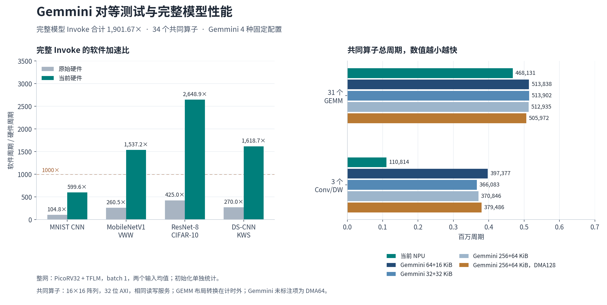

# Gemmini 对等测试与 mini_tflm_dsa 调度优化

## 1. 实测结果

本项目采用 WS/IS 自动选择、R/W 复用参数计算和可选矩阵打包。DMA 与 VEC 通过支持多个在途请求的窗口接口传递数据，共享缓存持续返回命中数据，并按卷积窗口顺序预取。DW 的乘加、重新量化和写回独立推进，短算子使用 Prepared 提交、静态 Reshape 共享存储和硬件 Softmax。最终生产源码固定为 `9a145ff6e6f3f0c87689d0378e03034cabb5749f`。完整模型的性能测量与中间张量检查分别运行。

四个模型各执行一次的硬件总周期为 **1,145,220**，相对纯软件的合计加速比为 **1,901.67×**。相对于原始硬件的 6,899,581 周期，完整 Invoke 加速比为 **6.02×**。

在默认 64 B DMA 上限的三种 Gemmini 存储配置中，31 个共同 GEMM 均由本项目取得较少周期。本项目合计 **468,131**，最快配置 Gemmini 合计 **512,935**。更长 DMA 突发的敏感性结果在第 3、4 节单独报告。扩大至 128 B 并重新搜索合法分块后，Gemmini 的完整测试集为 **505,972 周期**，本项目在 **31/31** 项中更快。

共同算子比较使用官方 Gemmini 完整加速器 RTL，包含循环展开器、Load/Execute/Store 控制器、scratchpad、accumulator、阵列、DMA 和官方 TileLink 至 AXI 转换。四个完整 TFLM 模型在 PicoRV32 与本项目 NPU 组成的 SoC 上运行。Gemmini 侧测量的是共同算子，没有执行这四个完整 TFLM 模型。100 MHz 仅用于周期到时间的换算。

结果文件：

- [逐项测量与配置](gemmini_measurements.json)
- [全部共同 GEMM、Conv、DW 的周期表](gemmini_operator_cycles.csv)
- [驱动 API、缓存算法、流水线和资源说明](scheduling_and_window_cache.md)



## 2. 论文中的加速比与本项目的比较方法

Gemmini 论文在 ResNet-50 上报告相对于 Rocket 约 2,670×、相对于 BOOM 约 1,130×的加速，在 1 GHz 条件下达到 22.8 FPS；MobileNetV2 相对于 Rocket 的结果约为 127×。论文同时给出 16×16 阵列、256 KiB scratchpad 和 64 KiB accumulator 的配置。[1]

软件加速比为

\[
S=T_{\mathrm{software}}/T_{\mathrm{accelerated}}.
\]

CPU、软件内核、网络、存储器和计时范围均会影响这一比值。本项目首先比较相同数学算子的完整加速器周期，再单独报告 PicoRV32 执行完整 TFLM Invoke 的软件加速比。PE 的空间占用、完整任务的有效吞吐率和整网软件加速比分别计算。

## 3. 对等测试设置

### 3.1 固定版本与硬件

| 项目 | 本项目 | Gemmini |
| --- | --- | --- |
| 源码版本 | 当前 `9a145ff`；原始 `48b73c5` | `b82d49cca798a59f010488a6f6de7243f0616536` |
| 官方软件 | 本项目驱动 | gemmini-rocc-tests `7ac28e7e7f447d4131db03292de405e5bd978410` |
| 主阵列 | 16×16，WS/IS | 16×16，WS/OS |
| 外部输入与权重 | INT8 | INT8 |
| 内部乘法输入 | 16 位 | 8 位 |
| 部分和/accumulator | 32 位 | 32 位；阵列内部输出为 20 位 |
| 共同外部接口 | 32 位 AXI，最多 4 个未完成读事务 | 相同 |
| 内部主要存储 | IA8，PS799，S8 FIFO32，S16 FIFO4 | SP64+ACC16、SP32+ACC32、SP256+ACC64 KiB |
| DW 执行 | 8 PE VCE，经共享 DMA 窗口缓存 | 官方 `LoopConv` 的 depthwise 模式 |
| 初始状态 | 每项独立复位，片上缓存为空 | 相同 |
| 工具 | Verilator 5.054，启用 RTL 断言 | 相同 |

默认 4 KiB 窗口数据缓存使用 10,304 B 逻辑元数据；预取描述、需求队列、窗口描述队列及 VCE 数据在容量统计中分别计算。其他控制寄存器和 PE 寄存器另计。Gemmini 表中容量为 scratchpad 与 accumulator 的数据容量。各模块的位宽、端口和用途不同，面积与最高频率需要采用相同工艺及约束进行综合测量。

### 3.2 数学输入和硬件卷积

31 个 GEMM 包括从四个模型提取的 26 种不同 Conv/FC 形状，以及 5 个基本形状。数学定义为 `A[M,K]×B[K,N]+bias[N]`。输入和权重取值 −3 至 3，偏置取值 −8 至 8，zero-point 为 0。输出为

\[
y=\operatorname{clip}_{[-128,127]}\left(\operatorname{RNE}(\mathrm{acc}/32)\right).
\]

两侧均采用最近偶数舍入。Gemmini 的比例为精确 FP32 数 `0.03125`，NPU 为 `multiplier=1<<30, shift=-4`，测试整数满足其数值范围。参考结果经 INT64 数组计算及独立标量循环核对，实际输出逐字节比较并保存 SHA-256。

GEMM 的输入矩阵展开与布局转换在计时前完成。联合调度比较允许 NPU 选择普通、A packed、B packed、两者 packed，Gemmini 选择普通存储、转置 A 或转置 B。另有辅助测试固定各自原生矩阵存储格式：NPU 的 B 原生为 `[N,K]`，Gemmini 普通 B 为 `[K,N]`。共同数学张量保持一致。

三个原生卷积直接读取 NHWC 图像，硬件窗口读取、地址生成、补零、计算和写回均计时：

| 算子 | 输入 → 输出 | 核、步幅与填充 |
| --- | --- | --- |
| 普通 Conv | 96×96×3 → 48×48×8 | 3×3，stride 2，SAME_UPPER |
| DW | 48×48×8 → 48×48×8 | 3×3，stride 1，四边各 1 |
| DW | 48×48×8 → 24×24×8 | 3×3，stride 2，SAME_UPPER |

batch、扩张率和 DW 通道倍数均为 1。stride 2 的上、左填充为 0，下、右为 1。

本次固定的 Gemmini 版本使用 `has_loop_conv=true`、`has_dw_convs=true` 和 `has_first_layer_optimizations=true`，由官方 `tiled_conv_auto`、`tiled_conv_dw_auto` 提交硬件 `LOOP_CONV_WS` 命令。该硬件从原始 NHWC 图像生成卷积窗口；三项测试均记录实际 LoopConv 活动，DW 测试还记录 depthwise 启动次数。该版本保留的独立 `Im2Col` 模块为 `has_im2col=false`，本次使用的是官方当前卷积 API 的硬件窗口路径。[2][3]

### 3.3 外部存储器与计时

| 参数 | 两侧共同设置 |
| --- | --- |
| 空闲 AR 至首个 R 握手 | 3 周期 |
| 同一读突发相邻数据拍 | 每 2 周期一拍 |
| 跨突发末 R 至下一个首 R | 至少 3 周期 |
| 读请求等待队列 | 16 项，正在服务项另计 |
| AW 至首个 W | 至少 1 周期 |
| 写数据 | 每周期最多一拍，同时服务一个写事务 |
| 末 W 至 B | 至少 1 周期 |
| 并行关系 | 读写独立 |

持续读带宽为 2 B/cycle。NPU 配置在计时前设置，从启动请求接受至任务完成计时；Gemmini 从首条计时配置命令提交至最终 FENCE，包含 ready 等待及全部外部响应。宿主 CPU 指令执行不进入共同算子计时。每项检查输出、全部非输出内存以及读写事务完成状态。

三种 64 B 配置使用 Gemmini 官方默认 `dma_max_bytes=64`，NPU 支持最长 256 拍、1,024 B 的线性传输，本组 packed INT8 tile 读取通常为 256 B。两侧接受相同的外部存储器服务，最大 DMA 突发属于各自内部硬件配置。另外将 Gemmini 最大突发扩大至 128 B，完整搜索调度与输入布局，并测量其实际性能。

计时同时保留 Gemmini 首条配置至完成、LOOP 启动至完成两项结果。64 B 配置中 `M2304,N8,K27` 的 NPU 完整任务为 39,690 周期，Gemmini 从 LOOP 启动至完成为 40,811 周期。OS 方式没有 LOOP 启动命令，对应字段为 null，另可比较首次 AR 至完成的时间。在 128 B 配置中，`M9,N256,K256` 的 NPU 为 35,980 周期，Gemmini 为 36,101 周期；去除 LOOP 启动前配置后为 36,091 周期。

#### 共同 GEMM 的计时起点核对

原有 NPU 周期从 `calc_start` 接受到 `done`；Gemmini 完整周期从首条计时配置指令提交开始，结束时全部外部存储事务已经完成。另用原始时间戳计算循环启动和首次 AXI 读请求之后的周期。

| Gemmini 配置 | 完整计时，NPU 更快的形状数 | 循环启动计时，NPU 更快的有效记录数 | 双方首个 AR 至完成，NPU 更快的形状数 |
| --- | ---: | ---: | ---: |
| sp64_acc16_dma64 | 31/31 | 30/30 | 31/31 |
| sp32_acc32_dma64 | 31/31 | 30/30 | 31/31 |
| sp256_acc64_dma64 | 31/31 | 30/30 | 31/31 |
| sp256_acc64_dma128 | 31/31 | 30/30 | 31/31 |
| sp256_acc64_dma256 | 26/26 | 49/49 | 26/26 |
| sp256_acc64_dma1024 | 19/19 | 34/34 | 19/19 |

有循环启动时间戳的 203 份记录中，实测首条循环启动相对于完整计时起点的偏移为 10 周期。
缺少循环启动时间戳的 6 份记录均为 `tail17` 的直接 OS 指令序列；相应字段保持空缺。其首次 AR 时间戳完整，已计入双方首个 AR 至完成的比较。DMA256 和 DMA1024 的表内计数只包含数值、内存保持和事务排空检查通过的项目，不计算未覆盖 31 个形状的整套周期。

上述计时起点变化产生 **0 项胜负变化**。再只删除 Gemmini 首个 AR 之前的全部时间，NPU 仍保留完整 `calc_start` 至 `done`，209 份有效记录均为 NPU 更快。最小绝对差为 `tile16` 的 60 周期；最小相对差对应 `model_m9_n256_k256`，NPU 35,980 周期、Gemmini 首 AR 后 36,077 周期，相差 97 周期。

逐例完整周期、启动时间、首 AR 时间、各区间周期和源文件 SHA-256 均保存在本计时分析 JSON。


### 3.4 Gemmini 调度搜索

Gemmini 侧使用官方 `tiled_matmul`。对于 64 B 最大突发，在三个容量配置中枚举合法 WS/OS、`I/J/K` 分块和受支持物理转置。共考虑 35,585 个候选，2,524 个执行到结束并通过数值、内存及事务检查；其他候选由经过实际传输量核对的读取下界排除，或运行至已经超过当前最快正确结果的周期数。最终 93 个选定 GEMM 又独立运行一次，全部通过，周期与搜索结果相同。

这些结果对应明确的硬件参数和搜索集合。三个容量配置的结果分别保留，不以逐项切换物理存储容量构造一台虚拟设备。在三个 64 B 突发配置中，SP256+ACC64 KiB 在本组 31 项中均达到最短值或并列最短值。另行测量的 128 B 配置保留相同阵列、存储容量和外部服务条件。64 B 和 128 B 两种张量起始边界分别搜索，共检查 32,542 个合法候选，1,851 次执行到结束的 RTL 测试全部通过；最终选出的 31 项再独立执行一次。搜索和运行方法见 [Gemmini RTL 测试说明](../test/gemmini_comparison/gemmini_rtl/README.md)。

## 4. 共同算子结果

### 4.1 汇总

| 执行配置 | 31 个 GEMM 总周期 | 3 个原生 Conv/DW 总周期 | NPU 更快的 GEMM 数量 |
| --- | --- | --- | --- |
| 当前 NPU | 468,131 | 110,814 | — |
| Gemmini SP64+ACC16 KiB，DMA64 | 513,838 | 397,377 | 31/31 |
| Gemmini SP32+ACC32 KiB，DMA64 | 513,902 | 366,083 | 31/31 |
| Gemmini SP256+ACC64 KiB，DMA64 | 512,935 | 370,846 | 31/31 |
| Gemmini SP256+ACC64 KiB，DMA128 | 505,972 | 379,486 | 31/31 |

每个形状只计一次，以上总和描述共同测试集。各配置中本项目更快的项数分别列出；布局、数据流、复用数和输出摘要保存在结构化结果中。

各自原生矩阵存储格式、仅优化调度的辅助结果为：

| Gemmini 配置 | NPU 总周期 | Gemmini 总周期 | NPU 更快项数 |
| --- | --- | --- | --- |
| Gemmini SP64+ACC16 KiB，DMA64 | 530,569 | 574,018 | 22/31 |
| Gemmini SP32+ACC32 KiB，DMA64 | 530,569 | 572,254 | 22/31 |
| Gemmini SP256+ACC64 KiB，DMA64 | 530,569 | 571,245 | 22/31 |

固定官方版本的读响应字节计数为 8 位。扩大 DMA 上限至 256 B 和 1,024 B 后，分别有 26 个与 19 个形状完成全部数值和内存检查，这些配置的整套总周期保留为 null。将这些有效单项加入逐形状参考后，本项目的 31 个共同 GEMM 仍全部更快。各配置、起始地址、实际传输量和逐项记录见 [DMA 参数研究](gemmini_dma_parameters.md)。

31 项全部更快对应允许打包和物理转置的主要比较组。原生矩阵存储辅助组的结果如上表所示，其中动态布局转换均没有进入算子计时。完整 TFLM 测试在 Prepare 中打包静态权重，动态输入保持原始格式。

### 4.2 代表性 GEMM

| M, N, K | NPU 周期 | Gemmini 256+64 KiB，DMA64 | Gemmini 256+64 KiB，DMA128 | NPU 调度 | NPU 布局 |
| --- | --- | --- | --- | --- | --- |
| 16,16,16 | 497 | 581 | 581 | WS，R1/W1 | row-major |
| 32,32,32 | 1,527 | 1,682 | 1,649 | WS，R2/W2 | both-packed |
| 64,64,64 | 5,504 | 6,017 | 5,785 | WS，R4/W4 | both-packed |
| 17,23,19 | 1,153 | 1,445 | 1,760 | WS，R2/W2 | row-major |
| 784,8,9 | 6,979 | 7,567 | 8,422 | IS，R1/W16 | both-packed |
| 2,304,8,27 | 39,690 | 40,821 | 40,821 | IS，R1/W16 | both-packed |
| 144,64,64 | 8,882 | 9,972 | 9,516 | IS，R4/W16 | both-packed |
| 125,64,64 | 8,042 | 9,007 | 8,593 | IS，R4/W8 | both-packed |
| 1,024,16,144 | 81,542 | 84,243 | 82,513 | IS，R1/W16 | both-packed |
| 64,64,576 | 39,176 | 40,743 | 40,125 | WS，R4/W4 | both-packed |
| 1,64,784 | 27,125 | 27,554 | 27,430 | IS，R4/W1 | rhs-packed |

### 4.3 原生 Conv/DW

| 算子 | NPU | Gemmini SP64+ACC16 KiB，DMA64 | Gemmini SP32+ACC32 KiB，DMA64 | Gemmini SP256+ACC64 KiB，DMA64 | Gemmini SP256+ACC64 KiB，DMA128 | 相对最快 Gemmini 的速度比 |
| --- | --- | --- | --- | --- | --- | --- |
| 普通 3×3，stride 2 | 55,335 | 89,414 | 86,569 | 85,266 | 93,906 | 1.541× |
| DW 3×3，stride 1 | 44,018 | 191,054 | 166,080 | 172,232 | 172,232 | 3.773× |
| DW 3×3，stride 2 | 11,461 | 116,909 | 113,434 | 113,348 | 113,348 | 9.890× |

DW 的性能改善来自缓存提前供数、需求查找与填充并行、多窗口请求以及结果流水线。本项目在两个共同 DW 测试中的总读取量均为 18,600 B，包含输入、权重和参数；预取传输已经计入实际读取量。

固定官方软件中的 `tiled_conv_dw` 在空间分块内部逐通道调用 `sp_tiled_conv`，传入 `pochs=1`、`kchs=1` 和 `dw=true`。本次 3×3 DW 同时满足第一层像素打包条件，实际命令的 `max_pixels_per_row=3`。`LoopConvExecute` 因此形成 `[I,3]×[3,1]` 的内层运算，其中 `I≤16`，三个卷积核行依次推进并累加到同一输出。逻辑输出列宽为 1；完整任务的利用率还受空间尾部、阵列推进、装载和写回影响。[3][5]

实际外部事务数量为：

| 算子 | 实现 | 读取字节 | 读请求 | 写请求 | 周期 |
| --- | --- | --- | --- | --- | --- |
| DW stride 1 | 当前 NPU | 18,600 | 1,164 | 2,304 | 44,018 |
| DW stride 1 | 最快 Gemmini 配置 | 93,728 | 23,432 | 18,432 | 166,080 |
| DW stride 2 | 当前 NPU | 18,600 | 1,164 | 576 | 11,461 |
| DW stride 2 | 最快 Gemmini 配置 | 83,456 | 20,864 | 4,608 | 113,348 |

NPU 的 VCE 并行处理通道，窗口缓存保存图像数据，连续通道结果合并写回。共同 DW 的速度差同时来自这种映射、图像复用以及较少的短传输。

## 5. 从 Gemmini 学到的 GEMM 调度方法

### 5.1 循环顺序和操作数驻留

官方软件 `tiled_matmul_outer` 的外层循环为 `i0 → j0 → k0`。满足容量条件时，后续外层组通过已有 scratchpad 标识复用 A 或 B。硬件 `LoopMatmulExecute` 的块内顺序为 `k → j → i`，i 为最内层：第一个 i 装载 B 并执行 `COMPUTE_AND_FLIP`，后续 i 使用 `COMPUTE_AND_STAY`，继续使用已经驻留的权重。[4][5]

这使存储容量、循环顺序和数据流共同决定传输量。对于 INT8、16×16 的 WS 分块，一份活动 A/B 和 C 的基本容量条件为

\[
256K_t(I_t+J_t)\le S_{\mathrm{SP}}/2,
\qquad
1024I_tJ_t\le S_{\mathrm{ACC}}/2.
\]

另一半容量用于并行准备和双缓冲。SP64+ACC16 KiB 时，对应 `K_t(I_t+J_t)≤128`、`I_tJ_t≤8`。改变 accumulator 与 scratchpad 的分配会改变可复用的输出组和操作数，单纯增加总字节数不足以描述这种效果。

### 5.2 让装载、执行、写回分别推进

Gemmini 的 `LoopMatmul` 使用独立的 A/B 装载状态和执行状态，根据装载进度判断某块是否可以开始。双循环上下文配合 ReservationStation 和独立 Load/Execute/Store 控制器，使下一组数据装载可以与当前计算、上一组结果写回重叠。[4][6]

本项目已有权重工作寄存器与影子寄存器。当前修改围绕供数和输出连续性展开：扩大可复用 IA 组、按实际 PS 容量计算合法 R/W、让 packed tile 形成连续 DMA 读取，并让 WS/IS 输出使用已有 FIFO 合并写回。权重加载器在缓冲区最后一行写入时接受下一块读取，完成信号与数据使用同一寄存器阶段。WS 按实际尾行数生成输出描述，完整连续片段使用最长 1,024 B 的逻辑写描述，短行组采用两个通道 tile 的片段以重叠计算和写回。DW 使用独立输入生产与消费状态、II=1 重新量化和双结果区域。

### 5.3 驱动中的自动优化

`dsa_schedule_plan` 枚举设备支持的 WS/IS 和合法 R/W。对每个候选计算操作数读取遍数、地址低位、行跨度、尾部、偏置与逐通道参数、输出写请求及阵列填充排空成本，采用

\[
\widehat T=\max(\widehat T_{\mathrm{read}},\widehat T_{\mathrm{write}},\widehat T_{\mathrm{compute}})
\]

作为选择分数。分数相同时依次比较读取量、请求数、计算量、写请求、PS 占用及数据流编号。该分数用于选择调度，实际性能由 RTL 测量。

WS 的流方向维度为 `(M,N)`，IS 为 `(N,M)`。令有效组大小为 `r=min(R,T_r)`、`w=min(W,T_c)`，`K>16` 时 PS 行需求为

\[
\mathrm{PS\_rows}=((r+1)16-1)(w+1).
\]

当前 PS 实际为 799 行，IA 为 8 块，可支持 `R=4,W=8` 等组合；小尾部可以使 `R=4,W=16` 合法。S16 输出另外检查 4 个 FIFO bank 的容量。`K≤16` 无中间归约存储需求。容量来自 `0xe4/0xe8/0xec` 寄存器，包含硬件是否支持 IS。

`dsa_schedule_plan_layout` 进一步枚举可准备的四种 A/B 布局。`dsa_matmul_plan` 提供驱动接口；`DSA_DATAFLOW_AUTO` 保持原有 WS/IS 编号兼容。调用者给出的 R/W 非零值作为搜索上限，零表示由设备容量确定上限。支持两种方向的数据类型在显式指定 WS 或 IS 时保持该方向；S16×S8→S16 使用硬件支持的 WS 方式。

TFLM 在 Prepare 中打包静态 Conv/FC 权重并生成寄存器配置，动态输入保持原始格式。Invoke 只更新动态地址、执行必要范围检查并提交任务，不重复查询容量或搜索调度。完整可编译示例见 [API 说明](scheduling_and_window_cache.md#71-api-示例)。

## 6. PE 利用率与存储器瓶颈

### 6.1 空间占用和任务有效利用率

两种映射的阵列槽位数分别为

\[
Q_{\mathrm{WS}}=M\left\lceil K/16\right\rceil16\left\lceil N/16\right\rceil16,
\quad
Q_{\mathrm{IS}}=N\left\lceil K/16\right\rceil16\left\lceil M/16\right\rceil16.
\]

空间占用率为 `MKN/Q`。完整主阵列任务的有效利用率为 `稠密等价 MAC 数/(256×任务周期)`，包括装载、计算、量化和写回。稠密等价 MAC 数包含卷积边界填充值，不包含阵列维度填充。完整模型按实际 WS/IS 的 IA 有效输入计数逐层核对映射；DW、池化、Softmax 和 CPU 时间另计。

| 模型 | 当前空间占用率 | 原始任务有效利用率 | 当前任务有效利用率 | Invoke 中 NPU 未忙碌的周期 | 占完整 Invoke |
| --- | --- | --- | --- | --- | --- |
| MNIST CNN | 28.46% | 0.89% | 3.52% | 21,067 | 33.22% |
| MobileNetV1 VWW | 94.48% | 2.73% | 15.29% | 85,778 | 17.02% |
| ResNet-8 CIFAR-10 | 99.35% | 2.45% | 18.96% | 47,374 | 11.36% |
| DS-CNN KWS | 95.08% | 4.62% | 25.52% | 36,791 | 22.88% |

ResNet-8 等模型的空间占用已经较高，主要限制来自输入、权重和结果的持续传输。小模型还受到尾部与软件固定开销影响。自动调度可以选择空间占用较低、但总传输和执行时间更少的方向，因此评价调度应使用完整任务周期。

对于共同 GEMM，数学 MAC 数和主阵列 PE 数相同，较低任务周期对应较高的这一定义下的有效利用率。它包含存储器等待，不能作为每个 PE 在计算阶段的逐周期活动比例。

| 共同 GEMM 配置 | 总周期 | 完整任务有效 PE 利用率 |
| --- | --- | --- |
| 当前 NPU | 468,131 | 13.309% |
| Gemmini SP64+ACC16 KiB，DMA64 | 513,838 | 12.125% |
| Gemmini SP32+ACC32 KiB，DMA64 | 513,902 | 12.124% |
| Gemmini SP256+ACC64 KiB，DMA64 | 512,935 | 12.147% |
| Gemmini SP256+ACC64 KiB，DMA128 | 505,972 | 12.314% |

### 6.2 读取服务下界

共同外部存储器每两周期返回一个 32 位读数据拍。对实际读取字节数 `B_r`、读请求数 `N_r`，当前服务规则给出

\[
T_{\mathrm{read}}\ge B_r/2+N_r.
\]

总执行时间还受计算、写回和依赖关系约束。两个相同数学规模的实际例子如下：

| 形状 | 版本 | 读取字节 | 读请求 | 读取服务下界 | 实测周期 | 高于下界 |
| --- | --- | --- | --- | --- | --- | --- |
| M1024 N16 K144 | 原始 | 221,248 | 13,825 | 124,449 | 128,525 | 3.28% |
| M1024 N16 K144 | 当前 | 156,736 | 613 | 78,981 | 81,542 | 3.24% |
| M64 N64 K576 | 原始 | 111,104 | 6,920 | 62,472 | 65,071 | 4.16% |
| M64 N64 K576 | 当前 | 73,984 | 301 | 37,293 | 39,176 | 5.05% |

这些结果说明缩短小状态间隔的剩余收益已经有限。继续显著降低这些项的周期，需要减少重复传输、提高接口持续带宽或增加能够跨组保存操作数的容量。读取算术强度 `AI=MAC/B_r` 给出吞吐量约束 `min(256,2AI)` MAC/cycle。当前 32 位外部接口下，增加 PE 数量会同时提高供数要求。

Gemmini 在 `M9,N256,K256` 上通过转置 B、选择 `I/J/K=(1,5,16)`，保留小 A 矩阵并跨多个 J 组复用；本项目使用 `R=1,W=16` 保持相同操作数读取量，再通过双缓冲交接和较小输出片段缩短等待。跨 K 方向保存完整小操作数、允许更灵活的输出分块，是 Gemmini 调度中仍值得继续采用的机制。

## 7. 共享窗口缓存和 DW 流水线

### 7.1 根据卷积访问顺序管理缓存

DW 通过 DMA 提交图像几何、卷积核、步幅、扩张率、填充和通道片段信息，使用与普通卷积相同的 `windowed_cache`。当前为 128 集合、2 路、每行 16 B，总数据容量 4 KiB。

缓存以空间位置选择集合，以完整物理地址标记确认命中，并记录通道片段 `epoch` 与最后可能使用的输出行 `retire`。替换优先选择无效数据、已结束通道片段和已经超过最后使用位置的数据。预取下一通道片段时优先保留当前仍有后续用途的数据；集合容量不足时按完整替换规则选择对象。几何索引条件不满足时使用物理地址索引，命中仍由完整物理标记确认。

8 项预取队列保存地址和元数据，并排除已经驻留、正在填充或已经排队的重复行。当前通道片段优先，容量允许时预取下一片段；需求缺失优先于新的预取。前台需求命中可以与后台填充并行，队列和缓存状态独立维护。算法的完整适用条件、步幅处理和地址范围检查见 [缓存设计](scheduling_and_window_cache.md#2-窗口缓存的几何映射与替换)。

对步幅大于 1 的单位置通道片段，前端保持当前核坐标，预测接下来第一个和第二个输出位置的输入地址，并正确处理输出行回绕。下一通道片段的提示集中在当前片段最后一个字，使近期空间需求优先。缓存成功接收当前填充的最后一个 `R` 数据拍时，可同时发出下一填充的 `AR`；地址受到反压时保持客户端与地址参数。缓存填充通道最多保留一个物理读事务。

### 7.2 99% 的实际测量

需求命中率为 `hits/(hits+misses)`。每个被接受的缓存需求字请求统计一次，首次访问计入分母，预取尚未返回时的需求计为缺失。预取字节包含在实际总读取字节中。

实际完整模型的 DW 统计如下，计数为两个输入的合计：

| 模型 | DW 层数 | Hits | Misses | 加权需求命中率 | 窗口读取字节 |
| --- | ---: | ---: | ---: | ---: | ---: |
| DS-CNN KWS | 4 | 121,424 | 48 | 99.960485% | 64,000 |
| MobileNetV1 VWW | 13 | 357,210 | 302 | 99.915527% | 281,088 |

17 个 DW 层、两个输入共 34 项中，34 项的需求命中率达到 99%，最低为 99.30795848%。每项 DW 窗口读取字节均等于输入张量大小，输入读取放大率为 1.0。

| 共同算子 | 周期 | Hits | Misses | 需求命中率 | 窗口读取字节 | 输入读取放大率 |
| --- | ---: | ---: | ---: | ---: | ---: | ---: |
| conv3x3_s2_96_c3_o8 | 55,335 | 22,637 | 68 | 99.700506% | 33,296 | 1.204282 |
| dw3x3_s1_48_c8 | 44,018 | 40,326 | 2 | 99.995041% | 18,432 | 1.000000 |
| dw3x3_s2_48_c8 | 11,461 | 10,022 | 60 | 99.404880% | 18,432 | 1.000000 |

需求命中率采用 Hits / (Hits + Misses)，包含冷启动需求；窗口读取字节包含预取填充。完整模型的需求命中率与读取放大率统计范围是上述 17 个 DW 层。
共同普通 Conv 的输入张量为 27,648 B，窗口读取为 33,296 B，其读取放大率单独列出。


整网逐层记录包含需求命中、缺失、执行周期和实际读取字节；组件测试另外记录预取使用、浪费、剩余及迟到计数。命中率与返回吞吐分别测量，前端按实际需求提交请求。

### 7.3 多个在途请求与命中数据流水返回

DMA 窗口接口使用 `valid/ready` 接受描述，每个描述携带输出位置、卷积核位置、通道数和 `tag`，最多接受 4 个尚未收到终止响应的描述。VCE 将现有输入缓冲的前 32 个 INT16 位置按当前通道数划分为四组 8 元素或两组 16 元素。请求接受后保留对应区域，返回时根据 `tag` 写入，MAC 消费完成后释放。第二结果区域继续复用输入缓冲的后半部，VCE 输入数据数组仍为 128 B。

共享缓存使用深度 4 的需求与响应队列，并维持响应顺序。请求队列、正在执行的查找与响应队列合计最多保留四个尚未完成的需求字请求。已驻留数据在空队列、持续接收条件下具有一个周期返回延迟，可每周期接受并返回一个 32 位输入字。对于本次 DW 使用的 S8 输入，DMA 执行扩展和零点修正后，每周期向 VEC 返回最多四个 INT16 元素。当前窗口的最后一拍与下一个描述的接受可以同周期完成。消费者反压时，数据、有效通道和 `tag` 保持稳定。错误终止返回覆盖错误出现时尚未完成的已接受描述，完成信号需要等待相关写事务结束。

连续命中组件测试在 128 个窗口描述上返回 512 拍，稳定阶段达到每周期一拍，最大在途描述数为 4。缓存组件另用多个不同的已驻留地址检查持续吞吐和一个周期返回延迟。

八次硬件逐层运行共记录 34 个 DW 任务。接受并完成 139,910 个窗口描述，正确返回 1,915,936 个有效元素。每个活动任务均观察到请求与响应重叠，最多同时保留 4 个未完成描述。连续响应拍占可相邻响应拍的 87.71%，实际返回区间平均吞吐为 3.128 个有效元素/周期。请求数量与元素数量由模型卷积几何独立计算，包含通道片段和边界处理。

| 层，两个输入合计 | 窗口描述 | 响应拍 | 最多在途 | 有效元素/周期 | NPU busy |
| --- | --- | --- | --- | --- | --- |
| MobileNetV1 VWW，层 1 | 40,328 | 80,656 | 4 | 3.694 | 88,004 |
| MobileNetV1 VWW，层 3 | 10,082 | 40,328 | 2 | 3.386 | 48,398 |
| DS-CNN KWS，层 1 | 7,592 | 30,368 | 2 | 3.132 | 39,548 |

### 7.4 MAC、重新量化与写回重叠

VCE 保持 8 个 PE 乘法器，重新量化与 Softmax 共用一个 32×32 乘法器。输入取数、MAC、重新量化和写回依据各区域状态独立推进。

重新量化流水线的启动间隔为 1 周期，保留最近偶数舍入。16 通道 S8 结果连续排列，地址满足 4 字节整数倍且整段位于同一 4 KiB 页时合并为一条 4 拍写突发；跨页时由 DMA 分段。下一输出位置的 MAC、上一位置的重新量化和更早结果的写回可同时进行。专项测试直接检查相邻周期接受、双阶段和三阶段并行，而完整模型检查所有中间输出。

Softmax 在 Prepare 中准备指数查找表，VCE 执行固定点归一化和舍入。当前默认最大深度为 16，四个模型的输出维度均在支持范围内。

### 7.5 当前 DW 吞吐下界

这 34 个 DW 任务共完成 1,915,936 次有效乘加，busy 合计 625,334 周期。按有效 MAC 除以 `8×busy`，任务有效 PE 利用率为 38.30%。

| 资源 | 周期下界 |
| --- | --- |
| 8 PE，每周期 8 次乘加 | 239,492 |
| 窗口返回，每周期 4 个元素 | 478,984 |
| 重新量化，每周期一个输出 | 241,408 |
| 重新量化，包含逐组启动及流水线尾部 | 310,976 |
| SoC 外部读取，每周期 4 B | 101,980 |
| SoC 输出写回，每周期 4 B | 60,352 |

当前映射每次有效乘加消费一个返回元素，因此 4 元素/周期的接口对应 8 PE 的 50% 长期利用率上限。当前 DW busy 总和是返回下界的 1.306 倍。这一比值只描述这些 DW 任务在当前映射中的改进范围。增加 PE 之前，应优先扩大命中数据交付带宽并减少输出组交接间隔。`vector_dma_wait` 中至少 206,242 周期与运算重叠，该计数不能作为可直接删除的空闲时间。

## 8. 完整模型性能和初始化成本

CPU 为 PicoRV32 RV32IM，硬件乘除法启用，指令缓存关闭，外部 RAM 为 2 MiB，附加固定延迟为 0。编译器为 xPack RISC-V GCC 14.2.0-3，优化等级 `-O3`。每个模型使用两份输入，分别执行软件/硬件、性能/逐层检查，共 32 次。正式性能取关闭逐层记录的 `MicroInterpreter::Invoke()` 前后 `rdcycle` 差值。初始化、输入复制和输出检查在该计时范围外。

### 8.1 完整 Invoke

| 模型 | 软件周期 | 原始硬件周期 | 当前硬件周期 | 当前耗时，100 MHz / ms | 软件加速比 | 相对原始硬件 |
| --- | --- | --- | --- | --- | --- | --- |
| MNIST CNN | 38,019,523 | 362,685.5 | 63,412 | 0.634 | 599.56× | 5.72× |
| MobileNetV1 VWW | 774,553,902.5 | 2,973,247 | 503,857 | 5.039 | 1,537.25× | 5.90× |
| ResNet-8 CIFAR-10 | 1,104,949,961 | 2,599,616.5 | 417,138 | 4.171 | 2,648.88× | 6.23× |
| DS-CNN KWS | 260,306,344 | 964,032 | 160,813 | 1.608 | 1,618.69× | 5.99× |
| 四模型各一次 | 2,177,829,730.5 | 6,899,581 | 1,145,220 | 11.452 | 1,901.67× | 6.02× |

合计推理以及 MobileNetV1 VWW、ResNet-8 CIFAR-10、DS-CNN KWS 已超过 1,000×。MNIST 的 1,000× 目标为 38,019.523 周期，当前还需减少 25,392.477 周期，即 40.04%。

MNIST 的 NPU 忙碌时间为 42,345 周期，其余 Invoke 时间为 21,067 周期。按七个顺序硬件任务的实际外存字节数，分别计算每周期 4 B 的读取、写入下界并求和，得到 17,855 周期。保持当前传输量及 NPU 非忙碌时间时，Invoke 下界为 38,922 周期。达到目标需要同时减少固定软件提交时间并改善卷积供数或减少 FC 实际传输量。Softmax 硬件、Prepared 提交和静态 Reshape 共享存储均已计入当前结果。

### 8.2 初始化、内存和重复使用

静态权重打包和调度搜索进入 Prepare。Conv、DW、FC 和池化还保存所需的 `TfLiteEvalTensor` 对象，在 Invoke 时读取本次数据地址；RISC-V 提交函数将 MMIO 基地址保存在寄存器中，减少重复构造地址。符合条件的静态 Reshape 由内存规划器分配为共享存储，并延长实际存储所有者的有效期，省去数据复制。

下表按实际初始化计数统计；张量内存不含程序和外部模型存储。当前测试预留 512 KiB tensor arena，实际占用逐模型报告。

| 模型 | 原始初始化周期 | 当前初始化周期 | 当前 tensor arena / B | 当前初始化加一次 Invoke | 抵消新增初始化所需次数 |
| --- | --- | --- | --- | --- | --- |
| MNIST CNN | 1,974,479 | 5,701,025 | 66,180 | 5,764,437 | 13 |
| MobileNetV1 VWW | 43,499,323 | 59,856,664 | 313,876 | 60,360,521 | 7 |
| ResNet-8 CIFAR-10 | 6,407,550 | 13,096,510 | 138,372 | 13,513,648 | 4 |
| DS-CNN KWS | 9,591,473 | 12,978,913 | 48,884 | 13,139,726 | 5 |

这里的抵消次数是相对于原始硬件版本：重复使用同一个已初始化的解释器，累计 Invoke 节省达到新增初始化周期的最少推理次数。

四模型分别初始化并执行一次，当前硬件合计 92,778,332 周期，相对软件相同计时范围为 24.14×。持续推理和初始化后只执行一次的结果应按实际使用方式选择。

## 9. 验证与复现

| 验证对象 | 通过结果 |
| --- | --- |
| 四模型软件/硬件 × 两输入 × 性能/逐层 | 32/32，全部输出与逐层张量检查通过 |
| NPU 共同算子 | 31 GEMM、31 原生矩阵存储格式 GEMM、3 原生 Conv/DW |
| Gemmini 64 B 最优命令独立复跑 | 93 GEMM；93 原生存储格式 GEMM；9 原生 Conv/DW |
| Gemmini 128 B 最优命令独立复跑 | 31 GEMM；3 原生 Conv/DW |
| 两套 Prepared 驱动入口 | 各 2,197 项；WS-only 兼容设置各 78 项 |
| Prepared 运行时启用与张量地址 | 64 种启用组合、43,594 项检查；动态张量对象绑定检查 |
| 静态 Reshape 分配与生命周期 | 12 项、28 次重复推理，ASan/UBSan 通过 |
| VCE 默认 8 PE 与单 PE | 各 592 项，包括 DW、Pool、Add、Softmax 和错误恢复 |
| 默认 VCE 性能场景 | 23 项，103,668 个输出元素正确 |
| 窗口描述请求与响应 | 421 项接受，417 项完成，4 项由复位取消；随机反压、有序错误及配置切换检查 |
| 写授权期间的窗口错误 | 16 项，覆盖错误报告、完整写回、完成后静止及后续任务 |
| 缓存需求流水 | 36 个配置场景；连续命中、队列反压、缺失、配置排空与复位 |
| 范围读取与仲裁同周期交接 | 452 段读取；768 个双客户端事务，400 次末 R 与下一 AR 同周期握手 |
| 窗口前端 SIZE16 与 SIZE4 | 各 37 项，另有范围、控制及 9 种窗口压力检查 |
| 调度传输量核对 | 31/31 读字节与 31/31 写请求预测等于实际 RTL |

组件验证记录分别保存被测模块的源文件摘要与实际覆盖范围；最终 32 次完整 SoC 测量使用同一份仿真程序。

测试保存模型、输入、输出、固件、RTL 源文件和仿真程序摘要。重新使用已编译程序时检查这些摘要；最终 32 个模型测试均在固定生产源码下运行。

完整模型命令示例：

```bash
python3 test/model_benchmark/run_suite.py \
  --prepared "$PREPARED_MODELS" --out build/model_measurements \
  --gcc "$RISCV_GCC" --verilator "$VERILATOR" \
  --ia-cache-blocks 8 --ps-storage-rows 799 --s16-output-banks 4 \
  --jobs 2 --run-jobs 5 --modes hw sw
```

共同 GEMM、原生 Conv/DW 和 Gemmini 搜索的完整命令分别见 [共同算子说明](../test/gemmini_comparison/README.md)、[官方 Gemmini 构建说明](../test/gemmini_comparison/gemmini_rtl/README.md) 和 [性能分析工具](../test/performance_analysis/README.md)。交付包包含最终源码补丁、逐项结果、共同数学张量、模型与输入、生成配置和文件摘要。

## 参考资料

1. Hasan Genc et al., [Gemmini: Enabling Systematic Deep-Learning Architecture Evaluation via Full-Stack Integration](https://arxiv.org/pdf/1911.09925)，2021 年版本。
2. [Gemmini 官方架构及参数说明](https://github.com/ucb-bar/gemmini/tree/b82d49cca798a59f010488a6f6de7243f0616536)。
3. [官方 LoopConv.scala](https://github.com/ucb-bar/gemmini/blob/b82d49cca798a59f010488a6f6de7243f0616536/src/main/scala/gemmini/LoopConv.scala)。
4. [官方 LoopMatmul.scala](https://github.com/ucb-bar/gemmini/blob/b82d49cca798a59f010488a6f6de7243f0616536/src/main/scala/gemmini/LoopMatmul.scala)。
5. [官方 gemmini.h](https://github.com/ucb-bar/gemmini-rocc-tests/blob/7ac28e7e7f447d4131db03292de405e5bd978410/include/gemmini.h)。
6. [官方 ReservationStation.scala](https://github.com/ucb-bar/gemmini/blob/b82d49cca798a59f010488a6f6de7243f0616536/src/main/scala/gemmini/ReservationStation.scala)。
