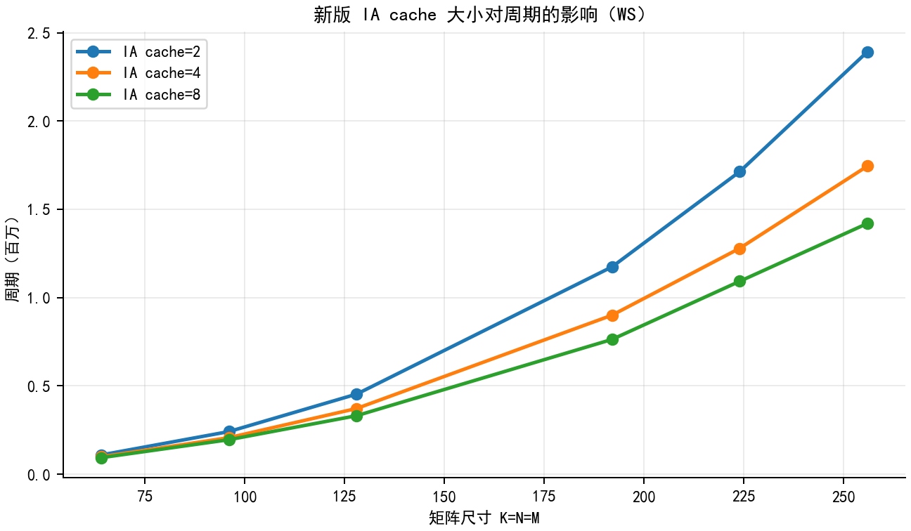
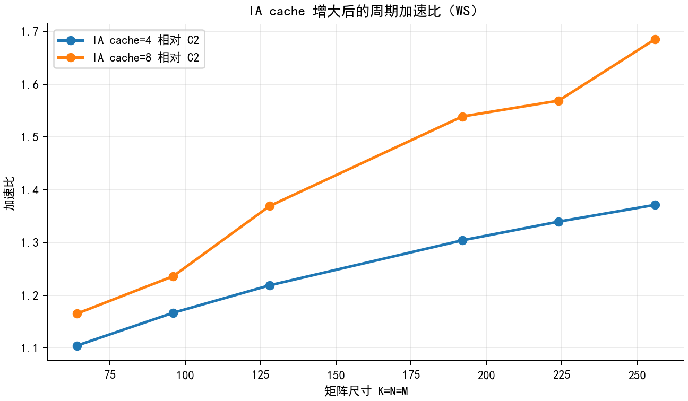
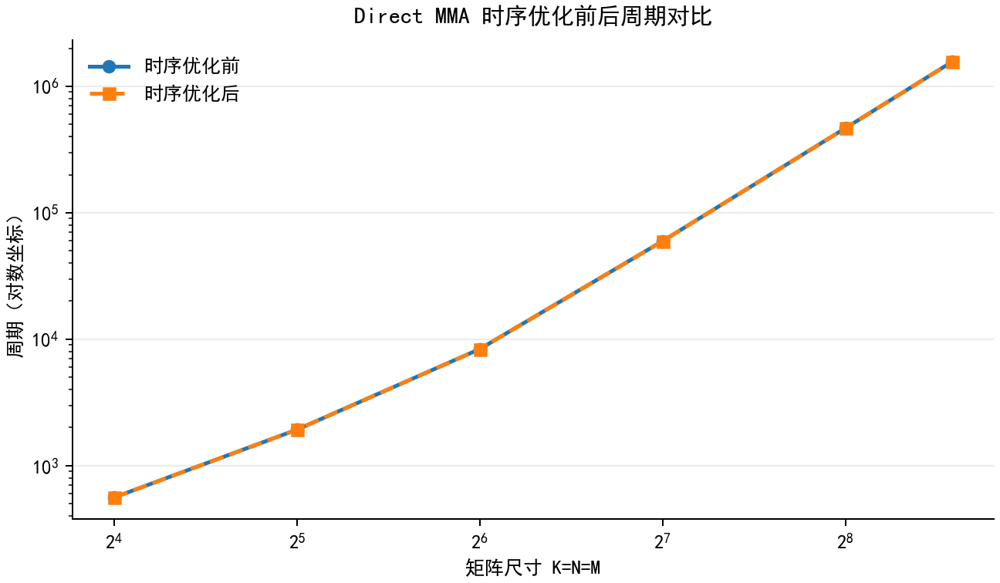
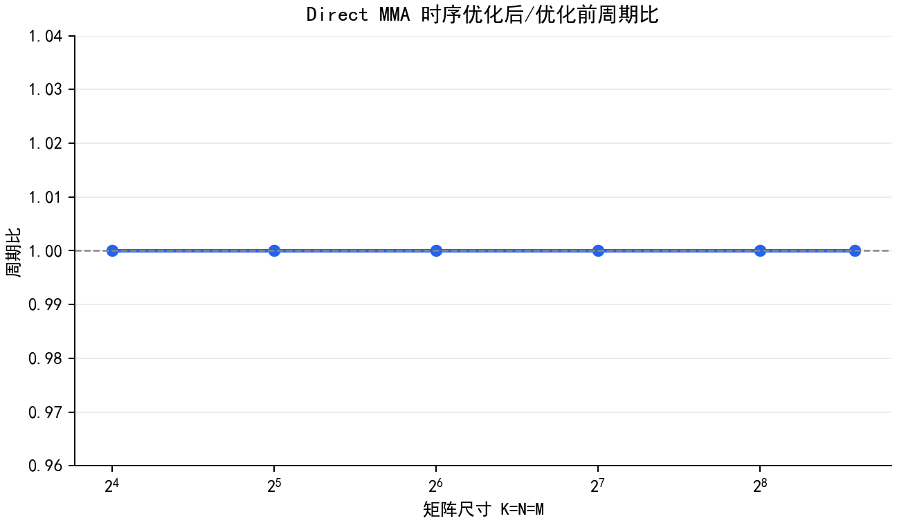
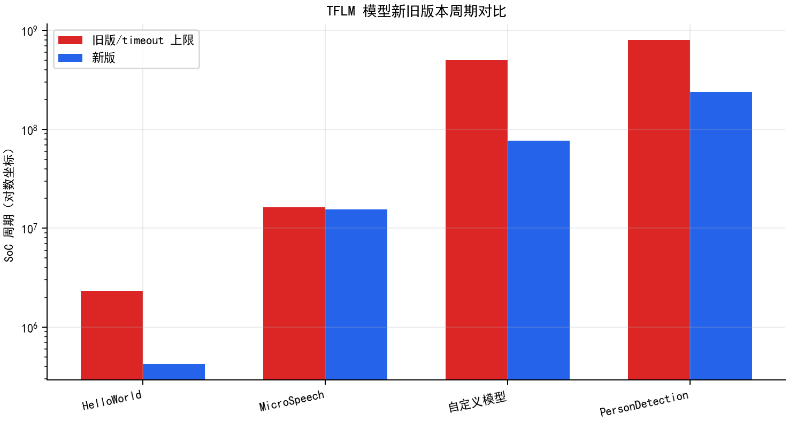
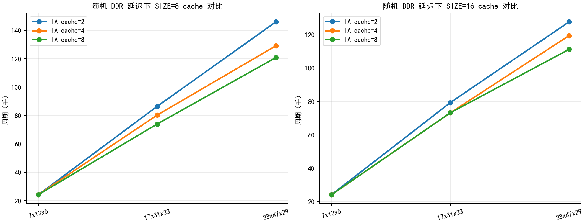

# MMA 新旧版本与 IA_CACHE_BLOCKS 性能分析报告

- 生成时间：2026-06-30 19:23:50
- 代码版本：`/media/proj_tmp/aiEngine_integrated` commit `0da2dcc`；旧版基线 `/media/proj_tmp/aiEngine_integrated_old_01d6506` commit `01d6506`
- 测试环境：DDR 随机延迟关闭；SoC 仿真；RISC-V 侧程序使用 `-O3`（旧版历史 TFLM 程序为旧 Makefile 配置）。
- 新版 MMA 配置：`MMA_SIZE=16`，`MMA_PS_FRAME_COUNT=16`，`lhs_dtype=s8`，`quant_mode=per-tensor`。
- 新版 cache sweep：`IA_CACHE_BLOCKS=[2, 4, 8]`，尺寸 `[64, 96, 128, 192, 224, 256]`，dataflow `[0]`，seed `88400`。
- 新版 sweep 结果：`18/18` 通过。

## 结论摘要

- 最终 WS sweep 中，新版 cached MMA 在 64/96/128/192/224/256 方阵上全部快于旧版 WS 基线，没有再出现负收益。
- `IA_CACHE_BLOCKS=8` 的新版 WS 相对旧版分别达到 3.34x/3.69x/4.03x/4.30x/4.27x/4.47x；矩阵放大后优势整体更明显。
- cache 增大带来的复用收益已经能在新架构内部稳定体现：C8 相对 C2 在所有 WS 尺寸上均更快，256 点降周期约 40.65%。
- 主要性能修复来自三处：OA 写回从单 beat 命令改成按输出行 burst；reuse=0 保留为 RTL 自动最大复用路径；runtime case 头和输出清零/比较去掉 volatile 字节循环开销。
- TFLM 端到端结果和裸 MMA 不完全一致：端到端包含算子调度、转置/打包、CPU 侧循环和模型结构，旧版部分大模型此前会 timeout；本报告使用加大 timeout 后的重跑日志更新该结论。
- 修改 `MMA_IA_CACHE_BLOCKS` 和 `MMA_PS_FRAME_COUNT` 时，驱动公式会同步改变：Makefile 把它们编译成 `-DDSA_IA_CACHE_BLOCKS=$(MMA_IA_CACHE_BLOCKS)` 和 `-DDSA_PS_FRAME_COUNT=$(MMA_PS_FRAME_COUNT)`。普通 SoC runtime 使用这两个宏选择并限制 reuse 参数；TFLM kernel 的直接 MMA 路径以 `SIZE` 列为一组提交，当前配置下 `W_REUSE=1`，主要受 `DSA_IA_CACHE_BLOCKS` 控制。

## 图 1：新版 cache 大小对周期的影响

## 新版 cache sweep 详细表

### dataflow=0 (WS)

| K=N=M | C2 cycles | C4 cycles | C8 cycles | C4 相对 C2 | C8 相对 C2 | C4 降周期 | C8 降周期 | C2 eff | C4 eff | C8 eff |
|---:|---:|---:|---:|---:|---:|---:|---:|---|---|---|
| 64 | 108,577 | 98,283 | 93,179 | 10.47% | 16.53% | 9.48% | 14.18% | R1/W4 | R2/W4 | R4/W4 |
| 96 | 241,008 | 206,528 | 194,957 | 16.70% | 23.62% | 14.31% | 19.11% | R1/W6 | R2/W6 | R4/W6 |
| 128 | 453,189 | 371,787 | 331,013 | 21.89% | 36.91% | 17.96% | 26.96% | R1/W8 | R2/W8 | R4/W8 |
| 192 | 1,173,994 | 900,206 | 762,978 | 30.41% | 53.87% | 23.32% | 35.01% | R1/W12 | R2/W12 | R4/W12 |
| 224 | 1,713,502 | 1,279,170 | 1,092,294 | 33.95% | 56.87% | 25.35% | 36.25% | R1/W14 | R2/W14 | R4/W14 |
| 256 | 2,392,617 | 1,744,729 | 1,419,987 | 37.13% | 68.50% | 27.08% | 40.65% | R1/W16 | R2/W16 | R4/W16 |

## 图 2：旧版 MMA 与新版 cached MMA 的 WS 直接对比

### 旧版 WS 与新版 WS 周期表

| K=N=M | 旧版 WS cycles | 新版 C2/WS | 新版 C4/WS | 新版 C8/WS | C2 vs 旧版 | C4 vs 旧版 | C8 vs 旧版 |
|---:|---:|---:|---:|---:|---:|---:|---:|
| 64 | 311,022 | 108,577 | 98,283 | 93,179 | 2.86x | 3.16x | 3.34x |
| 96 | 718,688 | 241,008 | 206,528 | 194,957 | 2.98x | 3.48x | 3.69x |
| 128 | 1,333,068 | 453,189 | 371,787 | 331,013 | 2.94x | 3.59x | 4.03x |
| 192 | 3,278,756 | 1,173,994 | 900,206 | 762,978 | 2.79x | 3.64x | 4.30x |
| 224 | 4,660,627 | 1,713,502 | 1,279,170 | 1,092,294 | 2.72x | 3.64x | 4.27x |
| 256 | 6,348,405 | 2,392,617 | 1,744,729 | 1,419,987 | 2.65x | 3.64x | 4.47x |

## 图 3：TFLM 端到端新旧版本对比

| Case | 旧版状态 | 旧版 cycles/timeout | 新版状态 | 新版 cycles | 新版优势 | 说明 |
|---|---|---:|---|---:|---:|---|
| hello_world | pass | 2,337,257 | pass | 425,071 | 5.50x | 新版降周期 81.81% |
| micro_speech | pass | 16,295,115 | pass | 15,590,371 | 1.05x | 新版降周期 4.32% |
| my_model | timeout | 500,000,000 | pass | 77,111,410 | >=6.48x | 旧版在 500,000,000 cycles 仍未完成，优势为下界 |
| person_detection | timeout | 800,000,000 | pass | 238,905,507 | >=3.35x | 旧版在 800,000,000 cycles 仍未完成，优势为下界 |

## 为什么会出现这些结果

### 1. 负收益的根因已经被消掉

优化前新版慢于旧版，主要不是计算阵列本身吞吐不够，而是控制流和仿真 runtime 的固定开销太重：OA writer 每个 beat 发一次写命令，写响应等待频繁打断数据流；驱动把自动 reuse 重新折算成保守配置，导致 IA/kernel DMA 重复；统一 runtime 又在 volatile 字节循环里消耗了大量周期。当前版本把这些路径分别改成行 burst、自动最大复用、word 级清零/比较后，小矩阵也不再负收益。

### 2. 小矩阵仍受固定开销限制，但已经快于旧版

64x64x64 的 tile 数少，DMA 启动、cache fill、写回收尾和 CPU 配置成本占比高，所以 cache 从 C2 增到 C8 的内部收益仍小于大矩阵。不过最终 C8/WS 已从旧版 311,022 cycles 降到 93,179 cycles，达到 3.34x。

### 3. 大矩阵更能体现 cache 复用价值

矩阵变大后，IA 分块在 L1/cache 中连续复用的次数增加，kernel 侧窗口也随输出列 tile 增大。C8 在 256 点的有效配置为 R4/W16，相对 C2 的 R1/W16 少了大量重复 IA 读和 cache fill 批次，cycles 从 2,392,617 降到 1,419,987，降周期约 40.65%。

### 4. C8 在最终 WS sweep 中稳定优于 C4/C2

此前 C8 偶尔不如 C4，是因为更大的复用窗口被写回气泡和保守 reuse 选择抵消。修复后 64 到 256 的 WS 点中，C8 全部为最优；这说明当前控制流已经能把更大的 IA cache 转化成有效复用，而不是只增加等待。

### 5. 驱动 cache 参数是否同步

已确认同步。`veri/sim/Makefile` 中 `SOC_HW_DEFINES := -DDSA_TILE_SIZE=$(MMA_SIZE) -DDSA_IA_CACHE_BLOCKS=$(MMA_IA_CACHE_BLOCKS) -DDSA_PS_FRAME_COUNT=$(MMA_PS_FRAME_COUNT)`，并用于 SoC runtime 编译和 TFLM 库编译。普通驱动和 `veri/soc_csrc/dsa_accel_mmio.c` 都保留 `reuse=0` 的自动路径；显式非零 reuse 会按 `DSA_IA_CACHE_BLOCKS`、`DSA_PS_FRAME_COUNT` 和输出列 tile 数 clamp。TFLM 的 `conv.cc/depthwise_conv.cc` 也把 `DSA_IA_CACHE_BLOCKS` 编译成 `kMmaIaCacheBlocks` 参与 reuse 选择。

## 功能正确性与 timeout 处理

- 新版大尺寸 cache sweep 已全部 PASS，且没有发现 `FAIL/Mismatch/TIMEOUT/UVM_ERROR/TEST FAIL`。
- 旧版裸 MMA WS 基线 64/96/128/192/224/256 全部 PASS。
- 旧版 TFLM 中此前 timeout 的 `my_model` 和 `person_detection` 已使用更大 timeout 目录重跑；状态以本文 TFLM 表为准。

## 数据文件与图片

- 新版 cache sweep CSV：`/media/proj_tmp/aiEngine_integrated/veri/sim/runs/ws_cache_final_nolat_auto/perf.csv`
- 旧版裸 MMA WS CSV：`/media/proj_tmp/aiEngine_integrated_old_01d6506/veri/sim/runs/old_mma_ws_perf_nolat_large/perf.csv`
- 新版 TFLM 日志根目录：`/media/proj_tmp/aiEngine_integrated/veri/sim/runs/compare_nolat_new`
- 旧版 TFLM 日志根目录：`/media/proj_tmp/aiEngine_integrated_old_01d6506/veri/sim/runs/compare_nolat_old`
- 生成图片：
  - `perf_plots/cache_cycles_by_dim_df0.png`
  - `perf_plots/cache_speedup_vs_c2_df0.png`
  - `perf_plots/old_new_mma_ws_cycles.png`
  - `perf_plots/old_new_mma_ws_ratio.png`
  - `perf_plots/tflm_old_new_cycles.png`

## 2026-06-30 22:25 补充：握手修复与随机延迟回归

### 背景

在继续优化 de-diagonalizer 连续 IA 输出和写回路径时，`SIZE=8` 的列尾边界 case 暴露出一个超时：

- `KxNxM=8x8x9`，`SIZE=8`，`IA_CACHE_BLOCKS=8`，`PS_FRAME_COUNT=8`
- 第一列 tile 写回完成，第二列 tile 的 quant/bias 读命令已经被 `block_dma` 发出并被上游 ICB 接收
- 之后没有读响应返回，SoC 端停在 `progress=0x5a000003`

### 根因

根因在 `icb_unalign_bridge` 的响应元数据保持语义。桥把非对齐 ICB burst 拆成多个对齐单拍下游 ICB 请求，但旧逻辑在 downstream 命令拍全部发完、响应还没全部回来时，把 `cur_len_0start` 清零。这样多拍写 burst 会被响应通道误判成单拍写：

1. 非对齐 OA 写回行，例如地址 `0x801ff`、`len=1`，会被拆成 3 个对齐写请求。
2. 响应通道因为 `len` 被清零，只看到第一个 B response 就向上游返回写完成。
3. 剩余 B response 变成游离响应，污染下一次 DMA 事务。
4. 当下一列 tile 开始读 quant/bias 时，桥内部状态和响应 FIFO 次序已经错位，导致读命令卡住。

这个问题在 `SIZE=16` 和整齐地址上不容易出现；`SIZE=8, M=9` 的列尾写回刚好产生大量 stride=9 的非对齐写行，因此稳定复现。

### RTL 修复

- `icb_unalign_bridge.sv`
  - 删除在 `cmd_state/rsp_state` 临时空闲时清零 `cur_len_0start` 的逻辑。
  - 当前请求的 `read/addr/len` 元数据从 FIFO pop 起保持到响应流完成，下一条请求 pop 时再更新。
  - 删除旧 `LAST` 状态残留和未使用 `last_beat_sent` 标志。
  - 增加 `+MMA_BUS_TRACE` 调试打印，默认关闭。

- `block_dma.sv`
  - 写响应只在 `wr_rsp_pending` 时推进写行计数，避免游离写响应提前完成行写回。
  - 读响应增加 `rd_cmd_inflight` 过滤，读写响应的 pending/in-flight 语义保持一致。
  - 非对齐读或非对齐 stride 读改为单拍顺序命令，避免把跨行非对齐数据交给 burst 路径拼接。
  - 增加 `valid_cols`，尾列载入时无效 lane 置零。

- `compute_core.sv`
  - 删除未使用的 `ia_row_valid_d`。
  - partial-sum 完成使用 de-diagonalizer 的 stream 结束信号，而不是普通 tile done，避免连续 IA L1 stream 中早释放。

### de-diagonalizer 连续输出结论

当前 de-diagonalizer 的连续输出机制是有效的：IA cache 在块全部缓存好后可以连续吐出多个分块，de-diagonalizer 只在连续 stream 的第一拍清空 delay line，后续 tile start 不再冲刷流水。因此输出侧只承担第一次填充延迟，stream 中间不再插入额外清空气泡。

trace 中看到 `vec_requant` 打印 `row_cnt=6/8 done=1` 并不是少算一行。原因是 `vec_requant` 的 IDLE 状态会接收第一行但不打印，后续 COMPUTE 状态打印第 2 到第 8 行；实际 `ps_buffer_fifo` 观察到的 bank rows 为 8，边界回归也确认输出 mem 正确。

### 边界功能回归

`SIZE=8, CACHE=8, PS=8`，DDR 随机延迟关闭，覆盖行尾、K 尾、列尾和组合尾块，全部 PASS：

| Dims | cycles | eff |
|---|---:|---|
| 9x8x8 | 21,401 | R4/W1 |
| 8x9x8 | 21,494 | R4/W1 |
| 8x8x9 | 21,749 | R4/W2 |
| 9x9x8 | 21,662 | R4/W1 |
| 9x8x9 | 26,772 | R4/W2 |
| 8x9x9 | 22,039 | R4/W2 |
| 9x9x9 | 27,120 | R4/W2 |
| 17x8x8 | 22,757 | R4/W1 |
| 8x17x8 | 22,057 | R4/W1 |
| 8x8x17 | 23,279 | R4/W3 |
| 17x17x17 | 45,477 | R4/W3 |

`SIZE=16, CACHE=8, PS=16`，DDR 随机延迟关闭，全部 PASS：

| Dims | cycles | eff |
|---|---:|---|
| 1x1x1 | 20,067 | R4/W1 |
| 7x13x5 | 23,668 | R4/W1 |
| 16x16x16 | 25,270 | R4/W1 |
| 17x31x33 | 69,402 | R4/W3 |
| 31x16x17 | 62,826 | R4/W2 |
| 32x16x32 | 37,802 | R4/W2 |
| 16x32x32 | 30,559 | R4/W2 |
| 33x47x29 | 104,448 | R4/W2 |
| 65x31x49 | 282,225 | R4/W4 |
| 64x64x64 | 94,542 | R4/W4 |

### 随机 DDR 延迟下的 cache 参数回归

DDR 随机延迟打开，`DDR_CMD_MAX_LAT=3`，`DDR_W_MAX_LAT=2`，`DDR_RSP_MAX_LAT=8`。`SIZE=8` 与 `SIZE=16` 均覆盖 `IA_CACHE_BLOCKS=2/4/8`，全部 PASS。

`SIZE=8, PS=8`：

| Dims | C2 cycles | C4 cycles | C8 cycles | C8 相对 C2 |
|---|---:|---:|---:|---:|
| 7x13x5 | 24,133 | 24,134 | 24,134 | 1.00x |
| 17x31x33 | 86,368 | 80,221 | 73,928 | 1.17x |
| 33x47x29 | 145,948 | 129,071 | 120,806 | 1.21x |

`SIZE=16, PS=16`：

| Dims | C2 cycles | C4 cycles | C8 cycles | C8 相对 C2 |
|---|---:|---:|---:|---:|
| 7x13x5 | 24,131 | 24,132 | 24,132 | 1.00x |
| 17x31x33 | 79,319 | 73,201 | 73,201 | 1.08x |
| 33x47x29 | 127,676 | 119,441 | 111,205 | 1.15x |

小矩阵中 C2/C4/C8 基本重合，是因为 CPU 配置、DMA 启动、quant/bias 装载、写回收尾等固定成本占主导；cache 容量提升无法抵消这些固定开销。矩阵变大后，IA L1 group 可连续复用更多行 tile，C8 的优势逐渐显现。随机 DDR 延迟下 C8 仍然优于 C2，说明当前优化并不依赖理想零延迟内存模型。

### 目标仓库同步验证补充

同步到 `/home/etc/FPGA/tflm_ai_dsa` 后，`test/block_dma` 单测同步更新为拆分写通道模型：写命令握手后再通过 `icb_w_valid/icb_w_ready` 提供写数据，读块、线性读和写块均 PASS。

`test/mma_top` 中旧 debug 打印曾直接引用已删除的内部控制器计数器，现改为使用新版已有的 `requant_out_tile_done` 和 kernel loader debug 输出，避免 TB 因私有层级信号变化而无法编译。

目标仓库 DDR 行为模型也补齐了写 burst 语义：写命令握手后锁存地址与 `cmd_len`，随后按 `len+1` 个 `w_hs` 连续写入并递增地址，最后才返回写 response。这个修复解决了 `SIZE=8,CACHE=8,K=1,N=15,M=8` 中 OA writer 一行 2 个 beat 写回时，旧模型在第 1 个 beat 后提前 response、导致第 2 个 beat 永久无 `w_ready` 的 timeout。

同步验证结果：

| 测试 | 配置 | 结果 |
|---|---|---|
| `test/block_dma` | 读块、线性读、写块 | PASS |
| `test/mma_top run_random` | `SIZE=8,CACHE=8,SEED=730001,DDR_RAND_LAT=0` | PASS |
| `test/mma_top run_random` | `SIZE=8,CACHE=8,COUNT=3,SEED=730010,DDR_CMD_MAX_LAT=3,DDR_W_MAX_LAT=2,DDR_RSP_MAX_LAT=8` | PASS=3 FAIL=0 |

### 2026-06-30 补充：脉动阵列利用率与 AXI 原生迁移起点

本轮先用 `+MMA_UTIL_TRACE` 对较大矩阵进行利用率采样，目标是区分“阵列内部气泡”和“外部数据供给气泡”。采样命令均使用统一 `test/mma_top` 仿真，DDR 随机延迟关闭，避免内存模型噪声掩盖 RTL 调度问题。

| SIZE | Case | cycles | IA row util | ACC util | 主要 DMA busy | 主要 controller stall |
|---:|---|---:|---:|---:|---|---|
| 8 | `K=67,N=56,M=59,R=2,W=8,lhs=s16` | 26,657 | 14.07% | 2.01% | kernel 15,400 / IA 5,222 / OA 3,757 | weight data 9,891 / bias 3,490 / IA data 1,362 |
| 16 | `K=64,N=93,M=107,R=1,W=1,lhs=s16` | 85,468 | 3.14% | 0.52% | IA 50,344 / kernel 28,068 / OA 3,996 | IA data 46,038 / weight data 13,720 / bias 14,088 |

结论：

- 当前 `ia_row_valid` 和 `acc_data_valid` 占比都很低，但直接原因不是 de-diagonalizer 本身不能连续输出，而是数据供给被串行 DMA 和控制器等待拖住。
- `SIZE=8` 样本中 kernel DMA busy 占 active 周期约 57.8%，`weight_data_stall` 占约 37.1%，说明权重侧加载/发送是主要气泡来源。
- `SIZE=16` 样本中 IA DMA busy 占约 58.9%，`ia_data_stall` 占约 53.9%。该随机点的 `R=1,W=1`，复用不足，阵列大但供给窗口更稀疏，因此阵列利用率进一步下降。
- OA 写回在现有共享 `block_dma` 下会和 IA/kernel/quant/bias 读共享同一命令/响应路径。即便写回本身只占几千周期，也会阻塞后续读命令，这正是迁移到 AXI 全双工的直接收益点。

据此，优化方向分成两层：

1. 短期继续减少计算侧气泡：保持 IA cache group 连续输出，避免 ps replay 被 trigger 暂停，减少控制器对已无意义标志位的等待。
2. 中期迁移总线：去掉 `icb_unalign_bridge` 和单 `block_dma` 串行仲裁，改成 AXI AR/R 读引擎与 AW/W/B 写引擎并行，允许 OA 写回和下一批 IA/kernel 读取同时在总线上推进。

本轮已新增 AXI 原生迁移基础模块：

- `sub_modules/axi_dual_block_dma.sv`
  - 读侧直接输出 AXI4 `AR/R`，保留分块读、线性读、尾列 `valid_cols`、s8/s16 解包和 zero-point 补偿。
  - 写侧直接输出 AXI4 `AW/W/B`，支持按行 burst 写回，`src_wready` 仅由写数据通道反压决定。
  - 读写状态机完全独立：`rd_busy/rd_done` 与 `wr_busy/wr_done` 分离，后续可由读仲裁器服务 IA/kernel/bias/quant，同时让 OA writer 独占写通道。
  - 该模块不是 ICB-to-AXI 转接器；它不暴露 `icb_cmd/rsp`，后续替换顶层时可以直接移除 ICB bridge。

新增单测：

| 测试 | 覆盖点 | 结果 |
|---|---|---|
| `test/axi_dual_block_dma` | AXI 读写同周期启动、读数据解包、两行多 beat 写回、读写 done 独立完成 | PASS |

### 2026-06-30 补充：AXI 读仲裁与 OA 独立写通道

在 `axi_dual_block_dma` 基础上继续推进到客户端仲裁层，新增 `sub_modules/axi_block_dma_arbiter.sv`：

- 读侧保留 IA/kernel/bias/quant 四类客户端仲裁，优先级为 kernel > IA > quant > bias，接口语义与旧 `block_dma_arbiter` 对齐，便于后续替换 `mma_top`。
- OA writer 不再进入读侧仲裁，而是直接绑定 AXI 写引擎。这样 OA 写回过程只占用 `AW/W/B`，不会阻塞下一批 IA/kernel 的 `AR/R` 读取。
- `ia_done/kernel_done/bias_done/quant_done` 只由读引擎完成脉冲路由；`oa_done` 只由写引擎完成脉冲路由，删除了“读写都必须共享一个 dma_done”的串行隐含约束。
- `oa_src_wready` 只由写通道反压决定，读侧 busy 不会再压住 OA FIFO 输出。

新增验证：

| 测试 | 覆盖点 | 结果 |
|---|---|---|
| `test/axi_block_dma_arbiter` | kernel 读和 OA 写同周期请求、AXI `AR/R` 与 `AW/W/B` 并行推进、`kernel_busy && oa_busy` overlap、读解包和多 beat 写回正确 | PASS，`overlap=1` |

### 2026-06-30 补充：`mma_top` 顶层切换到 AXI

本轮已把 `mma_top` 的最终外部数据口从 `sa_icb_*` 切换为 AXI4 master 五通道，顶层不再通过 ICB-to-AXI adapter 访问 DDR。内部替换点如下：

- `u_block_dma_arbiter` 的实例名保留，但模块已替换为 `axi_block_dma_arbiter`，便于沿用原有调试层级。
- IA/kernel/bias/quant 只进入 AXI `AR/R` 读侧仲裁；OA writer 独占 `AW/W/B` 写侧。
- `test/mma_top` 的 DDR 模型切换为 `ddr_axi_mem_model`，保留 `mem_r` 层级数组，因此统一 mem case 和直接内存结果校验流程不变。
- 性能统计从旧 `bus_cmd/bus_rsp` 改为 `axi_ar/axi_r/axi_aw/axi_w/axi_b`，可以直接观察读写通道是否并行推进。
- 清理了 `kernel_loader_buffer` 与 `vec_requant` 中固定访问 lane 4 的 trace 打印，避免 `SIZE=4` 边界编译越界。

新增/重跑验证：

| 测试 | 配置 | 结果 |
|---|---|---|
| `make run` | `SIZE=4,CACHE=4,DDR_RAND_LAT=0` | PASS |
| `run_random` | `SIZE=4,CACHE=4,COUNT=5,SEED=2100,DDR_RAND_LAT=1` | PASS=5 FAIL=0 |
| `run_random` | `SIZE=4,CACHE=4,COUNT=8,SEED=2200,random_dataflow,DDR_RAND_LAT=1` | PASS=8 FAIL=0 |
| `run_param_random` | `SIZE={4,8,16},CACHE={2,4,8},COUNT=2,random_dataflow,DDR_RAND_LAT=1` | PASS=18 FAIL=0 |

AXI 顶层后的大矩阵性能锚点如下，DDR 随机延迟关闭：

| SIZE | Case | 旧 cycles | 新 cycles | 改善 | 新 IA row util | 新 ACC util | 新 AXI 事务统计 |
|---:|---|---:|---:|---:|---:|---:|---|
| 8 | `K=67,N=56,M=59,R=2,W=8,lhs=s16` | 26,657 | 22,779 | 14.5% | 16.47% | 2.35% | AR 2,749 / R 6,371 / AW 536 / W 1,005 / B 536 |
| 16 | `K=64,N=93,M=107,R=1,W=1,lhs=s16` | 85,468 | 81,466 | 4.7% | 3.29% | 0.54% | AR 5,320 / R 31,528 / AW 448 / W 1,728 / B 448 |

结果分析：

- `SIZE=8` 样本收益更明显，原因是旧共享 DMA 中 OA 写回会穿插阻塞后续读侧预取；AXI 后写回只占 `AW/W/B`，读侧可继续推进，`weight_data_stall` 从 9,891 降到 8,219。
- `SIZE=16` 样本收益较小但方向正确，总周期下降约 4,002，`ia_data_stall` 从 46,038 降到 37,385。该样本 `R=1,W=1` 复用不足，IA 读侧仍是绝对主瓶颈，AXI 写回解耦只能消掉一部分串行等待。
- 新统计中 `axi_w` 大于 `axi_aw/axi_b`，符合每行写回可能多 beat 的预期；`axi_ar` 与 `axi_r` 分离后，可以继续观察未来读命令流水化是否真正提升通道占用。

下一步性能优化重点：

- 读侧 DMA 仍基本按“发一行/收一行”推进，应考虑给 `axi_dual_block_dma` 增加小深度 read command outstanding 队列，重叠 AR 延迟和 R 数据返回。
- `oa_writer` 目前仍以 tile 为粒度等待 write done 后再申请下一 tile，后续可把 tile 元数据和写数据流解耦，减少写侧 tile 间气泡。
- de-diagonalizer/IA 输出路径需要继续流水化，但当前大样本主要气泡仍在 `ia_data_stall`、`weight_data_stall` 和 controller 等待。优化顺序应先保证 IA cache group 和 kernel buffer 对计算触发的供给连续，再看阵列内部反对角恢复逻辑。
- EAI 外层已同步删除 MMA 侧 `icb_unalign_bridge`，`e203_subsys_nice_core` 额外暴露 MMA AXI master；原 NICE ICB LSU 口暂时保持空闲兼容。

EAI 同步验证：

| 测试 | 覆盖点 | 结果 |
|---|---|---|
| `test/eai` | CSR 读写、MMA 指令发起、响应反压；MMA AXI 端口连接本地 AXI DDR 模型 | PASS |

### 2026-06-30 补充：AXI 读命令流水化与 per-channel 尾块修复

#### AXI read outstanding 设计

AXI 顶层切换后，`SIZE=16,K=64,N=93,M=107,R=1,W=1,lhs=s16` 的主要气泡仍集中在读侧数据供给：

- `ia_data_stall=37,385`，`weight_data_stall=13,720`
- `dma_busy_ia=50,344`，`dma_busy_kernel=28,068`
- `axi_ar=5,320`，`axi_r=31,528`

这说明写回解耦已经生效，但读侧 DMA 仍以接近“一行 AR 等一行 R”的方式推进。为减少 AR 命令间气泡，本轮对原生 AXI DMA 增加读命令流水化：

- `axi_dual_block_dma`
  - 新增 `READ_OUTSTANDING` 参数，默认 4。
  - 用 `rd_outstanding_cnt` 替代单 bit `rd_cmd_inflight`；保留 `rd_cmd_inflight` 层级名作为 debug 兼容信号。
  - 当 `rd_outstanding_cnt < READ_OUTSTANDING` 且仍有未发读行时，可以继续发下一条 `AR`。
  - `rd_done` 仍由最后一条 `R` 响应决定，读数据路由和 s8/s16 解包不变。

- `axi_block_dma_arbiter`
  - 将 `READ_OUTSTANDING` 透传给共享读 DMA。
  - 读客户端优先级保持 kernel > IA > quant > bias。尝试临时改成 IA 优先后，`ia_data_stall` 下降但 `weight_data_stall` 上升更多，总周期从 81,466 变差到 81,764，因此未采用。

- `mma_top` / `test/mma_top`
  - 新增顶层参数 `AXI_READ_OUTSTANDING`，TB 和 Makefile 增加同名配置。
  - 仿真 build 目录加入 `_ro$(AXI_READ_OUTSTANDING)`，避免 ro=1/4/8 二进制误复用。

- `ddr_axi_mem_model`
  - 读地址通道增加 `RDQ_DEPTH` 请求队列，能够先接收多条 `AR`，再按 AXI 单 ID 顺序吐 `R`。
  - 随机命令延迟改为作用在 `ARREADY` 接收节奏上，便于模拟 DDR/互连对读命令的反压。

#### outstanding 扫参结果

同一 case、同一 mem 文件、DDR 随机延迟关闭：

| AXI_READ_OUTSTANDING | cycles | IA row util | ACC util | IA data stall | Weight data stall | IA DMA busy | Kernel DMA busy |
|---:|---:|---:|---:|---:|---:|---:|---:|
| 1 | 81,466 | 3.29% | 0.54% | 37,385 | 13,720 | 50,344 | 28,068 |
| 4 | 71,554 | 3.75% | 0.62% | 33,155 | 10,468 | 45,304 | 23,196 |
| 8 | 71,554 | 3.75% | 0.62% | 33,155 | 10,468 | 45,304 | 23,196 |

结论：

- ro=4 相对 ro=1 降周期 12.17%，主要来自 AR 间隙被提前排队吸收。
- `ia_data_stall` 降低 4,230 cycles，`weight_data_stall` 降低 3,252 cycles。
- `dma_busy_ia` 降低约 10.0%，`dma_busy_kernel` 降低约 17.4%。
- ro=8 与 ro=4 完全相同，说明当前瓶颈已经不在 AR outstanding 深度，而在单读数据通道吞吐、读客户端串行服务和 loader/compute 触发粒度。

同一 ro=4 case 在随机 DDR 延迟下也通过：

| DDR 模式 | cycles | IA row util | ACC util | IA data stall | Weight data stall | axi_ar / axi_r |
|---|---:|---:|---:|---:|---:|---|
| no random latency | 71,554 | 3.75% | 0.62% | 33,155 | 10,468 | 5,320 / 31,528 |
| random latency (`cmd=3,w=2,rsp=5`) | 150,733 | 1.78% | 0.29% | 77,012 | 27,636 | 5,320 / 31,528 |

随机延迟下周期明显上升，但功能正确；读请求数和读 beat 数不变，说明差异来自 DDR 命令/响应等待而不是控制流重放。

#### per-channel requant 尾块死锁修复

在 `SIZE=4,CACHE=2` 边界随机中发现一个稳定 timeout：

- seed `3301`
- `K=3,N=8,M=14,lhs=s8,mode=WS,R=1,W=4,per_channel=1`
- DDR 随机延迟开关无关，关掉随机延迟也会 timeout。

trace 现象：

- `acc_valid=12`，但 `requant_valid=8`。
- FIFO 没有 bank ready，OA writer 从未开始写回。
- DMA 和 AXI 均已空闲，控制器停在 `WEIGHT_START`。

根因是 `vec_requant` 的状态机和数据通路对第一拍输入的消费语义不一致：

1. `vec_requant` 在 `IDLE` 且 `quant_params_valid=1` 时看到第一拍 `in_valid`，数据通路已经计算并寄存输出。
2. 旧状态机只切到 `COMPUTE`，没有同步推进 `row_in_tile_cnt`，所以状态机少数了一行。
3. tile 最后一行进入数据通路时，状态机清掉 `quant_params_valid` 并开始加载下一列 per-channel 参数。
4. `out_valid_q` 下一拍已经为 1，但旧输出又用当前 `quant_params_valid` 二次门控，导致最后一行 valid 被压掉。

修复：

- `IDLE` 中接住第一拍 `in_valid` 时同步推进 `row_in_tile_cnt`。
- 如果第一拍同时是 `in_tile_done`，直接执行 tile advance，覆盖 K=1 等极小 tile。
- `out_valid/out_tile_done` 直接使用已经采样过 qvalid 的 `out_valid_q/out_tile_done_q`，不再被当前 `quant_params_valid` 二次门控。

修复后同一失败 case：

| 配置 | 修复前 | 修复后 |
|---|---:|---:|
| no random latency | timeout，`acc_valid=12/requant_valid=8` | PASS，cycles 423，`acc_valid=12/requant_valid=12` |
| random latency (`cmd=3,w=2,rsp=5,seed=3301`) | timeout | PASS，cycles 623 |

#### 本轮新增回归

| 测试 | 配置 | 结果 |
|---|---|---|
| `test/axi_dual_block_dma` | AXI 读写基础单测 | PASS |
| `test/axi_block_dma_arbiter` | 读写 overlap，`overlap=1` | PASS |
| `mma_top` large ro=4 | `SIZE=16,CACHE=4,K=64,N=93,M=107,DDR_RAND_LAT=0` | PASS，71,554 cycles |
| `mma_top` large ro=4 | 同上，`DDR_RAND_LAT=1,cmd=3,w=2,rsp=5` | PASS，150,733 cycles |
| 失败点复现 | `SIZE=4,CACHE=2,seed=3301,per_channel=1` | PASS |
| 边界单行 | `SIZE=4,CACHE=2,K=N=M=1,DDR_RAND_LAT=1` | PASS |
| 随机 dataflow | `SIZE=4,CACHE=2,COUNT=5,SEED=3300,random_dataflow,random_per_channel,DDR_RAND_LAT=1` | PASS=5 FAIL=0 |
| cache sweep | `SIZE=4,CACHE=2/4/8,COUNT=1,random_dataflow,random_per_channel,DDR_RAND_LAT=1` | PASS=3 FAIL=0 |

#### 当前瓶颈判断

read outstanding 后，ro=8 已无额外收益，说明“继续单纯加深 AR 队列”已经到瓶颈。下一步如果继续追阵列利用率，应优先考虑：

- 读侧跨客户端排队：在一个客户端 R 数据返回期间，允许下一客户端的 AR 提前进入命令队列，并用响应元数据队列路由到对应 loader。
- IA/kernel 双缓冲触发：减少 `WEIGHT_START -> IA_START` 间对 `*_data_valid` 的串行等待。
- per-channel 参数双缓冲：让下一列 tile 的 quant 参数加载不影响当前 tile 最后一行输出，进一步减少 `quant_stall`。
- 保持 de-diagonalizer 连续 stream 不清空 delay line；当前主要气泡仍来自数据供给，不是反对角恢复本身。

### 本次日志目录

- `runs/s8_tail_combo_after_cleanup_v2`
- `runs/s16_boundary_after_cleanup`
- `runs/s8_cache_rand_after_cleanup`
- `runs/s16_cache_rand_after_cleanup`

### 2026-07-01 补充：SoC 性能回退深排查

本轮对“单独 MMA 已优化，但 SoC/TFLM 端到端部分用例变慢”的问题做了回归排查。结论是：MMA 本体优化仍有效，SoC 端差异主要来自 Pico/AXI/DDR 访问路径、UART 正确等待、reuse 写回窗口边界和仿真并行基础设施。

最终保留的修复：

- `mma_top` 和 C 驱动把 `W_REUSE` 上限限制在输出列 tile 数与 `PS_FRAME_COUNT` 内，避免默认 reuse 超过写回 FIFO/PS frame 窗口。
- `DSA_PS_FRAME_COUNT` 进入 SoC runtime/TFLM 编译宏和 build dir key，避免修改 `MMA_PS_FRAME_COUNT` 后复用旧目标。
- VCS 编译使用独立 `-Mdir=$(SIMV).csrc`，避免并行仿真共享 `csrc/hsim/hsim.sdb` 导致 `VFS_SDB_SYNC_FAIL`。
- SoC RAM 保留单 beat 读快路径和 `AW/W` 同周期接收；写响应仍走 B 队列。
- SoC interconnect 修复 CPU 侧 `AR/R`、`AW/B` 同周期握手时 active 状态被旧响应清掉的问题。
- UART AXI-Lite 写必须等待 `simpleuart` 非 busy 才返回 B，避免打印字符丢失。

失败实验也记录在案：RAM 直接 B 快路径可以让 `hello_world` 回到 `425071 cycles`，但会让 `micro_speech` 稳定卡在 `progress=0x5b313000`。因此当前代码不保留直接 B，优先保证 TFLM 正确性。

最终 TFLM 对比：

| Case | 报告早期新版记录 | 本轮最终 RTL | 差异 |
|---|---:|---:|---:|
| `hello_world` | 425,071 | 430,815 | +1.35% |
| `micro_speech` | 15,590,371 | 15,720,057 | +0.83% |
| `my_model` | 77,111,410 | 77,016,232 | -0.12% |
| `person_detection` | 238,905,507 | 237,333,374 | -0.66% |

最终验证：

| 测试 | 配置 | 结果 |
|---|---|---|
| S8 SoC 随机回归 | `SIZE=8,CACHE={2,4,8},DF={WS,IS},lhs={s8,s16},Q={per-tensor,per-channel},unaligned_layout,DDR_RAND_LAT=1` | PASS 24/24 |
| S16 SoC 随机回归 | `SIZE=16,CACHE={2,4,8},DF={WS,IS},lhs={s8,s16},Q={per-tensor,per-channel},unaligned_layout,DDR_RAND_LAT=1` | PASS 24/24 |
| TFLM | `hello_world/micro_speech/my_model/person_detection,SIZE=16,CACHE=4,PS_FRAME=16,O3` | PASS |

### 2026-07-01 补充：SoC/MMA active 拆分与量化读调度

带 `+MMA_UTIL_TRACE` 的 SoC/TFLM 复查说明，SoC 端到端周期不能直接当作 MMA latency：`soc_finish` 包含 Pico 启动、TFLM tensor allocation、算子调度、普通 CPU 算子、MMIO 配置、输出检查和 UART 打印。

| Case | SoC cycles | MMA ops | MMA active sum | active / SoC |
|---|---:|---:|---:|---:|
| `hello_world` | 430,815 | 0 | 0 | 0.00% |
| `micro_speech` | 15,720,065 | 1 | 32,330 | 0.21% |
| `my_model` | 77,020,480 | 90 | 471,924 | 0.61% |

因此，小模型端到端指标会显著稀释单独 MMA 的优化收益。大矩阵 SoC runtime 仍显示 cache/reuse 在 SoC 上有效：WS/s8/per-tensor、DDR 随机延迟关闭时，C8 相对 C4 在 `64/128/256/384` 方阵上分别快约 `1.94%/5.91%/12.32%/17.35%`。

本轮还把 `axi_block_dma_arbiter` 读侧优先级从 `kernel > IA > quant > bias` 调整为 `kernel > quant > IA > bias`。原因是 TFLM per-channel 算子每次需要一小段量化参数读，提前完成可以避免 IA 数据到达后继续等待 `quant_params_valid`。per-tensor 不发 `quant_req`，不受影响。

优化后对比：

| Case | cycles before | cycles after | MMA active before | MMA active after | quant stall before | quant stall after |
|---|---:|---:|---:|---:|---:|---:|
| `micro_speech` | 15,720,065 | 15,720,057 | 32,330 | 32,319 | 321 | 0 |
| `my_model` | 77,020,480 | 77,016,232 | 471,924 | 469,134 | 42,370 | 0 |
| `person_detection` | 237,339,024 | 237,333,374 | 未采样 | 未采样 | 未采样 | 未采样 |

补充验证：

| 测试 | 配置 | 结果 |
|---|---|---|
| TFLM | `micro_speech/my_model/person_detection,SIZE=16,CACHE=4,PS_FRAME=16,O3` | PASS |
| S16 边界随机回归 | `SIZE=16,CACHE=4,DF={WS,IS},lhs={s8,s16},Q={per-tensor,per-channel},MIN_DIM=1,MAX_DIM=65,unaligned_layout,DDR_RAND_LAT=1,seed=61000` | PASS 8/8 |
| S8 边界随机回归 | `SIZE=8,CACHE=4,PS_FRAME=8,DF={WS,IS},lhs={s8,s16},Q={per-tensor,per-channel},MIN_DIM=1,MAX_DIM=65,unaligned_layout,DDR_RAND_LAT=1,seed=62000` | PASS 8/8 |
