# TFLM AI DSA NPU RTL 仿真与 FPGA 验证报告

| 文档项 | 内容 |
|---|---|
| 文档名称 | TFLM AI DSA NPU RTL 仿真与 FPGA 验证报告 |
| 验证对象 | NPU RTL、AXI-Lite 配置接口、AXI4 DMA 数据访问、PicoRV32 SoC 集成环境、150 MHz FPGA 工程 |
| RTL 仿真工具 | Verilator 5.040、Synopsys VCS W-2024.09-SP1、URG W-2024.09-SP1 |
| FPGA 工具 | Vivado 2024.2.1 |
| FPGA 器件 | Xilinx Artix-7 `xc7a200tfbg484-3` |
| 报告日期 | 2026-07-04 |
| 报告状态 | RTL 模块级仿真、SoC 功能仿真、覆盖率收集、Vivado 前仿、综合实现、bitstream 生成、150 MHz 时序和分模块资源报告均已完成；当前裁剪工程的 post-implementation functional 后仿未作为新增 PASS 证据归档 |

## 1. 验证结论摘要

本报告汇总 NPU 从 RTL 功能仿真到 FPGA 工程实现的验证结果。RTL 验证覆盖模块级 directed test、NPU 顶层随机 golden compare、SoC C 程序功能仿真、TFLM/NMSIS-NN 推理仿真和 VCS 覆盖率收集；FPGA 验证覆盖 Vivado behavioral 前仿、bitstream 生成、150 MHz routed timing、route/DRC 检查和分模块资源统计。

当前归档结果表明：NPU 顶层随机 smoke 用例 2/2 通过；SoC C 回归 3/3 通过；int8 参数回归 24/24 通过；int16 参数回归 24/24 通过；固定 IA cache 容量扫描 12/12 通过；最终关键 SoC 组合 2/2 通过。覆盖率方面，模块级 line coverage 为 `96.71%`，SoC 级 line coverage 为 `95.21%`，均达到 95% 签核目标。FPGA 裁剪功能工程完成 150 MHz routed 实现，setup WNS 为 `+0.398 ns`，hold WHS 为 `+0.058 ns`，DRC 为 0 error，bitstream 已生成。

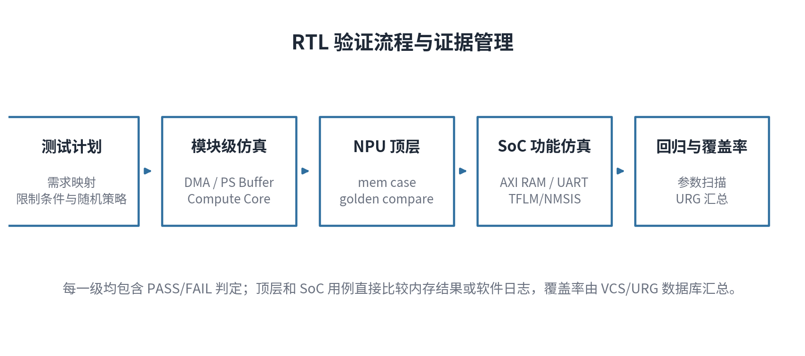

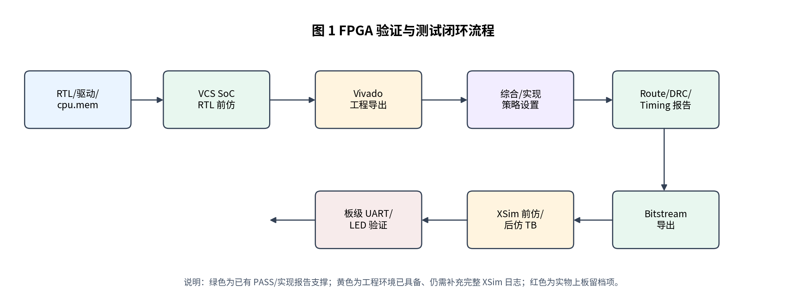

## 2. 被测对象与验证配置

### 2.1 NPU RTL 范围

被测 RTL 覆盖当前 NPU 主体和 SoC 集成环境。NPU 通过 AXI-Lite 寄存器接口接收配置，通过 AXI4 master 访问共享 RAM，内部包含 IA cache、kernel loader、bias loader、compute core、partial sum buffer、requant 和 output writer 等单元。

| 类别 | 主要模块 | 验证重点 |
|---|---|---|
| NPU 顶层 | `npu_top`、`npu_axil_top`、AXI-Lite 寄存器模块 | 配置寄存器、启动完成握手、数据流调度、状态反馈 |
| DMA 与访问仲裁 | `axi_dual_block_dma`、`axi_block_dma_arbiter` | AXI4 burst、outstanding、读写请求仲裁、字节写掩码、响应反压 |
| 输入加载 | `ia_loader`、`kernel_loader`、`bias_loader` | IA cache 分块、权重列展开、bias 与量化参数读取、非整块尺寸 |
| 计算核心 | `compute_core`、`ws_systolic_cell` | 参数化阵列、WS/IS 数据流、partial sum 累加、无效通道清零 |
| 写回量化 | `vec_requant`、int8 输出 FIFO、`oa_writer` | per-tensor/per-channel requant、饱和、FIFO 排空、AXI 写回顺序 |
| SoC 集成 | `soc_top`、PicoRV32、AXI interconnect、AXI RAM、UART | CPU 配置 NPU、共享 RAM 访问、UART 监视、总线锁定 |

### 2.2 关键参数

RTL 回归覆盖多个阵列规模和 IA cache 配置；FPGA 最终工程采用资源裁剪配置。`SIZE` 表示脉动阵列单边规模，`IA_CACHE_BLOCKS` 表示 IA cache 分块数量，`PS_FRAME_COUNT` 表示 partial sum buffer 帧数。

| 配置项 | RTL 回归覆盖 | FPGA 最终工程 |
|---|---|---|
| 阵列规模 | 4x4、8x8、16x16、32x32 等组合 | 4x4 |
| IA cache 分块数 | 2、4、8、16、32、64、256 等组合 | 32 |
| 输入位宽 | int8、int16 | int8 |
| 数据流 | WS 与 IS | WS |
| 量化模式 | per-tensor 与 per-channel | per-tensor |
| AXI 数据宽度 | 32 bit | 32 bit |
| NPU 内部地址宽度 | 参数化覆盖 | 19 bit |
| CPU RAM 深度 | SoC 仿真与 FPGA 工程保持一致 | 65536 word |
| 核心时钟 | RTL 仿真按周期统计 | 150 MHz |

FPGA 资源裁剪工程用于验证当前板级容量、时序和基本推理功能；完整功能组合由 RTL/SoC 回归验证覆盖。

## 3. RTL 仿真验证方法

RTL 验证采用分层测试方法。第一层为模块级 directed/smoke，直接检查局部接口时序和数据变换；第二层为 NPU 顶层随机用例，通过 Python 生成输入、权重、bias、量化参数和 golden mem，仿真结束后直接比较 RAM 输出区域；第三层为 SoC C 程序仿真，由 PicoRV32 通过 AXI-Lite 配置 NPU 并读取结果；第四层为 TFLM/NMSIS-NN 推理仿真和覆盖率收集。

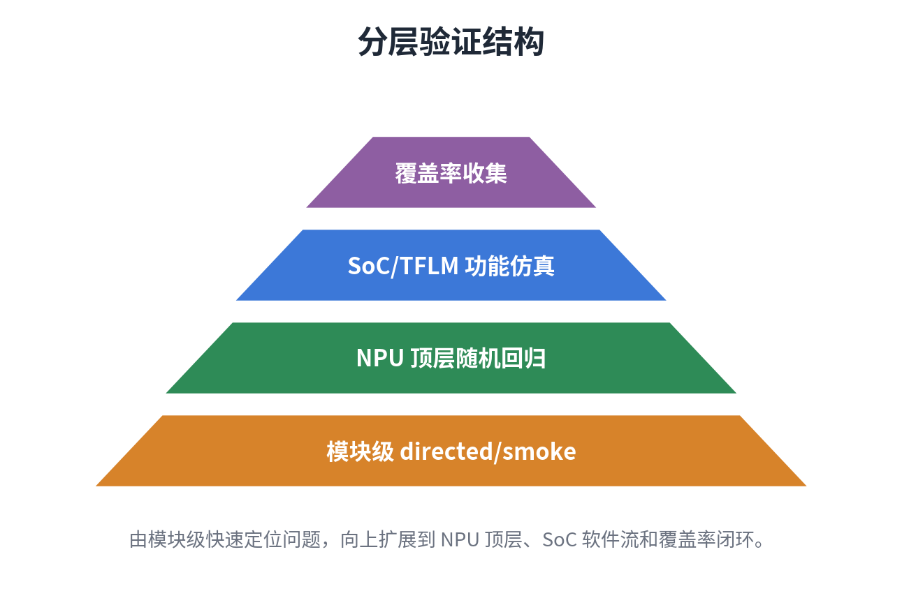

| 检查项 | 检查方法 | 通过条件 |
|---|---|---|
| 复位与启动 | directed/random case 观察 `calc_start`、`sa_ready` | 复位后空闲，启动后执行，完成后恢复 ready |
| AXI-Lite 配置 | SoC C 程序写寄存器并启动 NPU | C 程序返回 PASS，`UVM_ERROR=0` |
| AXI4 读写 | DMA 模块 TB 与 NPU 顶层 memory compare | 地址递增正确，`RLAST/WLAST` 正确，RAM 输出与 golden 一致 |
| RAM 随机响应延时 | 命令、写数据、读响应插入随机延时 | 无死锁，无数据错位，输出 compare PASS |
| 非整块尺寸 | K/N/M 不为阵列规模整数倍 | 无效通道不污染输出，字节写掩码正确 |
| 数据流与位宽 | WS/IS、int8/int16 参数回归 | 对应组合全部 PASS |
| 量化模式 | per-tensor 与 per-channel 回归 | 输出与 golden 一致 |
| 覆盖率 | VCS `.vdb` 数据库 | line coverage 达到 95% |

## 4. 模块级仿真结果

模块级仿真用于隔离 DMA、缓存、计算阵列、partial sum buffer 和写回等局部问题。所有模块级 smoke 均已通过。

| 模块 | Testbench | 运行入口 | 验证内容 | 结果 |
|---|---|---|---|---|
| AXI dual block DMA | `test/axi_dual_block_dma/tb_axi_dual_block_dma.sv` | `make -C test/axi_dual_block_dma run` | AXI4 读写通道、burst 长度、读写完成、异常检查 | PASS |
| AXI block DMA arbiter | `test/axi_block_dma_arbiter/tb_axi_block_dma_arbiter.sv` | `make -C test/axi_block_dma_arbiter run` | 多读客户端仲裁、请求重叠、DMA 输出稳定性 | PASS |
| PS Buffer | `test/ps_buffer/tb_ps_buffer.sv` | `make -C test/ps_buffer run` | diagonal partial sum replay、de-diagonalize、FIFO bypass | PASS |
| Compute Core | `test/compute_core/tb_compute_core.sv` | `make -C test/compute_core run_random` | systolic array 输出、final row、`tile_calc_over` 与 `acc_data_valid` 时序 | PASS |
| NPU Top | `test/npu_top/tb_npu_top.sv` | `make -C test/npu_top run_random` | 完整 loader/compute/requant/writeback，直接比较 RAM | PASS |

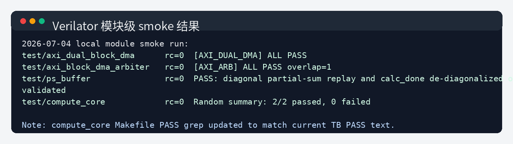

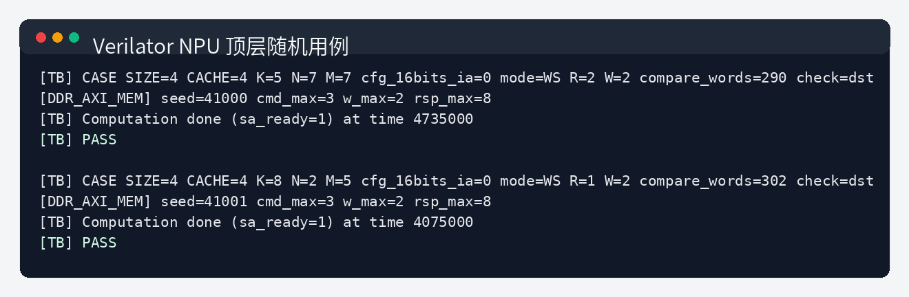

## 5. NPU 顶层随机仿真结果

NPU 顶层测试使用 Python 生成 `init.mem`、`golden.mem` 和 `config.mem`。仿真时 RAM 模型先加载 `init.mem`，NPU 运行完成后测试平台读取输出区域，与 `golden.mem` 逐字节比较。该方法减少了仿真文本输出，并直接检查字节写掩码、非整块尺寸、写回顺序和量化结果。

| 日志 | 阵列规模 | IA cache 分块数 | K | N | M | 数据流 | RAM 响应延时 | 完成时间 | 结论 |
|---|---:|---:|---:|---:|---:|---|---|---:|---|
| `/tmp/tflm_ai_dsa_report_s4/random_41000.log` | 4x4 | 4 | 5 | 7 | 7 | WS | cmd≤3，w≤2，rsp≤8 | 4735000 | PASS |
| `/tmp/tflm_ai_dsa_report_s4/random_41001.log` | 4x4 | 4 | 8 | 2 | 5 | WS | cmd≤3，w≤2，rsp≤8 | 4075000 | PASS |

两组用例均在 RAM 随机响应延时下通过，说明当前 NPU 顶层握手、burst 读写、有效通道标志和写回比较在上述限制条件下工作正确。

## 6. SoC 与 TFLM 功能仿真

### 6.1 SoC C 程序仿真

SoC 功能仿真使用 PicoRV32 执行 C 程序。程序通过 AXI-Lite/MMIO 配置 NPU，NPU 通过 AXI4 master 访问共享 RAM，计算完成后 CPU 检查输出并写入结束状态。VCS UVM test 监视 `soc_finish`、`soc_status`、`cpu_trap` 和 UVM error count。

| 项目 | 结果 |
|---|---|
| 代表性日志 | `/media/proj_tmp/aiEngine_integrated/veri/sim/runs/uart150m_check_div1300/sim.log` |
| `dsa_execute_cycles` | 2744 |
| SoC finish 周期 | 2025474 |
| 结束状态 | `soc_status=0x00000001` |
| CPU trap | 0 |
| UVM 统计 | `UVM_ERROR=0`，`UVM_FATAL=0` |
| 判定 | PASS |

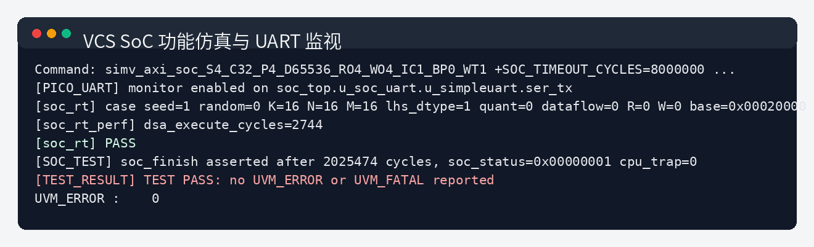

### 6.2 TFLM/NMSIS-NN 推理仿真

TFLM 功能仿真使用 MNIST MLP 作为代表性推理任务。硬件路径由 NMSIS-NN 调用 NPU；软件路径关闭 NPU 加速宏后走纯软件实现。两条路径均执行 3 个样本，标签和预测完全一致。

| 路径 | 样本 0 | 样本 1 | 样本 2 | 总周期 | 平均周期 | 结论 |
|---|---|---|---|---:|---:|---|
| NPU 加速 | label=7 pred=7 | label=2 pred=2 | label=1 pred=1 | 479777 | 159925 | PASS |
| 纯软件 | label=7 pred=7 | label=2 pred=2 | label=1 pred=1 | 15343242 | 5114414 | PASS |

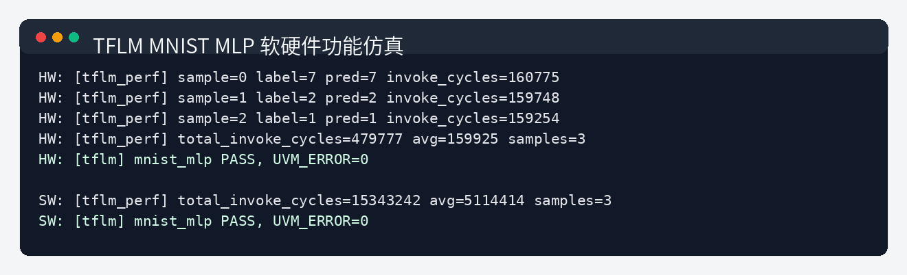

硬件路径日志同时输出 NPU 利用率字段，例如 `active`、`ia_row`、`acc_valid`、`requant_valid`、`fifo_valid`、`dma_busy_ia`、`dma_busy_kernel`、`axi_ar`、`axi_r`、`axi_aw`、`axi_w` 和 `axi_b`。SoC 统计字段记录 `npu_lock=192141`、`cpu_lock_ar_block=192099`，说明 NPU 工作期间总线锁定机制在该用例中生效，CPU 侧读访问被阻塞且系统最终正常结束。

## 7. 回归测试与覆盖率

### 7.1 回归测试结果

当前可归档的通过回归如下表。调试阶段生成的失败日志仅用于定位问题，不作为最终签核证据。

| 回归集合 | 目标 | 覆盖配置 | 结果 |
|---|---|---|---|
| SoC C 程序基础随机回归 | CPU/NPU 协同与输出检查 | seed 33001/33002/33003 | 3/3 PASS |
| int8 完整参数回归 | int8 输入数据路径 | cache 2/4/8，dataflow 0/1，D1/D2，Q0/Q1 | 24/24 PASS |
| int16 完整参数回归 | int16 输入数据路径 | cache 2/4/8，dataflow 0/1，D1/D2，Q0/Q1 | 24/24 PASS |
| 固定 IA cache 容量扫描 | 阵列规模与 IA cache 块数参数化 | 4x4/8x8/16x16/32x32，矩阵 128³/256³/512³ | 12/12 PASS |
| 最终关键 SoC 组合 | 资源裁剪配置与 16x16 参考配置 | 4x4 + 32 个 IA cache 分块，16x16 + 4 个 IA cache 分块 | 2/2 PASS |
| 模块级覆盖率计划 | AXI-Lite directed + SoC runtime | 2 个编译项 + 24 个运行项 | PASS |
| SoC 级覆盖率计划 | SoC runtime | 1 个编译项 + 21 个运行项 | PASS |

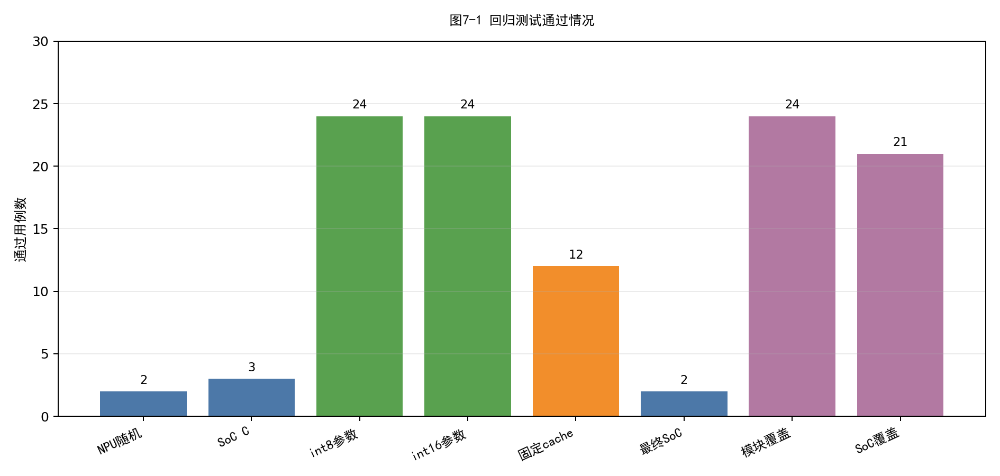

### 7.2 覆盖率结果

覆盖率只统计 NPU 加速器 RTL，不把 PicoRV32、UART 和 SoC RAM 计入签核分母。模块级计划包含 AXI-Lite mem generation、RAL mem generation、寄存器 directed 读写，以及 SoC runtime 场景；SoC 级计划只运行 SoC runtime 场景。新增覆盖项包括 int8 IS per-channel、int16 WS per-channel、最小矩阵、激活截断、IS 模式 RAM 随机响应延时和 tail per-channel 组合。

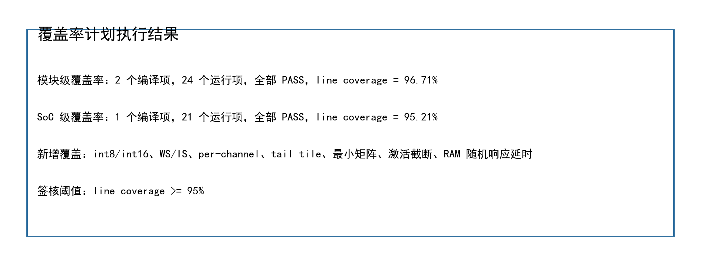

| 覆盖率范围 | 编译项 | 运行项 | line | condition | branch | FSM | toggle | 综合辅助指标 | 签核结果 |
|---|---:|---:|---:|---:|---:|---:|---:|---:|---|
| 模块级 NPU 覆盖率 | 2 | 24 | 96.71% | 82.78% | 82.35% | 57.10% | 52.67% | 74.32% | PASS |
| SoC 级 NPU 覆盖率 | 1 | 21 | 95.21% | 82.17% | 80.77% | 62.72% | 45.13% | 73.20% | PASS |

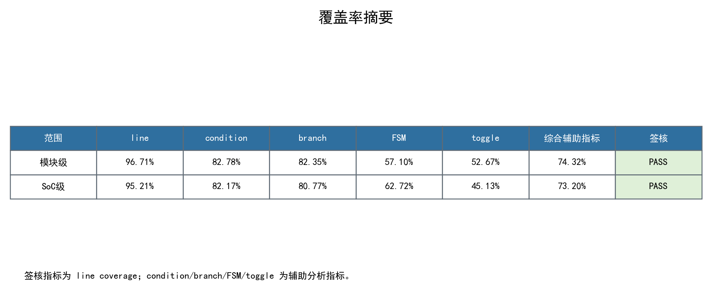

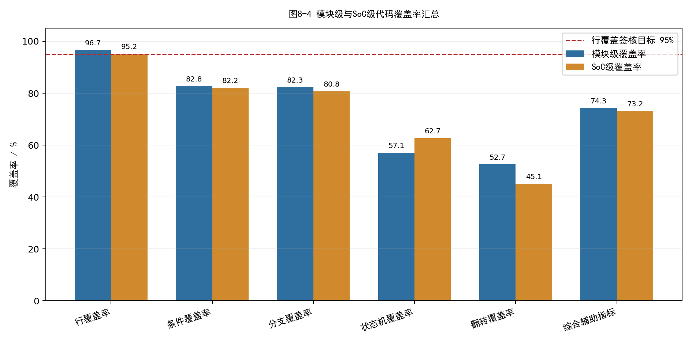

line coverage 已达到 95% 目标，说明 NPU 主要 RTL 语句已被当前测试集触达。condition、branch、FSM 和 toggle 指标作为辅助分析项保留；此类辅助指标低于 line coverage，主要原因是 NPU 包含大规模参数化 generate 结构、宽数据总线、保留配置字段和未触发错误响应状态。

## 8. FPGA 工程与仿真验证

### 8.1 FPGA 工程配置

FPGA 最终工程采用 Vivado 2024.2.1，板级输入时钟为 50 MHz，核心时钟由 Clocking Wizard 生成 150 MHz。工程路径和主要产物如下。

| 项目 | 内容 |
|---|---|
| Vivado 工程 | `vivado_export/tflm_ai_dsa_soc_final_150m_size4_cache32_w8_pruned_addr19_6000lut_uart115200/project/tflm_ai_dsa_soc.xpr` |
| 最终报告目录 | `vivado_export/tflm_ai_dsa_soc_final_150m_size4_cache32_w8_pruned_addr19_6000lut_uart115200/reports/` |
| bitstream | `fpga_top.bit` |
| routed checkpoint | `fpga_top_routed.dcp` |
| CPU memory image | `mem/cpu.mem` |
| UART 波特率 | 约 115200 baud |

`cpu.mem` 已按 FPGA RAM 深度补齐至 `65536` 行。程序区来自 `cpu_firmware_only.mem`，runtime case 数据从 word `32768` 开始写入，确保综合、前仿和实现工程使用一致的 RAM 内容。

### 8.2 Vivado behavioral 前仿

前仿使用 `fpga_top_behav_smoke_tb.sv`。测试平台输入 50 MHz `sys_clk`，通过 Clocking Wizard 仿真模型生成 150 MHz 核心时钟。判据为 `user_led_tri_o[1]` 拉高且 `user_led_tri_o[2]` 不拉高。

| 项目 | 结果 |
|---|---|
| 仿真器 | Vivado XSim 2024.2.1 |
| 进度标记 | `0x5a000001`、`0x5a000002`、`0x5a000003` 均出现 |
| finish 状态 | `status=0x00000001` |
| 完成周期 | 675397 个 50 MHz sys_clk 周期 |
| 判定 | PASS |

### 8.3 Vivado post-implementation functional 后仿

后仿使用 `fpga_top_post_impl_tb.sv` 和实现后的 functional netlist。脚本已适配当前网表中 UART 等待计数器的优化后命名，能够定位并 force UART 等待对象。本次运行在 `run all` 阶段持续 3 分 36 秒未结束，随后人工中止；该项未作为当前裁剪工程新增 PASS 证据。

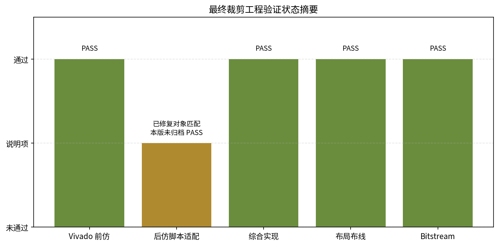

## 9. FPGA 实现、时序与资源结果

### 9.1 Bitstream 与检查结果

最终实现使用综合策略 `Flow_AreaOptimized_high`，综合 directive 为 `AreaOptimized_high`，实现策略为 `Performance_Explore`。实现完成后已导出 routed checkpoint、bitstream、timing、utilization、route 和 DRC 报告。

| 检查项 | 结果 |
|---|---|
| Bitstream 生成 | PASS，`fpga_top.bit` 已写出 |
| Route status | fully routed |
| DRC | 0 error |
| Routed setup timing | PASS |
| Routed hold timing | PASS |

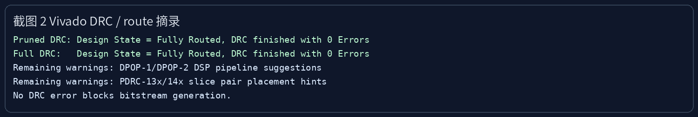

### 9.2 时序结果

150 MHz 核心时钟周期为 `6.667 ns`。Routed timing summary 如下。

| 指标 | 数值 | 判定 |
|---|---:|---|
| WNS | +0.398 ns | PASS |
| TNS | 0.000 ns | PASS |
| setup failing endpoints | 0 | PASS |
| WHS | +0.058 ns | PASS |
| THS | 0.000 ns | PASS |
| hold failing endpoints | 0 | PASS |
| WPWS | +2.283 ns | PASS |

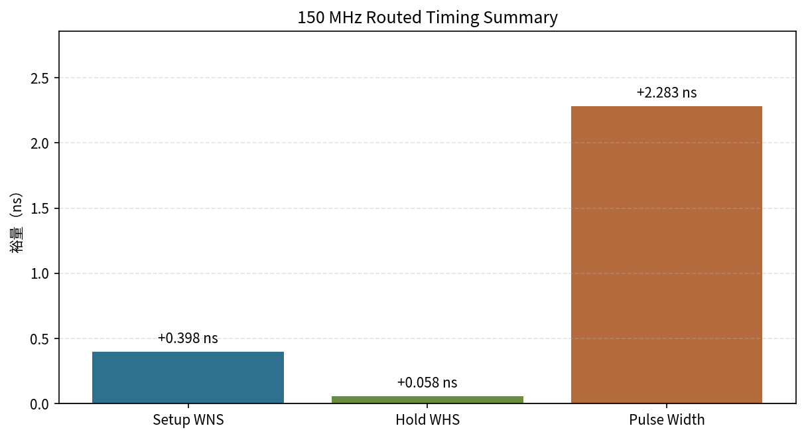

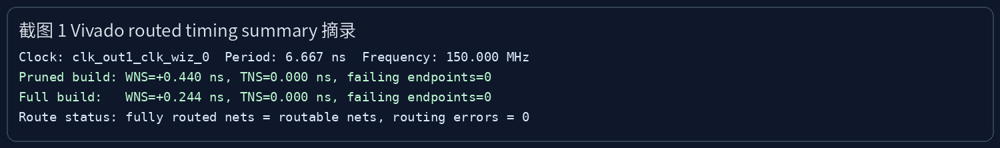

### 9.3 资源利用率

最终工程资源利用率如下。资源裁剪配置在 Artix-7 `xc7a200tfbg484-3` 上占用 7.50% LUT、4.01% FF、19.45% BRAM 和 4.32% DSP。

| 资源 | Used | Available | Utilization |
|---|---:|---:|---:|
| Slice LUTs | 10089 | 134600 | 7.50% |
| Slice Registers | 10788 | 269200 | 4.01% |
| Block RAM Tile | 71 | 365 | 19.45% |
| DSPs | 32 | 740 | 4.32% |
| Bonded IOB | 8 | 285 | 2.81% |
| BUFGCTRL | 2 | 32 | 6.25% |
| MMCME2_ADV | 1 | 10 | 10.00% |

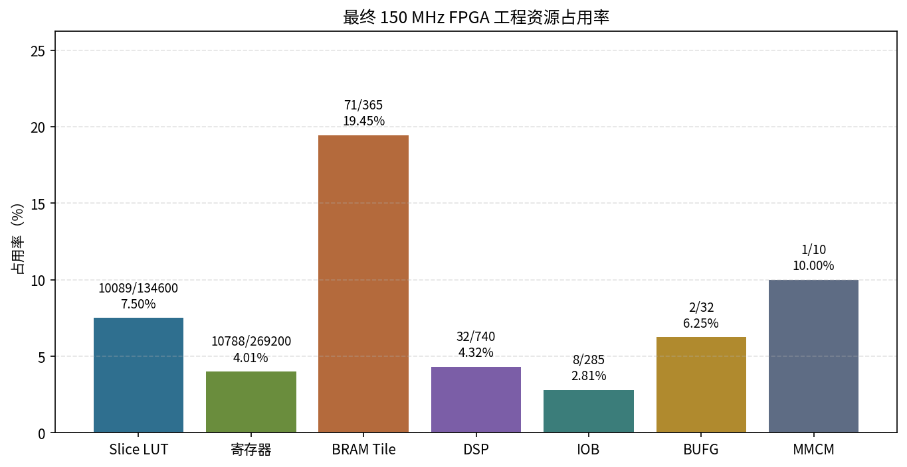

主要层次模块资源如下。

| 层次模块 | Total LUTs | FFs | RAMB36 | RAMB18 | DSP |
|---|---:|---:|---:|---:|---:|
| `fpga_top` | 10089 | 10788 | 66 | 10 | 32 |
| `u_soc_top` | 10088 | 10785 | 66 | 10 | 32 |
| `u_npu_axil_top` | 5754 | 6308 | 2 | 9 | 32 |
| `u_npu_top` | 5283 | 5604 | 2 | 9 | 32 |
| `u_picorv32` | 1793 | 1024 | 0 | 0 | 0 |
| `u_axi_sim_ram` | 1242 | 187 | 64 | 0 | 0 |
| `u_pico_axi_bridge` | 637 | 1693 | 0 | 1 | 0 |
| `u_axi_interconnect` | 187 | 94 | 0 | 0 | 0 |
| `u_soc_uart` | 129 | 206 | 0 | 0 | 0 |
| `u_soc_ctrl` | 80 | 140 | 0 | 0 | 0 |

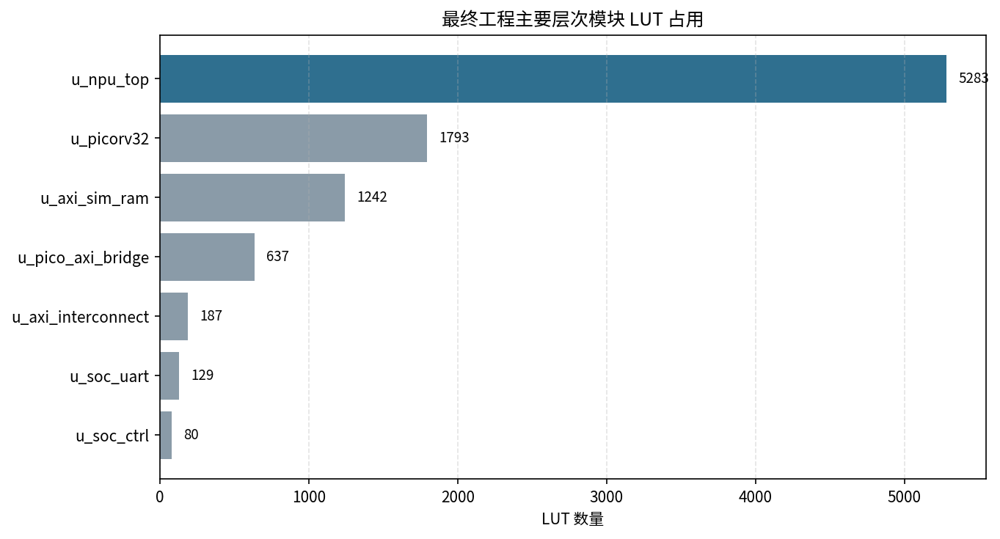

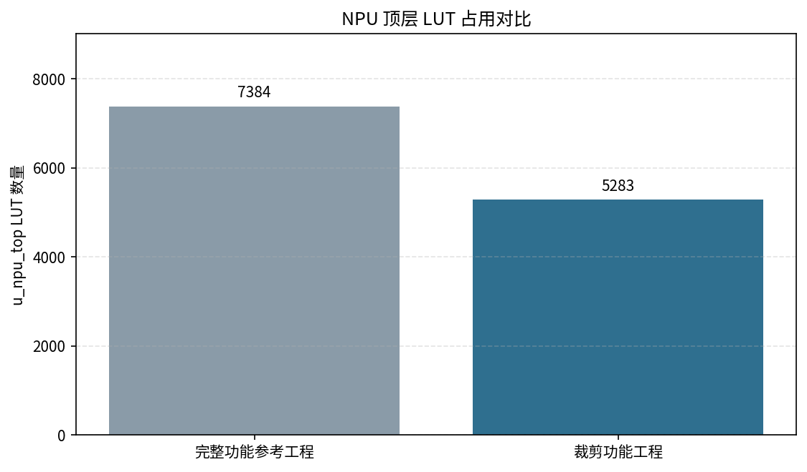

## 10. 结果判定与后续工作

### 10.1 已满足项

| 项目 | 判定 | 证据 |
|---|---|---|
| 模块级仿真入口 | 通过 | DMA、arbiter、PS Buffer、Compute Core、NPU Top smoke 均 PASS |
| NPU 顶层随机功能仿真 | 通过 | seed 41000/41001 均 `[TB] PASS` |
| RAM 随机响应延时 | 通过 | NPU 顶层随机用例与 SoC 覆盖率用例均通过 |
| SoC 功能仿真 | 通过 | `soc_status=1`、`cpu_trap=0`、`UVM_ERROR=0` |
| TFLM 推理仿真 | 通过 | MNIST MLP 软硬件路径预测一致 |
| int8/int16 参数回归 | 通过 | 两类输入位宽均完成 24/24 参数回归 |
| 覆盖率签核 | 通过 | 模块级 line coverage 96.71%，SoC 级 line coverage 95.21% |
| Vivado 前仿 | 通过 | `soc_finish` 拉高，trap 未拉高 |
| 150 MHz 时序 | 通过 | WNS +0.398 ns，WHS +0.058 ns |
| bitstream | 通过 | `fpga_top.bit` 已生成 |

### 10.2 后续增强项

| 项目 | 当前状态 | 说明 |
|---|---|---|
| post-implementation functional 后仿 | 脚本已适配，当前裁剪工程未归档 PASS | 需要继续压缩门级仿真运行时间，或增加直接面向 finish 状态的检查方式 |
| 非字对齐地址专项验证 | 尚需专项 directed test | 当前签核计划覆盖 RAM 随机响应延时和非整块尺寸，非字对齐多行写回组合建议用 DMA directed test 单独加强 |
| 结构辅助覆盖指标 | 未作为本轮签核阻塞项 | condition、branch、FSM、toggle 可通过错误响应、极限反压、运行中复位等 directed case 继续提高 |
| 实物板卡 transcript | 当前自动化证据集中未采集 | bitstream 已生成，板卡下载与 UART transcript 可作为后续板级实测归档 |

## 11. 归档文件清单

| 类型 | 路径 |
|---|---|
| RTL/FPGA 综合验证报告 | `docs/rtl_fpga_validation_report_cn.md` |
| RTL 验证报告 | `docs/rtl_verification_report_cn.md` |
| FPGA 验证报告 | `docs/fpga_validation_report_cn.md` |
| 覆盖率 summary | `/media/proj_tmp/aiEngine_integrated/veri/sim/runs/coverage_module/coverage_code_report_summary.json` |
| SoC 覆盖率 summary | `/media/proj_tmp/aiEngine_integrated/veri/sim/runs/coverage_soc/coverage_code_report_summary.json` |
| Vivado 工程 | `vivado_export/tflm_ai_dsa_soc_final_150m_size4_cache32_w8_pruned_addr19_6000lut_uart115200/project/tflm_ai_dsa_soc.xpr` |
| bitstream | `vivado_export/tflm_ai_dsa_soc_final_150m_size4_cache32_w8_pruned_addr19_6000lut_uart115200/fpga_top.bit` |
| timing summary | `vivado_export/tflm_ai_dsa_soc_final_150m_size4_cache32_w8_pruned_addr19_6000lut_uart115200/reports/fpga_top_timing_summary_routed.rpt` |
| hierarchical utilization | `vivado_export/tflm_ai_dsa_soc_final_150m_size4_cache32_w8_pruned_addr19_6000lut_uart115200/reports/fpga_top_utilization_hier_routed.rpt` |
