# 面向 TFLM 端侧推理 NPU 的 RTL 验证报告

| 项目 | 内容 |
|---|---|
| 文档版本 | V1.0 |
| 生成日期 | 2026-07-04 |
| 验证对象 | NPU RTL、AXI-Lite 配置接口、AXI DMA/共享 RAM 访问路径、PicoRV32 SoC 集成仿真环境 |
| 仿真工具 | Verilator 5.040、Synopsys VCS W-2024.09-SP1、URG W-2024.09-SP1 |
| 证据来源 | `test/` 模块级 testbench、`/media/proj_tmp/aiEngine_integrated/veri/sim/runs` 回归日志、VCS/URG 覆盖率报告 |
| 报告范围 | RTL 模块级仿真、NPU 顶层功能仿真、SoC 功能仿真、随机回归、参数回归、覆盖率收集 |

## 1. 验证结论摘要

本轮 RTL 验证采用“模块级 directed test + NPU 顶层随机 golden compare + SoC C 程序功能仿真 + TFLM/NMSIS NN 推理仿真 + VCS/URG 覆盖率收集”的分层策略。模块级测试覆盖 AXI DMA、DMA 仲裁、PS Buffer、Compute Core 等关键模块；NPU 顶层测试通过 Python 生成 mem case，仿真完成后直接比对 RAM 输出区域；SoC 测试通过 PicoRV32 执行 C 程序，验证 CPU 配置 NPU、NPU 经 AXI 访问共享 RAM、计算完成后 CPU 读取结果并输出 PASS 的完整执行过程。

当前可归档结果如下：NPU 顶层随机 smoke 用例 2/2 通过；SoC C 回归 3/3 通过；int8 参数回归 24/24 通过；int16 参数回归 24/24 通过；固定 cache 容量扫描 12/12 通过；最终关键 SoC 验证 2/2 通过；模块级覆盖率计划包含 2 个编译项和 24 个运行项，SoC 级覆盖率计划包含 1 个编译项和 21 个运行项，均已通过。TFLM MNIST MLP 软硬件路径均给出正确标签，硬件路径 3 个样本平均 `159925` 周期，软件路径平均 `5114414` 周期，功能结果一致。

覆盖率方面，本轮补充了 AXI-Lite 寄存器 directed、WS/IS、int8/int16、per-channel、tail tile、reuse、RAM 随机响应延时、最小矩阵和激活截断等覆盖率用例。模块级 line coverage 达到 `96.71%`，SoC 级 line coverage 达到 `95.21%`，均超过 95% 签核目标；翻转覆盖率相比此前结果显著提高，模块级达到 `52.67%`，SoC 级达到 `45.13%`。本报告结论是：功能性回归已通过当前归档测试集，覆盖率收集流程已经建立，line coverage 已达到当前签核目标；非签核辅助指标中的 FSM 与 toggle 覆盖仍受大规模 generate 结构、保留配置字段和未触发异常状态影响。

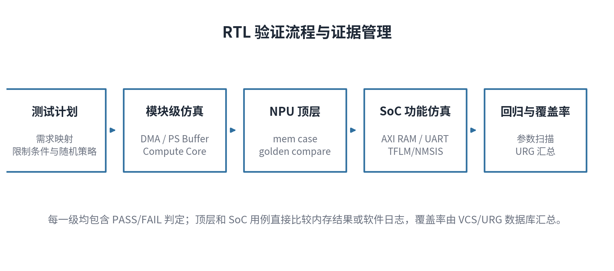

## 2. 验证对象与范围

### 2.1 被测 RTL 范围

本报告覆盖当前仓库中的 NPU RTL 及其 SoC 集成路径，核心文件包括：

| 类别 | 主要文件 | 验证重点 |
|---|---|---|
| NPU 顶层 | `rtl/npu/top/npu_top.sv` | 配置寄存器加载、启动/完成握手、loader/compute/writeback 调度、AXI 读写通路 |
| DMA 与总线 | `rtl/npu/dma/axi_dual_block_dma.sv`、`rtl/npu/dma/axi_block_dma_arbiter.sv` | AXI burst、outstanding、读写请求仲裁、非对齐访问、响应反压 |
| 输入加载 | `rtl/npu/loaders/ia_loader.sv`、`kernel_loader.sv`、`bias_loader.sv` | IA cache 分块、权重列展开输出、bias/quant 读取、tail tile |
| 计算核心 | `rtl/npu/compute/compute_core.sv`、`ws_systolic_cell.sv` | SIZE 参数化、WS/IS 数据流、部分和、无效 lane |
| 中间缓存 | `rtl/npu/buffers/ps_buffer.sv` | partial sum replay、de-diagonalize、同步 RAM/FIFO |
| 写回与量化 | `rtl/npu/writeback/vec_requant.sv`、int8 输出 FIFO、`oa_writer.sv` | per-tensor/per-channel requant、饱和、FIFO 排空、AXI 写回顺序 |
| RAM 模型 | `test/dep_modules/ddr_axi_mem_model.sv` | RAM 随机响应延时、读写握手、memory compare |

### 2.2 不在本报告范围内的内容

本报告只描述 RTL 仿真验证，不将 Vivado 综合、实现、后仿、上板 UART 验证和资源时序签核作为本报告结论。与 FPGA 工程有关的前仿/后仿/上板结果另见 FPGA 验证报告。本文中的性能周期来自 RTL 仿真日志，用于功能路径和统计计数器一致性说明，不等价于最终上板吞吐签核。

## 3. 仿真环境与检查机制

### 3.1 工具环境

模块级和 NPU 顶层仿真主要使用 Verilator，顶层随机回归使用 `-O3` 编译并复用可执行文件，以减少大规模随机测试的编译开销。SoC 功能仿真、TFLM 推理仿真和覆盖率收集主要使用 VCS。覆盖率报告由 URG 从 VCS `.vdb` 数据库生成。

| 项目 | 版本/方式 | 说明 |
|---|---|---|
| Verilator | 5.040 | 用于模块级、NPU 顶层随机回归 |
| VCS | W-2024.09-SP1 | 用于 SoC UVM/C 程序仿真、TFLM 路径仿真 |
| URG | W-2024.09-SP1 | 用于 line/cond/toggle/branch/FSM 覆盖率汇总 |
| 激励生成 | Python mem case | 生成 `init.mem`、`golden.mem`、`config.mem` |
| 结果检查 | memory compare、scoreboard、C 程序 PASS、UVM error count | 输出 RAM 与 golden mem 一致，或软件程序返回成功 |

### 3.2 分层验证结构

验证按四层展开。第一层为模块级 directed/smoke，检查局部握手、FIFO、地址递增和控制时序；第二层为 NPU 顶层随机 case，使用真实 loader、compute、requant、writer 串接并直接比较内存；第三层为 SoC 功能仿真，由 CPU 通过 AXI-Lite/MMIO 配置 NPU 并执行 C 程序；第四层为覆盖率收集，将 WS、IS、reuse、tail、per-channel、非对齐和 RAM 随机响应延时等场景合并到 VDB 后由 URG 统计。

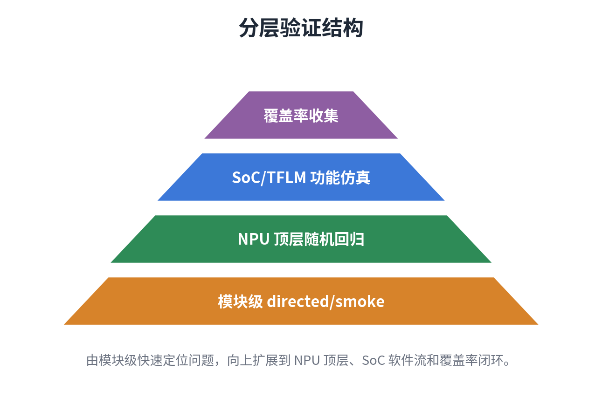

### 3.3 主要检查点

| 检查点 | 检查方法 | 通过标准 |
|---|---|---|
| 复位与启动 | directed/random case 观察 `calc_start`、`sa_ready` | 复位后空闲，启动后计算，完成后恢复 ready |
| AXI-Lite 配置 | SoC C 程序写寄存器并启动 NPU | C 程序结束状态为 PASS，`UVM_ERROR=0` |
| AXI burst 读写 | DMA 模块 TB、NPU 顶层 memory compare | 读写地址递增正确，`RLAST/WLAST` 正确，写回 RAM 与 golden 一致 |
| RAM 随机响应延时 | `+DDR_RAND_LAT=1`、随机命令/响应延时 | 无死锁、无数据错位、输出 compare PASS |
| 分块与 tail | 非 SIZE 对齐的 K/N/M 随机矩阵 | 无效 lane 不污染输出，tail mask 正确 |
| WS/IS 与数据位宽 | int8/int16、dataflow 参数回归 | 对应组合全部 PASS |
| per-channel 量化 | 参数回归与覆盖率用例 | 输出与 golden 一致 |
| TFLM/NMSIS NN 调用 | MNIST MLP 软硬件路径 | 标签预测一致，软件/硬件均 PASS |
| 覆盖率 | VCS `.vdb` + URG | 行覆盖达到 95%，总体覆盖缺口被记录 |

## 4. 模块级仿真

模块级仿真用于在进入 NPU 顶层前定位局部握手和数据通路问题。当前 `test/` 目录保留了以下模块级 testbench 和 Makefile。

| 模块 | Testbench | 运行入口 | 验证内容 | 本轮 smoke 结果 |
|---|---|---|---|---|
| AXI dual block DMA | `test/axi_dual_block_dma/tb_axi_dual_block_dma.sv` | `make -C test/axi_dual_block_dma run` | AXI 读写通道、burst 长度、读写完成、异常检查 | PASS，`[AXI_DUAL_DMA] ALL PASS` |
| AXI block DMA arbiter | `test/axi_block_dma_arbiter/tb_axi_block_dma_arbiter.sv` | `make -C test/axi_block_dma_arbiter run` | 多读客户端仲裁、请求重叠、DMA 输出稳定性 | PASS，`[AXI_ARB] ALL PASS overlap=1` |
| PS Buffer | `test/ps_buffer/tb_ps_buffer.sv` | `make -C test/ps_buffer run` | diagonal partial-sum replay、calc_done 后 de-diagonalize、FIFO bypass | PASS，partial-sum replay 与 de-diagonalize 均通过 |
| Compute Core | `test/compute_core/tb_compute_core.sv` | `make -C test/compute_core run_random` | systolic array 输出、final row、`tile_calc_over` 与 `acc_data_valid` 时序 | PASS，seed 42/43 共 2/2 通过 |
| NPU Top | `test/npu_top/tb_npu_top.sv` | `make -C test/npu_top run_random` | 完整 loader/compute/requant/writeback，直接比较 RAM | PASS，seed 41000/41001 共 2/2 通过 |

DMA 模块级 TB 的通过条件是打印 `[AXI_DUAL_DMA] ALL PASS` 或 `[AXI_ARB] ALL PASS`。Compute Core TB 检查最终输出矩阵、额外 valid row、`tile_calc_over` 过早或过晚等控制时序；PS Buffer TB 检查对角输入到行输出的顺序恢复，以及 FIFO replay 时无效 lane 清零。NPU Top TB 则加载 Python 生成的 `init.mem`、`golden.mem` 和 `config.mem`，等待 `sa_ready` 后按 case 中给定的 `compare_words` 或输出区域逐字节比较。

模块级仿真的核心价值是把总线、缓存、脉动阵列和写回问题拆开。如果 NPU 顶层出现数值错，通常先用 Compute Core 和 PS Buffer TB 确认阵列输出与 de-diagonalize；如果出现死锁，优先用 DMA 和 arbiter TB 检查 AXI `valid/ready` 反压语义。当前报告中直接归档的截图证据选取 NPU 顶层随机用例，因为该用例同时串接了所有关键模块。

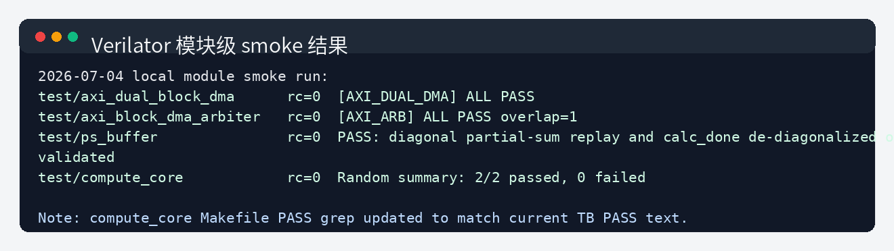

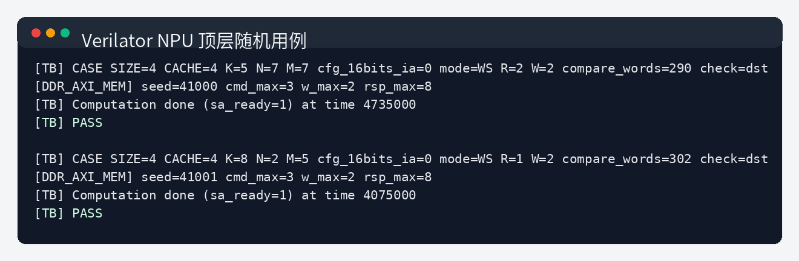

## 5. NPU 顶层功能仿真

### 5.1 Python mem case 生成与直接内存比对

NPU 顶层测试使用 `test/npu_top/gen_mem.py` 生成输入、权重、bias、量化参数、配置和 golden 输出。仿真时 RAM 模型先加载 `init.mem`，NPU 运行完成后 TB 从同一 RAM 模型中读取输出区域，与 `golden.mem` 比较。该方式避免了大量 `$display` 输出，缩短仿真时间，同时可以直接覆盖 `WSTRB`、非对齐地址、tail mask 和写回顺序。

可复现命令示例：

```bash
make -C test/npu_top run_random \
  SIZE=4 IA_CACHE_BLOCKS=4 PS_FRAME_COUNT=8 \
  COUNT=2 SEED=41000 TRACE=0 \
  BUILD_ROOT=/tmp/tflm_ai_dsa_report_obj \
  OUT_DIR=/tmp/tflm_ai_dsa_report_s4 \
  RANDOM_GEN_ARGS='--random --random_quant --lhs_dtype 1 --min_dim 1 --max_dim 12 --ps_frame_count 8' \
  SIM_ARGS='+DDR_RAND_LAT=1 +DDR_CMD_MAX_LAT=3 +DDR_W_MAX_LAT=2 +DDR_RSP_MAX_LAT=8'
```

### 5.2 代表性通过用例

| 日志 | SIZE | IA cache blocks | K | N | M | dataflow | 复用参数 | RAM 响应延时 | 完成时间 | 结论 |
|---|---:|---:|---:|---:|---:|---|---|---|---:|---|
| `/tmp/tflm_ai_dsa_report_s4/random_41000.log` | 4 | 4 | 5 | 7 | 7 | WS | R=2, W=2 | cmd≤3, w≤2, rsp≤8 | 4735000 | PASS |
| `/tmp/tflm_ai_dsa_report_s4/random_41001.log` | 4 | 4 | 8 | 2 | 5 | WS | R=1, W=2 | cmd≤3, w≤2, rsp≤8 | 4075000 | PASS |

`K=5,N=7,M=7` 同时包含 K、N、M 三个方向的尾块，能检查 IA loader、kernel loader、PS buffer、requant 和 OA writer 是否正确屏蔽无效 lane。`K=8,N=2,M=5` 则覆盖 N 小于阵列列数、M 方向存在尾块的情况。两组用例均在 RAM 随机响应延时下通过，说明当前顶层握手、burst 读写、tail mask 和写回比较在这些限制条件下成立。

## 6. SoC 功能仿真

### 6.1 CPU/NPU 协同路径

SoC 功能仿真使用 PicoRV32 执行 C 程序，程序通过 AXI-Lite/MMIO 配置 NPU，NPU 通过 AXI master 访问共享 RAM，计算完成后 CPU 检查输出并写入结束状态。VCS UVM test 监视 `soc_finish`、`soc_status`、`cpu_trap` 和 UVM error count。代表性日志如下：

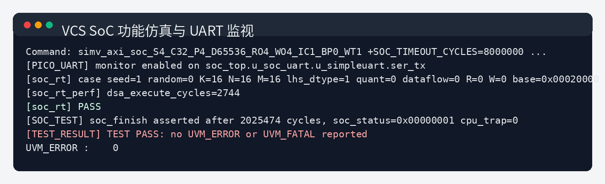

UART/SoC smoke 用例记录 `dsa_execute_cycles=2744`，`soc_finish` 在 `2025474` 周期后置位，`soc_status=0x00000001`，`cpu_trap=0`，最终 `UVM_ERROR=0`。该用例说明 CPU 程序加载、UART 监视、NPU 启动、共享 RAM 读写和软件 PASS 判定在 SoC 环境中可完整执行。

### 6.2 TFLM/NMSIS NN 功能仿真

TFLM 功能仿真使用 MNIST MLP 作为代表性推理任务。硬件路径由 NMSIS NN 调用 NPU；软件路径关闭 NPU 加速宏后走纯软件实现。两条路径均执行 3 个样本，标签和预测完全一致。

| 路径 | 样本 0 | 样本 1 | 样本 2 | 总周期 | 平均周期 | 结论 |
|---|---|---|---|---:|---:|---|
| NPU 加速 | label=7 pred=7 | label=2 pred=2 | label=1 pred=1 | 479777 | 159925 | PASS |
| 纯软件 | label=7 pred=7 | label=2 pred=2 | label=1 pred=1 | 15343242 | 5114414 | PASS |

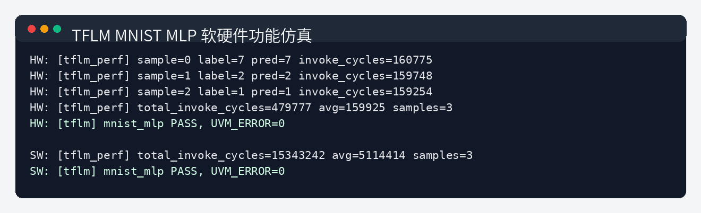

硬件路径日志同时输出 NPU 利用率字段，例如 `active`、`ia_row`、`acc_valid`、`requant_valid`、`fifo_valid`、`dma_busy_ia`、`dma_busy_kernel`、`axi_ar`、`axi_r`、`axi_aw`、`axi_w`、`axi_b`。SoC 统计字段记录 `npu_lock=192141`、`cpu_lock_ar_block=192099`，说明 NPU 工作期间总线锁定机制已在该用例中生效，CPU 侧读访问被阻塞且系统最终正常结束。

## 7. 回归测试

### 7.1 回归测试集合

当前可归档的通过回归如下表。表中只列入最终闭合的回归目录；调试过程中留下的 fail/trace 目录用于 bug 定位，不作为最终 sign-off 结果。

| 回归目录 | 目标 | 覆盖配置 | 结果 |
|---|---|---|---|
| `axi_soc_c_regression` | SoC C 程序基础随机回归 | seed 33001/33002/33003 | 3/3 PASS |
| int8 完整参数回归 | int8 输入数据路径参数回归 | cache 2/4/8，dataflow 0/1，D1/D2，Q0/Q1 | 24/24 PASS |
| int16 完整参数回归 | int16 输入数据路径参数回归 | cache 2/4/8，dataflow 0/1，D1/D2，Q0/Q1 | 24/24 PASS |
| `fixed_capacity_size_cache_sweep_burst8_fix` | 固定 cache 容量 SIZE/CACHE 扫描 | SIZE 4/8/16/32，矩阵 128³/256³/512³ | 12/12 PASS |
| `final_key_soc_verify_20260704_052000` | 最终关键 SoC 组合验证 | SIZE=4 cache=32 与 SIZE=16 cache=4 | 2/2 PASS |
| 模块级 coverage plan | 覆盖率计划用例执行 | AXI-Lite、WS/IS、reuse、tail、per-channel、非对齐、RAM 随机响应延时、最小矩阵、激活截断 | 2 个编译项 + 24 个运行项 PASS |
| SoC 级 coverage plan | 覆盖率计划用例执行 | WS/IS、reuse、tail、per-channel、非对齐、RAM 随机响应延时、最小矩阵、激活截断 | 1 个编译项 + 21 个运行项 PASS |

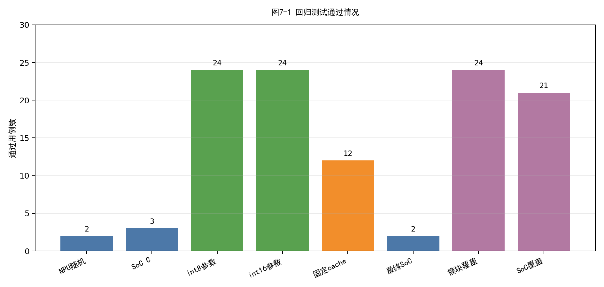

### 7.2 参数化覆盖情况

回归组合覆盖了以下维度：

| 维度 | 覆盖内容 |
|---|---|
| 阵列规模 | `SIZE=4/8/16/32` 的功能回归和性能扫描；报告证据中 sign-off 主要包含 4/8/16/32 |
| IA cache blocks | `2/4/8/16/32/64/256` 等容量相关组合在不同性能/功能扫描中出现 |
| 输入位宽 | int8、int16 路径均有 SoC 参数回归 |
| 数据流 | WS 与 IS 均纳入参数回归和覆盖率用例 |
| 量化模式 | per-tensor 与 per-channel 均纳入 int8/int16 参数回归 |
| 非对齐尺寸 | K/N/M 非 SIZE 对齐、N 小于 SIZE、M 尾块、K 尾块 |
| RAM 响应 | 命令、写数据、读响应插入随机延时 |
| 总线行为 | AXI read/write burst、outstanding、NPU lock、CPU/NPU 访问竞争 |

固定容量扫描的代表性结果为 `total=12 pass=12`。其中 `SIZE=4, IA cache blocks=256`、`SIZE=8, IA cache blocks=64`、`SIZE=16, IA cache blocks=16`、`SIZE=32, IA cache blocks=4` 在 128³、256³、512³ 三种矩阵尺寸下均通过。该实验说明在固定片上 cache 容量约束下，阵列大小和 cache 块数同时改变时，功能路径仍保持参数化正确。

## 8. 覆盖率收集与分析

### 8.1 覆盖率执行计划

覆盖率计划目录为：

```text
/media/proj_tmp/aiEngine_integrated/veri/sim/runs/coverage_module
/media/proj_tmp/aiEngine_integrated/veri/sim/runs/coverage_soc
```

本轮将覆盖率测试拆成模块级和 SoC 级两组。模块级计划包含 AXI-Lite mem generation、RAL mem generation、寄存器 directed 读写，以及 NPU 在 SoC 环境中的 21 个运行场景；SoC 级计划只保留 SoC 集成环境中的 21 个运行场景。新增运行项包括 int8 IS per-channel、int16 WS per-channel、最小矩阵、激活截断、IS 模式 RAM 随机响应延时和 tail per-channel 组合。覆盖率脚本同时修正了 `--only` 名称不存在时静默跳过的问题，若计划项名称拼写错误会立即返回失败。

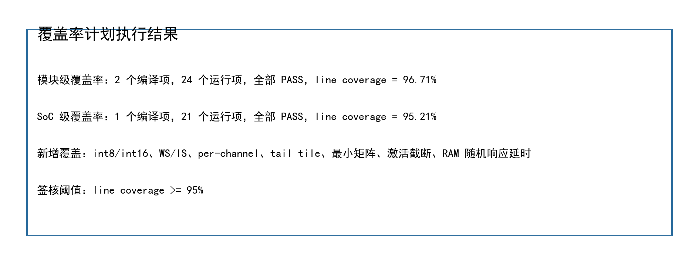

覆盖率收集流程如下：

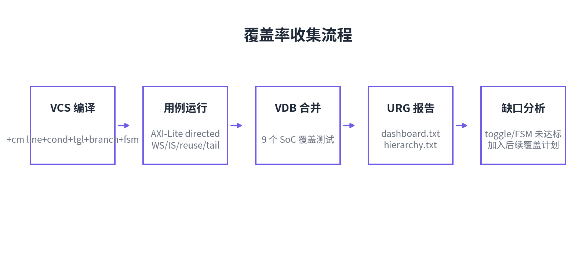

### 8.2 覆盖率结果

覆盖率报告由 VCS `.vdb` 数据库生成。若 URG 在单个数据库上无法导出完整文本报告，脚本会从 VCS VDB testdata bitmap 直接计算 line/condition/branch/FSM/toggle 指标，并继续使用 95% line coverage 阈值进行签核判定。

| 覆盖率范围 | 编译项 | 运行项 | line | condition | branch | FSM | toggle | 综合辅助指标 | 签核结果 |
|---|---:|---:|---:|---:|---:|---:|---:|---:|---|
| 模块级 NPU 覆盖率 | 2 | 24 | 96.71% | 82.78% | 82.35% | 57.10% | 52.67% | 74.32% | PASS |
| SoC 级 NPU 覆盖率 | 1 | 21 | 95.21% | 82.17% | 80.77% | 62.72% | 45.13% | 73.20% | PASS |

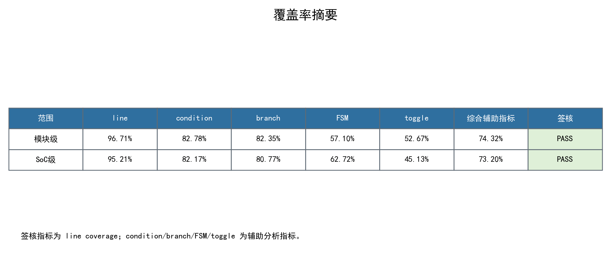

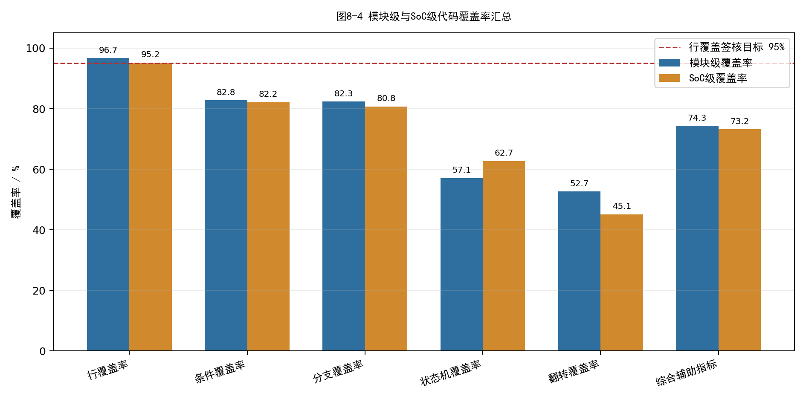

### 8.3 覆盖率结果分析

模块级和 SoC 级 line coverage 均达到 95% 目标，说明 NPU 主要 RTL 语句已被当前测试集触达。新增 per-channel、IS、最小矩阵、tail tile 和 RAM 随机响应延时用例后，toggle coverage 明显提高：模块级达到 `52.67%`，SoC 级达到 `45.13%`。这说明新增用例能够驱动更多阵列数据位、量化参数、DMA 反压状态和写回控制状态。

综合辅助指标仍低于 95%，主要原因是当前 NPU 包含大规模参数化 generate 结构、宽数据总线、保留配置字段和未触发错误响应状态。部分状态只会在 AXI 错误响应、复位打断、极限反压或调试配置下出现；这些状态不属于本次功能签核必须触发的正常推理场景。后续若需要把非签核辅助指标继续提高，可补充 AXI-Lite 非法地址读写、AXI SLVERR/DECERR 响应、DMA outstanding 达上限后的持续反压、OA writer FIFO 满/空条件、IS 模式输出转置排空、per-channel 参数读取被 RAM 响应延时打断、NPU lock 解除瞬间 CPU 访问恢复，以及运行中复位打断用例。

## 9. 结果判定与剩余风险

### 9.1 已满足项

| 项目 | 判定 | 证据 |
|---|---|---|
| 模块级仿真入口完整 | 通过 | `test/axi_dual_block_dma`、`test/axi_block_dma_arbiter`、`test/ps_buffer`、`test/compute_core`、`test/npu_top` |
| NPU 顶层随机功能仿真 | 通过 | `random_41000.log`、`random_41001.log` 均 `[TB] PASS` |
| RAM 随机响应延时下功能 | 通过 | `cmd_max=3 w_max=2 rsp_max=8` 两组随机 case PASS |
| SoC 功能仿真 | 通过 | `uart150m_check_div1300/sim.log` 中 `soc_status=1`、`UVM_ERROR=0` |
| TFLM 功能仿真 | 通过 | MNIST MLP 硬件/软件路径预测一致且 PASS |
| int8/int16 参数回归 | 通过 | 两类输入位宽均完成 24/24 参数回归 |
| 固定 cache 容量参数扫描 | 通过 | `fixed_capacity_size_cache_sweep_burst8_fix` 12/12 |
| 模块级覆盖率计划 | 通过 | 2 个编译项 + 24 个运行项 PASS |
| SoC 级覆盖率计划 | 通过 | 1 个编译项 + 21 个运行项 PASS |
| line coverage | 通过 | 模块级 96.71%，SoC 级 95.21% |

### 9.2 后续增强项

| 项目 | 当前状态 | 影响 | 后续处理建议 |
|---|---|---|---|
| 综合辅助覆盖指标 | 模块级 74.32%，SoC 级 73.20% | 不能将非签核辅助指标声明为 95% | 继续补充错误响应、极限反压和运行中复位类 directed stress |
| toggle coverage | 模块级 52.67%，SoC 级 45.13% | 宽阵列和保留配置位仍有大量 bit 未翻转 | 增加随机数据强度，扩大 int8/int16、WS/IS、per-channel 组合 |
| FSM coverage | 模块级 57.10%，SoC 级 62.72% | 部分异常状态和反压状态未触发 | 增加 AXI 错误响应、FIFO 满/空、lock 解除访问恢复用例 |
| 非字对齐地址组合 | 当前签核计划覆盖 RAM 随机响应延时和尺寸 tail，非字对齐多行写回组合仍需专项验证 | 可能影响极端地址布局 | 建议增加 DMA directed test 后再纳入签核计划 |

## 10. 交付物清单

| 类型 | 路径 |
|---|---|
| RTL 验证报告 | `docs/rtl_verification_report_cn.md` |
| 验证流程图 | `docs/rtl_verification_figs/rtl_verification_flow.png` |
| 分层验证结构图 | `docs/rtl_verification_figs/rtl_test_hierarchy.png` |
| 回归通过统计图 | `docs/rtl_verification_figs/rtl_regression_pass_summary.png` |
| 覆盖率流程图 | `docs/rtl_verification_figs/rtl_coverage_collection_flow.png` |
| 覆盖率汇总图 | `docs/rtl_verification_figs/rtl_coverage_summary.png` |
| NPU 顶层随机用例截图 | `docs/rtl_verification_figs/screenshot_module_random_pass.png` |
| 模块级 smoke 截图 | `docs/rtl_verification_figs/screenshot_module_smoke_pass.png` |
| SoC/UART 功能仿真截图 | `docs/rtl_verification_figs/screenshot_soc_uart_pass.png` |
| TFLM MNIST 功能仿真截图 | `docs/rtl_verification_figs/screenshot_tflm_mnist_pass.png` |
| 覆盖率摘要截图 | `docs/rtl_verification_figs/screenshot_coverage_dashboard.png` |
| 覆盖率计划截图 | `docs/rtl_verification_figs/screenshot_coverage_plan_pass.png` |

## 附录 A：关键日志路径

```text
/tmp/tflm_ai_dsa_report_s4/random_41000.log
/tmp/tflm_ai_dsa_report_s4/random_41001.log
/tmp/tflm_ai_dsa_rtl_verif/axi_dual_block_dma.log
/tmp/tflm_ai_dsa_rtl_verif/axi_block_dma_arbiter.log
/tmp/tflm_ai_dsa_rtl_verif/ps_buffer.log
/tmp/tflm_ai_dsa_rtl_verif/compute_core_random.log
/media/proj_tmp/aiEngine_integrated/veri/sim/runs/uart150m_check_div1300/sim.log
/media/proj_tmp/aiEngine_integrated/veri/sim/runs/axi_soc_c_regression/summary.txt
/media/proj_tmp/aiEngine_integrated/veri/sim/runs/axi_soc_full_*_final/summary.txt
/media/proj_tmp/aiEngine_integrated/veri/sim/runs/fixed_capacity_size_cache_sweep_burst8_fix/summary.txt
/media/proj_tmp/aiEngine_integrated/veri/sim/runs/final_key_soc_verify_20260704_052000/summary.txt
/media/proj_tmp/aiEngine_integrated/veri/sim/runs/tflm_hw_sw_s4_c32_ic1_final_20260704/mnist_mlp_hw/sim.log
/media/proj_tmp/aiEngine_integrated/veri/sim/runs/tflm_hw_sw_s4_c32_ic1_final_20260704/mnist_mlp_sw/sim.log
/media/proj_tmp/aiEngine_integrated/veri/sim/runs/coverage_module/coverage_plan_results.md
/media/proj_tmp/aiEngine_integrated/veri/sim/runs/coverage_module/coverage_code_report_summary.json
/media/proj_tmp/aiEngine_integrated/veri/sim/runs/coverage_soc/coverage_plan_results.md
/media/proj_tmp/aiEngine_integrated/veri/sim/runs/coverage_soc/coverage_code_report_summary.json
```

## 附录 B：回归命令模板

NPU 顶层随机回归：

```bash
make -C test/npu_top run_random \
  SIZE=4 IA_CACHE_BLOCKS=4 PS_FRAME_COUNT=8 \
  COUNT=20 SEED=1000 TRACE=0 \
  RANDOM_GEN_ARGS='--random --random_quant --lhs_dtype 1 --min_dim 1 --max_dim 32 --ps_frame_count 8' \
  SIM_ARGS='+DDR_RAND_LAT=1 +DDR_CMD_MAX_LAT=3 +DDR_W_MAX_LAT=2 +DDR_RSP_MAX_LAT=8'
```

NPU 顶层参数随机回归：

```bash
make -C test/npu_top run_param_random \
  SIZES='4 8 16' CACHE_BLOCKS_LIST='2 4 8' \
  COUNT=20 SEED=20000 TRACE=0 \
  RANDOM_GEN_ARGS='--random --random_quant --lhs_dtype 1 --min_dim 1 --max_dim 64'
```

VCS 覆盖率报告生成：

```bash
make coverage_module COVERAGE_GOAL=95
make coverage_soc COVERAGE_GOAL=95
```
