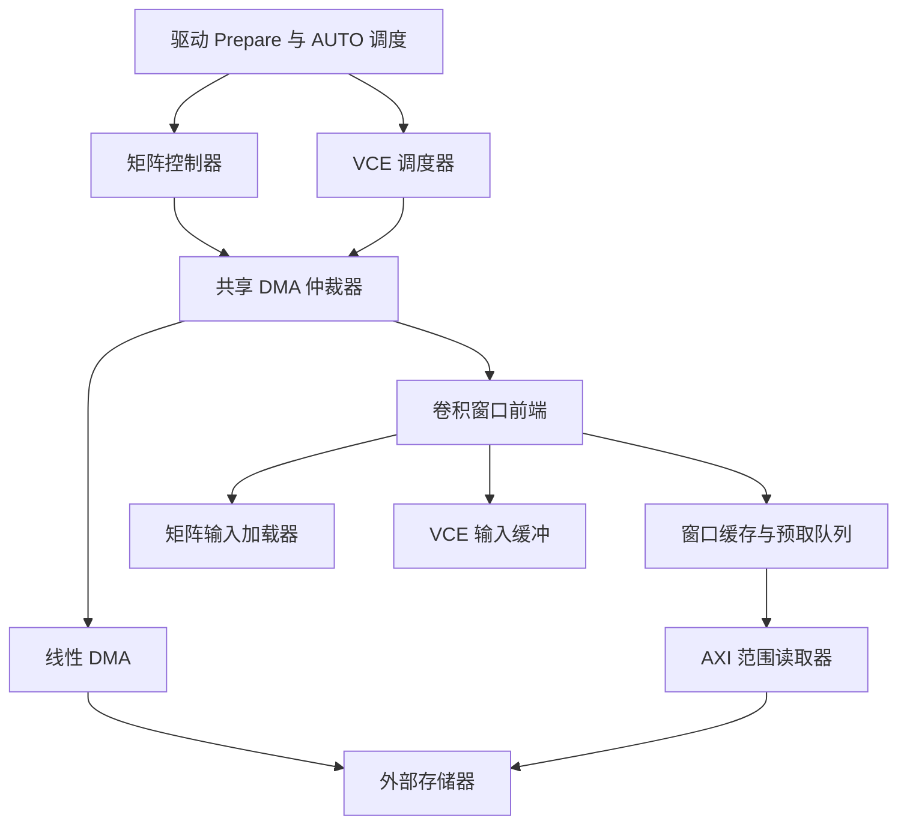

# 矩阵调度与共享窗口缓存

本文说明矩阵乘法、卷积和向量计算共用的存储与调度机制。默认启用 `PCR_ENGINE=1`，阵列为 `SIZE=16`，`NPU_AXI_DATA_WIDTH=64`，`PS_FRAME_COUNT=16`，`OA_S16_FIFO_BANKS_MAX=4`。IA/PS 共享数据容量由 bank 大小与数量的乘积确定。通用及 ASIC 的 [`config/npu.mk`](../config/npu.mk) 默认使用七个 2 KiB bank，共 14 KiB；FPGA 的 [`config/npu_fpga.mk`](../config/npu_fpga.mk) 默认使用七个 8 KiB bank，共 56 KiB。

bank 大小支持 2、4、8 KiB，数量支持六至九个；FPGA 工程要求每 bank 为 8 KiB。Prepare 为每层选择 1、2 或 4 个 IA bank，其余用于 PS，并把结果保存在 arena 配置中。窗口缓存采用 `CACHE_POLICY=3`，包含 128 个集合、每集合 2 路、每行 16 字节，共 4 KiB。容量和物理 RAM 映射分别见[容量说明](capacity.md)与[共享 RAM 映射](shared_ram_mapping.md)。

## 1. 数据流与模块职责

矩阵运算使用以下数学记号：输入为 `A[M,K]`，权重在内存中存为 `B[N,K]`，输出为 `C[M,N]`。`B` 的每个输出通道具有连续的归约维度。下表说明驱动字段与数学维度的对应关系。

| 接口 | 输出行数 M | 归约长度 K | 输出通道数 N |
| --- | --- | --- | --- |
| `dsa_matmul_config_t` | `K` | `N` | `M` |
| `dsa_prepared_matmul_s8_config_t` | `rows` | `depth` | `channels` |
| `dsa_schedule_config_t` | `rows` | `depth` | `cols` |

普通 GEMM 通过线性 DMA 读取输入与权重。普通卷积由 `conv_im2col_frontend` 生成窗口内的元素序列，再送入矩阵加载器；WS 使用 IA 加载路径，IS 使用权重加载路径。DW 向同一 DMA 前端提交图像几何信息和窗口请求，由共享窗口缓存提供数据。VCE 内部保留计算所需的短期输入缓冲，图像空间复用由共享缓存负责。



满足步幅为 1、扩张率为 1、填充为 0、输入输出空间尺寸一致、完整通道组以及连续存储条件的 1×1 卷积，可在 Prepare 阶段转换为直接 GEMM。输入零点修正由现有加载器执行，权重可使用 packed 布局。其他卷积保持窗口前端路径。相关实现见 [`dsa_prepared_impl.h`](../drivers/dsa_prepared_impl.h)、[`conv_im2col_frontend.sv`](../rtl/npu/conv/conv_im2col_frontend.sv) 和 [`npu_top.sv`](../rtl/npu/top/npu_top.sv)。

### 1.1 DiP 完整行输入与旋转索引

IA loader 每周期向阵列顶行提供完整的 `SIZE` 个归约元素。顶行第 `c` 列接收该行的第 `c` 个元素；其后第 `r` 行、第 `c` 列接收上一行第 `(c+1) mod SIZE` 列的值。第零列因此把输入传递到下一行的最后一列。部分和沿同一列向下传递，来自同一输入行的各输出列在同一周期有效。

定义局部驻留矩阵 `S[k,c]`：WS 使用 `B[n0+c,k0+k]`，IS 使用 `A[m0+c,k0+k]`。PE `(r,c)` 的驻留值为：

\[
S_{\mathrm{PE}}[r,c]=S[(r+c)\bmod\mathrm{SIZE},c].
\]

`kernel_loader_buffer` 按递减归约索引 `k` 发送权重时，第 `c` 个输出取缓存向量的第 `(k+c) mod SIZE` 个元素。旋转在加载器中完成，外存的普通布局和 packed 布局均保持各自的定义。WS 与 IS 共用该规则，驻留操作数由数据流选择。

IA RAM 读取、阵列输入、PS 恢复和 PS 写入均使用完整矩阵行。归约尾部按逻辑有效元素补零，PS frame 高度使用有效矩阵行数。控制信息随行通过阵列传播管线。两个权重缓冲槽分别保存描述符，shadow 权重预加载与当前计算并行；有效数据离开阵列后，所有 PE 同时接收广播提交信号。实现见 [`ws_systolic_array.sv`](../rtl/npu/compute/ws_systolic_array.sv)、[`kernel_loader_buffer.sv`](../rtl/npu/loaders/kernel_loader_buffer.sv) 和 [`compute_core.sv`](../rtl/npu/compute/compute_core.sv)。

## 2. 窗口缓存的几何映射与替换

### 2.1 物理标记与集合选择

每条缓存行保留完整的物理行标记 `address[31:4]`。集合选择可以使用卷积几何信息；命中判断始终比较物理标记和有效位。

令一个像素占用 `P=input_c×element_bytes` 字节，空间位置为 `(y,x)`。当输入基地址为 16 字节整数倍，且满足下列任一条件时，前端提供几何集合索引：

- `P≥16` 且 `P` 为 16 的整数倍；
- `P<16` 且 `P` 为 2 的幂。

对于 `P≥16`，集合索引来自 `y×input_w+x`。同一像素内不同的 16 字节通道片段共享集合位置，并使用不同的 `epoch`：

\[
\mathrm{epoch}=\left\lfloor\frac{(\mathrm{group\_offset}+\mathrm{channel})\,\mathrm{element\_bytes}}{16}\right\rfloor.
\]

对于 `P<16`，一条缓存行容纳多个像素，索引按每行可容纳的像素数进行右移，`epoch=0`。其余地址使用物理地址异或索引。几何映射只在 policy 3 中启用。实现见 [`conv_im2col_frontend.sv`](../rtl/npu/conv/conv_im2col_frontend.sv) 与 [`conv_read_cache.sv`](../rtl/npu/conv/conv_read_cache.sv)。

### 2.2 epoch 与最后使用位置

`epoch` 标识当前处理的通道片段。`req_window_progress` 表示当前输出行。缓存行同时保存 `retire`，用于估计该输入行最后可能服务的输出行。

当垂直步幅为 2 的幂时，输入行 `y` 的保守最后使用位置为：

\[
\mathrm{retire}=\min\left(\left\lfloor\frac{y+\mathrm{pad\_top}}{\mathrm{stride\_h}}\right\rfloor,\ \mathrm{output\_h}-1\right).
\]

若一个像素少于 16 字节，一条缓存行可能覆盖相邻输入行，前端在允许范围内将最后使用位置延后一行。其他垂直步幅使用无限远标记，保持保守替换。扩张卷积的空间地址由前端正常计算，替换判断仍使用这一保守最后使用位置。

替换时依次寻找无效路、其他已结束片段或当前片段中已超过最后使用位置的行，再根据保存的使用位置选择替换对象。跨片段预取不会仅因为片段编号不同就将当前需求片段视为已结束。缓存集合的路数有限；当同一集合中需要同时使用的有效行超过容量时，会发生替换和重新读取，数值计算仍按完整物理标记完成。

当输入空间位置总数不超过集合数、且至少具有两路时，当前通道片段与下一通道片段可以分别驻留在同一像素集合的不同路中。这种安排适合空间尺寸较小、通道数较多的 DW 层。

### 2.3 有序需求流水与独立填充

policy 3 的需求接口使用独立的请求队列和响应队列，默认 `DEMAND_DEPTH=4`。容量按已经接受、响应尚未被消费者接收的需求字请求计算，包含请求队列、正在执行的查找和响应队列三部分。响应严格按照请求接受顺序返回，每项同时保存数据和错误标志。消费者暂停接收时，已完成的响应进入队列并保持稳定；达到在途容量上限后，`req_ready` 降低。

请求队列为空时，请求直接进入缓存查找；响应队列为空时，同步 RAM 的读取结果直接送到响应接口。数据已驻留、前方没有等待请求且消费者持续接收时，返回延迟为一个周期，连续请求可达到每周期接受一个 32 位字、每周期返回一个 32 位字。`cfg_windowed=0` 的几何提示模式保持单个需求在途，以便使用对应请求的使用位置提示。

缓存仍使用一个前台查找和一个独立填充事务。预取填充进行时，前台可以读取其他已驻留的缓存行；同一数据字的读写冲突受到保护。已经完成的响应保存在响应队列中，后续缓存行替换不会改变这些数据。请求入队时的命中状态不锁定缓存行，执行查找时会重新比较物理标记；如果等待期间发生替换，该请求正常发起重新填充。需求缺失优先于新的预取填充。

填充器在成功接收当前范围的最后一个数据拍时，可以同时接受下一范围描述。AXI 仲裁器允许当前读事务的最后一个 `R` 握手与下一事务的 `AR` 握手发生在同一周期。范围读取器同时处理一个物理突发，共享仲裁器按配置的并发深度管理其他 DMA 读事务。下一地址受到反压时，地址、突发参数和被选中的客户端保持不变。缓存保护刚完成的集合与路，防止下一填充覆盖尚待需求查找的数据；错误填充在终止处理完成后再调度后续事务。

配置切换需要等待已接受请求、响应队列、填充事务和预取队列全部完成。等待期间持续有效的 `cfg_valid` 阻止接受新请求，已有工作继续执行。配置被接受后，模块清除有效位和队列状态，并重置统计计数。复位会清除所有在途请求。队列存储容量见第 8.3 节。

填充范围限制为缓存行与合法输入张量范围的交集。地址为物理数据拍字节数的整数倍且剩余长度足够时，范围读取器采用完整 AXI 数据拍，AXI32 为 4 字节，AXI64 为 8 字节；首尾不足一个完整拍的部分按字节读取。读取器按最大突发长度和 4 KiB 边界拆分，并在背压期间保持请求。填充失败的缓存行保持无效状态。等待该填充的需求收到错误；其他需求仍按自己的地址和返回状态处理。具体逻辑见 [`conv_axi_span_reader.sv`](../rtl/npu/conv/conv_axi_span_reader.sv)。图像范围外的卷积填充值由前端直接生成零值，不读取张量范围之外的存储器。

## 3. 八项预取队列

预取队列保存 8 项地址和几何元数据，每项包含地址、集合索引、片段编号、最后使用位置以及索引有效位。队列不保存图像数据。

接收预取提示前，缓存检查该物理行是否已经驻留、正在填充或已经存在于队列中。重复提示不占用队列项。队列已满时可以放弃提示，需求读取继续运行。

从队列选择填充请求时，优先选择与当前需求 `epoch` 相同的项；没有此类项时选择队首。选择队列内部的项后，用队首内容填补该位置，再推进队首，因此其余提示继续保留。已经命中、与在途填充重复或超出合法范围的项会被移除。

前端依据卷积步幅、扩张率、每个像素的字节数及当前片段已经发出的 32 位输入字数，生成空间方向的提前读取地址。对适用的单位置、单位扩张窗口，地址推进能够从当前卷积核行进入下一行。通道数较多且空间范围较小的任务，还可以在当前空间提示已重复时，向下一 16 字节通道片段提供提示。相关条件均由图像配置和请求坐标计算，无须软件逐窗口发出预取命令。

步幅大于 1 时，单个输出位置的通道片段请求使用另一种空间预测：保持当前卷积核坐标，提前读取后续第一个和第二个输出位置的相应输入数据。跨越输出行末尾时，同时按水平回绕量和垂直步幅计算新坐标，并检查输出和输入边界。各输入字交替提供这两个位置的提示；下一通道片段的提示只在当前 16 字节片段的最后一个字发出，使空间方向的近期需求优先。该策略利用 DW 实际窗口遍历顺序决定预取地址。

需求缺失的填充始终具有更高优先级。该设计通过可用计算时间提前传输数据；需求接口不会为了增加命中统计而等待预取完成后才接收请求。

### 3.1 命中率和字节统计

缓存的需求命中率定义为：

\[
H=\frac{\mathrm{stat\_hits}}{\mathrm{stat\_hits}+\mathrm{stat\_misses}}.
\]

每个处于合法张量范围内的已接受需求字请求只统计一次，初次访问也计入分母。接受请求时尚未驻留的数据计为缺失，即使其预取已经在进行，或者等待队列中的请求稍后获得了填充完成的数据。范围错误通过错误响应报告，不计入命中或缺失。前端对同一个 32 位字的本地重复使用可能不发出新的缓存请求，因此该比例描述缓存需求接口。

内部 `stat_lookup_hits` 和 `stat_lookup_misses` 记录请求实际进入查找阶段时的驻留状态。接受和查找之间可能发生填充或替换，两个阶段的计数分别说明请求到达时的数据状态和执行时的读取行为。单次请求的实际延迟还取决于前面的请求、填充进度和响应背压，应通过接受与返回时间测量。

| 指标 | 含义 |
| --- | --- |
| `stat_hits` / `stat_misses` | 外部请求被接受时，合法需求字的驻留命中数与缺失数 |
| 内部 `stat_lookup_hits` / `stat_lookup_misses` | 请求进入查找阶段时的驻留命中数与缺失数 |
| 内部 `stat_peak_outstanding` | 本次配置中已经接受、尚未消费响应的最大需求字请求数 |
| `stat_read_bytes` | 范围读取器实际传输的总字节数，包含预取 |
| `stat_prefetch_bytes` | 其中由预取发起的字节数，是总读取字节的子集 |
| `stat_prefetch_lines` | 成功填充的预取行数 |
| `stat_prefetch_used` | 首次被需求使用的预取行数 |
| `stat_prefetch_wasted` | 尚未被需求使用就被替换的预取行数 |
| `stat_prefetch_unused` | 测量结束时仍驻留且尚未被需求使用的预取行数 |
| `stat_prefetch_late` | 外部请求被接受时发生缺失，且同一物理行正在预取的次数 |

99% 目标以包含初次访问的需求命中率衡量，同时报告执行周期、总读取字节、预取字节及预取利用情况。组件测试和实际 VCE 调度的请求间隔分别记录。低空间复用任务、容量冲突和无效预取的性能影响通过实际传输字节及执行周期分析。

[`test/cache_pipeline`](../test/cache_pipeline) 对缓存流水进行独立 RTL 验证，默认四项在途、两路缓存配置的测量如下。

| 场景 | 实际检查结果 |
| --- | --- |
| 16 个连续驻留字地址，循环提交 64 个请求 | 接受间隔和返回间隔均为 1 周期；逐项延迟为 1 周期；外部读取字节增加量为 0 |
| 消费者暂停接收响应 | 接受 4 个请求后停止接受；已有响应的数据与错误标志在整个暂停期间保持稳定 |
| 同一冷地址的 4 个请求先后入队 | 接受时为 0 次命中、4 次缺失；执行查找时为 3 次命中、1 次缺失 |
| 预取尚未完成时接受需求 | 按接受时驻留状态记录缺失，返回数据按接受顺序逐字节校验 |

三种配置分别为四项在途配合一或两路缓存，以及单项在途配合两路缓存。共 36 个场景接受 576 个请求，返回 567 个响应，另有 9 个请求在测试复位时取消；每项配置均检查数据顺序、随机 AXI 等待、范围错误、填充错误后恢复、配置排空和旁路读取。窗口几何测试另有 9 项，`SIZE=16` 与 `SIZE=4` 的前端回归分别包含 37 项。模型运行的具体命中率和周期记录于相应的 SoC 测量结果。

## 4. DW 的取数、计算、重新量化与写回

### 4.1 两个或四个输入区域与有序窗口请求

VCE 使用 8 个 `vector_pe`，每个 PE 具有一个乘法器。默认 `TILE=16` 时，`input_buf` 前 32 个 INT16 元素用于窗口输入：当前有效通道数 `active≤8` 时划分为四个 8 元素区域，其余情况划分为两个 16 元素区域。后 32 个 INT16 元素继续用于第二个结果区域。此划分保持输入数据数组容量不变。DW 和非全局空间池化使用相同的窗口请求通道，全局池化使用连续范围读取路径。

取数端维护独立的输出坐标、卷积核坐标和输入地址，通过加法推进步幅、扩张和换行位置。目标输入区域可用时，它提交包含输出空间位置 `p0`、归约起点 `q0`、有效通道数 `cols` 和 2 位 `tag` 的描述。`tag` 标识目标输入区域。每个区域保存对应的输出位置和卷积核位置，计算端按既定顺序消费已经准备好的区域。超出图像范围的位置由坐标检查跳过，不发出窗口读取请求。

共享 DMA 内的 [`conv_window_queue.sv`](../rtl/npu/conv/conv_window_queue.sv) 保存有序描述，默认 `WINDOW_OUTSTANDING=4`，计数包含正在执行的描述。有效通道数不超过 8 时，VCE 可同时保留四个未完成的窗口请求；通道数为 9 至 16 时，输入区域限制该数量为两个。提交描述后立即设置目标区域的 `input_reserved`，在前一个请求完成之前也可提交其他空闲区域的请求。

响应包含原始 `tag`、通道位置、最多四个 INT16 元素、有效掩码、`last` 和错误标志。最后一拍被接受时释放 `input_reserved`，成功接收的区域设置 `input_ready`；计算完成后释放 `input_ready`，该区域才可再次使用。16 个有效通道需要两个 PE 执行周期完成一个卷积核位置的乘加，尾通道按实际有效数量控制。

前端可以在当前描述最后一拍输出被接受的同一周期接受下一个描述，并根据新描述提交缓存字请求。在连续字已经驻留且消费者持续接收的条件下，缓存的每周期一个 32 位字返回能力可供前端持续使用。对于 DW 使用的 S8 输入，一个字提供四个元素，经扩展和零点修正后返回 INT16 数据。窗口描述队列与缓存需求字队列分别计数，二者均通过各自的接受和完成事件测量在途数量。

窗口响应严格遵循描述接受顺序。消费者施加背压时，`tag`、位置、掩码、数据和终止标志保持稳定。前端报告错误后停止接受新窗口请求，并为错误出现时尚未完成的已接受描述依次返回带原始 `tag` 的终止错误响应，其数据掩码为零。VCE 的失败处理继续消费这些响应，并等待已有写回完成。新配置等待窗口队列、前端和共享缓存排空；复位清除描述及区域占用状态。

### 4.2 双结果区域与 II=1 重新量化

VCE 具有两个可轮换的结果区域。第一个区域使用 `result_buf`，第二个区域复用 `input_buf` 的后半部分。每个区域依次经历空闲、原始累加值、重新量化、可写回和写回状态。区域独立的状态使下一位置的 MAC、上一位置的重新量化和更早位置的写回能够并行。

重新量化流水线每周期接收一个累加值和相应乘数，即启动间隔 `II=1`。有符号乘法、舍入和输出截断分为流水阶段。对于 S8 输出：

\[
y=\operatorname{clamp}\left(\operatorname{RNE}\left(\frac{a\,m}{2^{31-s}}\right)+z_{out},\ a_{min},\ a_{max}\right),
\]

其中 `RNE` 表示舍入到最近整数，恰好位于中点时选择偶数；负数也遵守同一规则。16 个通道需要连续输入 16 个累加值，再等待流水线尾部完成。驱动检查乘数、移位和累加范围，保持硬件与软件参考的量化语义一致。

VCE 的算术乘法资源为 8 个 PE 乘法器，以及重新量化与 Softmax 共用的一个 32×32 乘法器。地址和配置表达式中的乘法单独统计。相关实现见 [`vector_engine.sv`](../rtl/npu/conv/vector_engine.sv)、[`vector_pe.sv`](../rtl/npu/conv/vector_pe.sv) 和 [`vector_softmax.sv`](../rtl/npu/conv/vector_softmax.sv)。

### 4.3 写回带宽与 Softmax

16 个连续 S8 通道共 16 字节。输出地址为物理数据拍字节数的整数倍、且整段位于同一 4 KiB 页时，AXI64 使用两个 W 数据拍，AXI32 使用四个 W 数据拍；无 W 通道背压时每周期传输一拍。跨页数据由 DMA 分段。地址握手和写响应具有各自的时延。尾通道和其他起始地址通过字节使能及数据重排传输相应数据。

共享线性写 DMA 按 4 KiB 页边界和每条突发最多 256 拍的限制拆分物理写事务。源接口继续按逻辑行提供数据，跨分段保留字节拼接状态；只有逻辑行完成时才推进源行。AW、W 和 B 分别统计物理事务的接受、数据完成和响应完成，全部响应返回后才报告任务结束。该路径保持最多 4 个未完成写事务，并保留错误状态用于本次任务的返回值。实现见 [`axi_linear_block_dma.sv`](../rtl/npu/dma/axi_linear_block_dma.sv)。

组件测试分别记录逻辑写描述、物理写突发和 W 数据拍数量，并统计连续重新量化输入、MAC 与重新量化、MAC 与写回以及三者共同工作的周期数。各项结果同时保存对应的 AXI 数据位宽与存储器时延。

Softmax 使用独立操作码和固定点计算状态机，查找表通过 DMA 读取，继续使用共享乘法器与现有数据缓冲。默认最大深度为 16，可通过能力寄存器查询。Softmax 和 DW 的运行由操作描述选择；两者的数据缓冲生命周期由 VCE 状态机管理。

## 5. AUTO 数据流与复用规划

### 5.1 候选集合与物理容量

`dsa_schedule_plan` 在指定数据流内搜索复用参数；`DSA_SCHEDULE_AUTO` 同时搜索 WS 和设备允许的 IS。显式指定 WS 或 IS 时，搜索保持该方向。`requested_r` 和 `requested_w` 是搜索上限，零表示采用设备容量上限。`dsa_schedule_memory_plan` 将候选交给同一个评分回调，比较 IA 分配、数据流、R/W 和 frame 高度的组合。

WS 的流方向维度为 `(M,N)`，IS 为 `(N,M)`。以下分别记为 `(s_r,s_c)`，tile 数为 `T_r=ceil(s_r/16)`、`T_c=ceil(s_c/16)`，归约 tile 数为 `T_k=ceil(K/16)`。实际窗口取 `r=min(R,T_r)`、`w=min(W,T_c)`。R 取设备允许的 2 的幂；连续调度的 W 取 2 的幂，逐 frame 调度允许范围内的整数 W。连续调度可使用紧邻实际尾组大小的较大 2 的幂，容量按实际有效 tile 数计算。

共享硬件参数从能力寄存器读取。令单个 bank 容量为 `B_bank`，总数为 `n_bank`，则：

\[
B_{\mathrm{total}}=B_{\mathrm{bank}}n_{\mathrm{bank}},\qquad
B_{\mathrm{IA}}=B_{\mathrm{bank}}n_{\mathrm{IA}},\qquad
B_{\mathrm{PS}}=B_{\mathrm{bank}}(n_{\mathrm{bank}}-n_{\mathrm{IA}}).
\]

`B_bank` 支持 2,048、4,096 或 8,192 字节，`n_bank` 支持 6 至 9；当前 IA 分配集合为 `n_IA∈{1,2,4}`。通用及 ASIC 默认 `2,048×7`，FPGA 默认 `8,192×7`。每个 PS bank 包含 `D_bank=B_bank/16` 个 128 位字，分别为 128、256、512 个字。容量计算使用读取到的 bank 参数。

紧凑 S8 的 IA 双缓冲需要 `512R` 字节，完整 S16 需要 `1024R` 字节。完整 S16 行访问要求至少两个 IA bank。四个 8 KiB IA bank 可容纳紧凑 S8 的 `R=64` 或 S16 的 `R=32`；PS、输出 FIFO 及任务形状继续限制最终候选。WS 中 IA 保存输入，IS 中 IA 保存 S8 权重，因此两种数据流分别确定紧凑格式和可用 R。紧凑存储还要求支持该功能的能力位及合法零点修正范围。S16 输出受到独立输出 FIFO 的限制，默认要求 `R≤4`。

当 `K>16` 时，一条 PS 记录对应 16 个 INT32 累加值。严格上界规定每条记录最多占用 `u∈{2,3,4}` 个 128 位字，分别对应 S16、S24、RAW32。包含 `L` 条记录的 frame 在每个 PS bank 上最多保留：

\[
q(L,u)=\left\lceil\frac{Lu}{n_{\mathrm{PS}}}\right\rceil,
\qquad n_{\mathrm{PS}}=n_{\mathrm{bank}}-n_{\mathrm{IA}}.
\]

连续调度使用 `L=min(s_r,16R)`，要求 `w×q(L,u)≤D_bank`，并满足 `w≤PS_FRAME_COUNT`、`wL≤PS_DIRECTORY_ROWS` 和 `n_PS≥u`。逐 frame 调度枚举完整 R 行组、16 行和 32 行切片，并检查一帧所需的严格容量与目录容量。目录默认有 1,024 条记录。`K≤16` 的任务没有需要跨 K tile 保存的部分和，因此 PS payload 需求为零。

逐 frame 运行时，每个活动 frame 独立保存 `next_k`。更新完成后才推进该 frame 的 K 位置。可用空间不足时，调度器优先继续已有输出列，使其完成最终 K 并释放存储，再接纳其他列。硬件在接受 PS 更新前，结合可用字数、本帧可回收的旧记录和严格上界检查空间；这一检查使用实际分配状态。`DSA_PLANNER_RECORD_BYTES` 默认取 32 字节，仅用于预测 frame 驻留数量和重复读取次数。

#### 5.1.1 静态权重的部分和上界

Prepare 可对不可变 S8 权重计算所有合法输入的部分和范围。零点修正后的输入区间为 `[a,b]=[-128+input_offset,127+input_offset]`。对输出通道 `j`，在最后一个需要保留的归约前缀

\[
K_{\mathrm{retained}}=16\left\lfloor\frac{K-1}{16}\right\rfloor
\]

内，分别累加修正后权重的非负项 `P_j` 与负项 `Q_j`。该前缀的精确区间为：

\[
\ell_j=aP_j+bQ_j,\qquad h_j=bP_j+aQ_j.
\]

支持的输入修正范围使 `[a,b]` 包含零，因此该区间同时包含所有更短的保留前缀。所有通道均位于 `[-32768,32767]` 时采用 S16 上界；均位于 `[-8388608,8388607]` 时采用 S24 上界；其余采用 RAW32 上界。偏置在最终 K 完成后加入，不计入保留 PS 的范围。扫描按逻辑有效权重进行，packed 尾部不参与求和，实现使用固定大小的临时存储。

只有硬件同时报告 STORE、FRAME 和 `DSA_PS_CAP_LITERAL_BOUND`，且当前策略允许压缩时，Prepare 才扫描权重并提交相应 `PS_CONTROL` 上界字段。普通规划接口可根据原始数值格式和 K 范围使用保守上界。硬件持续检查实际编码记录的长度；超出配置上界时报告错误。启用压缩后，只要 `K>16`，选中的窗口使用无损编码；RAW32 已足够容纳该窗口时也适用。`dsa_set_ps_force_raw()` 和硬件 RAW_ONLY 均使实际提交保持 RAW32，RAW32 提交不携带 S16/S24 上界字段。

#### 5.1.2 固定 PS FIFO 配置

`PCR_ENGINE=0` 的固定 IA 与 PS FIFO 配置采用独立容量计算。规划器使用 `R≤max(1,IA_CACHE_BLOCKS/2)`，并在 `K>SIZE` 时计入一个备用 frame：

\[
\mathrm{PS\_rows}=((r+1)\,\mathrm{SIZE}-1)(w+1),
\qquad
\mathrm{PS\_bytes}=\mathrm{PS\_rows}\,\mathrm{SIZE}\,4.
\]

`K≤SIZE` 时，中间 PS 需求同样为零。下表使用固定的 `SIZE=16`、`PS_STORAGE_ROWS=799` 配置和足够大的矩阵。

| R / W | 所需 PS 行 | IA 配置要求 | PS 容量判断 |
| --- | ---: | --- | --- |
| 2 / 16 | 799 | IA4 及以上 | 可执行 |
| 4 / 8 | 711 | IA8 及以上 | 可执行 |
| 8 / 4 | 715 | IA16 及以上 | 可执行 |
| 4 / 16 | 1,343 | IA8 及以上 | 超过 PS799 |

S16 输入和 S16 输出的组合按驱动支持范围选择 WS。S16 输入、S8 输出可使用已支持的 WS 或 IS。超出容量或接口限制的配置在启动计算前拒绝。实现见 [`dsa_schedule.h`](../drivers/dsa_schedule.h)、[`dsa_memory_schedule.h`](../drivers/dsa_memory_schedule.h)、[`gempact_tiling.h`](../drivers/gempact_tiling.h)、[`dsa_ps_bound.h`](../drivers/dsa_ps_bound.h) 和 [`npu_top.sv`](../rtl/npu/top/npu_top.sv)。

### 5.2 成本估计与布局选择

#### 5.2.1 数据拍、请求和复用次数

令 AXI 物理数据拍字节数为 `B=axi_data_bits/8`，支持 `B=4` 或 `B=8`。`read_beats` 和 `write_beats` 以该物理数据拍计数；公开的 `read_words` 和 `write_words` 保持 32 位字单位：

\[
\mathrm{read\_words}=\mathrm{read\_beats}\frac B4,
\qquad
\mathrm{write\_words}=\mathrm{write\_beats}\frac B4.
\]

普通操作数按有效 K16 片段计算传输；packed 操作数保留完整 K16 物理宽度，最后一个行 tile 只计有效行。行跨度、起始地址相对 B 的余数、每条描述的最大传输长度及连续行合并条件共同决定数据拍和请求数量。当前线性 DMA 对起始地址不为 B 的整数倍的逻辑行增加一拍重排空间。规划器使用相同规则，先按完整物理数据拍向上取整，再乘复用次数。

连续调度的流式元素工作量为 `s_r×K×ceil(T_c/W)`，驻留侧工作量为 `s_c×K×ceil(T_r/R)`。逐 frame 调度根据实际 IA slot 映射、可保留的 K 历史、切片及预测驻留 frame 数计算重复装载。WS 将 A 作为流式操作数，IS 将 B 作为流式操作数。偏置、逐通道乘数和移位数组按各自生命周期另计数据拍和请求，乘数与移位各占每通道一个 32 位字。

`dma_max_bytes` 限制每条物理突发，最大值为 `256×B`。写请求计算包括连续输出跨 4 KiB 页增加的事务。普通读取请求估计包括描述长度分段，未逐项枚举每条读描述的 4 KiB 地址分段；读取端的实际 AR 数量由仿真计数器另行报告。卷积的逻辑 im2col 工作量与窗口缓存服务单独建模，实际外存读取量由窗口缓存命中、预取与替换共同决定。

#### 5.2.2 传输、计算和流水依赖

设候选的读取数据拍数与请求数为 `B_r,Q_r`，写入数据拍数与请求数为 `B_w,Q_w`。四个可配置系数分别为 `c_rb,c_rr,c_wb,c_wr`：

\[
C_r=B_rc_{rb}+Q_rc_{rr},\qquad
C_w=B_wc_{wb}+Q_wc_{wr}.
\]

阵列工作量包含有效输入行、传播尾部、驻留矩阵移位以及 frame 完成控制。若 `G_s` 是连续调度的行组数或逐 frame 调度的切片组数，`F=G_sT_cT_k`，则当前估计为：

\[
C_{\mathrm{array}}=(s_r+15G_s)T_cT_k,
\qquad
C_{\mathrm{shift}}=16N_{\mathrm{stationary\_loads}},
\]

\[
C_{\mathrm{compute}}=C_{\mathrm{array}}+C_{\mathrm{shift}}+3F.
\]

其中传播项描述 DiP 阵列中的有效结果传播。权重旋转由加载器按发送索引完成，外存 packed 布局保持不变。

流式填充与驻留矩阵安装具有先后依赖，额外计算：

\[
C_{\mathrm{stream}}=B_{\mathrm{stream}}c_{rb}
 +Q_{\mathrm{stream}}c_{rr}+C_{\mathrm{shift}}.
\]

该项避免把流式补充和驻留矩阵移位全部视为可隐藏的工作。连续调度的主体估计为：

\[
C_{\mathrm{long}}=\max(C_r,C_w,C_{\mathrm{compute}},C_{\mathrm{stream}}).
\]

逐 frame 调度需要在最终 K 的输出写回完成后提交下一条命令，采用：

\[
C_{\mathrm{frame}}=\max(C_r,C_{\mathrm{compute}},C_{\mathrm{stream}})+C_w.
\]

逐 frame 式把写回数据服务作为串行费用；单个最终 frame 内仍可能发生计算与写回重叠，因此这是用于候选比较的保守估计。

#### 5.2.3 加载控制与量化参数组

连续调度另外计算 IA tile 描述和缓存接纳的控制开销。实际流式 tile 装载次数估计为：

\[
N_{\mathrm{IA}}=\left\lceil\frac{s_r}{16}\right\rceil
 T_k\left\lceil\frac{T_c}{W}\right\rceil.
\]

对应费用为 `N_IA×DSA_SCHEDULE_IA_TILE_SETUP_CYCLES`，该系数默认取 2。逐通道量化还计算驻留矩阵首块与各量化参数组的串行加载费用。设首块有效行数为 `n_0=min(s_c,16)`，其元素宽度为 `e_0`，普通布局归约长度为 `k_0=min(K,16)`，packed 布局为 `k_0=16`。对应物理数据拍为：

\[
B_{\mathrm{first}}=n_0\left\lceil\frac{k_0e_0}{B}\right\rceil,
\]

\[
B_{\mathrm{parameters}}=2P_q\left(
\left\lfloor\frac{N}{16}\right\rfloor\frac{64}{B}
+\left\lceil\frac{4(N\bmod16)}B\right\rceil\right).
\]

令 `G_r=ceil(s_r/(16R))`。WS 每个行组重新遍历所有输出通道，采用 `P_q=G_r`；IS 将每个通道组的参数保留到空间列遍历结束，采用 `P_q=1`。参数组数量分别为 WS 的 `G_q=G_r×ceil(N/16)` 和 IS 的 `G_q=G_r`。每个组进入 `vec_requant.LOAD` 后需要保存范围并建立首条命令，这部分控制费用由 `DSA_SCHEDULE_QUANT_GROUP_SETUP_CYCLES` 表示，默认取 2。

逐通道量化时，加载控制总费用为：

\[
C_{\mathrm{loader}}=c_{\mathrm{IA}}N_{\mathrm{IA}}
 +(B_{\mathrm{first}}+B_{\mathrm{parameters}})c_{rb}
 +c_qG_q.
\]

其中 `c_IA=DSA_SCHEDULE_IA_TILE_SETUP_CYCLES`，`c_q=DSA_SCHEDULE_QUANT_GROUP_SETUP_CYCLES`。逐张量量化只保留第一项。参数数据已经包含在总读取量中，上式增加的是参数组就绪条件造成的串行等待估计；它不增加统计的读取字节数。逐 frame 调度令 `C_loader=0`，其加载控制由 frame 命令费用覆盖。

`DSA_PLANNER_MICRO_CYCLES` 默认取 64，乘以逐 frame 命令数量 `N_micro`。连续调度的 `N_micro=0`。该系数估计命令控制、PS 准备及收尾，实际状态机时长还受数据就绪和背压影响。

#### 5.2.4 卷积窗口费用

`dsa_schedule_image_cost` 根据 im2col 元素服务量 E 和每个片段的有效通道数 c，先计算 `E+6×ceil(E/c)`。缓存工作集使用当前 K16 片段覆盖的空间位置，结合水平步幅、源元素宽度与跨卷积核行访问估计。对于符合几何索引条件的通道组，还按集合占用峰值检查冲突；S16 源数据按两倍字节数计入。

WS 的空间范围由 R 决定，IS 由 W 决定。逐 frame IS 使用预计实际驻留的输出列数限制空间范围。设本阶段的估计工作集为 F、缓存字节数为 H、源元素字节数为 e，输入张量字节数为 `B_input`，则：

\[
f=\min\left(256,\left\lfloor\frac{256B_{\mathrm{input}}}{MKe}\right\rfloor\right),
\qquad
U=\left\lfloor\frac{Ee(256-f)}{256}\right\rfloor.
\]

当 `F>H` 时，令 `o=256-floor(256H/F)`，当前费用为：

\[
C_{\mathrm{image}}=E+6\left\lceil\frac Ec\right\rceil
+\left\lfloor\frac{Uo}{512}\right\rfloor.
\]

`F≤H` 时最后一项为零。F 取空间范围的字节工作集和适用的集合占用估计中的较大值；集合估计检查输出遍历前至多 1,024 个位置。该费用使用窗口服务与重新装载的估计系数，AXI 数据拍费用由 `C_r` 计算。几何项不读取激活值，也不影响 PS 的严格容量判断。

#### 5.2.5 最终分数和适用范围

共享存储候选的最终分数为：

\[
C_{\mathrm{estimate}}=C_{\mathrm{long\ or\ frame}}
 +N_{\mathrm{micro}}c_{\mathrm{micro}}
 +C_{\mathrm{loader}}+C_{\mathrm{image}}.
\]

同分时依次比较读取字数、读取请求数、计算周期、写请求数、PS 字节数和数据流编号。快速搜索复用已经算出的工作量并排除支配候选；主机测试将其结果与独立合法候选枚举比较。RAW32 与压缩策略使用相同的周期公式，压缩搜索保留所有 RAW32 可执行方案。压缩容量充足时也启用编码，同一复用窗口的运行时编码策略在最终配置中确定。

| 系数 | 驱动编译默认值 | 使用方式 |
| --- | ---: | --- |
| `DSA_SCHEDULE_READ_BEAT_CYCLES` | 2 | 每个物理读数据拍的有效服务周期；测量固件按目标 profile 配置 |
| `DSA_SCHEDULE_WRITE_BEAT_CYCLES` | 1 | 每个物理写数据拍的有效服务周期 |
| `DSA_SCHEDULE_READ_REQUEST_CYCLES` | 1 | 读取请求的有效控制费用 |
| `DSA_SCHEDULE_WRITE_REQUEST_CYCLES` | 3 | 写请求的有效控制费用 |
| `DSA_SCHEDULE_IA_TILE_SETUP_CYCLES` | 2 | 连续调度每次 IA tile 装载的控制费用 |
| `DSA_SCHEDULE_QUANT_GROUP_SETUP_CYCLES` | 2 | 连续调度每个逐通道量化参数组的控制费用 |
| `DSA_PLANNER_MICRO_CYCLES` | 64 | 每条 frame 命令的控制与准备费用 |

首个 AXI 读响应的物理时延与持续返回的数据拍间隔分别由存储器模型记录。规划器的请求系数描述有效服务费用，可包含事务和计算重叠后的影响。测量工具从选用的 `build.json` 读取 AXI 位宽、最大突发、bank 参数、持续读数据拍周期和首响应时延，并记录四个传输系数以及两个加载控制系数。Conv 构建记录缺少时延字段时，工具从对应源码版本的 `axi_memory.sv` 参数取得默认值。每次测量在提交配置前核对设备能力寄存器。

AUTO 返回候选集合中估计周期最低的方案。实际周期由 RTL 执行测量，报告同时保存所选方案与邻近合法候选的结果。初始化、规划和 Invoke 分别统计；RAW32 与压缩比较采用同一硬件、同一总存储容量、同一固件和相同输入。

#### 5.2.6 布局和输出合并

`dsa_schedule_plan_layout(c, may_pack, out, layout_flags)` 枚举允许的输入与权重布局。`may_pack` 的 bit 0 允许打包 A，bit 1 允许打包 B；配置中已有的 packed 标志保持有效。调用者分配存储并执行打包，准备好的只读权重可在后续推理中复用。

连续调度时，IS 的 S8 输出可以把同一组 R 个转置 tile 按输出行重新读取，每行合并为 `16R` 字节的 DMA 写描述。使用条件包括 `R∈{2,4,8,16}`、足够的 S8 FIFO 容量、N 能被 `16R` 整除，以及输出基地址和行跨度都能被 `16R` 整除。末尾不足 16 个 M 行时按有效行数输出。逐 frame 调度按输出 tile 写回，逻辑写描述数为 `M×ceil(N/16)`，物理突发数继续受最大传输长度限制。实现见 [`vec_s8_to_fifo.sv`](../rtl/npu/writeback/vec_s8_to_fifo.sv) 和 [`oa_writer.sv`](../rtl/npu/writeback/oa_writer.sv)。

### 5.3 WS 输出分组与写请求计算

连续调度时，WS 的 S8 输出在现有 FIFO 中将相邻通道 tile 组合成连续行。每个片段包含 2、4、8 或 16 个通道 tile；片段宽度受 W、实际有效行 tile 数和输出 bank 数量限制。输出通道数需要能被片段宽度整除，行跨度需要等于输出通道数。对于 2 至 15 行的矩阵，片段采用两个通道 tile，使前面通道的写回与后面通道的计算重叠。

每个行组使用其实际有效行数。`oa_writer` 在描述开始时提供有效行 tile 数，FIFO 根据各 bank 的有效行计数完成输出与释放，因此最后一个行组可以包含不足 16 行的 tile。若一个通道片段覆盖完整输出行，AXI64 连续数据优先组成 2,048、1,024、512 或 256 字节的逻辑写描述，AXI32 从 1,024 字节开始选择；其余片段按有效输出行生成描述。DMA 负责拆分物理页边界和最大突发长度。

`dsa_schedule_writes` 按这些条件计算候选调度的写请求数量。连续输出的估计包含跨 4 KiB 页增加的请求、配置的最大突发长度及起始地址相对物理数据拍的余数。该计算使用矩阵几何信息和地址余数，运行时间不随输出元素数量增长。独立描述拆分检查覆盖 AXI32/64、完整行组、尾行、页边界和起始地址低位；共同 GEMM 测试另外比较规划值与实际 AXI 请求数。

### 5.4 加载完成与下一块读取

权重加载路径将 DMA 返回的数据组合成一行，再由 `kernel_loader_buffer` 的输入寄存器保存，随后写入双缓冲 RAM。完成信号与最后一行经过同一个寄存器阶段。另一个缓冲槽为空时，当前槽的最后一次 RAM 写入与下一块读取的接受可以发生在同一周期；两个操作使用各自的槽编号和有效列信息。

该结构用于 WS 的权重读取，也用于 IS 的输入矩阵读取。控制器可以更早开始下一块传输，同时保留 RAM 写入前的寄存器和两个原有缓冲槽。外部存储器传输、阵列计算和输出写回分别按可用资源推进。相关实现见 [`kernel_loader.sv`](../rtl/npu/loaders/kernel_loader.sv) 与 [`kernel_loader_buffer.sv`](../rtl/npu/loaders/kernel_loader_buffer.sv)。

## 6. 容量寄存器与 packed 布局

### 6.1 设备能力

`dsa_matrix_query` 读取设备身份、ABI、矩阵容量、AXI 数据位宽、最大突发及共享 bank 参数，填入 `dsa_matrix_limits_t`。有效的设备能力优先使用；无有效 MMIO 能力时采用编译配置。AXI 位宽编译默认值依次采用显式 `DSA_SCHEDULE_AXI_DATA_BITS`、生成的 `NPU_CONFIG_NPU_AXI_DATA_WIDTH` 和 32 位兼容值。项目默认配置生成 64 位。调用者在 Prepare 阶段查询能力，将结果提供给纯调度接口 `dsa_matmul_plan`。

| 寄存器 | 位段 | 含义 |
| --- | --- | --- |
| `NPU_REG_MATRIX_CAPS`，`0xe4` | `[7:0]` | bit 0 支持 A packed；bit 1 支持 B packed；bit 2 支持 IS |
| 同上 | `[15:8]` | IA 缓存块数 |
| 同上 | `[23:16]` | PS 帧数量 |
| 同上 | `[31:24]` | tile 边长 |
| `NPU_REG_MATRIX_PS_ROWS`，`0xe8` | `[31:0]` | PS 实际存储行数 |
| `NPU_REG_MATRIX_OUTPUT_BANKS`，`0xec` | `[15:0]` / `[31:16]` | S8 / S16 输出 tile bank 数 |
| `NPU_REG_DMA_MAX_BYTES`，`0xf0` | `[31:0]` | 最大物理 DMA 突发字节数，默认 AXI32 为 1,024，AXI64 为 2,048 |
| `NPU_REG_AXI_DATA_BITS`，`0xf4` | `[31:0]` | NPU 外存 AXI 数据位宽 32 或 64 |
| `NPU_REG_SHARED_TOTAL_BYTES`，`0x100` | `[31:0]` | IA 与 PS 共享数据总字节数 |
| `NPU_REG_SHARED_BANK_BYTES`，`0x104` | `[31:0]` | 单个共享 bank 字节数 |
| `NPU_REG_IA_BANK_MASK`，`0x10c` | bit n | 是否支持分配 n 个 IA bank |
| `NPU_REG_PS_DIRECTORY_ROWS`，`0x110` | `[31:0]` | PS 目录记录总数 |
| `NPU_REG_PS_CAPS`，`0x124` | bit 5 | 支持经过静态权重范围计算的 S16/S24 上界 |

容量值随硬件配置变化，规划器使用 Prepare 查询得到的结果。硬件关闭 IS 时清除 bit 2，AUTO 只搜索 WS，显式 IS 请求返回不支持状态。容量寄存器为零的兼容路径通过 `DSA_ENABLE_IS_MODE` 指定平台是否支持 IS，默认值为 1。CTRL bit 9 和 bit 10 分别选择 A/B packed；按字节写入 CTRL 时，byte 1 控制这些位。接口定义见 [`dsa_matrix.h`](../drivers/dsa_matrix.h) 和 [`npu_axil_reg_if.sv`](../rtl/axi_top/npu_axil_reg_if.sv)。

### 6.2 数据排列

每个 packed 操作数的物理形状为：

```text
[ceil(rows/16), ceil(depth/16), 16, 16]
```

最后一个维度是归约维度。逻辑元素 `(r,k)` 的字节偏移为：

\[
\left(\left(\left\lfloor r/16\right\rfloor\left\lceil K/16\right\rceil+\left\lfloor k/16\right\rfloor\right)256+(r\bmod16)16+(k\bmod16)\right)\mathrm{element\_bytes}.
\]

A 使用 `rows=M`，B 使用 `rows=N`。每个 tile 在归约维度保留 16 个物理元素。驱动打包时将无效行和无效归约元素写为零；加载器按有效逻辑列显式屏蔽归约尾部，使其不会受零点修正影响。最后一个行 tile 只读取实际有效的行数。

`dsa_matrix_packed_bytes` 返回所需物理字节数。`dsa_matrix_pack` 接受带行跨度的原始矩阵，支持 S8 和 S16，检查源和目标的存储范围以及重叠情况。硬件使用的 packed 基地址必须为 4 字节整数倍且位于 32 位设备地址范围内。卷积允许 B packed；卷积输入由窗口前端产生，配置时禁止 A packed。

打包增加的物理字节数和 Prepare 时间应单独记录。重复推理时，静态权重可以复用同一份 packed 数据。

## 7. TFLM Prepare 与动态激活地址

`AllocateTensors()` 调用各算子的 Prepare。Conv、DW、FC、池化、Add 和 Softmax 在这一阶段通过 `InitializeLayerConfig` 为层配置分配持久化 arena 空间，`OpData` 保存配置指针。再次 Prepare 时复用已经分配的描述符并重新初始化；配置分配失败返回 `kTfLiteError`。当前硬件未支持的算子配置保留其软件执行函数。

矩阵层的准备过程包含设备能力查询、形状与量化参数检查、静态权重打包、符合条件的 PS 上界计算、IA/PS bank 分配以及 WS/IS、R/W 和 frame 方式选择。`dsa_prepare_conv_s8`、`dsa_prepare_matmul_s8` 和 `dsa_prepare_spatial_s8` 将结果及固定寄存器值写入 `dsa_prepared_t`。Add 和 Softmax 保存相应的专用层配置。

`PreparedPackWeights` 通过 `AllocatePersistentBuffer` 为静态权重分配存储，再调用 `dsa_matrix_pack`。支持该能力时静态 B 使用 packed 布局，动态 A 保持原始布局。普通卷积的原始权重为 `[Cout,KH,KW,Cin]`，每个输出通道的归约元素连续。packed 权重、偏置和量化数组在描述符使用期间保持有效且不可变。

驱动使用小型规划结果缓存复用相同配置。缓存键包含形状、行跨度、格式、允许的数据流、R/W 上限、所有设备容量、AXI 位宽和 DMA 长度、服务费用、卷积几何、RAW 策略及 PS literal 上界。输入与权重地址只保留相对物理数据拍的余数，输出地址保留 4 KiB 页内偏移；这些字段覆盖当前评分使用的地址条件。改变 RAW 策略或设备参数会重新选择配置。

加载控制系数为固件编译常量，同一固件内保持不变。主机导出器检查实际编译系数，并将它们与驱动源码摘要一同记录。

矩阵和空间算子的 Invoke 通过保存的层配置指针调用 NMSIS 的 `riscv_nn_execute_prepared_s8`，后者提交 `dsa_prepared_execute`。Add 使用 `riscv_nn_execute_prepared_add_s8`，Softmax 使用 `riscv_nn_execute_prepared_softmax_s8`；Softmax 配置保存 `dsa_softmax_plan_t`、行数及元素数量。执行阶段读取本次输入、输出地址，检查 32 位地址范围、输入输出及只读张量重叠、描述符有效性和设备状态，再提交固定配置与启动命令。计划搜索、设备容量查询、权重打包和 PS 上界扫描都在 Prepare 完成。形状、静态权重、量化、设备容量或运行时 RAW 策略变化时，调用者重新执行 Prepare。

`dsa_set_ps_force_raw()` 应在 `AllocateTensors()` 或相应 `dsa_prepare_*` 之前设置。已经准备的描述符继续使用其保存的策略。初始化总周期、规划周期和 Invoke 周期分别报告；`dsa_last_planning_cycles()` 与 `dsa_total_planning_cycles()` 提供规划计数。[连续 Invoke 测试](../test/prepared_lifecycle/README.md)检查规划计数不增加、Prepare 调用次数和 arena 用量不增加，并验证配置和只读张量内容保持不变。实现见 [`dsa_prepared_impl.h`](../drivers/dsa_prepared_impl.h)、[`dsa_schedule_impl.h`](../drivers/dsa_schedule_impl.h)、[`riscv_nn_prepared.h`](../drivers/tflm/NMSIS/NN/Include/riscv_nn_prepared.h) 和 [`nmsis_nn/prepared.h`](../drivers/tflm/tflm/tflite-micro/tensorflow/lite/micro/kernels/nmsis_nn/prepared.h)。

### 7.1 API 示例

下例准备一个无偏置、对称 S8 GEMM。输入为 `[rows,depth]`，原始权重为 `[channels,depth]`，输出为 `[rows,channels]`，重新量化比例为 `1/32`。调用者提供的 `packed_weights` 必须在描述符使用期间保持有效。函数返回驱动状态码，零表示成功。

```c
#include <stdint.h>
#include "dsa_accel.h"
#include "dsa_matrix.h"
#include "dsa_prepared.h"

uint32_t prepare_dense_s8(dsa_prepared_t *prepared,
                          const int8_t *weights,
                          void *packed_weights, uint32_t packed_capacity,
                          uint32_t rows, uint32_t depth, uint32_t channels)
{
    dsa_matrix_limits_t limits;
    dsa_prepared_matmul_s8_config_t c = {0};
    uintptr_t address = (uintptr_t)packed_weights;
    uint32_t bytes;

    dsa_prepared_invalidate(prepared);
    if (!prepared || !weights || !packed_weights) return DSA_ERR_NULL_PTR;
    if (!rows || rows > 65535u || !depth || depth > 65535u ||
        !channels || channels > 65535u) return DSA_ERR_INVALID_DIM;
    bytes = dsa_matrix_packed_bytes(channels, depth, 1u);
    if (!bytes || address > UINT32_MAX || (address & 3u) ||
        bytes > UINT32_MAX - address || packed_capacity < bytes)
        return DSA_ERR_INVALID_DIM;

    dsa_matrix_query(&limits);
    if (limits.tile_size != 16u ||
        !(limits.flags & DSA_MATRIX_CAP_RHS_TILE_PACKED))
        return DSA_ERR_UNSUPPORTED;
    if (!dsa_matrix_pack(packed_weights, packed_capacity, weights,
                         channels, depth, depth, 1u))
        return DSA_ERR_INVALID_DIM;

    c.filter_base = (uint32_t)address;
    c.rows = rows;
    c.depth = depth;
    c.channels = channels;
    c.input_stride = depth;
    c.filter_stride = depth;
    c.output_stride = channels;
    c.dataflow_mode = DSA_DATAFLOW_AUTO;
    c.rhs_tile_packed = 1u;
    c.multiplier = 1 << 30;
    c.shift = -4;
    c.activation_min = -128;
    c.activation_max = 127;
    return dsa_prepare_matmul_s8(prepared, &c);
}

uint32_t execute_dense_s8(const dsa_prepared_t *prepared,
                          const int8_t *input, int8_t *output)
{
    return dsa_prepared_execute(prepared, input, output);
}
```

Prepare 与 Execute 需要可访问的设备 MMIO；`dsa_matrix_pack` 和纯调度函数可独立在主机上测试。调用者按返回状态决定使用准备好的硬件描述符或已有软件实现。

### 7.2 算子提交与张量地址

Conv、DW、FC、池化、Add 和 Softmax 在 Prepare 阶段保存所需的 `TfLiteEvalTensor` 对象指针。Invoke 从这些对象读取本次输入和输出数据地址，并检查运行时启用状态、数据类型和静态张量地址。固定形状、量化和调度参数来自 arena 中的层配置，动态激活地址支持内存规划结束后的地址分配及重复推理。

RISC-V 提交函数将 MMIO 基地址保留在一个寄存器中，减少固定寄存器写入之间的地址构造指令。配置按照准备好的顺序提交，随后执行完成和错误检查。Add 传入两个动态输入地址；Softmax 使用保存的行数、深度、查找表与专用计划。数值运算失败通过执行状态返回。

### 7.3 静态 Reshape 的共享存储

默认贪心内存规划器可让符合条件的静态 Reshape 输入和输出使用同一数据区域。
条件包括单个子图、相同元素类型与字节数、在线分配的非变量张量，以及输入、输出各自具有
唯一的产生算子。图输入、常量、变量、离线地址规划和保留所有张量的模式继续使用独立分配。

连续 Reshape 的别名指向同一个实际存储所有者。规划器将所有者的最后使用位置延长至所有
别名的最后使用位置，再分配其他张量，因此分支和图输出仍能在其有效期内读取原始数据。
提交内存规划时先确定所有者的地址，再设置别名地址；张量编号不限制这一顺序。
Reshape 的输入和输出地址相同时直接完成，其他情况执行原有复制操作。

[`test/reshape_alias`](../test/reshape_alias) 使用实际内存规划与分配代码，检查连续别名、
分支、图输出、张量编号顺序、无关缓冲区写入及重复推理，并通过 ASan 和 UBSan 检查访问行为。

## 8. 物理存储与容量报告

### 8.1 共享数据与目录

共享数据 RAM 的内部接口为 128 位，每个 PS 字为 16 字节。一条未压缩的 PS 行包含 16 个 INT32 值，共 64 字节。外部 AXI32 和 AXI64 的物理数据拍分别为 4 字节和 8 字节；传输统计与 PS 字数分别记录。

PS 目录为每条记录保存 3 位 opcode、起始 bank 编号和四个 payload 地址。设共享 bank 总数为 `n_bank`，单 bank 字节数为 `B_bank`，目录位宽为：

\[
D=3+\left\lceil\log_2(n_{\mathrm{bank}}-1)\right\rceil
 +4\left\lceil\log_2(B_{\mathrm{bank}}/16)\right\rceil.
\]

对于六至九个共享 bank，目录的 bank 编号占 3 位。默认目录含 1,024 行，单 bank 大小对应的容量如下：

| 单 bank 大小 | 每 bank 的 128 位字数 | 每条目录位数 | 目录字节数 | 七 bank 数据容量 |
| ---: | ---: | ---: | ---: | ---: |
| 2 KiB | 128 | 34 | 4,352 B | 14 KiB |
| 4 KiB | 256 | 38 | 4,864 B | 28 KiB |
| 8 KiB | 512 | 42 | 5,376 B | 56 KiB |

目录按实际位数统计。逐行压缩率可以对每条记录计入 `D/8` 字节的目录费用；物理目录在硬件中分配一次，并由不同 frame 重复使用。实际 payload 占用、目录容量、解码 FIFO 和编码状态分别列入容量报告。

### 8.2 目标存储器映射

ASIC 的共享 bank 通过 `smic40_sram_1r1w` 使用完整的 `RAMTP128X16` 宏。每个宏为 128 行、16 位宽；八个宏组成 2 KiB 的 128 位数据阵列。4 KiB 和 8 KiB bank 按完整的深度组扩展。

FPGA 工程使用 8 KiB bank。每个 bank 为 128 位宽、512 行，由两个 `RAMB36E1` 提供全部数据容量。parity 位单独统计，软件可见的 IA/PS 数据容量为 `SHARED_BANK_BYTES×SHARED_BANK_COUNT`。物理映射、宏数量及综合检查命令见[共享 RAM 映射](shared_ram_mapping.md)。

### 8.3 完整容量统计

完整 NPU 还包含两个权重缓冲槽、偏置与量化数组、S8/S16 输出 FIFO、4 KiB 窗口缓存、缓存标记和预取队列、VCE 数据缓冲，以及控制和算术流水寄存器。IA 与 PS 共享的数据 bank 只计算一次，窗口缓存和输出缓冲按独立数组计算。

[`scripts/capacity/model.py`](../scripts/capacity/model.py) 给出参数化容量，[`check_elaboration.py`](../test/capacity/check_elaboration.py) 按相同参数检查 RTL 实际展开。报告区分逻辑数据数组、完整顺序状态、ASIC 宏数据容量和 FPGA 的数据及 parity 容量。两种目标配置可分别检查：

```bash
make capacity-show NPU_CONFIG=config/npu.mk
make capacity-show NPU_CONFIG=config/npu_fpga.mk

python3 test/capacity/check_elaboration.py \
  --config config/npu_fpga.mk --verilator /path/to/verilator \
  --output-root build/shared_ram_mapping/npu_elaboration
```

容量预算和求解参数见[容量说明](capacity.md)。面积、时序和功耗使用相应目标的综合与实现报告。

## 9. 组件验证与结果使用

共享缓存和 VCE 的组件验证覆盖窗口乱序访问、通道组、S16 前端输入、填充、步幅、扩张、非整数倍地址、张量边缘、4 KiB 读取边界、AXI 背压、读取错误及后续任务。VCE 以 8 PE 和 1 PE 两种配置执行功能测试；Softmax 具有独立的算术测试和 TFLM 适配测试。矩阵布局验证覆盖 WS/IS、S8/S16、packed 尾部、非零零点、逐通道量化、严格张量访问范围、连续任务、PS 容量拒绝和 S16 FIFO 四个 bank 的背压。

| 测试入口 | 主要检查内容 |
| --- | --- |
| [`test/cache_pipeline/run.py`](../test/cache_pipeline/run.py) | 四项在途、连续命中吞吐、顺序与背压、接受时统计、错误、复位和配置排空 |
| [`test/window_dma/run.py`](../test/window_dma/run.py) | 带 tag 的有序窗口请求、描述队列容量、连续返回、背压、错误与配置切换 |
| [`test/conv_span_handoff/run.py`](../test/conv_span_handoff/run.py) | 最后读数据与下一地址的同周期握手、双客户端切换、地址反压和错误响应 |
| [`test/windowed_cache/run.py`](../test/windowed_cache/run.py) | 命中、初次访问、重复访问、预取利用、读取字节与连续请求压力 |
| [`test/vector_engine/run.py`](../test/vector_engine/run.py) | DW、池化、Add、向量计算、Softmax、并行计数与 AXI 行为 |
| [`test/vector_softmax/run.py`](../test/vector_softmax/run.py) | Softmax 定点算术与输出一致性 |
| [`test/conv_frontend`](../test/conv_frontend) | 卷积几何、不同 tile 大小、缓存策略、S16 与错误响应 |
| [`test/matrix_layout/run.py`](../test/matrix_layout/run.py) | IA4/8/16、packed 与通用布局、严格地址范围、容量寄存器及错误恢复 |
| [`test/linear_dma_write_4k/run.py`](../test/linear_dma_write_4k/run.py) | 4 KiB 与 256 拍写分段、字节使能、1/4 个未完成事务、随机背压及错误后的任务 |
| [`test/prepared_dispatch/run.py`](../test/prepared_dispatch/run.py) | Prepare/Execute、动态激活地址和固定配置 |
| [`test/reshape_alias/run.py`](../test/reshape_alias/run.py) | 静态 Reshape 的共享存储、生命周期、分支和重复推理 |
| [`test/nmsis_runtime/run.py`](../test/nmsis_runtime/run.py) | 算子运行时选择及软件执行路径 |

组件记录分别保留源码 SHA256、参数、数值校验结果和适用模块。重新构建时检查编译前后的源码摘要，并记录实际运行的存储器时延配置。最终完整 SoC 测量另行检查全部模型输出、中间张量、在途请求完成情况和内存访问范围。

完整模型的执行周期还包括 CPU 提交、算子切换和软件执行部分。整网统计使用对应的 SoC 执行结果；组件命中率、流水并行计数与纯硬件矩阵周期分别用于解释具体模块的行为。
