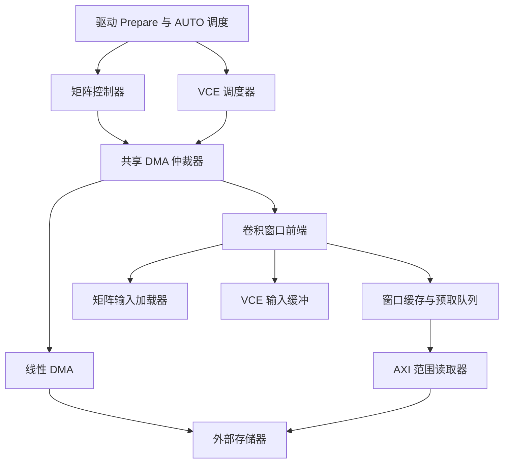

# 矩阵调度与共享窗口缓存

本文说明矩阵乘法、卷积和向量计算共用的存储与调度机制。默认配置为 `PCR_ENGINE=1`、`SIZE=16`、`NPU_AXI_DATA_WIDTH=64`、`SHARED_BANK_BYTES=2048`、`SHARED_BANK_COUNT=7`、`PS_FRAME_COUNT=16`、`OA_S16_FIFO_BANKS_MAX=4`。IA/PS 共享数据容量由 bank 大小与数量的乘积确定，默认为 14 KiB，由软件按任务分配。bank 大小支持 1、2、4 KiB，数量支持六至九个；IA 分配可选 1、2、4 个 bank，其余用于 PS。窗口缓存采用 `CACHE_POLICY=3`，包含 128 个集合、每集合 2 路、每行 16 字节，共 4 KiB。当前参数与完整容量计算见[容量说明](capacity.md)；本文中的 IA8、IA16 和 PS799 对比使用各自列出的固定测试配置。

## 1. 数据流与模块职责

矩阵运算使用以下数学记号：输入为 `A[M,K]`，权重在内存中存为 `B[N,K]`，输出为 `C[M,N]`。`B` 的每个输出通道具有连续的归约维度。下表说明驱动字段与数学维度的对应关系。

| 接口 | 输出行数 M | 归约长度 K | 输出通道数 N |
| --- | --- | --- | --- |
| `dsa_matmul_config_t` | `K` | `N` | `M` |
| `dsa_prepared_matmul_s8_config_t` | `rows` | `depth` | `channels` |
| `dsa_schedule_config_t` | `rows` | `depth` | `cols` |

普通 GEMM 通过线性 DMA 读取输入与权重。普通卷积由 `conv_im2col_frontend` 生成窗口内的元素序列，再送入矩阵加载器；WS 使用 IA 加载路径，IS 使用权重加载路径。DW 向同一 DMA 前端提交图像几何信息和窗口请求，由共享窗口缓存提供数据。VCE 内部保留计算所需的短期输入缓冲，图像空间复用由共享缓存负责。



满足步幅为 1、扩张率为 1、填充为 0、输入输出空间尺寸一致、完整通道组以及连续存储条件的 1×1 卷积，可在 Prepare 阶段转换为直接 GEMM。输入零点修正由现有加载器执行，权重可使用 packed 布局。其他卷积保持窗口前端路径。相关实现见 [`dsa_prepared_impl.h`](../drivers/dsa_prepared_impl.h)、[`conv_im2col_frontend.sv`](../rtl/npu/conv/conv_im2col_frontend.sv) 和 [`npu_top.sv`](../rtl/npu/top/npu_top.sv)。

## 2. 窗口缓存的几何映射与替换

### 2.1 物理标记与集合选择

每条缓存行保留完整的物理行标记 `address[31:4]`。集合选择可以使用卷积几何信息；命中判断始终比较物理标记和有效位。

令一个像素占用 `P=input_c×element_bytes` 字节，空间位置为 `(y,x)`。当输入基地址为 16 字节整数倍，且满足下列任一条件时，前端提供几何集合索引：

- `P≥16` 且 `P` 为 16 的整数倍；
- `P<16` 且 `P` 为 2 的幂。

对于 `P≥16`，集合索引来自 `y×input_w+x`。同一像素内不同的 16 字节通道片段共享集合位置，并使用不同的 `epoch`：

\[
\mathrm{epoch}=\left\lfloor\frac{(\mathrm{group\_offset}+\mathrm{channel})\,\mathrm{element\_bytes}}{16}\right\rfloor.
\]

对于 `P<16`，一条缓存行容纳多个像素，索引按每行可容纳的像素数进行右移，`epoch=0`。其余地址使用物理地址异或索引。几何映射只在 policy 3 中启用。实现见 [`conv_im2col_frontend.sv`](../rtl/npu/conv/conv_im2col_frontend.sv) 与 [`conv_read_cache.sv`](../rtl/npu/conv/conv_read_cache.sv)。

### 2.2 epoch 与最后使用位置

`epoch` 标识当前处理的通道片段。`req_window_progress` 表示当前输出行。缓存行同时保存 `retire`，用于估计该输入行最后可能服务的输出行。

当垂直步幅为 2 的幂时，输入行 `y` 的保守最后使用位置为：

\[
\mathrm{retire}=\min\left(\left\lfloor\frac{y+\mathrm{pad\_top}}{\mathrm{stride\_h}}\right\rfloor,\ \mathrm{output\_h}-1\right).
\]

若一个像素少于 16 字节，一条缓存行可能覆盖相邻输入行，前端在允许范围内将最后使用位置延后一行。其他垂直步幅使用无限远标记，保持保守替换。扩张卷积的空间地址由前端正常计算，替换判断仍使用这一保守最后使用位置。

替换时依次寻找无效路、其他已结束片段或当前片段中已超过最后使用位置的行，再根据保存的使用位置选择替换对象。跨片段预取不会仅因为片段编号不同就将当前需求片段视为已结束。缓存集合的路数有限；当同一集合中需要同时使用的有效行超过容量时，会发生替换和重新读取，数值计算仍按完整物理标记完成。

当输入空间位置总数不超过集合数、且至少具有两路时，当前通道片段与下一通道片段可以分别驻留在同一像素集合的不同路中。这种安排适合空间尺寸较小、通道数较多的 DW 层。

### 2.3 有序需求流水与独立填充

policy 3 的需求接口使用独立的请求队列和响应队列，默认 `DEMAND_DEPTH=4`。容量按已经接受、响应尚未被消费者接收的需求字请求计算，包含请求队列、正在执行的查找和响应队列三部分。响应严格按照请求接受顺序返回，每项同时保存数据和错误标志。消费者暂停接收时，已完成的响应进入队列并保持稳定；达到在途容量上限后，`req_ready` 降低。

请求队列为空时，请求直接进入缓存查找；响应队列为空时，同步 RAM 的读取结果直接送到响应接口。数据已驻留、前方没有等待请求且消费者持续接收时，返回延迟为一个周期，连续请求可达到每周期接受一个 32 位字、每周期返回一个 32 位字。`cfg_windowed=0` 的几何提示模式保持单个需求在途，以便使用对应请求的使用位置提示。

缓存仍使用一个前台查找和一个独立填充事务。预取填充进行时，前台可以读取其他已驻留的缓存行；同一数据字的读写冲突受到保护。已经完成的响应保存在响应队列中，后续缓存行替换不会改变这些数据。请求入队时的命中状态不锁定缓存行，执行查找时会重新比较物理标记；如果等待期间发生替换，该请求正常发起重新填充。需求缺失优先于新的预取填充。

填充器在成功接收当前范围的最后一个数据拍时，可以同时接受下一范围描述。AXI 仲裁器允许当前读事务的最后一个 `R` 握手与下一事务的 `AR` 握手发生在同一周期，物理读事务最多仍为一个。下一地址受到反压时，地址、突发参数和被选中的客户端保持不变。缓存保护刚完成的集合与路，防止下一填充覆盖尚待需求查找的数据；错误填充在终止处理完成后再调度后续事务。

配置切换需要等待已接受请求、响应队列、填充事务和预取队列全部完成。等待期间持续有效的 `cfg_valid` 阻止接受新请求，已有工作继续执行。配置被接受后，模块清除有效位和队列状态，并重置统计计数。复位会清除所有在途请求。队列存储容量见第 8.3 节。

填充范围限制为缓存行与合法输入张量范围的交集。地址为 4 字节整数倍的完整输入字采用 32 位 AXI 读取，首尾不足一个完整字的部分按字节读取；范围读取器拆分 4 KiB 边界，并在背压期间保持请求。填充失败的缓存行保持无效状态。等待该填充的需求收到错误；其他需求仍按自己的地址和返回状态处理。具体逻辑见 [`conv_axi_span_reader.sv`](../rtl/npu/conv/conv_axi_span_reader.sv)。图像范围外的卷积填充值由前端直接生成零值，不读取张量范围之外的存储器。

## 3. 八项预取队列

预取队列保存 8 项地址和几何元数据，每项包含地址、集合索引、片段编号、最后使用位置以及索引有效位。队列不保存图像数据。

接收预取提示前，缓存检查该物理行是否已经驻留、正在填充或已经存在于队列中。重复提示不占用队列项。队列已满时可以放弃提示，需求读取继续运行。

从队列选择填充请求时，优先选择与当前需求 `epoch` 相同的项；没有此类项时选择队首。选择队列内部的项后，用队首内容填补该位置，再推进队首，因此其余提示继续保留。已经命中、与在途填充重复或超出合法范围的项会被移除。

前端依据卷积步幅、扩张率、每个像素的字节数及当前片段已经发出的 32 位输入字数，生成空间方向的提前读取地址。对适用的单位置、单位扩张窗口，地址推进能够从当前卷积核行进入下一行。通道数较多且空间范围较小的任务，还可以在当前空间提示已重复时，向下一 16 字节通道片段提供提示。相关条件均由图像配置和请求坐标计算，无须软件逐窗口发出预取命令。

步幅大于 1 时，单个输出位置的通道片段请求使用另一种空间预测：保持当前卷积核坐标，提前读取后续第一个和第二个输出位置的相应输入数据。跨越输出行末尾时，同时按水平回绕量和垂直步幅计算新坐标，并检查输出和输入边界。各输入字交替提供这两个位置的提示；下一通道片段的提示只在当前 16 字节片段的最后一个字发出，使空间方向的近期需求优先。该策略利用 DW 实际窗口遍历顺序决定预取地址。

需求缺失的填充始终具有更高优先级。该设计通过可用计算时间提前传输数据；需求接口不会为了增加命中统计而等待预取完成后才接收请求。

### 3.1 命中率和字节统计

缓存的需求命中率定义为：

\[
H=\frac{\mathrm{stat\_hits}}{\mathrm{stat\_hits}+\mathrm{stat\_misses}}.
\]

每个处于合法张量范围内的已接受需求字请求只统计一次，初次访问也计入分母。接受请求时尚未驻留的数据计为缺失，即使其预取已经在进行，或者等待队列中的请求稍后获得了填充完成的数据。范围错误通过错误响应报告，不计入命中或缺失。前端对同一个 32 位字的本地重复使用可能不发出新的缓存请求，因此该比例描述缓存需求接口。

内部 `stat_lookup_hits` 和 `stat_lookup_misses` 记录请求实际进入查找阶段时的驻留状态。接受和查找之间可能发生填充或替换，两个阶段的计数分别说明请求到达时的数据状态和执行时的读取行为。单次请求的实际延迟还取决于前面的请求、填充进度和响应背压，应通过接受与返回时间测量。

| 指标 | 含义 |
| --- | --- |
| `stat_hits` / `stat_misses` | 外部请求被接受时，合法需求字的驻留命中数与缺失数 |
| 内部 `stat_lookup_hits` / `stat_lookup_misses` | 请求进入查找阶段时的驻留命中数与缺失数 |
| 内部 `stat_peak_outstanding` | 本次配置中已经接受、尚未消费响应的最大需求字请求数 |
| `stat_read_bytes` | 范围读取器实际传输的总字节数，包含预取 |
| `stat_prefetch_bytes` | 其中由预取发起的字节数，是总读取字节的子集 |
| `stat_prefetch_lines` | 成功填充的预取行数 |
| `stat_prefetch_used` | 首次被需求使用的预取行数 |
| `stat_prefetch_wasted` | 尚未被需求使用就被替换的预取行数 |
| `stat_prefetch_unused` | 测量结束时仍驻留且尚未被需求使用的预取行数 |
| `stat_prefetch_late` | 外部请求被接受时发生缺失，且同一物理行正在预取的次数 |

99% 目标以包含初次访问的需求命中率衡量，同时报告执行周期、总读取字节、预取字节及预取利用情况。组件测试和实际 VCE 调度的请求间隔分别记录。低空间复用任务、容量冲突和无效预取的性能影响通过实际传输字节及执行周期分析。

[`test/cache_pipeline`](../test/cache_pipeline) 对缓存流水进行独立 RTL 验证，默认四项在途、两路缓存配置的测量如下。

| 场景 | 实际检查结果 |
| --- | --- |
| 16 个连续驻留字地址，循环提交 64 个请求 | 接受间隔和返回间隔均为 1 周期；逐项延迟为 1 周期；外部读取字节增加量为 0 |
| 消费者暂停接收响应 | 接受 4 个请求后停止接受；已有响应的数据与错误标志在整个暂停期间保持稳定 |
| 同一冷地址的 4 个请求先后入队 | 接受时为 0 次命中、4 次缺失；执行查找时为 3 次命中、1 次缺失 |
| 预取尚未完成时接受需求 | 按接受时驻留状态记录缺失，返回数据按接受顺序逐字节校验 |

三种配置分别为四项在途配合一或两路缓存，以及单项在途配合两路缓存。共 36 个场景接受 576 个请求，返回 567 个响应，另有 9 个请求在测试复位时取消；每项配置均检查数据顺序、随机 AXI 等待、范围错误、填充错误后恢复、配置排空和旁路读取。窗口几何测试另有 9 项，`SIZE=16` 与 `SIZE=4` 的前端回归分别包含 37 项。模型运行的具体命中率和周期记录于相应的 SoC 测量结果。

## 4. DW 的取数、计算、重新量化与写回

### 4.1 两个或四个输入区域与有序窗口请求

VCE 使用 8 个 `vector_pe`，每个 PE 具有一个乘法器。默认 `TILE=16` 时，`input_buf` 前 32 个 INT16 元素用于窗口输入：当前有效通道数 `active≤8` 时划分为四个 8 元素区域，其余情况划分为两个 16 元素区域。后 32 个 INT16 元素继续用于第二个结果区域。此划分保持输入数据数组容量不变。DW 和非全局空间池化使用相同的窗口请求通道，全局池化使用连续范围读取路径。

取数端维护独立的输出坐标、卷积核坐标和输入地址，通过加法推进步幅、扩张和换行位置。目标输入区域可用时，它提交包含输出空间位置 `p0`、归约起点 `q0`、有效通道数 `cols` 和 2 位 `tag` 的描述。`tag` 标识目标输入区域。每个区域保存对应的输出位置和卷积核位置，计算端按既定顺序消费已经准备好的区域。超出图像范围的位置由坐标检查跳过，不发出窗口读取请求。

共享 DMA 内的 [`conv_window_queue.sv`](../rtl/npu/conv/conv_window_queue.sv) 保存有序描述，默认 `WINDOW_OUTSTANDING=4`，计数包含正在执行的描述。有效通道数不超过 8 时，VCE 可同时保留四个未完成的窗口请求；通道数为 9 至 16 时，输入区域限制该数量为两个。提交描述后立即设置目标区域的 `input_reserved`，在前一个请求完成之前也可提交其他空闲区域的请求。

响应包含原始 `tag`、通道位置、最多四个 INT16 元素、有效掩码、`last` 和错误标志。最后一拍被接受时释放 `input_reserved`，成功接收的区域设置 `input_ready`；计算完成后释放 `input_ready`，该区域才可再次使用。16 个有效通道需要两个 PE 执行周期完成一个卷积核位置的乘加，尾通道按实际有效数量控制。

前端可以在当前描述最后一拍输出被接受的同一周期接受下一个描述，并根据新描述提交缓存字请求。在连续字已经驻留且消费者持续接收的条件下，缓存的每周期一个 32 位字返回能力可供前端持续使用。对于 DW 使用的 S8 输入，一个字提供四个元素，经扩展和零点修正后返回 INT16 数据。窗口描述队列与缓存需求字队列分别计数，二者均通过各自的接受和完成事件测量在途数量。

窗口响应严格遵循描述接受顺序。消费者施加背压时，`tag`、位置、掩码、数据和终止标志保持稳定。前端报告错误后停止接受新窗口请求，并为错误出现时尚未完成的已接受描述依次返回带原始 `tag` 的终止错误响应，其数据掩码为零。VCE 的失败处理继续消费这些响应，并等待已有写回完成。新配置等待窗口队列、前端和共享缓存排空；复位清除描述及区域占用状态。

### 4.2 双结果区域与 II=1 重新量化

VCE 具有两个可轮换的结果区域。第一个区域使用 `result_buf`，第二个区域复用 `input_buf` 的后半部分。每个区域依次经历空闲、原始累加值、重新量化、可写回和写回状态。区域独立的状态使下一位置的 MAC、上一位置的重新量化和更早位置的写回能够并行。

重新量化流水线每周期接收一个累加值和相应乘数，即启动间隔 `II=1`。有符号乘法、舍入和输出截断分为流水阶段。对于 S8 输出：

\[
y=\operatorname{clamp}\left(\operatorname{RNE}\left(\frac{a\,m}{2^{31-s}}\right)+z_{out},\ a_{min},\ a_{max}\right),
\]

其中 `RNE` 表示舍入到最近整数，恰好位于中点时选择偶数；负数也遵守同一规则。16 个通道需要连续输入 16 个累加值，再等待流水线尾部完成。驱动检查乘数、移位和累加范围，保持硬件与软件参考的量化语义一致。

VCE 的算术乘法资源为 8 个 PE 乘法器，以及重新量化与 Softmax 共用的一个 32×32 乘法器。地址和配置表达式中的乘法单独统计。相关实现见 [`vector_engine.sv`](../rtl/npu/conv/vector_engine.sv)、[`vector_pe.sv`](../rtl/npu/conv/vector_pe.sv) 和 [`vector_softmax.sv`](../rtl/npu/conv/vector_softmax.sv)。

### 4.3 写回带宽与 Softmax

16 个连续 S8 通道共 16 字节。当输出地址为 4 字节整数倍且整段位于同一 4 KiB 页时，一条物理写突发发送 4 个 32 位 W 数据拍；无 W 通道背压时每周期传输一拍。跨页数据由 DMA 分段。地址握手和写响应还具有各自的时延。尾通道和非整数倍地址通过字节使能传输相应数据。

共享线性写 DMA 按 4 KiB 页边界和每条突发最多 256 拍的限制拆分物理写事务。源接口继续按逻辑行提供数据，跨分段保留字节拼接状态；只有逻辑行完成时才推进源行。AW、W 和 B 分别统计物理事务的接受、数据完成和响应完成，全部响应返回后才报告任务结束。该路径保持最多 4 个未完成写事务，并保留错误状态用于本次任务的返回值。实现见 [`axi_linear_block_dma.sv`](../rtl/npu/dma/axi_linear_block_dma.sv)。

组件测试中，64 个完整输出位置对应 64 条写突发和 256 个数据拍；1,024 次重新量化输入包含 960 次相邻周期连续接收。测试还直接记录 MAC 与重新量化、MAC 与写回以及三者共同工作的周期数，检查并行调度确实发生。

Softmax 使用独立操作码和固定点计算状态机，查找表通过 DMA 读取，继续使用共享乘法器与现有数据缓冲。默认最大深度为 16，可通过能力寄存器查询。Softmax 和 DW 的运行由操作描述选择；两者的数据缓冲生命周期由 VCE 状态机管理。

## 5. AUTO 数据流与复用规划

### 5.1 候选集合与物理容量

`dsa_schedule_plan` 在指定数据流内搜索复用参数；`DSA_SCHEDULE_AUTO` 同时搜索 WS 和允许的 IS。显式设置 `DSA_SCHEDULE_WS` 或 `DSA_SCHEDULE_IS` 时保持该方向。`requested_r` 和 `requested_w` 是搜索上限，零表示使用设备容量上限。

WS 的流方向维度为 `(M,N)`，IS 为 `(N,M)`。令这两个维度的 tile 数分别为 `T_r`、`T_c`，`r=min(R,T_r)`、`w=min(W,T_c)`。共享配置先读取设备能力，再联合搜索 IA bank 分配、R/W、数据流和 frame 高度。默认支持 IA=1、2、4 个 bank，PS 使用其余 bank。

紧凑 S8 的双缓冲需要 `512R` 字节，完整 S16 需要 `1024R` 字节；S16 还要求至少两个 IA bank。WS 中 IA 保存输入，IS 中 IA 保存 S8 权重，因此两种数据流分别确定可用 R。W 受 `PS_FRAME_COUNT` 限制，并与每个 frame 的有效行数及 PS 空间共同决定驻留范围。

当归约长度 `K>SIZE` 时，共享存储按物理 bank 计算部分和容量。包含 L 个有效矩阵行的 frame，在 RAW32 下需要 4L 个 128 位字，在可保证 S24 范围时需要至多 3L 个字。对于 `N_PS` 个 PS bank，每个 frame 在单个 bank 上分别保留 `ceil(4L/N_PS)` 或 `ceil(3L/N_PS)` 个字，默认每个 bank 的深度为 128。连续调度累计所有驻留 frame 的最坏占用；逐 frame 调度在接受命令前，根据空闲字数及本 frame 可释放的旧字数检查容量。目录行数、frame 数及编码所需的并行 bank 数也参与检查。K 只有一个 tile 时无需保存中间 PS。详细规则见[容量说明](capacity.md#每层选择-rw-和数据流)和[硬件架构](architecture.md#ps-编码与调度)。

固定 IA 与宽 PS FIFO 的 `PCR_ENGINE=0` 配置采用独立容量计算。其规划器使用 `R≤max(1,IA_CACHE_BLOCKS/2)`，并在 `K>SIZE` 时计入一个备用帧：

\[
\mathrm{PS\_rows}=((r+1)\,\mathrm{SIZE}-1)(w+1),
\qquad
\mathrm{PS\_bytes}=\mathrm{PS\_rows}\,\mathrm{SIZE}\,4.
\]

当 `K≤SIZE` 时，该配置的中间 PS 需求同样为零。下表使用固定的 `SIZE=16`、`PS_STORAGE_ROWS=799` 配置和足够大的矩阵。

| R / W | 所需 PS 行 | IA 配置要求 | PS 容量判断 |
| --- | ---: | --- | --- |
| 2 / 16 | 799 | IA4 及以上 | 可执行 |
| 4 / 8 | 711 | IA8 及以上 | 可执行 |
| 8 / 4 | 715 | IA16 及以上 | 可执行 |
| 4 / 16 | 1,343 | IA8 及以上 | 超过 PS799 |

S16 输出另外受独立的输出 FIFO 限制，默认配置要求 `R≤4`。S16 输入和 S16 输出的组合按驱动支持范围选择 WS。S16 输入、S8 输出的矩阵任务可以使用已支持的 WS 或 IS。超出物理容量的配置在启动计算前拒绝。实现见 [`dsa_schedule.h`](../drivers/dsa_schedule.h)、[`dsa_memory_schedule.h`](../drivers/dsa_memory_schedule.h)、[`dsa_schedule_impl.h`](../drivers/dsa_schedule_impl.h) 和 [`npu_top.sv`](../rtl/npu/top/npu_top.sv)。

### 5.2 成本估计与布局选择

每个候选估计读取字数、读取请求数、写入字数、写请求数和计算周期。读取估计包含输入与权重的复用次数、地址低位、行跨度、packed 尾部以及偏置和逐通道量化参数。计算估计包含阵列输入流、对角延迟和权重移位。共享存储的候选还计算 K 历史驻留、frame 切片及容量调度产生的重复装载。

最终分数取读取、写回和计算估计的最大值，再加入逐 frame 控制费用及 im2col 服务费用。`DSA_PLANNER_MICRO_CYCLES` 的默认值为 64，是每条 frame 命令的可配置调度系数；权重移位和 IA 对角延迟由计算量单独计入。图像费用依据窗口几何、源元素宽度、实际驻留的空间 tile 数以及缓存集合占用估计。相同分数依次比较读取字数、读取请求数、计算周期、写请求数、PS 字节数和数据流编号。共享调度通过同一评分回调比较合法候选；RAW32 和压缩策略均保留 RAW32 可执行的选择。

成本参数可以按具体存储器的每拍时延和请求开销配置。AXI 的 4 KiB 边界分段增加请求数量；窗口缓存容量或集合冲突导致的重新读取增加数据量。仲裁和瞬时背压也会影响实际周期，因此最终性能记录来自 RTL 执行。容量工具通过同一 C 调度函数获得共享存储配置的选择结果。

`dsa_schedule_plan_layout(c, may_pack, out, layout_flags)` 进一步枚举四种输入与权重布局。`may_pack` 的 bit 0 允许打包 A，bit 1 允许打包 B；配置中已有的 packed 标志保持有效。规划器输出选择结果，调用者负责分配存储器和执行数据打包。

连续调度时，IS 的 S8 输出可以把同一组 R 个转置 tile 按输出行重新读取，每行合并为 `16R` 字节的 DMA 写描述。使用条件包括有效的 M/N、`R∈{2,4,8,16}`、足够的 S8 FIFO 容量、`N` 能被 `16R` 整除，以及输出基地址和行跨度都能被 `16R` 整除。末尾不足 16 个 M 行时按有效行数输出。该方式使用既有 S8 FIFO。逐 frame 调度按 tile 写回，写请求估计为 `M×ceil(N/16)`。实现见 [`vec_s8_to_fifo.sv`](../rtl/npu/writeback/vec_s8_to_fifo.sv) 和 [`oa_writer.sv`](../rtl/npu/writeback/oa_writer.sv)。

### 5.3 WS 输出分组与写请求计算

连续调度时，WS 的 S8 输出在现有 FIFO 中将相邻通道 tile 组合成连续行。每个片段包含 2、4、8 或 16 个通道 tile；片段宽度受 W、实际有效行 tile 数和输出 bank 数量限制。输出通道数需要能被片段宽度整除，行跨度需要等于输出通道数。对于 2 至 15 行的矩阵，片段采用两个通道 tile，使前面通道的写回与后面通道的计算重叠。

每个行组使用其实际有效行数。`oa_writer` 在描述开始时提供有效行 tile 数，FIFO 根据各 bank 的有效行计数完成输出与释放，因此最后一个行组可以包含不足 16 行的 tile。若一个通道片段覆盖完整输出行，连续数据优先组成 1,024、512 或 256 字节的逻辑写描述；其余片段按有效输出行生成描述。DMA 负责拆分物理页边界和最大突发长度。

`dsa_schedule_writes` 按这些条件计算候选调度的写请求数量。连续输出的估计包含跨 4 KiB 页增加的请求，以及非 4 字节起始地址对 1,024 字节描述的影响。该计算使用矩阵几何信息和地址余数，运行时间不随输出元素数量增长。80 组独立的描述拆分计算覆盖完整行组、尾行、页边界和起始地址低位；共同 GEMM 测试另外比较规划值与实际 AXI 请求数。

### 5.4 加载完成与下一块读取

权重加载路径将 DMA 返回的数据组合成一行，再由 `kernel_loader_buffer` 的输入寄存器保存，随后写入双缓冲 RAM。完成信号与最后一行经过同一个寄存器阶段。另一个缓冲槽为空时，当前槽的最后一次 RAM 写入与下一块读取的接受可以发生在同一周期；两个操作使用各自的槽编号和有效列信息。

该结构用于 WS 的权重读取，也用于 IS 的输入矩阵读取。控制器可以更早开始下一块传输，同时保留 RAM 写入前的寄存器和两个原有缓冲槽。外部存储器传输、阵列计算和输出写回分别按可用资源推进。相关实现见 [`kernel_loader.sv`](../rtl/npu/loaders/kernel_loader.sv) 与 [`kernel_loader_buffer.sv`](../rtl/npu/loaders/kernel_loader_buffer.sv)。

## 6. 容量寄存器与 packed 布局

### 6.1 设备能力

`dsa_matrix_query` 读取设备身份、ABI 和矩阵容量信息，填入 `dsa_matrix_limits_t`。容量寄存器为零时使用平台编译配置。调用者可以在 Prepare 阶段查询一次，将结果提供给纯调度接口 `dsa_matmul_plan`。

| 寄存器 | 位段 | 含义 |
| --- | --- | --- |
| `NPU_REG_MATRIX_CAPS`，`0xe4` | `[7:0]` | bit 0 支持 A packed；bit 1 支持 B packed；bit 2 支持 IS |
| 同上 | `[15:8]` | IA 缓存块数 |
| 同上 | `[23:16]` | PS 帧数量 |
| 同上 | `[31:24]` | tile 边长 |
| `NPU_REG_MATRIX_PS_ROWS`，`0xe8` | `[31:0]` | PS 实际存储行数 |
| `NPU_REG_MATRIX_OUTPUT_BANKS`，`0xec` | `[15:0]` / `[31:16]` | S8 / S16 输出 tile bank 数 |

启用 IS 的 IA8/PS799/S16FIFO4 配置中，三个值依次为 `0x10100807`、`799`、`0x00040020`。IA16 配置的 `0xe4` 为 `0x10101007`。硬件关闭 IS 时清除 bit 2，AUTO 只搜索 WS，显式 IS 请求返回不支持状态。容量寄存器为零的兼容路径通过 `DSA_ENABLE_IS_MODE` 指定平台是否支持 IS，默认值为 1。CTRL bit 9 和 bit 10 分别选择 A/B packed；按字节写入 CTRL 时，byte 1 控制这些位。接口定义见 [`dsa_matrix.h`](../drivers/dsa_matrix.h) 和 [`npu_axil_reg_if.sv`](../rtl/axi_top/npu_axil_reg_if.sv)。

### 6.2 数据排列

每个 packed 操作数的物理形状为：

```text
[ceil(rows/16), ceil(depth/16), 16, 16]
```

最后一个维度是归约维度。逻辑元素 `(r,k)` 的字节偏移为：

\[
\left(\left(\left\lfloor r/16\right\rfloor\left\lceil K/16\right\rceil+\left\lfloor k/16\right\rfloor\right)256+(r\bmod16)16+(k\bmod16)\right)\mathrm{element\_bytes}.
\]

A 使用 `rows=M`，B 使用 `rows=N`。每个 tile 在归约维度保留 16 个物理元素。驱动打包时将无效行和无效归约元素写为零；加载器按有效逻辑列显式屏蔽归约尾部，使其不会受零点修正影响。最后一个行 tile 只读取实际有效的行数。

`dsa_matrix_packed_bytes` 返回所需物理字节数。`dsa_matrix_pack` 接受带行跨度的原始矩阵，支持 S8 和 S16，检查源和目标的存储范围以及重叠情况。硬件使用的 packed 基地址必须为 4 字节整数倍且位于 32 位设备地址范围内。卷积允许 B packed；卷积输入由窗口前端产生，配置时禁止 A packed。

打包增加的物理字节数和 Prepare 时间应单独记录。重复推理时，静态权重可以复用同一份 packed 数据。

## 7. TFLM Prepare 与动态激活地址

TFLM 的 `PreparedPackWeights` 在 Prepare 阶段查询 RHS packed 能力，通过 `AllocatePersistentBuffer` 为静态权重分配空间，再调用 `dsa_matrix_pack`。支持该能力的当前实现将静态 B 打包，动态 A 保持原始布局。普通卷积的原始权重为 `[Cout,KH,KW,Cin]`，展开后每个输出通道的归约元素连续，与 B 的行定义一致。相关代码位于 [`nmsis_nn/prepared.h`](../drivers/tflm/tflm/tflite-micro/tensorflow/lite/micro/kernels/nmsis_nn/prepared.h)。

`dsa_prepare_conv_s8`、`dsa_prepare_matmul_s8` 和 `dsa_prepare_spatial_s8` 检查形状、只读张量范围和量化参数，将选择的数据流、复用参数及固定寄存器值写入 `dsa_prepared_t`。Add 使用自己的准备描述符，两个输入地址在执行时提供。Softmax 保留相应的专用准备与执行接口。

Invoke 阶段调用 `dsa_prepared_execute`，刷新输入、输出地址，检查 32 位地址范围、输入输出重叠、输出与只读张量重叠及设备状态，然后提交寄存器和启动命令。Invoke 不再搜索矩阵调度或查询容量。原始权重地址另行保留，用于检查 TFLM 张量与准备描述符是否一致。形状、权重、偏置、量化或设备配置变化时，重新执行 Prepare。

### 7.1 API 示例

下例准备一个无偏置、对称 S8 GEMM。输入为 `[rows,depth]`，原始权重为 `[channels,depth]`，输出为 `[rows,channels]`，重新量化比例为 `1/32`。调用者提供的 `packed_weights` 必须在描述符使用期间保持有效。函数返回驱动状态码，零表示成功。

```c
#include <stdint.h>
#include "dsa_accel.h"
#include "dsa_matrix.h"
#include "dsa_prepared.h"

uint32_t prepare_dense_s8(dsa_prepared_t *prepared,
                          const int8_t *weights,
                          void *packed_weights, uint32_t packed_capacity,
                          uint32_t rows, uint32_t depth, uint32_t channels)
{
    dsa_matrix_limits_t limits;
    dsa_prepared_matmul_s8_config_t c = {0};
    uintptr_t address = (uintptr_t)packed_weights;
    uint32_t bytes;

    dsa_prepared_invalidate(prepared);
    if (!prepared || !weights || !packed_weights) return DSA_ERR_NULL_PTR;
    if (!rows || rows > 65535u || !depth || depth > 65535u ||
        !channels || channels > 65535u) return DSA_ERR_INVALID_DIM;
    bytes = dsa_matrix_packed_bytes(channels, depth, 1u);
    if (!bytes || address > UINT32_MAX || (address & 3u) ||
        bytes > UINT32_MAX - address || packed_capacity < bytes)
        return DSA_ERR_INVALID_DIM;

    dsa_matrix_query(&limits);
    if (limits.tile_size != 16u ||
        !(limits.flags & DSA_MATRIX_CAP_RHS_TILE_PACKED))
        return DSA_ERR_UNSUPPORTED;
    if (!dsa_matrix_pack(packed_weights, packed_capacity, weights,
                         channels, depth, depth, 1u))
        return DSA_ERR_INVALID_DIM;

    c.filter_base = (uint32_t)address;
    c.rows = rows;
    c.depth = depth;
    c.channels = channels;
    c.input_stride = depth;
    c.filter_stride = depth;
    c.output_stride = channels;
    c.dataflow_mode = DSA_DATAFLOW_AUTO;
    c.rhs_tile_packed = 1u;
    c.multiplier = 1 << 30;
    c.shift = -4;
    c.activation_min = -128;
    c.activation_max = 127;
    return dsa_prepare_matmul_s8(prepared, &c);
}

uint32_t execute_dense_s8(const dsa_prepared_t *prepared,
                          const int8_t *input, int8_t *output)
{
    return dsa_prepared_execute(prepared, input, output);
}
```

Prepare 与 Execute 需要可访问的设备 MMIO；`dsa_matrix_pack` 和纯调度函数可独立在主机上测试。调用者按返回状态决定使用准备好的硬件描述符或已有软件实现。

### 7.2 算子提交与张量地址

Conv、DW、FC 和池化在 Prepare 阶段保存所需的 `TfLiteEvalTensor` 对象指针。
Invoke 通过这些对象读取本次输入、输出的实际数据地址，检查运行时启用状态、数据类型、
静态权重和偏置地址，再调用 `dsa_prepared_execute`。固定形状和量化信息来自准备描述符；
动态激活地址仍在每次执行时读取，支持内存规划结束后的地址分配及重复推理。

RISC-V 提交函数将 MMIO 基地址保留在一个寄存器中，减少固定寄存器写入之间的地址构造指令。
寄存器写入顺序、数据值和启动后的完成检查保持相同。Softmax 在 Prepare 中保存元素数量和
张量对象，Invoke 直接引用其量化参数，并继续检查输入、输出的地址范围和重叠情况。

### 7.3 静态 Reshape 的共享存储

默认贪心内存规划器可让符合条件的静态 Reshape 输入和输出使用同一数据区域。
条件包括单个子图、相同元素类型与字节数、在线分配的非变量张量，以及输入、输出各自具有
唯一的产生算子。图输入、常量、变量、离线地址规划和保留所有张量的模式继续使用独立分配。

连续 Reshape 的别名指向同一个实际存储所有者。规划器将所有者的最后使用位置延长至所有
别名的最后使用位置，再分配其他张量，因此分支和图输出仍能在其有效期内读取原始数据。
提交内存规划时先确定所有者的地址，再设置别名地址；张量编号不限制这一顺序。
Reshape 的输入和输出地址相同时直接完成，其他情况执行原有复制操作。

[`test/reshape_alias`](../test/reshape_alias) 使用实际内存规划与分配代码，检查连续别名、
分支、图输出、张量编号顺序、无关缓冲区写入及重复推理，并通过 ASan 和 UBSan 检查访问行为。

## 8. 数据存储容量

本节保留 `48b73c5`、IA8 和 IA16 固定存储配置的容量比较，后两者使用 `PCR_ENGINE=0`、`PS_STORAGE_ROWS=799`、`OPERAND_CACHE_ENABLE=0`。表内容量按相应 `npu_axil_top` 的数组维度计算，单位 B 为字节，1 KiB=1,024 B。S8 与 S16 两个输出 FIFO 均计入这些物理配置。默认共享 bank 配置及其完整状态统计见[容量说明](capacity.md)。

### 8.1 六类主要 RAM

| 数据数组 | 初始 `48b73c5` | IA8 测试配置 | IA16 测试配置 | 表中配置的计算方法 |
| --- | ---: | ---: | ---: | --- |
| PS 数据 | 51,136 B | 51,136 B | 51,136 B | `799×16×32/8` |
| IA 数据 | 2,048 B | 4,096 B | 8,192 B | `IA_CACHE_BLOCKS×16×16×16/8` |
| 权重双 tile | 1,024 B | 1,024 B | 1,024 B | `2×16×16×16/8` |
| S8 输出 FIFO | 8,192 B | 8,192 B | 8,192 B | `32×16×16×8/8` |
| S16 输出 FIFO | 16,384 B | 2,048 B | 2,048 B | `4×16×16×16/8` |
| 共享卷积缓存数据 | 1,024 B | 4,096 B | 4,096 B | `128×2×16` |
| **合计** | **79,808 B** | **70,592 B** | **74,688 B** | **77.9375 / 68.9375 / 72.9375 KiB** |

初始配置的 IA 块数为 4，卷积缓存集合数为 32。IA8 测试配置中，IA 和两个输出 FIFO 的容量变化合计减少 12 KiB，共享卷积缓存增加 3 KiB；六类主要 RAM 合计减少 9 KiB。PS 以实际的 799 行计数。

### 8.2 偏置、量化与 VCE 数据数组

| 数据数组 | 初始 `48b73c5` | IA8 测试配置 | IA16 测试配置 |
| --- | ---: | ---: | ---: |
| 偏置双 bank 及两份 16 通道数据 | 384 B | 640 B | 1,152 B |
| WS/IS 逐通道乘数与移位参数 | 384 B | 640 B | 1,152 B |
| VCE 输入、右操作数、权重、偏置、量化、累加和结果缓冲 | 1,264 B | 1,264 B | 1,264 B |
| VCE Add 已寄存的中间数据数组 | 224 B | 224 B | 224 B |
| VCE 图像行缓存 | 3,072 B | 0 B | 0 B |
| **与六类主要 RAM 合并后的所列数据数组** | **85,136 B** | **73,360 B** | **78,480 B** |

表内 VCE 的 1,264 B 包括输入 128 B、右操作数 32 B、49×16 个 S8 权重 784 B，以及各 64 B 的偏置、乘数、移位、累加值和结果数组。第二个结果区域复用输入缓冲的后 64 B，计数时只计算一次。初始版本的图像行缓存实际展开为 `line_buf[8][384]`，每项 8 位，共 3,072 B。

上述表格列出数据数组。以下控制和元数据另外计算：表中窗口缓存的物理标记、有效位、预取位、13 位片段编号和 32 位最后使用位置共 2,400 B；8 项预取描述共 129 B；矩阵量化的已解码左右移位数组分别占 IA8 的 120 B、IA16 的 216 B。队列指针、事务状态、计数器、AXI 描述寄存器、算术流水寄存器及 PE 内部寄存器也占用存储资源，未包含在数据数组合计中。

这些容量适合与 Gemmini 的 scratchpad 和 accumulator 数据容量作分项比较。综合面积还取决于存储宏、端口、寄存器实现、算术位宽和时序约束，需要采用相同工艺与约束进行综合后报告。数组定义分别见 [`ps_buffer_fifo.sv`](../rtl/npu/buffers/ps_buffer_fifo.sv)、[`ia_loader_cache_mgr.sv`](../rtl/npu/loaders/ia_loader_cache_mgr.sv)、[`kernel_loader_buffer.sv`](../rtl/npu/loaders/kernel_loader_buffer.sv)、[`bias_loader_buffer.sv`](../rtl/npu/loaders/bias_loader_buffer.sv)、[`vec_requant.sv`](../rtl/npu/writeback/vec_requant.sv) 和前述 VCE、缓存、输出 FIFO 文件。

### 8.3 缓存需求队列的寄存器容量

默认 `DEMAND_DEPTH=4` 的需求流水增加以下寄存器声明。共享缓存的数据 RAM 仍为 4,096 B。

| 项目 | 计算方法 | 位数 |
| --- | --- | ---: |
| 请求地址与几何元数据 | `demand_t` 的 5 个 32 位字段与 3 个标志，共 `163×4` | 652 |
| 响应数据 | `32×4` | 128 |
| 响应错误标志 | `1×4` | 4 |
| 请求与响应队列的读写指针 | `2×4` | 8 |
| 两个队列计数与总在途计数 | `3×3` | 9 |
| 查找命中、查找缺失、峰值在途统计 | `32×3` | 96 |
| **合计** | **响应数据 128 位，地址与控制 673 位，统计 96 位** | **897** |

其中响应数据为 16 B，请求和响应队列内容合计为 98 B；包括指针、计数器和内部统计后的声明容量为 112.125 B。这些数值单独列于主要 RAM 和第 8.2 节数据数组之外。综合工具可以删除未被使用的内部统计和元数据位，实际寄存器数量以综合结果为准。

共享 DMA 中的窗口描述队列另外保存 `4×(3×32+2)=392` 位，即 49 B 的位置、长度和 `tag` 元数据。VCE 的四个输入区域各保存 32 位输出位置与 32 位卷积核位置，共 256 位，即 32 B。区域占用标志、描述队列指针、状态和统计寄存器另外计算。窗口描述队列不保存图像数据，VCE 的 128 B 输入数据数组保持不变。

## 9. 组件验证与结果使用

共享缓存和 VCE 的组件验证覆盖窗口乱序访问、通道组、S16 前端输入、填充、步幅、扩张、非整数倍地址、张量边缘、4 KiB 读取边界、AXI 背压、读取错误及后续任务。VCE 以 8 PE 和 1 PE 两种配置执行功能测试；Softmax 具有独立的算术测试和 TFLM 适配测试。矩阵布局验证覆盖 WS/IS、S8/S16、packed 尾部、非零零点、逐通道量化、严格张量访问范围、连续任务、PS 容量拒绝和 S16 FIFO 四个 bank 的背压。

| 测试入口 | 主要检查内容 |
| --- | --- |
| [`test/cache_pipeline/run.py`](../test/cache_pipeline/run.py) | 四项在途、连续命中吞吐、顺序与背压、接受时统计、错误、复位和配置排空 |
| [`test/window_dma/run.py`](../test/window_dma/run.py) | 带 tag 的有序窗口请求、描述队列容量、连续返回、背压、错误与配置切换 |
| [`test/conv_span_handoff/run.py`](../test/conv_span_handoff/run.py) | 最后读数据与下一地址的同周期握手、双客户端切换、地址反压和错误响应 |
| [`test/windowed_cache/run.py`](../test/windowed_cache/run.py) | 命中、初次访问、重复访问、预取利用、读取字节与连续请求压力 |
| [`test/vector_engine/run.py`](../test/vector_engine/run.py) | DW、池化、Add、向量计算、Softmax、并行计数与 AXI 行为 |
| [`test/vector_softmax/run.py`](../test/vector_softmax/run.py) | Softmax 定点算术与输出一致性 |
| [`test/conv_frontend`](../test/conv_frontend) | 卷积几何、不同 tile 大小、缓存策略、S16 与错误响应 |
| [`test/matrix_layout/run.py`](../test/matrix_layout/run.py) | IA4/8/16、packed 与通用布局、严格地址范围、容量寄存器及错误恢复 |
| [`test/linear_dma_write_4k/run.py`](../test/linear_dma_write_4k/run.py) | 4 KiB 与 256 拍写分段、字节使能、1/4 个未完成事务、随机背压及错误后的任务 |
| [`test/prepared_dispatch/run.py`](../test/prepared_dispatch/run.py) | Prepare/Execute、动态激活地址和固定配置 |
| [`test/reshape_alias/run.py`](../test/reshape_alias/run.py) | 静态 Reshape 的共享存储、生命周期、分支和重复推理 |
| [`test/nmsis_runtime/run.py`](../test/nmsis_runtime/run.py) | 算子运行时选择及软件执行路径 |

组件记录分别保留源码 SHA256、参数、数值校验结果和适用模块。重新构建时检查编译前后的源码摘要，并记录实际运行的存储器时延配置。最终完整 SoC 测量另行检查全部模型输出、中间张量、在途请求完成情况和内存访问范围。

完整模型的执行周期还包括 CPU 提交、算子切换和软件执行部分。整网统计使用对应的 SoC 执行结果；组件命中率、流水并行计数与纯硬件矩阵周期分别用于解释具体模块的行为。
